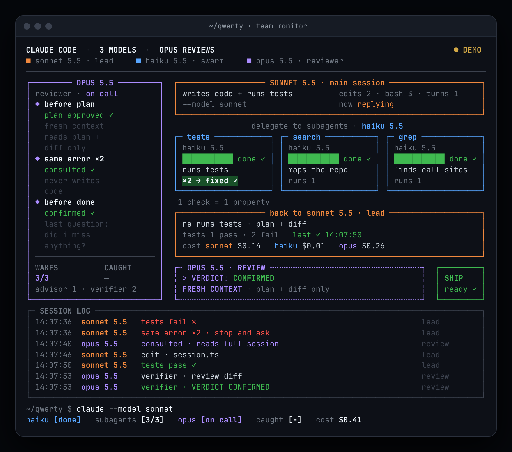

# qwerty：Claude Code 三模型协作 + 独立审查方案

主会话用 Sonnet 写代码，Haiku 只读侦察，Opus 负责把关。

这套配置可以直接复制到项目里使用。它综合了 X 上流传的"三模型"推文、Claude Code 官方文档，以及 GitHub 上 7 个同类项目的做法。调研过程和逐项对比见 [docs/research.md](docs/research.md)。

> 一句话来源：推文里的做法并不来自某个"神秘仓库"。它来自 Claude Code 官方的 **advisor 功能**（`advisorModel`），加上 **subagent 的 `model` 字段**。本仓库在这个基础上补了两样推文没有的东西：一个**只看计划和 diff 的新上下文审查员**，以及**用 hook 把软规则变成硬约束**。

## 四层结构

| 层 | 组件 | 模型 | 看到什么 | 作用 |
|---|---|---|---|---|
| 1 | 主会话 | Sonnet（`"model": "sonnet"`） | 全部 | 推理、写代码、做最终决定 |
| 2 | `Explore`、`callsites`、`tests` 三个 subagent | Haiku，effort low | 只看分派给它的任务，不读 CLAUDE.md | 找代码、查调用点、跑测试并原样返回输出，保持主上下文干净 |
| 3a | advisor（官方服务端工具） | Opus（`"advisorModel": "opus"`） | **完整对话** | 主会话拿不准时请教；调用时机由模型自己决定 |
| 3b | `verifier` subagent | Opus，新上下文 | **只看 `.claude/plan.md` 和 diff** | 以"推翻它"为目标审查计划和改动，结论是 CONFIRMED / REFUTED / INCONCLUSIVE，问题按 P0–P4 分级 |
| 4 | 三个 hook | 不用模型，确定性脚本 | hook 输入、对话记录和 git | 同一错误第二次出现时提醒先查根因；大改动没审查就拦截一次"完成"，先 commit 也绕不过去 |

3a 和 3b 是互补的：advisor 信息最全，但容易被主会话的推理带偏；verifier 没参与写代码，只看结果，更独立。

**只有非小改动才走计划审查和完成审查**（判断标准见 CLAUDE.md），小改动直接做，以免 Opus 成本失控。

## 文件

```
CLAUDE.md                         主会话规则：分派、计划审查、重复失败、完成审查
.claude/settings.json             主模型、advisor、hook 接线
.claude/agents/Explore.md         Haiku · 仓库地图（覆盖内置 Explore，内置版默认跟主会话同一模型）
.claude/agents/callsites.md       Haiku · 定义、引用、调用点
.claude/agents/tests.md           Haiku · 跑测试，原样返回命令、退出码、失败输出
.claude/agents/verifier.md        Opus · 新上下文，以推翻为目标的审查
.claude/hooks/repeat_failure.py   PostToolUseFailure(Bash)：同一错误第二次出现时提醒
.claude/hooks/session_base.py     SessionStart：记录会话开始时的 commit 和 transcript 路径
.claude/hooks/review_gate.py      Stop：相对会话起点 ≥40 行改动，且最后一次编辑（含 Bash 写文件）后没跑 verifier → 拦截一次
.claude/.gitignore                忽略 hook 状态和每次任务的 plan.md
.claude/monitor/team_monitor.py   单独窗口里的命令行仪表盘（只读 transcript）
.claude/monitor/open.sh           在 tmux 分屏 / macOS 新窗口中打开 monitor
tests/test_hooks.sh               24 个场景的 hook 回归测试
tests/test_monitor.py             52 个场景的 monitor 测试（含真实会话样本、Ctrl-C 恢复屏幕）
docs/research.md                  推文溯源、官方文档要点、7 个仓库对比
```

## 安装

### 前置条件

| 要求 | 原因 |
|---|---|
| Claude Code ≥ 2.1.293 | `haiku` 别名要在这个版本以上才会解析到 Haiku 5.5；`omitClaudeMd` 需要 ≥ 2.1.271 |
| Anthropic API 或 Claude 订阅 | advisor 是服务端工具，**Bedrock、Vertex、Foundry 不可用**，不可用时会静默跳过 |
| `python3` 在 PATH 里 | 三个 hook 都是 Python 写的，只用标准库 |
| **不要**设置 `DISABLE_TELEMETRY`、`DO_NOT_TRACK`、`CLAUDE_CODE_DISABLE_NONESSENTIAL_TRAFFIC`、`CLAUDE_CODE_DISABLE_ADVISOR_TOOL` | 前三个会关掉功能开关拉取，advisor 会静默失效；最后一个直接禁用 advisor |
| 检查 `CLAUDE_CODE_SUBAGENT_MODEL_FORCE` 和 `CLAUDE_CODE_EFFORT_LEVEL` | 前者让所有 subagent 忽略自己的 `model`，后者覆盖每个 agent 的 `effort` |

### 方式 A：装到某个项目（推荐）

> ⚠️ 如果目标项目已经有 `CLAUDE.md` 或 `.claude/settings.json`，**不要直接覆盖**。下面的命令带 `-n`，不会覆盖已存在的文件。被跳过的文件需要你手动合并：
> - 把本仓库 CLAUDE.md 里 "Model routing and verification" 这一节追加到你的 CLAUDE.md；
> - 把 `settings.json` 里的 `model`、`advisorModel` 和三个 `hooks` 条目合并到你的 settings.json。

```bash
cp -rn CLAUDE.md .claude tests /path/to/your-project/
```

然后在目标项目里运行测试：

```bash
bash tests/test_hooks.sh
```

### 方式 B：对你所有项目生效

把 `agents/` 和 `hooks/` 放进 `~/.claude/`，把 CLAUDE.md 那一节追加到 `~/.claude/CLAUDE.md`。hook 路径要从 `${CLAUDE_PROJECT_DIR}/.claude/hooks/...` 改成 `~/.claude/hooks/...`。hook 状态会写到当前项目的 `.claude/state/` 下，记得在项目里忽略它。

### 验证

1. 在项目里启动 `claude`，横幅里应该出现 Advisor Tool 已开启的提示。也可以输入 `/advisor` 查看当前设置。
2. 输入 `/agents`，确认 `Explore`、`callsites`、`tests` 显示为 haiku，`verifier` 显示为 opus。
3. 布置一个跨文件的任务，观察流程：先写 `.claude/plan.md` → 用 verifier 审计划 → 等你说开始 → 写代码 → 跑测试 → 用 verifier 审 diff → 回答"Did I miss anything?" → 汇报。

### 在 Claude Code 云端环境（claude.ai/code）使用

不用额外配置。云端会话启动时会克隆仓库，项目里的 `CLAUDE.md`、`.claude/settings.json`、`.claude/agents/` 和 `.claude/hooks/` 都会照常加载。容器里自带 `python3` 和 `git`。

2026-11-07 在云端容器里用 Claude Code 2.1.319 做过端到端实测（新开会话，`claude -p`）：

| 检查项 | 结果 |
|---|---|
| 主模型取自项目 settings | ✅ 主会话跑在 Sonnet 5.5 上 |
| `Explore` 覆盖内置版本 | ✅ 这个 subagent 的工具调用跑在 Haiku 5.5 上 |
| advisor | ✅ 会话里出现了一次服务端 `advisor` 调用（返回内容是加密的，只能看到调用本身） |
| SessionStart 记录起点 | ✅ 生成了 `.claude/state/base-<session>` 文件 |
| 同一错误第二次 | ✅ 第一次没有输出；第二次（数字不同）注入了 "Repeated failure #2" 提醒 |
| Stop 拦截 | ✅ 写入 60 行后第一次尝试结束被拦下 → 主会话调用 `verifier`（Opus 5.5）→ 再次结束时放行 |
| verifier 在前台运行 | ✅ 加上 `background: false` 后，审查结论在主会话结束前就返回了 |
| 小改动可以拒绝审查 | ✅ 被拦截后，模型按 CLAUDE.md 判定为小改动、说明理由后结束；`stop_hook_active` 保证不会卡死 |

三次测试共花费约 0.63 美元，其中第一次完整流程约 0.40 美元（Opus 约 0.26，Sonnet 约 0.13，Haiku 不到 0.01）。

注意：这套配置会对**所有**在云端打开这个仓库的会话生效，包括主模型被固定为 Sonnet。审查拦截只看本次会话对话记录里的编辑。

## Team Monitor：在单独窗口里实时查看三模型协作



这是一个命令行风格的实时仪表盘，在**单独的终端窗口**里运行，跟着当前的 Claude Code 会话刷新。版式参照了那些推文里的示意图：Opus 检查点卡、Sonnet 主会话框、三张 Haiku 卡、REVIEW 框、SHIP 状态、会话日志，以及底部状态行。区别在于，**实时模式下的每个数字都来自会话自己的 transcript**：

| 面板元素 | 数据来源 |
|---|---|
| 主模型 / 子 agent 模型 | assistant 消息里的 `model`、Agent 结果里的 `resolvedModel` |
| Haiku 卡片的 running / done / fail | Agent 调用，以及它的结果或后台完成通知（三种载体都会解析，并按 tool-use-id 去重） |
| 三个检查点、WAKES n/3 | verifier 调用相对第一次和最后一次编辑的先后；同一失败出现 ×2。编辑和重复失败的定义直接复用 `review_gate.py` / `repeat_failure.py` |
| CAUGHT | verifier 的 `VERDICT: REFUTED` 次数（只认整行匹配，模板里那行说明不算） |
| SHIP | 有改动 + 最新结论为 CONFIRMED + 结论在最后一次编辑之后 + 之后没有红的测试 |
| 成本 | transcript 里的 `cost-state`（按模型拆分） |

条形图**只表示状态**：运行中显示为一段流动的色块，完成显示为满格绿色，失败显示为满格红色。Claude Code 不提供子 agent 的真实进度，所以这里不显示百分比。

### 打开方式

```bash
.claude/monitor/open.sh
```

在 tmux 里会向右分出一个 102 列宽的窗格；在 macOS 上会生成一个临时的 `.command` 文件，用它新开一个 Terminal 窗口，路径里带空格也能用；其他环境会打印出要在第二个终端里运行的命令：

```bash
python3 .claude/monitor/team_monitor.py --project /path/to/project
```

终端至少要有 100 列宽。按 Ctrl-C 退出，屏幕会恢复原样。其他用法：

| 参数 | 作用 |
|---|---|
| `--demo` | 循环播放一段示例会话，标题栏标着 `● DEMO` |
| `--session ID` / `--transcript FILE` | 指定要跟随的会话；默认跟随最新的会话 |
| `--once` | 只打印一帧就退出 |
| `--html FILE` | 导出一帧 HTML（预览图就是这样生成的） |
| `--no-color` | 输出不带颜色 |

**怎么找到会话：** `session_base.py` 在 SessionStart 时写入 `.claude/state/session-<id>.json`，里面记着 transcript 的路径。如果没有这个文件，就退回到 `~/.claude/projects/<项目路径>/` 下最新的 `*.jsonl`。

**只读，不花钱：** monitor 不改任何文件（加载 hook 模块时也不会生成 `__pycache__`），不联网，也不调用模型。只用 Python 标准库。

更多截图：
- [审查进行中（演示数据）](docs/monitor-preview-reviewing.png)
- [一次真实会话（`tests/fixtures/real-session.jsonl`）](docs/monitor-real-session.png)

**局限：**
- transcript 格式不是公开接口。解析规则是按 Claude Code 2.1.319 的实际输出写的，未来版本可能变化。遇到认不出的行会跳过，不会报错。
- 判断"测试命令"和"测试失败"靠正则匹配。能识别 npm/pnpm/yarn/bun test、jest、vitest、mocha、pytest（包括 `uv run`）、tox、`python3 xxx_test.py`、go test、cargo test、make test，以及 `*test*.sh`。非零退出一律算失败；退出码为 0 时（比如输出被管道接到 tail），只认**行首**的失败标记和汇总行（`FAIL …`、`FAILED …`、`Tests: 1 failed`、`== 2 failed …`、`failed=1`、行首的 Traceback）。测试名称里出现的 "1 failed" 不算。识别不了的测试命令，SHIP 也就感知不到它的失败。
- 云端网页和手机 App 没有可供你操作的终端，所以 monitor 只能在本地使用。云端会话可以用 `--html` 导出一帧来查看。
- 字符画要求终端把方框字符按单宽显示。如果终端开启了"中文环境下模糊宽度字符按双宽显示"，排版会错位。

## 已知局限（如实说明）

- **CLAUDE.md 是软规则，advisor 的时机由模型决定。** 官方原话是 "model-driven rather than rule-based"，也没有任何设置能强制调用 advisor。hook 只保证了"重复失败会被提醒"和"大改动没审查不能直接收工"这两件事（后者的范围见下面几条）。
- **verifier 的只读只是部分硬性。** `Write`、`Edit`、`NotebookEdit`、`Agent` 被 `disallowedTools` 禁用了，但它保留了 `Bash`，因为要跑测试和 `git diff`。理论上它仍然能用 Bash 改文件，这一点只靠提示词约束。如果你要的是完全硬性的只读，可以删掉 `Bash`，代价是 verifier 只能读代码，不能自己跑测试。pilotfish 的 plan-verifier 就是这么取舍的。
- **项目里的 `"model": "sonnet"` 会改变所有打开这个项目的人的主模型。** 如果只想自己用，把它挪到 `.claude/settings.local.json`，或者启动时用 `claude --model sonnet`。
- **hook 只用模拟输入测过。** 输入字段按官方 hooks 文档编写：`PostToolUseFailure` 的 `error` 字段（首行是 `Exit code N`）和 `is_interrupt` 字段，Stop hook 的 `transcript_path`、`stop_hook_active` 字段和 `{"decision":"block"}` 输出。但这套配置还没在真实会话里端到端跑过。文档提到 transcript 可能落后于当前回合，最坏情况是多拦一次。Claude Code 自己也有保护：连续拦截 8 次后会强制结束。
- **识别 Bash 写文件靠正则匹配，属于启发式判断。** 能识别 `sed -i`、重定向、`tee`、heredoc、`mv`/`cp`/`rm`、`git apply`/`restore`，以及 Python 的 `open(...,"w")` 等写法。更隐蔽的写法（比如调用一个会写文件的脚本）识别不了。
- **会话起点由 SessionStart hook 记录。** 如果是在会话中途才装上这套配置，或者 SessionStart 没有跑，会退回到和 `HEAD` 比较。这时先 commit 再结束的改动会被漏掉，测试 "without a recorded base" 就是在说明这一点。
- **review_gate 按改动行数判断"大改动"**，默认阈值 40 行，可以用环境变量 `REVIEW_GATE_MIN_LINES` 调整。它分不清 40 行文档改动和 5 行危险改动，风险判断仍然要靠 CLAUDE.md 里的定义。
- **省钱效果没有实测。** 调研的 7 个项目里，只有 pilotfish 附了 benchmark。上线前后建议用 `/usage` 对比一下。
- Windows 原生环境下需要把 hook 命令改成 PowerShell 能执行的形式，比如 `python "$env:CLAUDE_PROJECT_DIR\.claude\hooks\..."`。

## 卸载

删除 `.claude/agents/{Explore,callsites,tests,verifier}.md`、`.claude/hooks/`、`.claude/state/`，以及 `settings.json` 里的 `hooks`、`advisorModel`、`model`，再删掉 CLAUDE.md 里对应的那一节。会话里也可以用 `/advisor off` 临时关闭 advisor。
