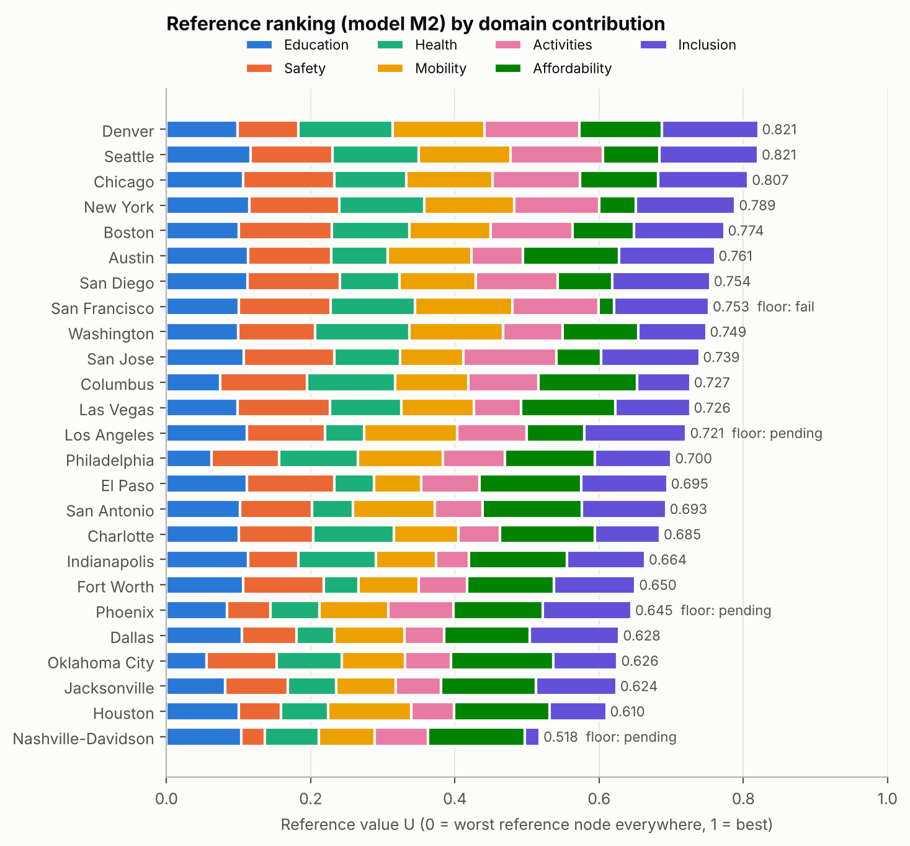
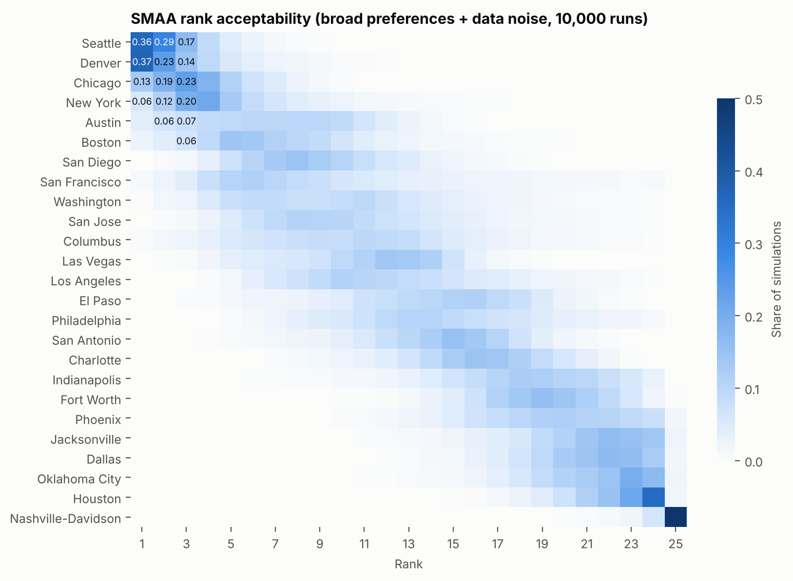
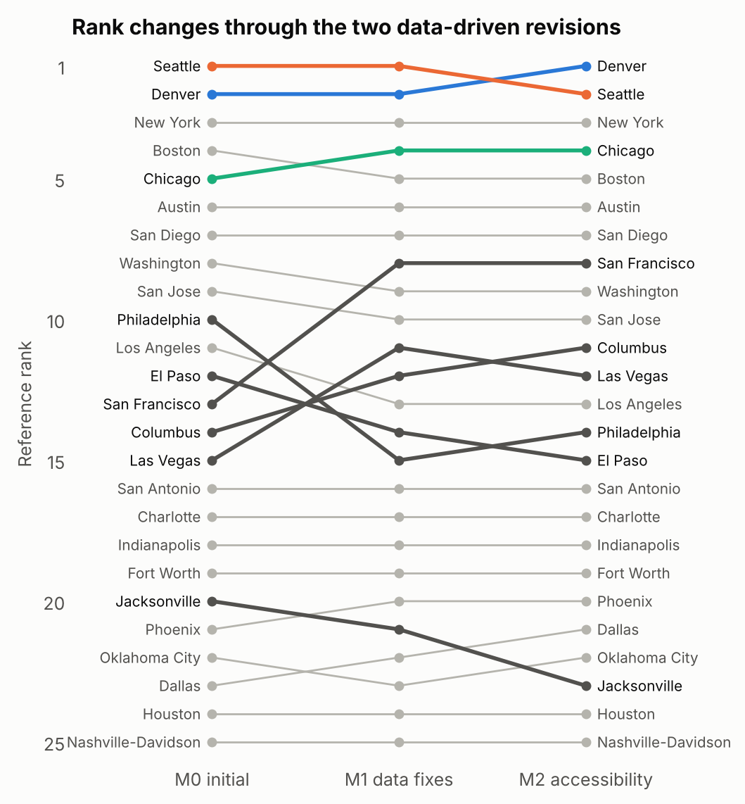
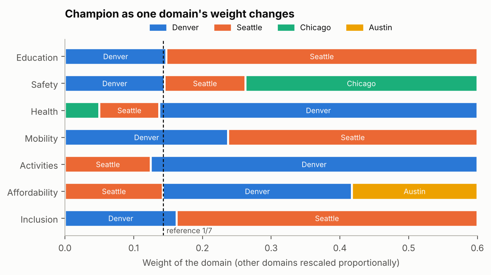
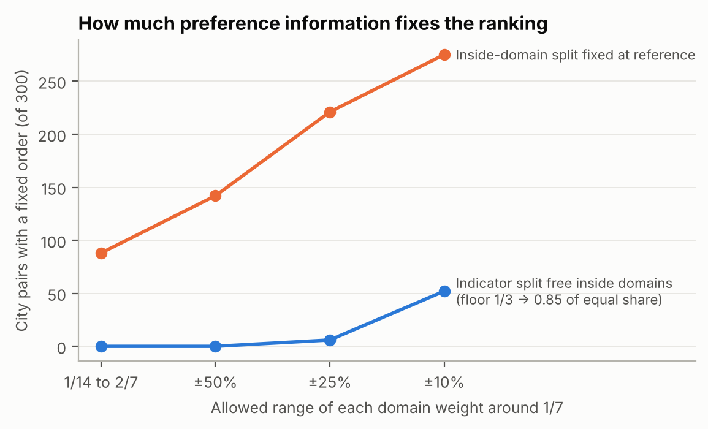
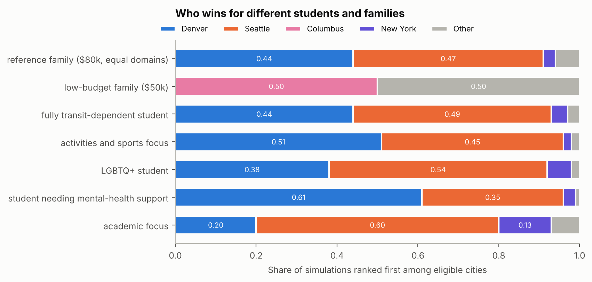
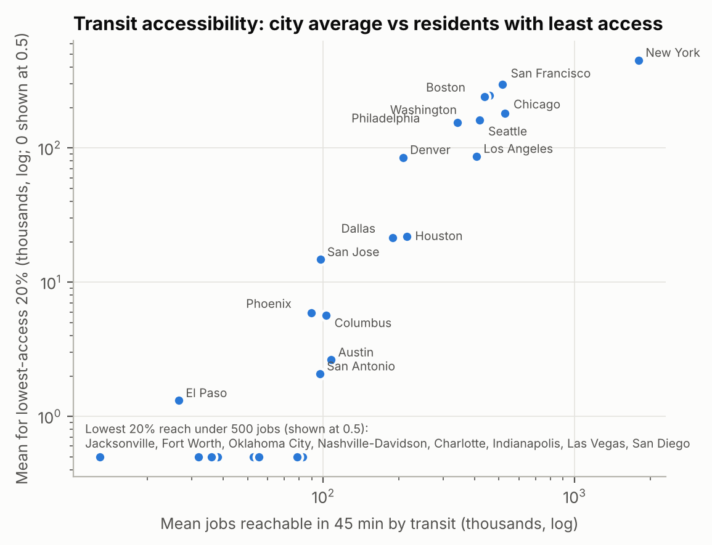

Problem Chosen: <b>A</b><b>2026 HiMCM Summary Sheet</b>Team Control Number: <b>TEAM_NUMBER</b>

<h1 class="paper-title">Floors First, Then Freedom: Ranking 25 U.S. Cities for High Schoolers Who Cannot Rely on a Car</h1>

**What makes a city great for a high schooler?** We define the best city as the one that, for a family on a fixed budget, clears basic floors on rent, violent crime and air quality, and then gives a public-school student who cannot depend on car rides the most real access to education, health support, independent travel, activities and fair treatment. The city must also keep that lead when reasonable people weigh these things differently.

**Criteria and data.** We built 20 measures in seven separate domains: education, safety, health, mobility, activities, affordability and inclusion. Every measure is computed from public data for the 25 most populous U.S. cities (Census Vintage 2025): CRDC and EDFacts school records, FBI and NHTSA FARS, EPA air data, SAMHSA, EPA Smart Location Database, FTA NTD, HUD, BEA and HRC. We dropped nine candidate criteria (for example weather and college rankings) and explain why (Section 3.2).

**Model.** (1) Three non-compensable floors screen cities before any scoring. (2) Each measure is converted to value by a piecewise-linear curve with fixed, city-independent reference points. (3) Linear programs test every pair of cities over the whole set of allowed preference weights. (4) Stochastic multicriteria acceptability analysis (SMAA) repeats the ranking 10,000 times under random weights and data errors. (5) Minimax regret and ELECTRE III check a cautious decision rule and a no-weak-spot rule.

**Results.** Seattle is our Best City for a High Schooler.

- Under the preferences stated in our definition, Seattle ranks first in **75.0%** of 10,000 simulations and in the top three in **99.1%**.
- It has the smallest worst-case regret (**0.151** on a 0–1 value scale) and passes all three floors.
- New York is second (first in 14.0% of simulations) and Denver third (7.8%), although Denver narrowly leads on equal domain weights (0.8210 against 0.8205).
- Among cities that pass the floors, the top five are Seattle, New York, Denver, Boston and Austin. San Francisco would place fourth but fails the rent floor for an $80,000 family (rent takes 50.4% of income).

**Significant revisions.** Auditing real data changed our model twice.

- M0→M1: a transit-frequency measure was blank for 96% of San Diego's residents, and one adult charter school pulled San Francisco's graduation rate to 56%. Fixing both moved San Francisco from 13th to 8th.
- M1→M2: we replaced transit service hours with jobs reachable within 45 minutes by scheduled transit, so we measure what a student can actually reach.

**Why it is more than our opinion.** Reference points are fixed, so removing any city reverses **0** pairs of other cities (an entropy-weight ranking reverses 106). At equal weights Denver and Seattle stay the two leaders with data noise up to four times its size and ±10% node shifts. Under our stated preferences Seattle stays first with node shifts (73%), with data noise quadrupled (36%), under low-substitution aggregation (84%) and without any single preference statement (62–75%). School-age survey outcomes agree with our domain scores: skipping school for fear of being unsafe rises with violent crime (ρ = +0.62), and sadness or hopelessness correlates with our health domain (ρ = −0.76).

**Caveat.** Seattle's lead belongs to families who can afford its neighborhoods. Only 38.5% of its residents live in census tracts that are affordable on $80,000 and well served by transit. For a $50,000 family Chicago leads at equal weights and Columbus when cost counts double.

<b>Keywords:</b> piecewise-linear value model; robust ordinal regression; linear programming; SMAA; minimax regret; ELECTRE III; transit accessibility

# Contents

1. Introduction3

2. Assumptions3

3. Criteria: What We Measure and What We Leave Out4

4. Data6

5. The Model8

6. Results: The Ranking12

7. Significant Revisions to the Model15

8. Why the Ranking Is More Than Our Opinion16

9. Who Should Choose Which City19

10. Strengths and Weaknesses21

11. Conclusion22

12. News Article: The Best City for a High Schooler23

13. References25

Report on Use of AI Tools (not counted toward the 25 pages)26

# 1. Introduction

## 1.1 Background

More than 15 million students attend U.S. public high schools. Most city rankings are written for adults: they weigh job markets, nightlife and home prices. A high schooler's life runs on different things: whether the nearest public school offers advanced courses, whether a bus can get her to practice and back after school, whether a counselor or a clinic will see a 16-year-old, and whether she is treated fairly. A teenager usually cannot drive and cannot choose the family budget, so the city's value to her depends on what she can reach and afford without an adult's car.

## 1.2 The task and our reading of it

1. Choose and justify criteria for a "best city for a high schooler", and discuss criteria left out.
2. Gather and cite data, apply the model, and discuss limitations.
3. Rank at least ten cities and reach a reasoned conclusion about the best one, under our own definition.
4. Show why the ranking has merit beyond opinion, and document at least one significant revision.
5. Write a one-to-two-page non-technical news article that includes our modeling process.

**Our definition of "best".** *The best city is the one that, for a family on a fixed budget, clears basic floors on cost and serious risk, and then gives a public-school student who cannot depend on car rides the most real access to education, health support, independent travel, activities and fair treatment — and keeps that lead across reasonable disagreements about what matters most.*

Three features of this definition shape the model. **Floors** come before trade-offs: no number of after-school programs should make up for a violent-crime rate above 1,200 per 100,000. **Real access** means measuring what a student can use (enrollments in advanced courses, jobs reachable by transit in 45 minutes), not how many buildings exist. **Robustness** means the answer must hold over a whole set of reasonable weightings, not a single set we chose.

**"Cannot depend on car rides."** The student does not drive and has no adult who can drive her to school, practice or work every day, so daily trips are made on foot, by bike or by transit. This describes many teenagers: in the 2022 National Household Travel Survey, half of all trips by 14–18-year-olds were as a passenger in someone else's car, and only half of 16–17-year-olds were drivers [26]. A city that works for such a student also works for one who sometimes gets a ride.

## 1.3 Our approach

<b>Measure</b> 25 cities × 20 measures in 7 domains, with error estimates

→

<b>Floors</b> rent, violent crime, air: pass / pending / fail

→

<b>Value</b> piecewise-linear curves on fixed reference points

→

<b>Robustness</b> LP over all weights; SMAA; regret; ELECTRE III

→

<b>Audit &amp; revise</b> M0 → M1 → M2 from real-data findings

The candidate pool is fixed before any score is computed: the 25 most populous U.S. cities in the Census Vintage 2025 estimates [1]. Every number in this paper is reproduced by our code from archived source files.

# 2. Assumptions

1. **The student attends a public high school and cannot rely on daily car rides.** *Justification:* most U.S. high schoolers attend public schools, and many teenagers do not drive; the problem asks about high schoolers, not families with cars.
2. **City-wide statistics describe the conditions a typical resident student meets.** *Justification:* consistent neighborhood data are not available for all measures in 25 cities. We test this assumption with census-tract data in Section 9.3.
3. **The reference family earns $80,000 a year and rents a two-bedroom home.** *Justification:* this is close to the U.S. median household income; we scan $50,000–$120,000 in Section 9.2.
4. **Recent multi-year averages represent current conditions.** *Justification:* we use 2021–2025 data and average several years where single years are noisy (crime 2022–2025, Chicago 2021; traffic and air 2021–2024).
5. **Once floors are met, a better result in one measure can partly make up for a worse one in another.** *Justification:* this is the usual way families trade off. We test it against a non-compensatory method (ELECTRE III) and against low-substitution aggregation (Section 8.2).
6. **Missing values are not zero.** *Justification:* a missing report is not evidence of no service. Two of 500 cells are missing; we show each city's rank with the missing value set to the worst and to the best node.

# 3. Criteria: What We Measure and What We Leave Out

## 3.1 Seven domains and twenty measures

We began from the needs of a 14–18-year-old rather than from available data. Each domain answers one question, and the domains stay separate even when their measures are correlated. Each measure has four fixed reference points ("nodes"): the worst node is worth 0 and the best node earns the full value of that measure. Node values come from standards where they exist (for example the 250-students-per-counselor recommendation [16] and HUD's 30% and 50% rent-burden lines [12]) and otherwise from round values that span realistic U.S. conditions. They were fixed before any city was scored.

| Domain (question) | Measure | Better | Nodes (worst → best) | Source |
|---|---|---|---|---|
| **Education** — what can a student learn? | AP, IB and dual-enrollment course enrollments per 100 students | ↑ | 10 / 25 / 40 / 55 | CRDC 2023–24 [3] |
| | Four-year graduation rate, non-charter schools (%) | ↑ | 60 / 75 / 85 / 95 | EDFacts 2020–21 [4] |
| | School counselors per 1,000 students | ↑ | 2 / 3 / 4 / 6 | CRDC 2023–24 [3] |
| **Safety** — how likely is serious harm? | Violent crimes per 100,000 residents (2022–25) | ↓ | 1200 / 900 / 600 / 300 | FBI CDE [5] |
| | Traffic deaths per 100,000 residents (2021–24) | ↓ | 20 / 14 / 8 / 2 | NHTSA FARS [6] |
| **Health** — can a student stay well? | Days with AQI above 100 (% of days, 2021–24) | ↓ | 30 / 15 / 5 / 0 | EPA AirData [7] |
| | School nurses, psychologists, social workers per 1,000 students | ↑ | 0.5 / 2 / 4 / 8 | CRDC 2023–24 [3] |
| | Youth mental-health facilities per 100,000 residents under 18 | ↑ | 2 / 6 / 12 / 20 | SAMHSA 2025 [8] |
| **Mobility** — can a student get around alone? | Jobs reachable in 45 min by transit and walking (thousands) | ↑ | 10 / 60 / 200 / 600 | EPA SLD v3 [9] |
| | National Walkability Index (1–20) | ↑ | 5.75 / 10.5 / 15.25 / 20 | EPA SLD v3 [9] |
| | Student fare for one local ride (USD) | ↓ | 2 / 1 / 0.5 / 0 | operator fare pages [10] |
| | Weekend service as a share of weekday service | ↑ | 0.3 / 0.5 / 0.7 / 0.9 | FTA NTD 2022–25 [11] |
| **Activities** — what can a student do after school? | Residents within a 10-minute walk of a park (%) | ↑ | 30 / 55 / 80 / 100 | TPL ParkScore 2026 [13] |
| | Teen library program attendance per 1,000 residents of the library's service area | ↑ | 0 / 10 / 25 / 50 | IMLS FY2023–24 [14] |
| | School sports participations per 100 students | ↑ | 10 / 20 / 35 / 50 | CRDC 2023–24 [3] |
| | Minimum wage for ages 16–17, divided by BEA all-items price parity (USD/h) | ↑ | 6.5 / 10 / 14 / 18 | DOL, state laws [15]; BEA [2] |
| **Affordability** — can the family pay? | Two-bedroom Fair Market Rent as % of $80,000 income | ↓ | 50 / 40 / 30 / 15 | HUD FY2024 [12] |
| | Prices of goods and other services (U.S. = 100) | ↓ | 110 / 105 / 100 / 95 | BEA RPP 2024 [2] |
| **Inclusion** — is the student treated fairly? | City non-discrimination laws and municipal services (% of HRC MEI parts I and III, 42 points) | ↑ | 25 / 50 / 75 / 100 | HRC MEI 2025 [17] |
| | Students suspended out of school per 100 | ↓ | 16 / 10 / 5 / 0 | CRDC 2023–24 [3] |

**Avoiding double counting.** Counselors appear only in education; nurses, psychologists and social workers only in health. Housing is excluded from the BEA price measure because rent is measured directly. Transit service and transit access are not both scored: in M2 the access measure already contains the service it uses (Section 7).

**Transit access data.** The access field is coded −99999 where no transit stop lies within walking distance; we count these residents as reaching 0 jobs. Unlike the frequency field of Revision 1, this code is reliable: in every city the share of residents coded −99999 equals the share with no stop within walking distance. The field uses 2020 timetables and 2017 job locations.

## 3.2 Criteria we considered and left out

| Criterion | Reason left out |
|---|---|
| Weather and climate | A matter of taste, not of opportunity; it belongs in a personal profile, not in the definition of "best" |
| College and university rankings | A nearby top university does not make it easier for local students to get in. Public universities favor residents of the state and the top students of every high school in it (UT Austin admits the top 6% of each Texas high school; UC guarantees a place to the top 9% of each California high school), so every city in a state gets the same advantage; private universities admit nationally. What a city adds before graduation, college courses taken in high school, is measured by dual enrollment |
| Test scores (SEDA) | Cover grades 3–8, not high school; state high-school tests differ by state and cannot be compared across our cities |
| Nightlife, restaurants, job growth | Weakly related to ages 14–18 |
| Teen employment rate | Mixes opportunity with need: a high rate can mean students must work |
| Racial and ethnic diversity | Describes who lives there, not how students are treated; kept as background only |
| Walk Score, AllTransit | Measure the same things as our EPA walkability and transit-access measures; scoring both would count the same thing twice |
| Youth survey outcomes (YRBS) | Available for only 12 of 25 cities; used to validate the model instead (Section 8.4) |
| Adult health outcomes (CDC PLACES) | Measures adults; teenagers' needs differ |

## 3.3 The candidate cities

The pool is the 25 most populous cities in the Census Vintage 2025 estimates [1], with each city as the Census defines it. Indianapolis and Nashville share their governments with their counties; for them the Census ranks the "balance", the merged city-county minus the small towns inside it that keep their own governments (for example Belle Meade in Nashville), and we use the same area for every measure. The list was frozen before any data were scored, so no city was added or dropped to favor a result.

# 4. Data

## 4.1 Sources and processing

We assembled a long table of 157,256 records (121,160 numeric values) from 28 public sources. It covers multiple years, geographic levels (school, police agency, county, metro area, transit operator) and sources [1]–[17]. From it we computed the 25 × 20 matrix used by the model. The main processing rules:

- **School measures** sum all high-school-offering schools located inside each city boundary (2,264 schools in CRDC 2023–24) and divide by their enrollment. Negative CRDC reserve codes are treated as missing, never as zero.
- **Rates** use Census city population, except where the police agency covers a larger area (Charlotte-Mecklenburg, Las Vegas Metropolitan and Metro Nashville), where we use the FBI agency population.
- **Chicago's violent crime.** The FBI series counts about 3,400 aggravated assaults a year in Chicago, against 15,606 aggravated assaults and batteries in the police department's 2021 report: aggravated battery is missing. We use the department's 2021 total (25,979, or 960 per 100,000) and keep the FBI series' relative error.
- **Fares** are the price of one local ride for an eligible student; Dallas and Indianapolis sell only 3-hour and 2-hour passes, whose prices we use.
- **Located measures**: traffic deaths are counted where the crash occurred and mental-health facilities by their postal city (no capacity data). Park access is county-scale for Charlotte and Nashville and rounded to whole percents (standard deviation 0.3).
- **Area measures** (air quality, rent) are weighted by the share of the city's residents in each county.
- **Neighborhood measures** (walkability, transit access) are population-weighted means over the census block groups inside each city (22,398 populated block groups).

## 4.2 Measurement error

Every value carries a standard deviation used in the uncertainty analysis:

- **Multi-year measures** (crime, traffic, air): the standard error of the annual mean.
- **School measures**: the difference between the two CRDC waves (2021–22 and 2023–24) divided by √2, the sample standard deviation of two values.
- **Graduation rates** published as ranges: the range width converted to a 90% interval. Chicago and Seattle report no school-level rates for this cohort, so we use their official district rates (Illinois Report Card, Washington OSPI) and treat them as exact. Other cities use cohort-weighted school rates.
- **Counts** (youth mental-health facilities): the Poisson standard deviation √n.

Seven measures are published standards or modeled values and are treated as exact: rent (HUD Fair Market Rents), price parity, youth fare, teen wage, HRC score, walkability and transit access. Errors are independent across cities and measures; Section 8.3 tests errors shared within a domain.

## 4.3 Missing data

Two of the 500 cells are missing:

- San Francisco reports no school athletics in schools enrolling 94% of its students, which we treat as a reporting gap.
- Washington, D.C. is not rated by HRC.

The reference ranking fills a missing cell with the 25-city median and reports the rank range when the missing value is set to the measure's worst node and to its best node. San Francisco's rank moves between 6th and 10th; Washington's between 9th and 17th. All other ranks are unaffected.

# 5. The Model

## 5.1 Notation

| Symbol | Meaning |
|---|---|
| $i, k$ | cities, $i = 1,\dots,25$ |
| $j$ | measures, $j = 1,\dots,20$; $d(j)$ is the domain of measure $j$ |
| $x_{ij}$, $s_{ij}$ | value of measure $j$ in city $i$ and its standard deviation |
| $t_{j0},\dots,t_{j3}$ | fixed nodes of measure $j$ (worst to best) |
| $\phi_{ijl}\in[0,1]$ | how much of segment $l$ of measure $j$ city $i$ covers |
| $\theta_{jl}\ge 0$ | value of segment $l$ of measure $j$; $\theta$ collects all 60 of them |
| $\Theta$ | set of allowed preference vectors; $\theta^0$ is the reference vector |
| $U_i(\theta)$ | overall value of city $i$, between 0 and 1 |

## 5.2 Step 1: floors that cannot be bought back

Some conditions are needs, not preferences. A city fails if any of three raw values crosses a floor:

$$
F=\{\,i:\ \text{rent}_i\le 50\%\text{ of income},\ \text{violent crime}_i\le 1200,\ \text{bad-air days}_i\le 30\%\,\}.
$$

The rent floor is HUD's "severe burden" line [12]. The violent-crime floor is about three times the 2023 national rate of 363.8 per 100,000 [5]. The air floor means that air is unhealthy for students with asthma on nearly one day in three. No city's value crosses the last two floors, and three cities come within measurement error. Traffic deaths stay in the safety domain but are not a floor: between our cities the yearly death rate differs by at most 15 per 100,000 (2.8 in New York, 18.3 in Phoenix), too small a risk to override every other strength. A floor is checked on the raw value, before any weighting, so no other strength can offset it.

Because each value has an error, a city has three states for each floor. It **passes** if its 90% interval $x\pm1.645s$ lies fully on the safe side, **fails** if it lies fully on the wrong side, and is **pending** otherwise. The joint chance of passing all three floors is estimated as the share of 20,000 simulated data sets in which all three values pass. Floors were also scanned over ranges (Section 9.2), because no floor value is universal.

## 5.3 Step 2: a piecewise-linear value for each measure

Families value the first improvements most. Going from 10% to 25% of students in advanced courses matters more than going from 40% to 55%. We model this with a curve made of three straight segments between the four fixed nodes. The coverage of segment $l$ is

$$
\phi_{ijl}=\min\!\left(1,\ \max\!\left(0,\ \frac{x_{ij}-t_{jl}}{t_{j,l+1}-t_{jl}}\right)\right),\qquad l=0,1,2,
$$

(nodes run from worst to best, so the same formula covers lower-is-better measures), and the overall value is a sum:

$$
U_i(\theta)=\sum_{j=1}^{20}\sum_{l=0}^{2}\theta_{jl}\,\phi_{ijl}=\phi_i^{\top}\theta .
$$

Here $\theta_{jl}$ is the value earned by completing segment $l$. A city at or below the worst node earns 0 on that measure; a city at or above the best node earns $\theta_{j0}+\theta_{j1}+\theta_{j2}$. No separate "weight" multiplies the curve, because the segment values already include how much the measure matters. This keeps the score linear in $\theta$, which is what makes exact robustness analysis possible.

**Fixed reference points.** Nodes are absolute values, not the best and worst city in the pool. Adding or removing a city therefore never changes the order of two other cities.

## 5.4 Step 3: the set of reasonable preferences

People disagree about how much, say, advanced courses are worth compared with after-school activities, or lower prices compared with better transit. Instead of one weight vector, we keep the whole set $\Theta$ of vectors that satisfy:

- **Normalization:** $\theta\ge0$ and $\sum\theta=1$, so $U_i\in[0,1]$.
- **Diminishing returns:** $\theta_{j0}\ge\theta_{j1}\ge\theta_{j2}$ for every measure, and the last segment keeps at least 10% of the measure's value.
- **Balanced domains:** each domain receives between half and double an equal share, $\tfrac1{14}\le\sum_{j\in D}\theta_j\le\tfrac27$.
- **No measure ignored:** within a domain, each measure receives at least one third of an equal share of that domain.

In symbols, write $W_j=\sum_l\theta_{jl}$ for the total value of measure $j$ and $W_D=\sum_{j\in D}W_j$ for domain $D$, which has $n_D$ measures. Then

$$
\Theta=\Big\{\theta\ge0:\ \textstyle\sum\theta=1,\ \ \theta_{j0}\ge\theta_{j1}\ge\theta_{j2}\ge0.1\,W_j,\ \ \tfrac1{14}\le W_D\le\tfrac27,\ \ W_j\ge\dfrac{W_{d(j)}}{3\,n_{d(j)}}\Big\}.
$$

The **reference vector** $\theta^0$ gives each domain 1/7 and splits it equally among its measures. Within each measure, it splits the value 0.563 / 0.289 / 0.148 across the three segments. These are the values of the smooth curve $u(z)=(1-e^{-2z})/(1-e^{-2})$ at $z=\tfrac13,\tfrac23,1$, a moderate diminishing return.

**Our stated preferences $\Theta_S$.** Our definition in Section 1.2 implies six further statements, each tied to a sentence of the definition:

| | Statement | Reason in our definition |
|---|---|---|
| P1 | Education weight ≥ Affordability weight | The budget is handled by the rent floor; extra savings above it are a softer preference |
| P2 | Mobility weight ≥ Affordability weight | Same reason, for independent travel |
| P3 | Mobility weight ≥ 1/7 | The student cannot rely on car rides |
| P4 | Education weight ≥ 1/7 | Access to school and courses is the first purpose |
| P5 | Each measure gets 0.6–1.4 times an equal share inside its domain, ${}0.6\,W_D/n_D\le W_j\le1.4\,W_D/n_D$ | Every core measure covers its own part of the domain |
| P6 | Safety weight ≥ 1/7 | "Serious risk": the crime floor catches only extreme rates, so safety keeps at least an equal share |

$\theta^0$ satisfies all six. $\theta^0$ is a benchmark, not our decision rule. It gives one transparent scorecard (Figure 1, Section 5.8) and the starting point of single-vector checks; the ranking itself is decided over $\Theta_S$ (Table 1).

## 5.5 Step 4: what holds for every reasonable preference (linear programs)

For two cities $a$ and $b$, we solve

$$
\underline{\Delta}_{ab}=\min_{\theta\in\Theta}(\phi_a-\phi_b)^{\top}\theta,\qquad
\overline{\Delta}_{ab}=\max_{\theta\in\Theta}(\phi_a-\phi_b)^{\top}\theta .
$$

If $\underline\Delta_{ab}\ge0$, city $a$ is at least as good as $b$ under **every** reasonable preference: a *necessary* preference. If $\overline\Delta_{ab}\ge0$, there is **some** preference under which it is: a *possible* preference. Both are linear programs because $\Theta$ is defined by linear inequalities. This is the idea of robust ordinal regression [18].

A city can win only if a **single** vector makes it at least as good as all others at once. We test this by maximizing a margin $\varepsilon$ subject to $(\phi_i-\phi_k)^{\top}\theta\ge\varepsilon$ for all $k$ and $\theta\in\Theta$. City $i$ is a *possible winner* if the best $\varepsilon\ge0$. Beating each rival with a different weighting is not enough.

**Data uncertainty in the LP.** Each value of $\phi$ rises with the measure's quality and $\theta\ge0$. So, for any $\theta$, the worst case of $U_a-U_b$ over all data inside the 90% intervals puts $a$ at the bad end and $b$ at the good end. One LP with these two fixed rows therefore gives an exact robust answer for both preference and data uncertainty.

## 5.6 Step 5: how often each city wins (SMAA)

The LP says what is possible; SMAA [19] says how common it is. We repeat the following round $N=10{,}000$ times.

**(a) Draw a preference vector.** Every $\theta$ in $\Theta$ is a product of three nested shares,

$$
\theta_{jl}=W_{d(j)}\cdot v_j\cdot g_{jl},\qquad v_j=\frac{W_j}{W_{d(j)}},\qquad g_{jl}=\frac{\theta_{jl}}{W_j},
$$

and each constraint of Section 5.4 limits only one level. We draw each level from the flat Dirichlet distribution, which is uniform over all non-negative vectors that sum to 1, and redraw whenever that level breaks a constraint:

1. *Domain weights* $(W_1,\dots,W_7)$: kept only if every $W_D$ lies in $[\tfrac1{14},\tfrac27]$ (about 1 draw in 83).
2. *Measure shares* $v_j$ inside each domain: kept only if every $v_j\ge\tfrac1{3n_D}$; under $\Theta_S$, $\tfrac{0.6}{n_D}\le v_j\le\tfrac{1.4}{n_D}$ (P5).
3. *Segment shares* $(g_{j0},g_{j1},g_{j2})$ of each measure: sorted from largest to smallest (diminishing returns) and kept only if $g_{j2}\ge0.10$.
4. Under $\Theta_S$, the assembled $\theta$ is kept only if it also satisfies P1–P4 and P6 (3.8% of accepted domain draws).

All 10,000 vectors therefore lie in $\Theta$ (or $\Theta_S$). Sorting a flat Dirichlet draw keeps it uniform over the ordered region, so each level is uniform over its allowed range and every allowed set of domain weights is equally likely. The 60 values are uniform level by level, not over $\Theta$ as a whole; we chose this because families disagree mainly about domain weights.

**(b) Draw a data set.** Each value is perturbed independently, $\tilde x_{ij}=x_{ij}+s_{ij}\varepsilon_{ij}$ with $\varepsilon_{ij}\sim N(0,1)$; measures treated as exact (Section 4.2) have $s_{ij}=0$. A missing cell takes the value of a randomly chosen city among those that report the measure. A value pushed beyond the end nodes needs no correction, because $\phi$ clips it to $[0,1]$.

**(c) Score and rank.** $U_i=\tilde\phi_i^{\top}\theta$ and $r_i=1+\#\{k:\ U_k>U_i\}$. No two cities tied in any round.

**(d) Summarize.** Over the $N$ rounds,

$$
p^{(1)}_i=\frac1N\sum_{n=1}^{N}\mathbf 1\big[r^{(n)}_i=1\big],\qquad
p^{(3)}_i=\frac1N\sum_{n=1}^{N}\mathbf 1\big[r^{(n)}_i\le3\big],\qquad
\bar r_i=\frac1N\sum_{n=1}^{N}r^{(n)}_i .
$$

The final ranking (Table 1) orders cities by mean rank $\bar r_i$. A city's *central weight vector* $\theta^c_i$ is the average of $\theta^{(n)}$ over the rounds it wins; its *confidence factor* is the share of 5,000 new data sets in which it ranks first with $\theta$ fixed at $\theta^c_i$. The 90% rank interval runs from the 5th to the 95th percentile of $r^{(n)}_i$. Fixing $\theta=\theta^0$ and drawing only data gives the "data noise only" runs of Sections 6.1 and 8.3.

**Precision.** The standard error of a share is at most $\sqrt{0.25/N}=0.005$ and that of a mean rank at most 0.03. Neighbors in Table 1 differ by more than five standard errors of their gap, except three pairs (San Diego and Chicago, San Jose and Los Angeles, Houston and Oklahoma City, at most 2.1 standard errors), which we treat as tied.

## 5.7 Step 6: two cross-checks with different philosophies

**Minimax regret** [25] answers a cautious family's question: "If I pick city $i$ and my true preferences are the worst case for that choice, how much value do I lose against the best city?"

$$
R_i=\max_{\theta\in\Theta}\Big[\max_k U_k(\theta)-U_i(\theta)\Big]
=\max_k\ \overline{\Delta}_{ki}.
$$

It reuses the pairwise LPs (over $\Theta_S$ in Table 1); the city with the smallest $R_i$ is the cautious choice.

**ELECTRE III** [20] does not allow free trade-offs. It uses each measure's value on a 0–1 scale, $g_{ij}=\sum_l\theta_{jl}\phi_{ijl}/W_j$, and the measure weights $W_j$. For cities $a,b$ let $\delta_j=g_{bj}-g_{aj}$ be $b$'s lead on measure $j$. Then

$$
c_j=\operatorname{clip}\Big(\frac{p-\delta_j}{p-q}\Big),\qquad
d_j=\operatorname{clip}\Big(\frac{\delta_j-p}{v-p}\Big),\qquad
\sigma(a,b)=C\prod_{j:\,d_j>C}\frac{1-d_j}{1-C},\quad C=\sum_j W_j c_j ,
$$

where clip limits a number to $[0,1]$ and $(q,p,v)=(0.05,0.20,0.80)$. $c_j$ measures how much measure $j$ supports "$a$ is at least as good as $b$"; $d_j=1$ is a veto, a lead of at least 80% of the scale. $\sigma(a,b)$ is the credibility of that statement. At a cut level $\lambda$, $a$ outranks $b$ if $\sigma(a,b)>\lambda$ and $\sigma(a,b)-\sigma(b,a)>0.30-0.15\,\sigma(a,b)$; a city's qualification is the number of cities it outranks minus the number that outrank it. The descending distillation repeatedly removes the cities with the highest qualification, the ascending one those with the lowest. City $a$ is placed above $b$ if it is at least as good in both orders and better in one; the *kernel* is the set of cities with no city above them. The sampled version repeats this for the first 400 vectors of Step 5 under $\Theta_S$, with point data; each vector changes both the weights $W_j$ and the shape of each value curve.

## 5.8 Worked example: Seattle against Denver

**Floors.** Seattle's two-bedroom rent ($2,645) is 39.7% of $80,000. Violent crime is 777 per 100,000 and bad-air days 1.8%. All three 90% intervals lie on the safe side, so Seattle passes with joint probability 1.000.

**One measure in detail.** Seattle has 54.2 advanced-course enrollments per 100 students. With nodes 10 / 25 / 40 / 55, it covers segments 1 and 2 fully and 14.2/15 = 0.946 of segment 3. With $\theta^0$ (education 1/7 split over three measures, so 0.0476 per measure, divided 0.563 / 0.289 / 0.148), its contribution is
$$0.0476\times(0.563+0.289+0.946\times0.148)=0.0472 .$$
Denver's 38.6 enrollments cover segment 2 only to 0.906 and earn 0.0393.

**All domains.** Summing the 20 contributions:

| Domain | Education | Safety | Health | Mobility | Activities | Affordability | Inclusion | **Total $U$** |
|---|---|---|---|---|---|---|---|---|
| Seattle | 0.116 | 0.114 | 0.119 | 0.128 | 0.128 | 0.078 | 0.137 | **0.8205** |
| Denver | 0.098 | 0.085 | 0.131 | 0.127 | 0.132 | 0.115 | 0.134 | **0.8210** |
| Difference | +0.018 | +0.030 | −0.012 | +0.001 | −0.004 | −0.037 | +0.004 | −0.0005 |

Seattle is safer and stronger in school; Denver is cheaper and has more school health staff and teen library programs.

**Robust comparison.** The LPs give $U_{\text{Seattle}}-U_{\text{Denver}}\in[-0.301,\,0.290]$ over all of $\Theta$ and $[-0.130,\,0.210]$ over $\Theta_S$. Both contain 0, so the order depends on preferences.

**Frequency and caution.** Under $\Theta_S$, SMAA puts Seattle first in 75.0% of draws against 7.8% for Denver. Seattle's worst-case regret is 0.151, against 0.210 for Denver.

# 6. Results: The Ranking

## 6.1 The reference scorecard

Figure 1 shows each city's value under the reference weights $\theta^0$, split by domain. Denver and Seattle differ by 0.0005, far below the spread caused by data error alone: under data noise only, each wins about half the time (Denver 52.5%, Seattle 47.5%). New York is third, 0.032 behind.

<figure><figcaption>Figure 1. Reference value of each city under equal domain weights, split by domain. Floor status is shown next to the score.</figcaption></figure>

## 6.2 Floors

At an income of $80,000:

- **21 cities pass all three floors.**
- **San Francisco fails** the rent floor: two-bedroom rent takes 50.4% of income. HUD Fair Market Rents are published standards, so we treat them as exact; San Francisco passes at incomes above $80,616.
- **Three cities are pending.** In Los Angeles and Phoenix, the share of bad-air days (27.9% and 27.4%) is within error of the 30% floor (joint pass probability 0.81 and 0.60). In Nashville, violent crime of 1,160 per 100,000 is close to 1,200 (0.73).

Pending cities stay in the ranking but are not recommended until confirmed. The joint pass probability from simulation and the conservative Bonferroni bound ${}1-\sum_k(1-p_k)$, where $p_k$ is the chance of passing floor $k$, differ by at most 0.0032, so the bound is not overly cautious here.

## 6.3 How stable is the ranking? (all reasonable preferences)

Over the full set $\Theta$, the LPs fix the order of **no** pair of cities, and all 25 cities are possible winners. The broad set allows extreme views (one domain at double weight, another at half), and almost any city has a domain in which it excels. Frequency, not possibility, then separates the cities (Figure 2):

- **First place:** Seattle 41.4%, Denver 40.5%, New York 6.7%, Austin 5.1% and Boston 2.7%.
- **Top three:** Seattle 86.8% and Denver 80.8%.
- **90% rank intervals:** Seattle 1–5, Denver 1–7 and New York 1–11.

<figure><figcaption>Figure 2. Share of 10,000 SMAA draws (broad preference set plus data noise) in which each city takes each rank.</figcaption></figure>

## 6.4 Under our stated definition: the final ranking

Adding statements P1–P6 narrows $\Theta$ to $\Theta_S$:

- **Fixed pairs:** seven pairs now have a necessary order (New York, Denver, Chicago and Austin above Nashville; Austin above Dallas, Fort Worth and Houston).
- **Possible winners:** six cities can no longer rank first under any preference in $\Theta_S$: Fort Worth, Phoenix, Dallas, Jacksonville, Houston and Nashville.

**What the stated preferences weigh.** The reference vector $\theta^0$ sits on the edge of $\Theta_S$: it gives education, mobility and affordability the same weight, the least that P1–P4 allow, and safety the 1/7 that P6 requires. The average of 10,000 vectors drawn from $\Theta_S$ (Step 5) gives education, mobility and safety 0.18 each, affordability 0.10 and the other three domains 0.11 each. Under this single vector Seattle scores 0.808, New York 0.788 and Denver 0.779.

**Why P6.** Without P6, statements P1–P4 raise education and mobility and leave safety at 0.127 on average, below an equal share, although our definition names serious risk and the crime floor catches only extreme rates. P6 raises Seattle's share of first places from 67.4% to 75.0% and moves New York ahead of Denver, whose violent-crime rate (978 per 100,000) is the highest of the three leaders.

Table 1 gives the final ranking by mean SMAA rank under $\Theta_S$ with data noise. With each city's central weight vector fixed and only the data varying, Seattle wins 98.9% of draws (its confidence factor); New York's is 65.0% and Denver's 38.9%.

**Table 1. Final ranking (stated preferences $\Theta_S$, 10,000 draws with data noise).** "Ref." is the reference scorecard rank; regret is on the 0–1 value scale. San Francisco fails a floor and is listed without a rank; the simulation includes all 25 cities, and leaving San Francisco out changes no other city's position. ‡ marks neighbors whose mean ranks differ by less than 2.2 standard errors; we treat them as tied.

| Rank | City | Mean rank | First | Top 3 | Max regret | Ref. | Floors ($80k) | Status |
|---|---|---|---|---|---|---|---|---|
| 1 | **Seattle** | 1.32 | 75.0% | 99.1% | **0.151** | 2 | pass | **Best city** |
| 2 | New York | 2.49 | 14.0% | 85.2% | 0.221 | 3 | pass | runner-up |
| 3 | Denver | 3.54 | 7.8% | 60.3% | 0.210 | 1 | pass | leads at equal weights |
| — | San Francisco | 5.83 | 0.7% | 17.9% | 0.235 | 8 | **fail** | fails rent floor, not ranked |
| 4 | Boston | 6.05 | 0.7% | 12.1% | 0.249 | 5 | pass |  |
| 5 | Austin | 6.30 | 1.7% | 15.7% | 0.307 | 6 | pass |  |
| 6 ‡ | San Diego | 7.17 | 0.0% | 3.8% | 0.275 | 7 | pass |  |
| 7 ‡ | Chicago | 7.25 | 0.0% | 3.5% | 0.247 | 4 | pass |  |
| 8 | Washington | 8.98 | 0.1% | 2.1% | 0.292 | 9 | pass |  |
| 9 ‡ | San Jose | 10.14 | 0.0% | 0.1% | 0.294 | 10 | pass |  |
| 10 ‡ | Los Angeles | 10.21 | 0.0% | 0.1% | 0.299 | 13 | pending (air) |  |
| 11 | Las Vegas | 11.16 | 0.0% | 0.2% | 0.362 | 12 | pass |  |
| 12 | Columbus | 12.45 | 0.0% | 0.1% | 0.398 | 11 | pass |  |
| 13 | San Antonio | 14.41 | 0.0% | 0.0% | 0.392 | 16 | pass |  |
| 14 | El Paso | 14.85 | 0.0% | 0.0% | 0.401 | 15 | pass |  |
| 15 | Philadelphia | 15.83 | 0.0% | 0.0% | 0.382 | 14 | pass |  |
| 16 | Charlotte | 16.48 | 0.0% | 0.0% | 0.425 | 17 | pass |  |
| 17 | Fort Worth | 17.97 | 0.0% | 0.0% | 0.440 | 19 | pass | cannot rank first |
| 18 | Indianapolis | 19.43 | 0.0% | 0.0% | 0.448 | 18 | pass |  |
| 19 | Dallas | 20.62 | 0.0% | 0.0% | 0.461 | 21 | pass | cannot rank first |
| 20 | Phoenix | 21.20 | 0.0% | 0.0% | 0.447 | 20 | pending (air) | cannot rank first |
| 21 | Jacksonville | 21.70 | 0.0% | 0.0% | 0.491 | 23 | pass | cannot rank first |
| 22 ‡ | Houston | 22.31 | 0.0% | 0.0% | 0.450 | 24 | pass | cannot rank first |
| 23 ‡ | Oklahoma City | 22.33 | 0.0% | 0.0% | 0.486 | 22 | pass |  |
| 24 | Nashville | 24.99 | 0.0% | 0.0% | 0.608 | 25 | pending (crime) | cannot rank first |

**Why Seattle.** Seattle has no weak domain except affordability. It has the highest advanced-course enrollment (54.2 per 100 students against a median of 32.8) and school sports participation (49.9 per 100 against 25.9). Its price-adjusted teen minimum wage ($19.17 per hour) is the highest of the 25, its students ride free, and it reaches 419,000 jobs by transit in 45 minutes (median 102,000). Its suspension rate is low (2.7 per 100 against 6.9).

**Why the others trail.**

- **New York** offers by far the most transit access (1.8 million jobs) and the fewest traffic deaths (2.8 per 100,000), but is expensive (rent 41.3% of income).
- **Denver** is held back by violent crime (978 per 100,000) and a lower district graduation rate (71.8%).
- **Chicago** is cheap for its quality (rent 25.7% of income), but its violent crime (960 per 100,000) and few school health staff (1.4 per 1,000 students against a median of 1.9) place it 7th.

**Leave-one-statement-out check.** Removing any single statement P1–P6 keeps Seattle first in SMAA (62.2–74.6%) and keeps it the minimum-regret city. P1 and P2 both limit affordability; removing them together still leaves Seattle first (72.2% against New York's 11.9%). All seven necessary pairs depend on P5; without it the count returns to 0.

**ELECTRE III.** With the reference weights, the kernel is Austin and Denver, followed by Seattle. With 400 weight vectors from $\Theta_S$, Seattle is in the kernel 88% of the time, Austin 35% and Denver 13%. No measure vetoes Seattle against any city.

# 7. Significant Revisions to the Model

<figure class="float-right"><figcaption>Figure 3. Reference rank of each city through the two revisions. Colored: top three; dark gray: cities that moved three or more places.</figcaption></figure>

We built a complete first model (M0) with the indicators and methods above, then audited every measure against its raw records. Two findings in real data led to revisions.

**Revision 1 (M0 → M1): fixing two measures that mismeasured students' conditions.**

- *Evidence 1.* M0 used the EPA's transit-frequency field (trips per hour near home). In San Diego, 96% of residents live in block groups where this field is coded −99999, yet only 22% live more than 0.75 mile from a stop. The code marks missing schedule data, not missing buses. Federal NTD data show San Diego's operator runs 1.11 service hours per resident, above the 25-city median of 0.85.
- *Evidence 2.* M0 averaged graduation rates over all schools in the city. In San Francisco, one charter school for adult re-entry students holds 36% of the city's graduation cohort and graduates 4%, pulling the city to 56%. Oklahoma City (one charter school, 51% of the cohort, 48%) and Las Vegas (21%, 7%) show the same pattern. A resident student enrolls by address in district schools, not in these programs.
- *Change.* We replaced transit frequency with NTD service hours per resident plus weekend service retention. Graduation now uses non-charter schools only, which places San Francisco at 85.4%. The other five school measures keep charter schools, which enroll resident students; Section 8.3 tests applying the same rule to them.
- *Controlled comparison.* Changing graduation alone moves San Francisco 13 → 9. Changing transit alone moves it 13 → 10; together, 13 → 8. Las Vegas rises 15 → 11 and Philadelphia falls 10 → 15. The top three do not change (Kendall τ between M0 and M1 = 0.887).

**Revision 2 (M1 → M2): from service supplied to places a student can reach.**

- *Evidence.* Service hours count buses, not destinations, and correlate 0.895 (Spearman) with transit access. Scoring both would count transit twice.
- *Change.* We replaced service hours by the EPA's 45-minute transit accessibility. This field counts jobs reachable from each block group by walking and scheduled transit, computed from GTFS timetables. Jobs stand in for shops, libraries, workplaces and other destinations.
- *Effect.* Kendall τ between M1 and M2 is 0.967. Denver and Seattle swap places in the reference scorecard. The measure also reveals large within-city gaps (Section 9.3).

**Why these revisions should convince more people.**

- They come from records, not from a preferred winner: both were found by checking raw files. The reference top three (Seattle, Denver, New York) was the same in M0, M1 and M2; only the order of the first two changed in M2, by 0.0005.
- Each fix makes a measure describe what a resident student can actually use: the bus schedule, the school she would attend, the destinations she can reach.

# 8. Why the Ranking Is More Than Our Opinion

## 8.1 Fixed reference points make the ranking stable when the pool changes

Popular objective methods such as entropy weighting derive weights from how much the measures vary among the candidates. Their results therefore depend on who else is in the pool. We tested this directly: removing one city at a time and re-scoring the other 24 reverses **106** pairs in total over the 25 removals under min-max entropy weights. Under our fixed reference points it reverses **0**, because a city's score depends only on its own data. The final ranking in Table 1, by mean SMAA rank, reverses only 2 pairs over the 25 removals, both between cities we already treat as tied (San Diego and Chicago; Houston and Oklahoma City). Entropy weighting would also put the largest weight on transit access (0.134) simply because New York is an outlier, and it would crown New York.

## 8.2 Different aggregation rules, similar leaders

| Rule (Kendall τ with our reference ranking) | Leader |
|---|---|
| Linear value, no diminishing returns (0.867) | Seattle |
| Smooth exponential value, k = 1, 2, 4 (0.920, 0.933, 0.867) | Denver |
| Geometric mean of domains, CES ρ = 0 (0.873) | Denver |
| Low substitution between domains, CES ρ = −1 (0.753) | Denver |
| Almost no substitution, CES ρ ≤ −4.75 | Chicago |
| Mobility–activities complementarity, 2-additive Choquet (0.987) | Seattle |
| ELECTRE III with vetoes (kernel) | Austin and Denver |
| Entropy weights / CRITIC (0.740 / 0.807) | New York / Seattle |

Here $s_D\in[0,1]$ is domain $D$'s contribution under $\theta^0$ times 7. CES is $(\tfrac17\sum_D s_D^{\rho})^{1/\rho}$ (the geometric mean at $\rho=0$); the Choquet rule is $\bar s-\tfrac I2\,|s_{\text{Mob}}-s_{\text{Act}}|$ with $I=0.05$ or ${}0.10$; the linear and exponential rules replace each curve by $z$ or $(1-e^{-kz})/(1-e^{-k})$, where $z$ is the position between the worst and best node; entropy and CRITIC weights use min-max normalized values. Seattle or Denver lead under every rule except entropy weighting, which follows New York's outlying transit access, and the two rules that most restrict trade-offs: Chicago leads only when domains can barely make up for each other (ρ ≤ −4.75), and the ELECTRE kernel adds Austin to Denver.

## 8.3 Sensitivity

Unless stated otherwise, $\Theta_S$ percentages in this section include data noise (10,000 draws); the node-shift and measure-removal tests use point data (2,000 and 4,000 draws).

- **Weights (Figure 4).** Raising any one domain while scaling the others shows where the leader changes. Seattle leads once education reaches 0.148, safety 0.145, inclusion 0.163 or mobility 0.238. Denver leads once affordability exceeds 0.143, health 0.138 or activities 0.125. No third city leads within the allowed range: New York needs safety above 0.39 and Austin affordability above 0.42.
The first four tests start from the reference weights $\theta^0$, where Denver and Seattle are tied, and are then repeated under $\Theta_S$.

- **Nodes.** Shifting every node independently by a uniform amount of up to ±10% of the measure's range, then re-sorting the four nodes (2,000 runs) keeps the winner between Denver (66.5%) and Seattle (33.5%). With weights drawn from $\Theta_S$, Seattle wins 73.1% of shifted runs, New York 15.1% and Denver 9.5%.
- **Data error.** Multiplying every standard deviation by 0.5, 1, 2 or 4 keeps Denver and Seattle as the two most frequent winners (Seattle 43.1%, 48.1%, 48.1%, 36.2%). Letting all measures of a city's domain share one error, instead of independent errors, changes Seattle's share of first places under $\Theta_S$ from 74.5% to 70.6% (5,000 draws).
- **One measure at a time.** Removing any one of the 20 measures (its weight spread over all remaining measures) leaves the champion Denver 13 times and Seattle 7 times. Under $\Theta_S$ (each domain keeps its weight), Seattle stays first for 19 of the 20 removals; removing advanced courses makes New York first (48% against 39%). Removing the graduation rate leaves a three-way tie (Seattle 34%, Denver 34%, New York 30%): much of Seattle's lead comes from Denver's low district graduation rate (71.8% against 87.2%).
- **Data intervals.** Placing every value at the unfavorable end of its 90% interval removes all seven necessary pairs of $\Theta_S$. Those orders depend on point estimates, so we do not claim them as certain.
- **Alternative data choices.** Each of the following keeps Seattle first under $\Theta_S$:
    - Chicago's FBI series (516 instead of 960 per 100,000) moves Chicago from 7th to 3rd by mean rank (11.5% first) and leaves Seattle first in 68.2% of draws.
    - Metro-area air monitors put Seattle first (82.7% of $\Theta_S$ draws); under metro monitors Phoenix fails the air floor.
    - Applying the non-charter rule of Revision 1 to all five school measures (charter schools enroll 5% of Seattle's students, 23% of Denver's and 50% of Oklahoma City's) keeps Seattle first in 71% of $\Theta_S$ draws against New York's 11%. Also leaving out alternative schools gives 58% against 21%.
    - Deflating the teen wage by non-housing prices, so that housing cost counts only through rent, leaves the reference top two unchanged and Seattle first in 74.1% of $\Theta_S$ draws.
    - A hierarchical Poisson–Gamma estimate [24] of traffic deaths at ages 14–18 shrinks small-city rates toward the 5.96 per 100,000 average (overdispersion χ² = 116.4 on 24 df) and keeps Seattle first at reference weights (τ = 0.940) and in 79.6% of $\Theta_S$ draws.

- **The same checks under $\Theta_S$** (10,000 draws). Seattle stays first with data errors doubled (59.2%) or quadrupled (35.9%, still the best mean rank), and under CES across domains at $\rho=0$ (88.9%) and $\rho=-1$ (83.7%), so the leaders at equal weights in Section 8.2 do not carry over to our stated preferences.

<figure><figcaption>Figure 4. Leader as one domain's weight changes (others rescaled proportionally). The dashed line is the equal weight 1/7.</figcaption></figure>

## 8.4 External checks

We compared our results with outcomes we did not use to build the model, including the 2023 Youth Risk Behavior Survey (YRBS) [23].

| External outcome (not used in the model) | Compared with | Spearman ρ | Expected sign |
|---|---|---|---|
| YRBS 2023: students who skipped school because they felt unsafe (9 cities) | violent crime | +0.62 | + ✓ |
| YRBS 2023: students not on a sports team (7 cities) | school sports participation | −0.93 | − ✓ |
| YRBS 2023: students who felt sad or hopeless (11 cities) | our health domain | −0.76 | − ✓ |
| YRBS 2023: students bullied at school (11 cities) | our inclusion domain | +0.45 | − ✗ |
| GTFS 2026 timetables: weekend/weekday trips (23 cities) | NTD weekend retention | 0.73 | + ✓ |
| Opportunity Atlas: adult income of children from low-income families [21] | total value $U$ | 0.33 (p = 0.11) | + ✓ (weak) |

Domain scores are domain contributions under $\theta^0$; the Opportunity Atlas value is county-level, weighted by each city's population share; the GTFS check leaves out Indianapolis and San Francisco, which had no service in the reference week. Three of four youth outcomes agree with our measures in the expected direction. Bullying does not: city non-discrimination policy measures what a city promises, not what happens in school hallways. We report this as a limit of the inclusion domain.

## 8.5 How much agreement would settle the ranking?

Figure 5 shows how the number of fixed pairs grows as preferences are narrowed. Most of the disagreement lies **inside** domains (how to split, say, safety between crime and traffic), not between domains. If the split inside domains is fixed at the reference, 88 of 300 pairs are already settled. If, in addition, every domain weight is held within ±25% of 1/7, 221 pairs are settled. In the opposite case, with every domain weight fixed at exactly 1/7 and the split inside domains left free, only 4 pairs are settled. Agreeing on how each domain is measured settles more of the ranking than agreeing on how much each domain matters.

<figure><figcaption>Figure 5. City pairs whose order is fixed for every preference in $\Theta$, as the set is narrowed. Upper line: the split inside domains and the value curves are fixed at $\theta^0$. Lower line: everything varies, and each measure's minimum share of its domain rises from 1/3 to 0.6 and 0.85 of an equal share.</figcaption></figure>

# 9. Who Should Choose Which City

## 9.1 Student profiles

The model answers different questions for different students by changing both their floors and their weights. The priority domain's weight is centered on 2/7, double the equal share, and the other six domains share the rest equally. We draw 5,000 vectors from a Dirichlet distribution centered on this profile (concentration 200) and keep those inside $\Theta$; because 2/7 is the upper limit of $\Theta$, the priority weight averages 0.26. Each vector is paired with a data set, and cities that fail the profile's floors are removed before ranking.

<figure><figcaption>Figure 6. Share of 5,000 draws in which each city ranks first among the cities that meet each profile's floors. Weights are centered on each profile inside $\Theta$ (not $\Theta_S$), so the reference-family row differs from Table 1.</figcaption></figure>

The main model assumes the student cannot count on daily rides; the transit-dependent profile assumes no rides at all, so it adds a floor on transit coverage.

| Profile | Extra floor | Cities eligible | Leader |
|---|---|---|---|
| Academic focus | — | 24 | Seattle (0.60) |
| LGBTQ+ student | city HRC policy score ≥ 75 | 19 | Seattle (0.54) |
| Fully transit-dependent student | ≤ 25% of residents without any transit access | 18 | Seattle (0.49) |
| Activities and sports | — | 24 | Denver (0.51) |
| Needs mental-health support | ≥ 5 youth facilities per 100,000 under 18 | 14 | Denver (0.61) |
| Low-budget family ($50,000) | rent floor at $50,000 | 17 | Columbus (0.50) |

## 9.2 Income changes the eligible set

The rent floor depends on income, so the eligible set does too:

- At **$120,000** all 25 cities pass.
- At **$70,000** San Jose and San Francisco fail.
- At **$50,000** eight cities fail: New York, Los Angeles, San Diego, San Jose, San Francisco, Seattle, Denver and Boston. The best remaining cities at reference weights are Chicago, Columbus, Austin, Las Vegas and Washington.

At reference weights, the leader among eligible cities is Seattle at $100,000 and above, Denver at $60,000–$80,000 (by less than 0.001 at $80,000) and Chicago at $50,000. Under our stated preferences Seattle leads at $80,000 (Table 1).

## 9.3 Inside the city: averages hide who is left out

City averages assume that a student lives in a typical neighborhood (Assumption 2). We tested this with census-tract data. We mapped ACS 2020–24 tract rents [22] to the transit-accessibility block groups (98–100% population coverage) and asked what share of residents live in tracts that are **both** affordable on $80,000 (the tract's median gross rent over all unit sizes, ACS table B25064, at most 30% of income) **and** reach at least 60,000 jobs by transit within 45 minutes (population-weighted over the tract's block groups). Median rent over all unit sizes is usually below two-bedroom rent, so these shares are upper bounds for a family that needs two bedrooms.

| City | Affordable at $80k | Affordable and transit-accessible ($80k) | Same at $50k |
|---|---|---|---|
| Philadelphia | 94.6% | 94.3% | 38.1% |
| Chicago | 87.5% | 86.1% | 36.5% |
| Denver | 68.2% | 68.1% | 6.6% |
| Seattle | 38.5% | 38.5% | 1.1% |
| San Francisco | 15.5% | 15.5% | 5.9% |

- **Seattle's averages describe its central neighborhoods.** Fewer than four in ten residents live where an $80,000 family can afford rent and a student can reach the city by transit.
- **Replacing the access measure with this joint share (nodes 0.02 / 0.10 / 0.30 / 0.60) keeps Denver first** at reference weights (τ = 0.953). Under $\Theta_S$ Seattle stays first, but by less: 62% of draws against Denver's 17% and New York's 14%.
- **Some cities strand their least-served residents.** The 20% of residents with the least transit access reach on average fewer than 500 jobs by transit in Jacksonville, Fort Worth, Oklahoma City, Nashville, Charlotte, Indianapolis, Las Vegas and San Diego.

<figure><figcaption>Figure 7. Mean transit access against the mean for the 20% of residents with the least access (log scales).</figcaption></figure>

# 10. Strengths and Weaknesses

**Strengths**

- **Floors before trade-offs.** No strength can compensate for unaffordable rent or high risk, and borderline cities are flagged as pending instead of being passed or failed silently.
- **Exact robustness, not just one weighting.** Linear programs test every pair over the whole preference set. SMAA turns that into frequencies with a standard error of at most 0.005, and minimax regret serves cautious families.
- **Stable when the pool changes.** Fixed reference points mean that adding or removing a city reverses no other pair of reference scores.
- **Data-driven revisions.** Two revisions came from errors found in real records, with controlled comparisons.
- **Reproducible.** Every number in this paper comes from archived public data and our scripts.

**Weaknesses and what would fix them**

- **Proxy for destinations.** The accessibility measure counts jobs, not schools, parks or teen programs. Point-level routing to actual facilities with current timetables would measure student trips directly.
- **Inclusion is measured by policy.** HRC points describe what a city promises; school-level climate surveys for all 25 cities would measure students' experience.
- **School location is not school access.** We use schools located inside each city; attendance-zone and lottery rules would show which schools a student can actually attend.
- **Some measures are dated.** Graduation rates are for the 2020–21 cohort and accessibility uses 2017 jobs with 2020 schedules. Seattle's lead depends on graduation: removing it leaves Seattle, Denver and New York tied under $\Theta_S$ (Section 8.3).
- **Crime definitions differ by agency.** Chicago's FBI series omits aggravated battery, so we used the police department's 2021 total; with the FBI series Chicago would rank 3rd (Section 8.3). A common incident-level definition for all 25 cities would remove this judgment.
- **Stated preferences are ours.** P1–P6 follow our definition. A family with other priorities can use the profile results or change the statements.

# 11. Conclusion

1. **Criteria.** We measured 20 conditions in seven separate domains that matter to a high schooler who cannot rely on a car, and left out nine criteria with reasons.
2. **Ranking.** We ranked all 25 of the largest U.S. cities. Under our definition, **Seattle is the Best City for a High Schooler**: first in 75.0% of 10,000 simulations, top three in 99.1%, smallest worst-case regret (0.151). It passes every floor for an $80,000 family.
3. **Close contenders.** New York is second, with by far the most transit access but high rents. Denver is a near-tie on equal weights (0.8210 vs 0.8205) and leads when affordability or health matter more. At $50,000 Chicago leads at equal weights and Columbus when cost counts double.
4. **Merit beyond opinion.** Under our stated preferences Seattle stays first with larger data errors, node shifts, low-substitution aggregation, any one preference statement removed, and any one measure removed except advanced courses. Three of four independent youth outcomes agree with our measures.
5. **Revisions.** Two revisions from real data replaced a broken transit field, removed adult-school distortions from graduation rates, and moved the model from buses supplied to places reachable.

Seattle's lead is clear under our stated preferences but narrow at equal weights, and it belongs mostly to families who can afford its connected neighborhoods. The next step is to measure what students can reach from where they can afford to live.

COMAP · <i>The Best City for a High Schooler</i> · November 2026

<h1 class="news-title">Seattle Tops Our Ranking — But Your Family's Budget Writes the Fine Print</h1>

We compared the 25 biggest U.S. cities on what a teenager without a car can actually reach, afford and use. Seattle came out on top, with New York and Denver close behind.

Picture a 15-year-old after the last bell. Practice ends at 5:30. Can she take a bus home, or does someone have to leave work to drive her? Can she sign up for AP Chemistry at her neighborhood school? Will a counselor see her if she is struggling? Those questions, not nightlife or house prices, decide whether a city is good for a high schooler.

**How we judged.** Our team gathered public records for the 25 most populous U.S. cities and turned them into 20 measures in seven areas. *Education* covers advanced courses, graduation and counselors. *Safety* covers violent crime and traffic deaths. *Health* covers clean air, school nurses and psychologists, and youth mental-health clinics. *Getting around* covers how many places a bus can reach in 45 minutes, walkability, student fares and weekend service. *Things to do* covers parks, teen library programs, school sports and the minimum wage for a first job. *Cost* covers rent and prices. *Fair treatment* covers anti-discrimination laws and how often students are suspended.

**Some things can't be traded.** Before scoring anything, we checked three basics: rent below half of an $80,000 family income, and violent crime and polluted-air days below danger levels. A city that fails one is not recommended, however good its schools are. San Francisco missed the rent line: a two-bedroom costs about half the family's income.

**Everyone weighs things differently.** One family cares most about safety; another about cost. So instead of picking one set of weights, we let a computer try 10,000 different ones that fit our definition, and counted how often each city came out first.

**The result.** Seattle won 75% of the time and finished in the top three 99% of the time. Its students ride transit free, a student can reach about 420,000 jobs by bus and train within 45 minutes, and its high schools have about one school-sport spot and one advanced or college-credit course enrollment for every two students. New York came second, with the best transit but high rents; Denver, cheaper but with more violent crime, was third.

<b>Top 5</b> 1 Seattle · 2 New York · 3 Denver · 4 Boston · 5 Austin San Francisco would be 4th but fails the rent check for an $80,000 family

**We changed our minds twice.** Our first model used a federal "buses per hour" figure. When we checked the raw files, it was blank for almost all of San Diego, though buses do run there. We also found that one adult-education school was dragging San Francisco's graduation rate down to 56%; the schools local teens actually attend graduate 85%. Fixing both moved San Francisco from 13th to 8th. Then we stopped counting buses and started counting places a student can reach. These fixes came from the data, not from wanting a different winner, and the top three never changed.

**Why trust it?** We tried the ranking every way we could think of: bigger data errors, different scoring rules, dropping any one city, measure or preference. Seattle stayed on top every time but one: without advanced courses, New York edges ahead. In the cities with student surveys, places we scored as safer had fewer students skipping school out of fear, and places with more school sports had more students on teams.

**The fine print.** Seattle's strengths sit in neighborhoods many families cannot afford. Only about 4 in 10 Seattle residents live where an $80,000 family can afford rent *and* buses reach plenty of destinations, compared with 86% in Chicago. If your family earns closer to $50,000, Chicago and Columbus are the better bets.

**The bottom line.** The best city for a high schooler is one where she can reach good classes, safe streets and things to do on her own, and where her family can afford to live. Today that is Seattle for families who can afford it, and Chicago for many who cannot.

<h2 class="news-sub">How we built the ranking, in four steps</h2>

<b>1. Measure</b> 20 things a teen can actually use, from public records for 25 cities

→

<b>2. Check the basics</b> rent, crime and dirty-air days must stay below danger lines

→

<b>3. Score</b> early gains count most: going from few to some courses beats going from many to more

→

<b>4. Stress-test</b> 10,000 different weightings plus data errors; count who wins

| Rank | City | How often #1 | Top 3 |
|---|---|---|---|
| 1 | Seattle | 75% | 99% |
| 2 | New York | 14% | 85% |
| 3 | Denver | 8% | 60% |
| 4 | Boston | <1% | 12% |
| 5 | Austin | 2% | 16% |
| 6 | San Diego | <1% | 4% |
| 7 | Chicago | <1% | 3% |
| 8 | Washington, D.C. | <1% | 2% |
| 9 | San Jose | 0% | <1% |
| 10 | Los Angeles | 0% | <1% |

**What the numbers mean.** "How often #1" is the share of our 10,000 test runs in which a city came out on top. A city that wins under many different weightings is a safer bet than one that wins only if you value one thing above all else.

**Pick by your priority.** Families who rank cost first should look at Columbus. Students who need mental-health support or love activities will find Denver on top. Students focused on academics, or who want strong anti-discrimination protection, will find Seattle first.

<figure class="news-fig"><figcaption>Who wins for different students: share of test runs in which each city ranks first, among the cities that meet each student's basic needs.</figcaption></figure>

<h1 class="refs-head">13. References</h1>

1. U.S. Census Bureau. *Annual Estimates of the Resident Population for Incorporated Places, Vintage 2025* (SUB-EST2025). https://www.census.gov/data/tables/time-series/demo/popest/2020s-total-cities-and-towns.html
2. U.S. Bureau of Economic Analysis. *Regional Price Parities by State and Metro Area, 2024*. https://www.bea.gov/data/prices-inflation/regional-price-parities-state-and-metro-area
3. U.S. Department of Education, Office for Civil Rights. *Civil Rights Data Collection 2021–22 and 2023–24*. https://ocrdata.ed.gov/data
4. U.S. Department of Education. *EDFacts Four-Year Adjusted-Cohort Graduation Rates, 2020–21*; Illinois Report Card; Washington OSPI. https://www2.ed.gov/about/inits/ed/edfacts/data-files/index.html
5. Federal Bureau of Investigation. *Crime Data Explorer, summarized agency data 2021–2025*; California DOJ OpenJustice. https://cde.ucr.cjis.gov/
6. National Highway Traffic Safety Administration. *Fatality Analysis Reporting System 2021–2024*. https://www-fars.nhtsa.dot.gov/
7. U.S. Environmental Protection Agency. *AirData Annual AQI by County and CBSA, 2021–2024*. https://aqs.epa.gov/aqsweb/airdata/download_files.html
8. SAMHSA. *2025 National Directory of Mental Health Treatment Facilities*. https://www.samhsa.gov/data/
9. U.S. EPA. *Smart Location Database v3.0* (2021), fields D4c, D5br and National Walkability Index. https://www.epa.gov/smartgrowth/smart-location-mapping
10. Youth and student fare pages of the principal transit operator in each city, accessed November 2026 (e.g., King County Metro, RTD Denver, CTA, MTA).
11. Federal Transit Administration. *National Transit Database, Annual Service Data 2022–2025*. https://www.transit.dot.gov/ntd/ntd-data
12. U.S. Department of Housing and Urban Development. *Fair Market Rents FY2024*; *Defining Housing Affordability* (30% and 50% cost-burden thresholds). https://www.huduser.gov/portal/datasets/fmr.html
13. The Trust for Public Land. *2026 ParkScore Index*. https://www.tpl.org/parkscore
14. Institute of Museum and Library Services. *Public Libraries Survey FY2023 and FY2024*; Texas State Library annual reports. https://www.imls.gov/research-evaluation/surveys/public-libraries-survey-pls
15. U.S. Department of Labor, Wage and Hour Division. *State Minimum Wage Laws* and state and city labor departments, effective 2026.
16. American School Counselor Association. *School Counselor Roles & Ratios* (recommended 250:1). https://www.schoolcounselor.org/
17. Human Rights Campaign. *Municipal Equality Index 2025*. https://www.hrc.org/resources/municipal-equality-index
18. Greco, S., Mousseau, V., & Słowiński, R. (2008). Ordinal regression revisited: Multiple criteria ranking using a set of additive value functions. *European Journal of Operational Research*, 191(2), 416–436.
19. Lahdelma, R., & Salminen, P. (2001). SMAA-2: Stochastic multicriteria acceptability analysis for group decision making. *Operations Research*, 49(3), 444–454.
20. Figueira, J. R., Greco, S., Roy, B., & Słowiński, R. (2013). An overview of ELECTRE methods and their recent extensions. *Journal of Multi-Criteria Decision Analysis*, 20(1–2), 61–85.
21. Chetty, R., Friedman, J. N., Hendren, N., Jones, M. R., & Porter, S. R. (2018). *The Opportunity Atlas*. NBER Working Paper 25147. https://opportunityinsights.org/data/
22. U.S. Census Bureau. *American Community Survey 2020–2024 5-year estimates*, tables B25064, B17001, B01001. https://www.census.gov/programs-surveys/acs/
23. Centers for Disease Control and Prevention. *Youth Risk Behavior Survey 2023, district results*. https://www.cdc.gov/yrbs/data/
24. Marshall, R. J. (1991). Mapping disease and mortality rates using empirical Bayes estimators. *Applied Statistics*, 40(2), 283–294.
25. Savage, L. J. (1951). The theory of statistical decision. *Journal of the American Statistical Association*, 46(253), 55–67.
26. Federal Highway Administration. *2022 NextGen National Household Travel Survey, Core Data V2.1*. https://nhts.ornl.gov/

