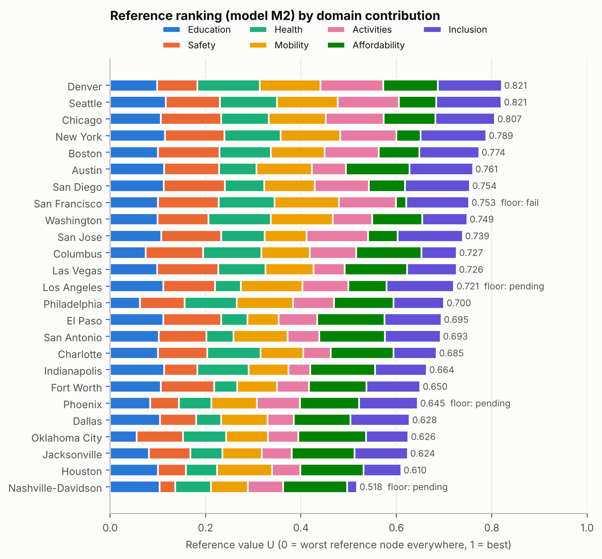
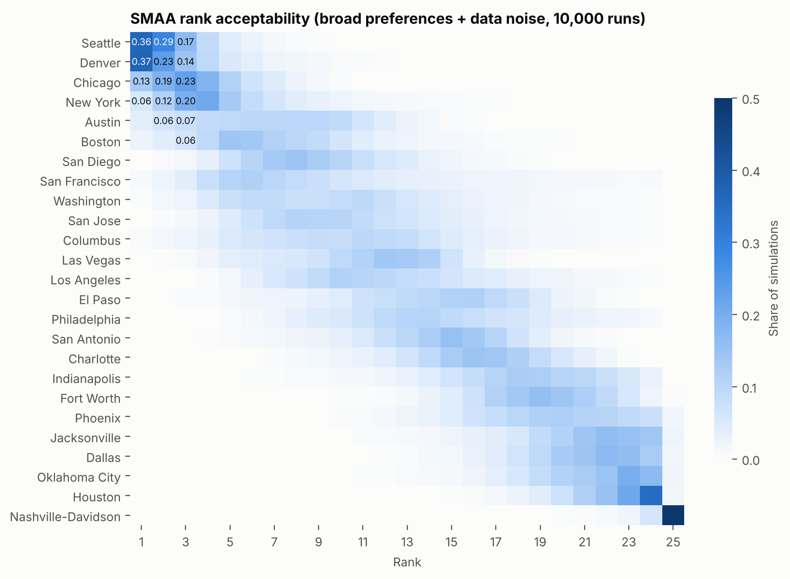
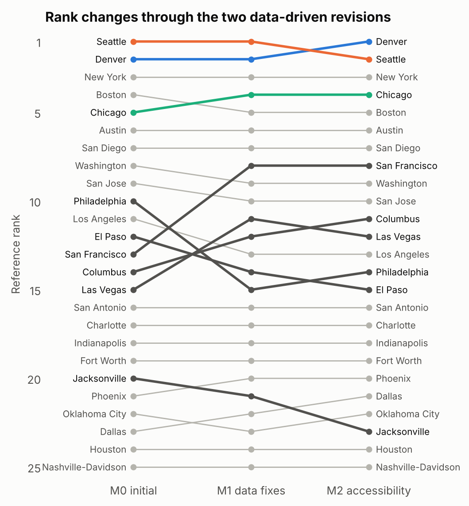
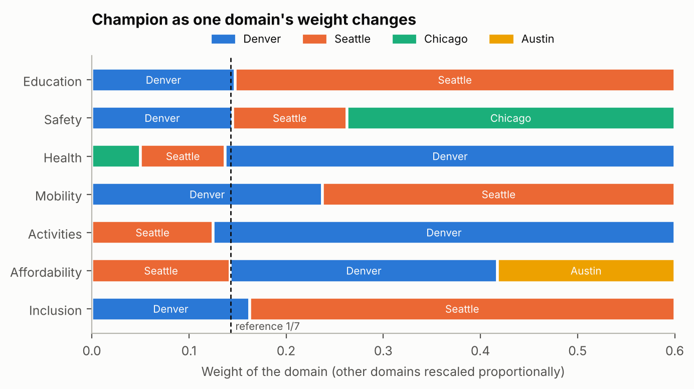
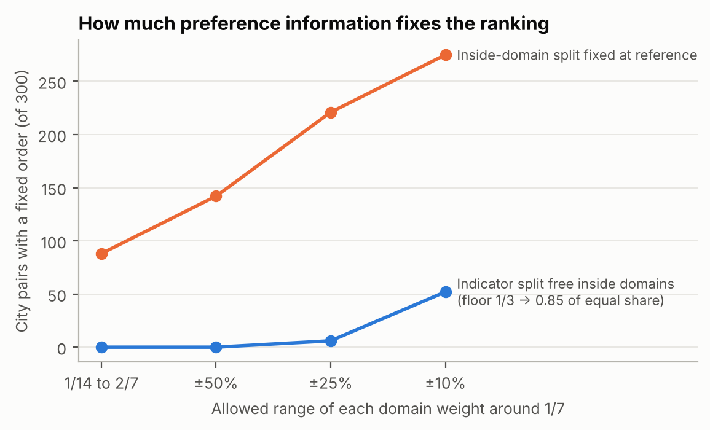
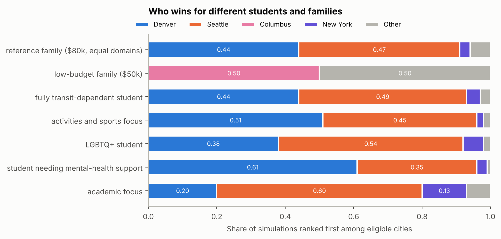
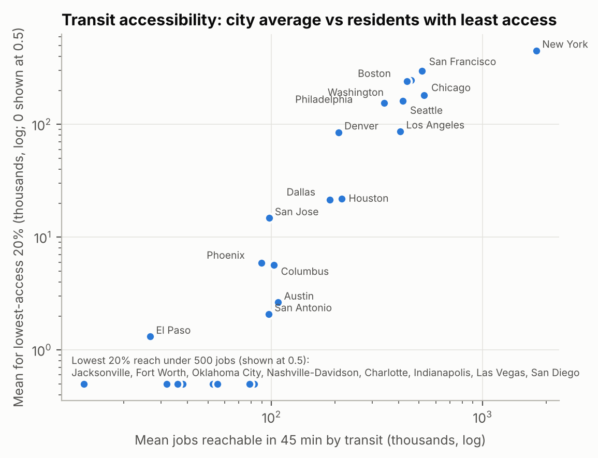

**HiMCM 2026 A 论文 · 中文讲解总版**

**全文讲解 + 分工 + 本版改动标记**

**这份文档是什么。** 全文英文原文照抄，每段后面接中文讲解（米黄色框），课程外的知识写成补充知识卡（绿色框）。讲解来自 2026-11-12 发给全组的原讲解版；论文按审计修改后，只改动受影响的讲解框，并在下面标出。四人的专用讲解都是从这份总版里切出来的，内容一致。

**标记说明（对照 2026-11-12 发给全组的原讲解版，52 页）**

| 标记 | 含义 |
|---|---|
| 本版更新 | 原讲解版就有这个讲解框，本版按修改后的论文改过；框里这种颜色的句子是改写或新加的，其余句子与原讲解版一字不差 |
| 本版新增 | 原讲解版没有这个讲解框，是本版为新增的论文内容写的 |
| 英文原文中这种颜色的句子 | 论文原文本版改过的句子；新增或改过的整行公式左侧加一条细线 |
| 无标记 | 与原讲解版完全相同 |

**分工总览**

| 组员 | 主题 | 模型部分（第 5 章） | 第 5 章之外 | 补充知识卡 | 工作量 |
|---|---|---|---|---|---|
| A | 测量与打分 | 5.1 记号；5.2 底线；5.3 分段线性价值；5.8 算例 | 第 2 章假设；第 4 章数据与测量误差；6.1 参考成绩单；6.2 底线结果；第 13 章参考文献 | K1 K2 K3 K4 K8 K10 K14 K15 | 约 30 |
| B | 偏好集合与线性规划 | 5.4 偏好集合 Θ、θ⁰、Θ_S；5.5 线性规划与可能赢家 | 第 1 章引言与定义；第 3 章指标；6.3 宽集合结果；6.4 中的四段（见“分段讲解”）；8.5 需要多少共识 | K5 K6 K7 | 约 30 |
| C | SMAA 与后悔值 | 5.6 SMAA；5.7 前半段（极小化最大后悔） | 6.4 中的表 1 与三段解读；8.3 敏感性分析；第 9 章不同学生、收入与城市内部；第 12 章新闻稿 | K9 K11 K12 K20 | 约 31 |
| D | 不可补偿规则与对照方法 | 5.7 后半段（ELECTRE III） | 摘要页；6.4 中的 ELECTRE 结果段；第 7 章两次修订；8.1 熵权法；8.2 其他加总规则；8.4 外部检验；第 10 章优缺点；第 11 章结论；AI 使用报告 | K13 K16 K17 K18 K19 | 约 31 |

**本版改动的讲解框**：全文共 130 个讲解框和知识卡，其中 69 个更新、12 个新增，其余与原讲解版相同。

| 位置 | 改动 | 讲解框开头 |
|---|---|---|
| 封面 | 更新 | 封面说明 |
| 摘要页 | 更新 | 摘要页第一段：我们的"最好"指什么。 这段给出整篇论文的定义。拆开看 |
| 摘要页 | 更新 | 指标和数据。 7 个领域、20 个指标，都来自公开数据，覆盖美国人口 |
| 摘要页 | 更新 | 结果的四个要点。 |
| 摘要页 | 更新 | 为什么不只是我们的主观看法。 这一段列了四类证据： |
| 摘要页 | 更新 | 提醒。 城市平均值会掩盖内部差别。Seattle 只有 38.5%  |
| 1.2 The task and our reading of it | 更新 | 我们对"最好"的定义。 这句话是全文的核心，后面每一个模型设计都能在 |
| 1.2 The task and our reading of it | 更新 | 定义的三个特征如何决定模型。 |
| 1.2 The task and our reading of it | 新增 | "不能依赖开车接送"到底指什么。 这段是按审计意见新加的定义：学生自 |
| 2. Assumptions | 更新 | 第 2 节 假设逐条讲。 每条假设后面都跟一个理由（Justific |
| 3.1 Seven domains and twenty measures | 更新 | 怎么读这张指标表。 每行一个指标，列依次是：所属领域（和它回答的问题 |
| 3.1 Seven domains and twenty measures | 新增 | 公交可达性数据的编码。 环保署的可达性字段在"步行范围内没有公交站" |
| 3.2 Criteria we considered and left out | 更新 | 3.2 考虑过但没用的指标。 题目要求讨论舍弃的指标。舍弃的理由归成 |
| 3.3 The candidate cities | 更新 | 3.3 候选城市。 用人口普查局对"城市"的官方边界。Indiana |
| 4.1 Sources and processing | 更新 | 4.1 数据来源和处理。 "长表"指每一行只存一个数字，并记录它属于 |
| 4.2 Measurement error | 更新 | 4.2 测量误差。 每个数据都不是绝对精确的，所以论文给每个值配一个 |
| 5.2 Step 1: floors that cannot be bought back | 更新 | 5.2 第一步：赎不回来的底线。 有些条件是"需要"，不是"偏好"： |
| 5.2 Step 1: floors that cannot be bought back | 新增 | 底线数值从哪来。 每条底线都要回答两个问题：它真的是"什么都补偿不了 |
| 5.2 Step 1: floors that cannot be bought back | 更新 | 通过、不通过、待定。 数据有误差，所以不能简单地"大于就不通过、小于 |
| 5.2 Step 1: floors that cannot be bought back | 更新 | 补充知识 K8 蒙特卡洛模拟 |
| 5.4 Step 3: the set of reasonable preferences | 更新 | 5.4 第三步：合理偏好的集合 Θ。 人们对"大学先修课和课外活动哪 |
| 5.4 Step 3: the set of reasonable preferences | 新增 | 把 Θ 写成一个式子。 这是按审计意见新加的：上面四条文字条件，用两 |
| 5.4 Step 3: the set of reasonable preferences | 更新 | 我们陈述的偏好 Θ_S。 Θ 允许的范围很宽，比如允许"可负担性权重 |
| 5.4 Step 3: the set of reasonable preferences | 新增 | θ⁰ 只是基准，不用来做决定。 这句是按审计意见新加的，回答"参考向 |
| 5.6 Step 5: how often each city wins (SMAA) | 更新 | 5.6 第五步：每个城市多常赢（SMAA）。 线性规划回答"有没有可 |
| 5.6 Step 5: how often each city wins (SMAA) | 新增 | (a) 抽一组权重：最终的 60 个数怎么拼出来。 第一个式子说，每 |
| 5.6 Step 5: how often each city wins (SMAA) | 更新 | 补充知识 K9 在"总和为 1"的约束下均匀抽样与拒绝抽样 |
| 5.6 Step 5: how often each city wins (SMAA) | 新增 | (b) 抽一套数据。 每个数据加上独立的正态误差：tilde x_{ |
| 5.6 Step 5: how often each city wins (SMAA) | 新增 | (c) 打分并排名。 用这一轮的权重和数据算 25 个总分 U_i， |
| 5.6 Step 5: how often each city wins (SMAA) | 新增 | (d) 汇总。 三个公式里的 mathbf 1[cdot] 是示性函 |
| 5.6 Step 5: how often each city wins (SMAA) | 更新 | 补充知识 K11 SMAA 的几个输出 |
| 5.6 Step 5: how often each city wins (SMAA) | 新增 | 精度。 比例的标准误不超过 sqrt{0.25/N}=0.005（推 |
| 5.7 Step 6: two cross-checks with different philosophies | 更新 | 5.7 第六步之一：极小化最大后悔。 设想一个谨慎的家庭：它不知道自 |
| 5.7 Step 6: two cross-checks with different philosophies | 更新 | 5.7 第六步之二：ELECTRE III。 加权求和允许"拿长处补 |
| 5.7 Step 6: two cross-checks with different philosophies | 更新 | 补充知识 K13 ELECTRE III |
| 5.8 Worked example: Seattle against Denver | 更新 | 5.8 算例：Seattle 对 Denver。底线。 Seattl |
| 5.8 Worked example: Seattle against Denver | 更新 | 稳健比较。 用第 5.5 节的线性规划算 U_{text{Seatt |
| 5.8 Worked example: Seattle against Denver | 更新 | 频率和谨慎。 SMAA 给出量化答案：在 Θ_S 下 Seattle |
| 6.1 The reference scorecard | 更新 | 6.1 参考成绩单。 先只用一组权重 θ⁰（等权重）给 25 个城市 |
| 6.2 Floors | 更新 | 6.2 底线结果（年收入 8 万美元）。 |
| 6.2 Floors | 更新 | 待定城市怎么处理。 待定城市留在排名里，但在数据确认之前不推荐。最后 |
| 6.2 Floors | 更新 | 补充知识 K14 多个条件同时满足的概率与 Bonferroni 下 |
| 6.3 How stable is the ranking? (all reasonable preferences) | 更新 | 6.3 在宽集合 Θ 下排名有多稳。 |
| 6.3 How stable is the ranking? (all reasonable preferences) | 更新 | 怎么读图 2。 这是 K11 讲的"排名可接受度"热力图：每个城市一 |
| 6.4 Under our stated definition: the final ranking | 更新 | 6.4 在我们的定义下：最终排名。 加上 P1–P6 后，集合从 Θ |
| 6.4 Under our stated definition: the final ranking | 更新 | 我们的偏好实际偏重什么。 讲两件事： |
| 6.4 Under our stated definition: the final ranking | 新增 | 为什么加 P6（审计后的修改）。 没有 P6 时，P1–P4 抬高教 |
| 6.4 Under our stated definition: the final ranking | 更新 | 表 1 的排序方法和置信因子。 最终排名按 Θ_S 下 SMAA 的 |
| 6.4 Under our stated definition: the final ranking | 更新 | 怎么读表 1。 各列含义： |
| 6.4 Under our stated definition: the final ranking | 更新 | 为什么其他城市落后。 |
| 6.4 Under our stated definition: the final ranking | 更新 | 逐条去掉偏好陈述的检查。 P1–P6 是我们写的，读者可能不同意其中 |
| 6.4 Under our stated definition: the final ranking | 更新 | ELECTRE III 的结果。 用参考权重时，核心（K13）是 A |
| 7. Significant Revisions to the Model | 更新 | 修订 1（M0 → M1）：修好两个测错了的指标。 |
| 7. Significant Revisions to the Model | 更新 | 补充知识 K16 斯皮尔曼等级相关系数 ρ 与 p 值 |
| 7. Significant Revisions to the Model | 更新 | 补充知识 K17 肯德尔 τ：两个排名有多一致 |
| 7. Significant Revisions to the Model | 更新 | 为什么这两次修订更有说服力。 |
| 8.1 Fixed reference points make the ranking stable when the pool changes | 更新 | 8.1 固定参考点让排名不受候选名单影响。 熵权法这类"客观"方法， |
| 8.2 Different aggregation rules, similar leaders | 更新 | 8.2 换不同的加总规则，领先者相似。 表里每一行是一种和我们不同的 |
| 8.2 Different aggregation rules, similar leaders | 更新 | 补充知识 K19 广义平均（CES）、几何平均与 Choquet 积 |
| 8.2 Different aggregation rules, similar leaders | 新增 | 表下的说明和结论。 第一句是按审计意见补的公式，把每种对照方法写清楚 |
| 8.3 Sensitivity | 更新 | 8.3 敏感性分析：权重。 把一个领域的权重从 0 逐步调大，其余六 |
| 8.3 Sensitivity | 更新 | 其余敏感性检验逐条讲。 开头一句是按审计意见加的：本节里 Θ_S 下 |
| 8.4 External checks | 更新 | 8.4 外部检验。 用模型没用过的数据来检验模型。如果模型测的东西是 |
| 8.4 External checks | 更新 | 霸凌那一项为什么不吻合。 包容领域用的是城市的反歧视政策分数（HRC |
| 8.5 How much agreement would settle the ranking? | 更新 | 8.5 需要多少共识才能定下排名？ 这里的"确定的对"就是必然偏好（ |
| 9.1 Student profiles | 更新 | 9.1 不同学生的选择。 "最好"因人而异。论文给六类学生各做一次  |
| 9.1 Student profiles | 更新 | 六类学生的结果表。 各列：学生类型、额外底线、满足底线的城市数、领先 |
| 9.2 Income changes the eligible set | 更新 | 按收入看谁领先（参考权重下）。 收入 10 万及以上，Seattle |
| 9.3 Inside the city: averages hide who is left out | 更新 | 9.3 城市内部：平均值掩盖了谁被落下。 这一节检验第 2 节的假设 |
| 9.3 Inside the city: averages hide who is left out | 更新 | 这一节的三个结论。 |
| 10. Strengths and Weaknesses | 更新 | 第 10 节 优点。 |
| 10. Strengths and Weaknesses | 更新 | 缺点，以及怎么改进。 每条缺点后面都写了"什么数据或方法能修好它"， |
| 11. Conclusion | 更新 | 第 11 节 结论，逐条对应题目要求。 |
| 11. Conclusion | 更新 | 最后一段。 Seattle 的领先在我们陈述的偏好下很明确，但在等权 |
| 12. 新闻稿 | 更新 | 新闻稿怎么用大白话讲模型。 对照论文： |
| 12. 新闻稿 | 更新 | 新闻稿的结果部分。 数字是论文结果四舍五入后的版本：75% 就是 7 |
| 12. 新闻稿 | 更新 | 新闻稿讲修订和可信度。 "我们改了两次主意"讲的是第 7 节的两次修 |
| 12. 新闻稿 | 更新 | 新闻稿的提醒和结尾。 "细则"段对应第 9.3 节：Seattle  |
| 12. 新闻稿 | 更新 | 新闻稿第二页的流程图。 四步对应论文的模型： |
| 12. 新闻稿 | 更新 | 新闻稿的表格和侧栏。 表格是论文表 1 的前 10 名（不含 San |
| 13. References | 更新 | 第 13 节 参考文献。 按在正文中第一次出现的顺序编号： |

本版更新

**HiMCM 2026 A 题论文 · 中文讲解版**

**这份文档是什么。** 这是论文的独立副本，提交用的原文件 `paper/paper.md` 没有改动（本版已同步到 2026-11-12 按审计修改后的论文）。英文原文一字未改，按原顺序排列；每段原文后面接一个**米黄色框**，用中文讲这段在说什么、为什么这么做。论文第一次用到课程外的知识时，插入一个**绿色框**（补充知识卡，编号 K1–K20），单独把这个知识点讲清楚。

**假设的数学基础。** 读者学过 A-level 数学的 P1（纯数 1）、P3（纯数 3）、S1（概率统计 1），以及 AS 进阶数学的 FP1（进阶纯数 1）和 FS1（进阶概率统计 1）。下面按 CIE 课程的内容来判断"学过"和"没学过"：

- 学过的，讲解里只简单提醒：函数与图像、求和符号 $\Sigma$、指数函数 $e^x$ 和对数、求导（斜率）、三维向量的点积、矩阵、排列组合、二项分布、正态分布和查表、期望与方差、卡方检验和 $t$ 检验的基本思路。
- 没学过的，一律写成补充知识卡：线性规划、蒙特卡洛模拟、泊松分布、等级相关系数、多准则决策方法（ELECTRE、Choquet 积分等）。

**原文目录里的页码**指原版 PDF（26 页，含 AI 报告），讲解版加了大量内容，页码对不上，以本 PDF 页眉的页码为准。

**补充知识卡索引**

| 编号 | 内容 | 第一次用到的地方 |
|---|---|---|
| K1 | 求和、向量的点积与转置记号 $\phi^\top\theta$ | 5.1 记号 |
| K2 | 集合记号 $\{\,i:\ \text{条件}\,\}$ 和 $\theta\in\Theta$ | 5.1 / 5.2 |
| K3 | 正态分布的 90% 区间与 1.645 | 5.2 |
| K4 | 截断函数 $\min(1,\max(0,\cdot))$ 与分段线性函数 | 5.3 |
| K5 | 凹函数与"边际递减" | 5.3 / 5.4 |
| K6 | 线性规划（LP） | 5.5 |
| K7 | 鲁棒序数回归：必然偏好、可能偏好、可能赢家 | 5.5 |
| K8 | 蒙特卡洛模拟 | 5.2 |
| K9 | 在"总和为 1"的约束下均匀抽样与拒绝抽样 | 5.6 |
| K10 | 标准误：估计值本身会抖多少 | 4.2 / 5.6 |
| K11 | SMAA：排名可接受度、中心权重、置信因子 | 5.6 |
| K12 | 极小化最大后悔（minimax regret） | 5.7 |
| K13 | ELECTRE III（不允许随便"拿长处补短处"的排序法） | 5.7 |
| K14 | 多个条件同时满足的概率与 Bonferroni 下界 | 6.2 |
| K15 | 泊松分布与"计数的标准差 $\sqrt n$" | 4.2 |
| K16 | 斯皮尔曼等级相关系数 $\rho$ 与 $p$ 值 | 7 |
| K17 | 肯德尔 $\tau$ | 7 |
| K18 | 熵权法与 CRITIC | 8.1 |
| K19 | 广义平均（CES）、几何平均与 Choquet 积分 | 8.2 |
| K20 | 泊松–伽马模型、过度离散检验与"收缩" | 8.3 |

**一页读懂整篇论文。** 题目问"哪个城市最适合高中生"。论文的回答分六步：

1. **定义"最好"**：家庭预算固定、学生不能靠父母开车接送；先过几道"底线"，再比谁给学生的真实机会最多；并且答案要在大家看重点不同时也站得住。
2. **测量**：25 个美国最大城市，每个城市 20 个指标，分 7 个领域（教育、安全、健康、出行、活动、可负担性、包容）。
3. **底线筛选**：房租、暴力犯罪、空气差的天数，任何一项越线就不推荐，别的优点补不回来。交通死亡仍是安全领域的指标，但不再作为底线。
4. **打分**：每个指标用一条"先陡后缓"的折线换算成 0 到 1 之间的分数，再加总。
5. **检验稳健性**：权重不是只定一组，而是允许一整个"合理权重集合"；用线性规划找出所有权重下都成立的结论，用一万次随机模拟统计每个城市夺冠的频率，再用"最大后悔"和 ELECTRE III 两种思路交叉验证。
6. **结论**：Seattle 第一（一万次模拟里 75.0% 夺冠），New York 第二，Denver 第三；Seattle 的优势主要属于住得起它好社区的家庭。

Problem Chosen: <b>A</b><b>2026 HiMCM Summary Sheet</b>Team Control Number: <b>TEAM_NUMBER</b>

<h1 class="paper-title">Floors First, Then Freedom: Ranking 25 U.S. Cities for High Schoolers Who Cannot Rely on a Car</h1>

**What makes a city great for a high schooler?** We define the best city as the one that, for a family on a fixed budget, clears basic floors on rent, violent crime and air quality, and then gives a public-school student who cannot depend on car rides the most real access to education, health support, independent travel, activities and fair treatment. The city must also keep that lead when reasonable people weigh these things differently.

本版更新 **摘要页第一段：我们的"最好"指什么。** 这段给出整篇论文的定义。拆开看有三层：

1. **先过底线**：对一个预算固定的家庭，房租、暴力犯罪、空气质量这三项必须达标。
2. **再比真实机会**：学生上公立学校、不能指望家长每天开车接送，那就看这个学生自己能用上多少教育、健康支持、独立出行、课外活动和公平对待。
3. **还要稳**：不同的人看重点不一样（有人最看重安全，有人最看重学校），排第一的城市在这些合理分歧下都应该保持领先。

后面所有的模型都是为了把这三层落实成数学。

**Criteria and data.** We built 20 measures in seven separate domains: education, safety, health, mobility, activities, affordability and inclusion. Every measure is computed from public data for the 25 most populous U.S. cities (Census Vintage 2025): CRDC and EDFacts school records, FBI and NHTSA FARS, EPA air data, SAMHSA, EPA Smart Location Database, FTA NTD, HUD, BEA and HRC. We dropped nine candidate criteria (for example weather and college rankings) and explain why (Section 3.2).

本版更新 **指标和数据。** 7 个领域、20 个指标，都来自公开数据，覆盖美国人口最多的 25 个城市（以人口普查局 2025 年估计为准）。括号里那一串缩写是数据来源：CRDC 和 EDFacts 是美国教育部的学校数据，FBI 是犯罪数据，NHTSA FARS 是交通死亡数据，EPA 是环保署的空气和城市形态数据，SAMHSA 是心理健康机构名录，FTA NTD 是公交运营数据，HUD 是住房部的租金标准，BEA 是各地物价水平，HRC 是一个评估城市反歧视政策的组织。

七个领域各回答一个问题，彼此分开计算。另外有 9 个候选指标被排除了，原因在 3.2 节。

**Model.** (1) Three non-compensable floors screen cities before any scoring. (2) Each measure is converted to value by a piecewise-linear curve with fixed, city-independent reference points. (3) Linear programs test every pair of cities over the whole set of allowed preference weights. (4) Stochastic multicriteria acceptability analysis (SMAA) repeats the ranking 10,000 times under random weights and data errors. (5) Minimax regret and ELECTRE III check a cautious decision rule and a no-weak-spot rule.

**模型五步。** 先用大白话把五个术语翻译一下，第 5 节会逐个用数学讲：

1. **不可补偿的底线**（non-compensable floors）：越线就出局，别的指标再好也"赎不回来"。
2. **分段线性曲线 + 固定参考点**：每个指标先换算成分数。换算规则是事先定好的几个数值（参考点），和这 25 个城市里谁最好谁最差无关。
3. **线性规划**：允许权重在一个范围内变，检查"城市 A 比 B 好"这个结论是否对范围内的每一组权重都成立。
4. **SMAA**（随机多准则可接受度分析）：随机抽一万组权重，同时给数据加上随机误差，每次排一次名，统计每个城市拿第一的比例。
5. **极小化最大后悔**和 **ELECTRE III**：前者站在"最怕选错"的家庭角度；后者不允许一个指标特别差的城市靠别的指标把分数补回来。两者都用来交叉检验。

**Results.** Seattle is our Best City for a High Schooler.

- Under the preferences stated in our definition, Seattle ranks first in **75.0%** of 10,000 simulations and in the top three in **99.1%**.
- It has the smallest worst-case regret (**0.151** on a 0–1 value scale) and passes all three floors.
- New York is second (first in 14.0% of simulations) and Denver third (7.8%), although Denver narrowly leads on equal domain weights (0.8210 against 0.8205).
- Among cities that pass the floors, the top five are Seattle, New York, Denver, Boston and Austin. San Francisco would place fourth but fails the rent floor for an $80,000 family (rent takes 50.4% of income).

本版更新 **结果的四个要点。**

- **"在我们陈述的偏好下"**指第 5.4 节的偏好集合 $\Theta_S$：我们根据定义，额外写下了六条偏好（比如"教育的权重不低于可负担性""安全的权重不低于 1/7"），只在满足这六条的权重里抽样。在这一万次模拟里，Seattle 75.0% 的次数排第一，99.1% 的次数进前三。
- **最大后悔 0.151**：不管真实偏好是哪一组权重，选 Seattle 最多比"当时的最佳城市"少 0.151 分（满分 1）。这是 25 个城市里最小的，详见 K12。
- **Denver 和 Seattle 几乎打平**：如果每个领域权重都是 1/7，Denver 0.8210，Seattle 0.8205，只差 0.0005。所以"Seattle 第一"的依据是它在大多数合理权重下都赢，等权重这一组只是其中一个点。New York 第二（14.0% 夺冠），Denver 第三（7.8%）。
- **San Francisco**：平均名次能排第四，但 8 万美元年收入的家庭付两居室房租要花掉 50.4% 的收入，超过 50% 的底线，所以不进入排名。

**Significant revisions.** Auditing real data changed our model twice.

**重要修订。** 题目要求至少记录一次模型修订。我们的两次修订都来自检查原始数据时发现的问题，第 7 节详细讲。

- M0→M1: a transit-frequency measure was blank for 96% of San Diego's residents, and one adult charter school pulled San Francisco's graduation rate to 56%. Fixing both moved San Francisco from 13th to 8th.
- M1→M2: we replaced transit service hours with jobs reachable within 45 minutes by scheduled transit, so we measure what a student can actually reach.

**两次修订的大意。**

- **M0 → M1**：第一版模型（M0）用的"公交发车频率"字段，在 San Diego 有 96% 的居民所在地区是空白（缺失编码），会被误当成"没有公交"。另外 San Francisco 有一所面向成年人的特许学校，把全市毕业率拉低到 56%。修好这两处后，San Francisco 从第 13 名升到第 8 名。
- **M1 → M2**：把"公交服务小时数"（运了多少车）换成"45 分钟内坐公交能到达的工作岗位数"（学生实际能到达多少地方）。后者更接近定义里的"真实机会"。

**Why it is more than our opinion.** Reference points are fixed, so removing any city reverses **0** pairs of other cities (an entropy-weight ranking reverses 106). At equal weights Denver and Seattle stay the two leaders with data noise up to four times its size and ±10% node shifts. Under our stated preferences Seattle stays first with node shifts (73%), with data noise quadrupled (36%), under low-substitution aggregation (84%) and without any single preference statement (62–75%). School-age survey outcomes agree with our domain scores: skipping school for fear of being unsafe rises with violent crime (ρ = +0.62), and sadness or hopelessness correlates with our health domain (ρ = −0.76).

本版更新 **为什么不只是我们的主观看法。** 这一段列了四类证据：

1. **换掉候选城市不影响别人的相对顺序**：参考点是固定的绝对数值，删掉任何一个城市，其余城市参考分数之间的先后关系一对都不变（0 对逆转）。对照组"熵权法"会逆转 106 对（熵权法见 K18）。
2. **等权重下的扰动**：把数据误差放大到 4 倍、参考点随机移动 ±10%，领先的始终是 Denver 和 Seattle 两个。
3. **在我们陈述的偏好下 Seattle 仍第一**：参考点移动时 73% 夺冠；数据误差放大 4 倍时 36%；用"长处很难弥补短处"的加总方式时 84%；随便去掉一条偏好陈述，仍有 62%–75%。
4. **和模型没用过的外部数据对得上**：青少年问卷里"因为觉得不安全而逃学"的比例和暴力犯罪率同向变化，$\rho=+0.62$；"感到悲伤或绝望"和我们的健康领域分数反向变化，$\rho=-0.76$。$\rho$ 是斯皮尔曼等级相关系数，范围 −1 到 1，绝对值越大说明两组排名越一致，见 K16。

**Caveat.** Seattle's lead belongs to families who can afford its neighborhoods. Only 38.5% of its residents live in census tracts that are affordable on $80,000 and well served by transit. For a $50,000 family Chicago leads at equal weights and Columbus when cost counts double.

本版更新 **提醒。** 城市平均值会掩盖内部差别。Seattle 只有 38.5% 的居民住在"8 万美元家庭付得起房租、并且公交能到很多地方"的普查区里。换句话说，Seattle 的优势主要属于住得起它中心社区的家庭。年收入 5 万美元的家庭：领域等权重时 Chicago 领先；把"花费"的权重加倍时 Columbus 领先。

<b>Keywords:</b> piecewise-linear value model; robust ordinal regression; linear programming; SMAA; minimax regret; ELECTRE III; transit accessibility

**关键词。** 分段线性价值模型；鲁棒序数回归；线性规划；SMAA；极小化最大后悔；ELECTRE III；公交可达性。每个词在第 5 节都有对应的步骤和补充知识卡。

# Contents

1. Introduction2

2. Assumptions3

3. Criteria: What We Measure and What We Leave Out3

4. Data6

5. The Model7

6. Results: The Ranking11

7. Significant Revisions to the Model14

8. Why the Ranking Is More Than Our Opinion15

9. Who Should Choose Which City18

10. Strengths and Weaknesses20

11. Conclusion21

12. News Article: The Best City for a High Schooler22

13. References24

Report on Use of AI Tools (not counted toward the 25 pages)26

**目录。** 正文 11 节，加上新闻稿（第 12 节）、参考文献（第 13 节）和 AI 使用报告（不计入 25 页限制）。这里的页码是原版 PDF 的页码。

# 1. Introduction

## 1.1 Background

More than 15 million students attend U.S. public high schools. Most city rankings are written for adults: they weigh job markets, nightlife and home prices. A high schooler's life runs on different things: whether the nearest public school offers advanced courses, whether a bus can get her to practice and back after school, whether a counselor or a clinic will see a 16-year-old, and whether she is treated fairly. A teenager usually cannot drive and cannot choose the family budget, so the city's value to her depends on what she can reach and afford without an adult's car.

**1.1 背景。** 一般的城市排行榜是给成年人看的，看工作、夜生活、房价。高中生关心的是另一套东西：附近的公立学校有没有大学先修课，放学后能不能自己坐公交去训练再回家，有心理问题时有没有辅导员或诊所愿意接待一个 16 岁的孩子，在学校会不会被公平对待。青少年一般不能开车，也决定不了家里的预算，所以一个城市对他的价值，取决于他不靠大人开车能到达什么、家里能负担什么。

## 1.2 The task and our reading of it

1. Choose and justify criteria for a "best city for a high schooler", and discuss criteria left out.
2. Gather and cite data, apply the model, and discuss limitations.
3. Rank at least ten cities and reach a reasoned conclusion about the best one, under our own definition.
4. Show why the ranking has merit beyond opinion, and document at least one significant revision.
5. Write a one-to-two-page non-technical news article that includes our modeling process.

**1.2 题目要求。** 这五条是对题目的复述：

1. 选择并论证评价指标，也要讨论没选的指标；
2. 收集并引用数据，应用模型，讨论局限；
3. 至少排 10 个城市，按我们自己的定义得出"最好的城市"；
4. 说明排名不只是个人意见，并记录至少一次重要修订；
5. 写一篇 1–2 页、面向普通读者的新闻稿，要介绍建模过程。

**Our definition of "best".** *The best city is the one that, for a family on a fixed budget, clears basic floors on cost and serious risk, and then gives a public-school student who cannot depend on car rides the most real access to education, health support, independent travel, activities and fair treatment — and keeps that lead across reasonable disagreements about what matters most.*

本版更新 **我们对"最好"的定义。** 这句话是全文的核心，后面每一个模型设计都能在这句话里找到出处：

- "预算固定的家庭"对应第 2 节的假设 3（年收入 8 万美元）。
- "先过成本和严重风险的底线"对应第 5.2 节的三道底线（房租、暴力犯罪、空气）。
- "公立学校学生、不能依赖开车接送"对应出行领域和"公交可达"指标。
- "在合理分歧下保持领先"对应第 5.4–5.6 节的权重集合、线性规划和随机模拟。

Three features of this definition shape the model. **Floors** come before trade-offs: no number of after-school programs should make up for a violent-crime rate above 1,200 per 100,000. **Real access** means measuring what a student can use (enrollments in advanced courses, jobs reachable by transit in 45 minutes), not how many buildings exist. **Robustness** means the answer must hold over a whole set of reasonable weightings, not a single set we chose.

本版更新 **定义的三个特征如何决定模型。**

- **底线在先**：课外活动再多，也抵消不了超过底线的暴力犯罪率。数学上，底线检查放在加权求和之前单独做。（原来的例子是"便宜的房租买不回危险的街道"，但现实中确实有家庭为了房租住在不安全的地方，所以按审计意见换成了论文实际用到的指标。）
- **真实可用**：测量学生实际能用的东西，例如大学先修课的选课人次、45 分钟公交能到的工作岗位数，而不是数城市里有几栋楼、几所学校。
- **稳健**：结论要在一整组合理权重下成立，而不是只在我们挑的一组权重下成立。

**"Cannot depend on car rides."** The student does not drive and has no adult who can drive her to school, practice or work every day, so daily trips are made on foot, by bike or by transit. This describes many teenagers: in the 2022 National Household Travel Survey, half of all trips by 14–18-year-olds were as a passenger in someone else's car, and only half of 16–17-year-olds were drivers [26]. A city that works for such a student also works for one who sometimes gets a ride.

本版新增 **"不能依赖开车接送"到底指什么。** 这段是按审计意见新加的定义：学生自己不开车，也没有大人能**每天**开车送他去学校、训练或打工，所以日常出行靠步行、自行车或公交。

数据支持来自美国交通部的全国家庭出行调查（NHTS 2022）。按调查权重算：14–18 岁青少年的出行里，49.8% 是坐别人开的私家车，24.3% 是自己开车，26.0% 是步行、骑车或坐公交；16–17 岁的人里只有 50.0% 是驾驶者，14–15 岁只有 3.4%。也就是说，一半的出行要靠别人开车，"没人接送时城市还能给学生什么"是个真实问题。

最后一句的意思：一个城市对"完全靠自己出行"的学生都好用，对偶尔有人接送的学生只会更好用，所以这个假设不会让结论偏向某类家庭。计算脚本：`analysis/model/run_nhts_teen_mode.py`。

## 1.3 Our approach

<b>Measure</b> 25 cities × 20 measures in 7 domains, with error estimates

→

<b>Floors</b> rent, violent crime, air: pass / pending / fail

→

<b>Value</b> piecewise-linear curves on fixed reference points

→

<b>Robustness</b> LP over all weights; SMAA; regret; ELECTRE III

→

<b>Audit &amp; revise</b> M0 → M1 → M2 from real-data findings

**1.3 流程图。** 五个方框从左到右：测量（25 城 × 20 指标，带误差估计）→ 底线（通过 / 待定 / 不通过）→ 价值（分段线性曲线、固定参考点）→ 稳健性（线性规划、SMAA、后悔值、ELECTRE III）→ 审计与修订（M0 → M1 → M2）。

The candidate pool is fixed before any score is computed: the 25 most populous U.S. cities in the Census Vintage 2025 estimates [1]. Every number in this paper is reproduced by our code from archived source files.

**候选城市先定死。** 25 个城市按人口普查局的人口排名确定，在算任何分数之前就固定下来。这样做是为了防止"为了让某个城市赢而挑选候选名单"。论文里的每个数字都能由代码从存档的原始文件重新算出来。

# 2. Assumptions

1. **The student attends a public high school and cannot rely on daily car rides.** *Justification:* most U.S. high schoolers attend public schools, and many teenagers do not drive; the problem asks about high schoolers, not families with cars.
2. **City-wide statistics describe the conditions a typical resident student meets.** *Justification:* consistent neighborhood data are not available for all measures in 25 cities. We test this assumption with census-tract data in Section 9.3.
3. **The reference family earns $80,000 a year and rents a two-bedroom home.** *Justification:* this is close to the U.S. median household income; we scan $50,000–$120,000 in Section 9.2.
4. **Recent multi-year averages represent current conditions.** *Justification:* we use 2021–2025 data and average several years where single years are noisy (crime 2022–2025, Chicago 2021; traffic and air 2021–2024).
5. **Once floors are met, a better result in one measure can partly make up for a worse one in another.** *Justification:* this is the usual way families trade off. We test it against a non-compensatory method (ELECTRE III) and against low-substitution aggregation (Section 8.2).
6. **Missing values are not zero.** *Justification:* a missing report is not evidence of no service. Two of 500 cells are missing; we show each city's rank with the missing value set to the worst and to the best node.

本版更新 **第 2 节 假设逐条讲。** 每条假设后面都跟一个理由（Justification），这是 HiMCM 论文的标准写法。

1. **学生上公立高中，不能指望每天有人开车接送。** 理由：美国大多数高中生上公立学校，很多青少年不开车。题目问的是高中生，而不是有车的家庭。
2. **全市统计值能代表一个普通在读学生遇到的情况。** 理由：25 个城市没有统一的社区级数据。这个假设第 9.3 节会用普查区数据检验，结果发现它在 Seattle 不太成立。
3. **参考家庭年收入 8 万美元，租两居室。** 理由：接近美国家庭收入中位数。第 9.2 节把收入从 5 万扫到 12 万，看结论怎么变。
4. **最近几年的平均值能代表现在的情况。** 理由：单一年份波动大，所以犯罪用 2022–2025 四年平均（Chicago 例外，用 2021 年，原因见 4.1），交通和空气用 2021–2024 四年平均。
5. **过了底线以后，一个指标好可以部分弥补另一个指标差。** 这就是"加权求和"的含义：总分 = 各项分数按权重加起来，A 项多 0.1 分可以抵消 B 项少 0.1 分。理由：家庭做选择时通常就是这样权衡的。第 8.2 节用"不允许补偿"的方法（ELECTRE III、低替代的 CES）做对照。
6. **缺失值不等于零。** 没报数据不代表没有这项服务。500 个格子（25 城 × 20 指标）里缺 2 个；第 4.3 节给出把缺失值设成最差和最好时的排名范围。

# 3. Criteria: What We Measure and What We Leave Out

## 3.1 Seven domains and twenty measures

We began from the needs of a 14–18-year-old rather than from available data. Each domain answers one question, and the domains stay separate even when their measures are correlated. Each measure has four fixed reference points ("nodes"): the worst node is worth 0 and the best node earns the full value of that measure. Node values come from standards where they exist (for example the 250-students-per-counselor recommendation [16] and HUD's 30% and 50% rent-burden lines [12]) and otherwise from round values that span realistic U.S. conditions. They were fixed before any city was scored.

**3.1 七个领域、二十个指标。** 这段讲三件事：

1. **从需求出发**：先想 14–18 岁的学生需要什么，再去找数据，而不是有什么数据就用什么。
2. **领域分开**：每个领域回答一个问题。即使两个领域的指标相关，也不合并。
3. **每个指标有 4 个固定参考点（节点 nodes）**：最差节点记 0 分，最好节点拿满这个指标的分。节点数值尽量来自权威标准（比如美国学校辅导员协会建议每 250 名学生配 1 名辅导员；住房部把房租超过收入 30% 定为"负担重"、超过 50% 定为"严重负担"），没有标准的就取覆盖美国现实范围的整数。节点在给任何城市打分之前就定好了。

| Domain (question) | Measure | Better | Nodes (worst → best) | Source |
|---|---|---|---|---|
| **Education** — what can a student learn? | AP, IB and dual-enrollment course enrollments per 100 students | ↑ | 10 / 25 / 40 / 55 | CRDC 2023–24 [3] |
| | Four-year graduation rate, non-charter schools (%) | ↑ | 60 / 75 / 85 / 95 | EDFacts 2020–21 [4] |
| | School counselors per 1,000 students | ↑ | 2 / 3 / 4 / 6 | CRDC 2023–24 [3] |
| **Safety** — how likely is serious harm? | Violent crimes per 100,000 residents (2022–25) | ↓ | 1200 / 900 / 600 / 300 | FBI CDE [5] |
| | Traffic deaths per 100,000 residents (2021–24) | ↓ | 20 / 14 / 8 / 2 | NHTSA FARS [6] |
| **Health** — can a student stay well? | Days with AQI above 100 (% of days, 2021–24) | ↓ | 30 / 15 / 5 / 0 | EPA AirData [7] |
| | School nurses, psychologists, social workers per 1,000 students | ↑ | 0.5 / 2 / 4 / 8 | CRDC 2023–24 [3] |
| | Youth mental-health facilities per 100,000 residents under 18 | ↑ | 2 / 6 / 12 / 20 | SAMHSA 2025 [8] |
| **Mobility** — can a student get around alone? | Jobs reachable in 45 min by transit and walking (thousands) | ↑ | 10 / 60 / 200 / 600 | EPA SLD v3 [9] |
| | National Walkability Index (1–20) | ↑ | 5.75 / 10.5 / 15.25 / 20 | EPA SLD v3 [9] |
| | Student fare for one local ride (USD) | ↓ | 2 / 1 / 0.5 / 0 | operator fare pages [10] |
| | Weekend service as a share of weekday service | ↑ | 0.3 / 0.5 / 0.7 / 0.9 | FTA NTD 2022–25 [11] |
| **Activities** — what can a student do after school? | Residents within a 10-minute walk of a park (%) | ↑ | 30 / 55 / 80 / 100 | TPL ParkScore 2026 [13] |
| | Teen library program attendance per 1,000 residents of the library's service area | ↑ | 0 / 10 / 25 / 50 | IMLS FY2023–24 [14] |
| | School sports participations per 100 students | ↑ | 10 / 20 / 35 / 50 | CRDC 2023–24 [3] |
| | Minimum wage for ages 16–17, divided by BEA all-items price parity (USD/h) | ↑ | 6.5 / 10 / 14 / 18 | DOL, state laws [15]; BEA [2] |
| **Affordability** — can the family pay? | Two-bedroom Fair Market Rent as % of $80,000 income | ↓ | 50 / 40 / 30 / 15 | HUD FY2024 [12] |
| | Prices of goods and other services (U.S. = 100) | ↓ | 110 / 105 / 100 / 95 | BEA RPP 2024 [2] |
| **Inclusion** — is the student treated fairly? | City non-discrimination laws and municipal services (% of HRC MEI parts I and III, 42 points) | ↑ | 25 / 50 / 75 / 100 | HRC MEI 2025 [17] |
| | Students suspended out of school per 100 | ↓ | 16 / 10 / 5 / 0 | CRDC 2023–24 [3] |

本版更新 **怎么读这张指标表。** 每行一个指标，列依次是：所属领域（和它回答的问题）、指标、方向（↑ 越大越好，↓ 越小越好）、四个节点（从最差到最好）、数据来源。几个容易看不懂的指标：

- **AP、IB、双学分课程**：AP 是大学先修课，IB 是国际文凭课程，双学分（dual enrollment）是高中生在读期间修大学课程、同时拿高中和大学学分。"每 100 名学生的选课人次"是把这三类课的选课人次加起来除以学生数再乘 100；一个学生选两门算两次，所以这个数可以超过 50。
- **非特许学校的四年毕业率**：特许学校（charter school）由政府出钱、独立运营，一般靠申请或抽签入学，而不是按住址划片。原因见第 7 节修订 1。
- **违法犯罪、交通死亡"每 10 万居民"**：用人数除以人口再乘 100,000，便于不同大小的城市比较。
- **AQI 超过 100 的天数占比**：AQI 是空气质量指数，超过 100 表示对敏感人群不健康。
- **45 分钟公交可达的工作岗位数（千个）**：从居民所在地出发，步行加按时刻表乘公交，45 分钟内能到达的地方一共有多少工作岗位。岗位数代表"能到达的目的地有多少"（商店、图书馆、工作地点等都有岗位）。
- **步行指数（1–20）**：美国环保署算的街区适合步行程度。注意它的四个节点 5.75 / 10.5 / 15.25 / 20 是等间距的。
- **周末服务 / 工作日服务**：周末公交服务量是工作日的几成，0.9 表示周末几乎和平时一样多。
- **按当地物价调整后的 16–17 岁最低工资**：名义最低工资除以 BEA 的全部商品价格平价（含住房，全国 = 100），换成"在全国平均物价下值多少钱"。第 8.3 节试过改用不含住房的价格。
- **图书馆青少年活动参与人次**：分母是图书馆系统服务区的人口（不一定等于城市人口），取 FY2023、FY2024 两年平均。
- **两居室公平市场租金占 8 万收入的百分比**：公平市场租金（Fair Market Rent）是住房部公布的当地标准租金，大约是当地普通质量出租房租金的第 40 百分位。
- **商品和其他服务的价格（全国 = 100）**：BEA 的地区价格水平，去掉了住房部分（因为房租已经单独算了）。
- **HRC 得分**：一个人权组织给城市打的"市政平等指数"。我们只用其中第一部分（反歧视法律，30 分）和第三部分（市政服务，12 分），共 42 分，换算成百分比。

节点的例子：辅导员的节点 2 / 3 / 4 / 6（每千名学生）中，"4 人/千人"正好对应"每 250 名学生 1 人"；房租的节点 50 / 40 / 30 / 15 中，50% 和 30% 正好是住房部的两条线。

**Avoiding double counting.** Counselors appear only in education; nurses, psychologists and social workers only in health. Housing is excluded from the BEA price measure because rent is measured directly. Transit service and transit access are not both scored: in M2 the access measure already contains the service it uses (Section 7).

**避免重复计算。** 同一个东西不能在两个地方各算一次分，否则它等于被加了双倍权重：

- 辅导员只算在教育领域；护士、心理学家、社工只算在健康领域。
- BEA 价格指标去掉住房，因为房租单独测了。
- 公交"服务量"和公交"可达性"不同时计分：M2 的可达性已经用到了时刻表里的服务（第 7 节）。

**Transit access data.** The access field is coded −99999 where no transit stop lies within walking distance; we count these residents as reaching 0 jobs. Unlike the frequency field of Revision 1, this code is reliable: in every city the share of residents coded −99999 equals the share with no stop within walking distance. The field uses 2020 timetables and 2017 job locations.

本版新增 **公交可达性数据的编码。** 环保署的可达性字段在"步行范围内没有公交站"的街区组里填 −99999。我们把这些居民记为"坐公交能到 0 个岗位"。

为什么这里可以这样处理，而第 7 节修订 1 的"发车频率"字段不行？因为验证过：在每个城市里，可达性字段为 −99999 的人口比例，**正好等于**步行范围内没有车站的人口比例（最高是 Oklahoma City 的 41.6%）。所以 −99999 在这里确实表示"没有公交"，而频率字段的 −99999 表示"缺时刻表数据"（San Diego 有车站却被标成 −99999）。最后一句说明数据年份：2020 年的时刻表、2017 年的就业分布，第 10 节把它列为缺点。

## 3.2 Criteria we considered and left out

| Criterion | Reason left out |
|---|---|
| Weather and climate | A matter of taste, not of opportunity; it belongs in a personal profile, not in the definition of "best" |
| College and university rankings | A nearby top university does not make it easier for local students to get in. Public universities favor residents of the state and the top students of every high school in it (UT Austin admits the top 6% of each Texas high school; UC guarantees a place to the top 9% of each California high school), so every city in a state gets the same advantage; private universities admit nationally. What a city adds before graduation, college courses taken in high school, is measured by dual enrollment |
| Test scores (SEDA) | Cover grades 3–8, not high school; state high-school tests differ by state and cannot be compared across our cities |
| Nightlife, restaurants, job growth | Weakly related to ages 14–18 |
| Teen employment rate | Mixes opportunity with need: a high rate can mean students must work |
| Racial and ethnic diversity | Describes who lives there, not how students are treated; kept as background only |
| Walk Score, AllTransit | Measure the same things as our EPA walkability and transit-access measures; scoring both would count the same thing twice |
| Youth survey outcomes (YRBS) | Available for only 12 of 25 cities; used to validate the model instead (Section 8.4) |
| Adult health outcomes (CDC PLACES) | Measures adults; teenagers' needs differ |

本版更新 **3.2 考虑过但没用的指标。** 题目要求讨论舍弃的指标。舍弃的理由归成几类：

- **属于个人口味**：天气。喜欢冷还是热因人而异，放进个人偏好，而不是"最好"的定义。
- **测的不是高中生**：夜生活和就业增长、成年人健康数据。
- **大学排名**：附近有好大学，不等于本地高中生更容易进去。公立大学确实偏向本地学生，但按"州"和"每所高中"给优惠：UT Austin 自动录取得州**每一所**高中排名前 6% 的学生，UC 保证加州**每一所**高中前 9% 的学生能进某个 UC 校区。所以同一个州里的城市待遇相同（我们有 6 个得州城市、4 个加州城市）；私立大学面向全国招生。城市本身在高中阶段能多给的，是在高中修大学课程的机会，已经由双学分课程指标衡量。
- **含义不清**：青少年就业率高，可能是机会多，也可能是家里需要孩子打工。
- **描述而非对待**：种族多样性说明谁住在这里，不说明学生是否被公平对待，只当背景资料。
- **不可比或重复**：SEDA 考试成绩只覆盖 3–8 年级；高中阶段各州考试不同，城市之间不能比较。Walk Score 和 AllTransit 测的东西和我们的步行指数、公交可达性相同，再加就重复计分了。（原文曾以"许可证、付费"为理由，按审计意见换成了实质理由。）青少年问卷（YRBS）只有 12 个城市有，改用来做外部验证（第 8.4 节）。

## 3.3 The candidate cities

The pool is the 25 most populous cities in the Census Vintage 2025 estimates [1], with each city as the Census defines it. Indianapolis and Nashville share their governments with their counties; for them the Census ranks the "balance", the merged city-county minus the small towns inside it that keep their own governments (for example Belle Meade in Nashville), and we use the same area for every measure. The list was frozen before any data were scored, so no city was added or dropped to favor a result.

本版更新 **3.3 候选城市。** 用人口普查局对"城市"的官方边界。Indianapolis 和 Nashville 是市县合并的城市：城市和县合用一个政府，但县里还有一些保留自己政府的小镇。普查局的城市人口排名用"balance"，就是合并辖区扣掉这些小镇后剩下的部分。例如 Nashville 合并辖区 745,904 人，balance 721,074 人，扣掉的是 Belle Meade、Berry Hill、Forest Hills、Oak Hill 等；Indianapolis 合并辖区 910,638 人，balance 901,116 人。我们所有指标（人口、学校、街区组）都用同一个 balance 边界，口径一致。名单在打分前冻结，没有为了结果增删城市。

# 4. Data

## 4.1 Sources and processing

We assembled a long table of 157,256 records (121,160 numeric values) from 28 public sources. It covers multiple years, geographic levels (school, police agency, county, metro area, transit operator) and sources [1]–[17]. From it we computed the 25 × 20 matrix used by the model. The main processing rules:

- **School measures** sum all high-school-offering schools located inside each city boundary (2,264 schools in CRDC 2023–24) and divide by their enrollment. Negative CRDC reserve codes are treated as missing, never as zero.
- **Rates** use Census city population, except where the police agency covers a larger area (Charlotte-Mecklenburg, Las Vegas Metropolitan and Metro Nashville), where we use the FBI agency population.
- **Chicago's violent crime.** The FBI series counts about 3,400 aggravated assaults a year in Chicago, against 15,606 aggravated assaults and batteries in the police department's 2021 report: aggravated battery is missing. We use the department's 2021 total (25,979, or 960 per 100,000) and keep the FBI series' relative error.
- **Fares** are the price of one local ride for an eligible student; Dallas and Indianapolis sell only 3-hour and 2-hour passes, whose prices we use.
- **Located measures**: traffic deaths are counted where the crash occurred and mental-health facilities by their postal city (no capacity data). Park access is county-scale for Charlotte and Nashville and rounded to whole percents (standard deviation 0.3).
- **Area measures** (air quality, rent) are weighted by the share of the city's residents in each county.
- **Neighborhood measures** (walkability, transit access) are population-weighted means over the census block groups inside each city (22,398 populated block groups).

本版更新 **4.1 数据来源和处理。** "长表"指每一行只存一个数字，并记录它属于哪个城市、哪一年、哪个地理层级、来自哪个数据源。15.7 万条记录覆盖学校、警察局辖区、县、都市区、公交运营商等不同层级，最后汇总成模型用的 25 × 20 矩阵（25 行城市、20 列指标）。四条处理规则：

- **学校指标**：把位于城市边界内、开设高中年级的所有学校（共 2,264 所）的数量加总，再除以这些学校的学生总数。CRDC 用负数编码表示"不适用"或"保密"，这些一律当缺失，而不是当 0。
- **比率**：分母一般用城市人口。三个城市的警察局管辖范围比城市大（Charlotte-Mecklenburg、Las Vegas 都市警察局、Metro Nashville），分母改用警察局辖区人口，分子分母才对得上。
- **Chicago 的暴力犯罪**：FBI 数据里 Chicago 每年只有约 3,400 起"加重伤害"，而芝加哥警察局 2021 年报告里"加重伤害和加重殴打"有 15,606 起，差的是加重殴打（aggravated battery）这一类。所以改用警察局 2021 年的总数 25,979 起，即每 10 万人 960 起；误差按 FBI 序列的相对误差保留。这一改动让 Chicago 从第 4 名降到第 7 名（第 6.4 节）。
- **票价**：符合条件的学生坐一次本地公交的价格；Dallas 和 Indianapolis 只卖 3 小时、2 小时通票，就用通票价格。
- **按地点计的指标**：交通死亡按事故发生地计；心理健康机构按邮政地址所在城市计，不考虑接待能力；公园可达性在 Charlotte 和 Nashville 是县级数据，原数据取整到百分比，所以标准差记为 0.3。
- **按县的数据**（空气、房租）：城市跨几个县时，按城市居民在各县的比例加权平均。例如 70% 居民在 A 县、30% 在 B 县，城市值 = 0.7 × A 县值 + 0.3 × B 县值。
- **社区指标**（步行指数、公交可达）：在城市内 22,398 个有人居住的"普查街区组"（block group，人口普查最小的统计单元之一，一般几百到几千人）上做人口加权平均：
$$\bar x=\frac{\sum_g p_g x_g}{\sum_g p_g},$$
其中 $p_g$ 是街区组 $g$ 的人口，$x_g$ 是该街区组的指标值。人多的街区占的分量大。

## 4.2 Measurement error

Every value carries a standard deviation used in the uncertainty analysis:

- **Multi-year measures** (crime, traffic, air): the standard error of the annual mean.
- **School measures**: the difference between the two CRDC waves (2021–22 and 2023–24) divided by √2, the sample standard deviation of two values.
- **Graduation rates** published as ranges: the range width converted to a 90% interval. Chicago and Seattle report no school-level rates for this cohort, so we use their official district rates (Illinois Report Card, Washington OSPI) and treat them as exact. Other cities use cohort-weighted school rates.
- **Counts** (youth mental-health facilities): the Poisson standard deviation √n.

本版更新 **4.2 测量误差。** 每个数据都不是绝对精确的，所以论文给每个值配一个标准差 $s$，表示"这个值大概会差多少"。后面的随机模拟会按这个标准差给数据加噪声。四种来源，各用一种方法：

- **多年平均的指标**（犯罪、交通、空气）：用"年均值的标准误"。如果有 $n$ 年数据，每年的值的标准差是 $\sigma$，那么平均值的标准差是 $\sigma/\sqrt n$。为什么要除以 $\sqrt n$，见下面 K10。
- **学校指标**：CRDC 有 2021–22 和 2023–24 两期。取新的一期作为数值，用两期的差估计误差。两个数 $a,b$ 的样本标准差（分母 $n-1$）恰好是 $|a-b|/\sqrt2$。推导：平均数 $m=(a+b)/2$，两个偏差都是 $\pm(a-b)/2$，平方和 $=2\cdot\frac{(a-b)^2}{4}=\frac{(a-b)^2}{2}$，除以 $n-1=1$ 再开方得 $|a-b|/\sqrt2$。
- **以区间公布的毕业率**：小学校为保护隐私只公布区间（比如 80–84%）。取区间中点作为数值，把区间当成 90% 区间，标准差 $=$ 区间宽度 $/(2\times1.645)$。1.645 的来历见 K3。Chicago 和 Seattle 没有这一届的学校级数据，改用州政府公布的全学区毕业率，当作精确值；其他城市按毕业队列人数加权平均各校的毕业率。
- **计数**（青少年心理健康机构数）：数到 $n$ 个，标准差取 $\sqrt n$。这是泊松分布的性质，见 K15。

有 7 个指标当作精确值、标准差为 0：房租（住房部标准）、价格平价、学生票价、青少年工资、HRC 分数、步行指数、公交可达性。前几项是官方公布的标准或法规，后两项是环保署的模型计算值。各城市、各指标的误差**相互独立**；第 8.3 节检验过"同一领域的误差同向"的情况。

**补充知识 K10　标准误：估计值本身会抖多少**

S1 学过：如果 $X_1,\dots,X_n$ 相互独立，每个的方差都是 $\sigma^2$，那么

$$\operatorname{Var}(X_1+\dots+X_n)=n\sigma^2 .$$

平均数 $\bar X=\frac1n(X_1+\dots+X_n)$ 的方差就是 $\frac1{n^2}\cdot n\sigma^2=\frac{\sigma^2}{n}$，标准差是 $\frac{\sigma}{\sqrt n}$。这个"平均数的标准差"就叫**标准误**（standard error）。它说明：平均的年数越多，平均值越稳定，但只按 $\sqrt n$ 的速度变稳——数据量变成 4 倍，误差才减半。

**比例的标准误。** 第 5.6 节会用到另一种形式。做 $n$ 次独立试验，每次"成功"（比如某城市排第一）的概率是 $p$，成功次数 $X\sim B(n,p)$。S1 学过 $\operatorname{Var}(X)=np(1-p)$。成功的比例 $\hat p=X/n$ 的方差是

$$\operatorname{Var}(\hat p)=\frac{np(1-p)}{n^2}=\frac{p(1-p)}{n}.$$

$p(1-p)$ 是开口向下的抛物线，在 $p=0.5$ 处最大，等于 0.25。所以无论 $p$ 是多少，标准误都不超过 $\sqrt{0.25/n}=0.5/\sqrt n$。$n=10{,}000$ 时，这个上界是 ${}0.5/100=0.005$，也就是 0.5 个百分点。这就是论文说"一万次模拟、任何比例的标准误不超过 0.005"的来历。

**补充知识 K15　泊松分布与"计数的标准差 $\sqrt n$"**

（泊松分布在 S2 里，这里单独讲。）

**泊松分布描述"一段时间或一块区域里，随机事件发生了几次"**，前提是事件彼此独立、发生率稳定。比如一年里一个城市发生几起交通死亡、一个地区开了几家诊所。如果平均次数是 $\lambda$，那么恰好发生 $k$ 次的概率是

$$P(X=k)=\frac{e^{-\lambda}\lambda^k}{k!},\qquad k=0,1,2,\dots$$

它最重要的性质是：**期望和方差相等，都是 $\lambda$**。所以标准差是 $\sqrt\lambda$。

**和二项分布的关系**：二项分布 $B(n,p)$ 中 $n$ 很大、$p$ 很小、$np=\lambda$ 不大时，近似于泊松分布。此时方差 $np(1-p)\approx np=\lambda$，正好对上。

**怎么用**：我们只观察到一次计数 $n$，就用 $n$ 估计 $\lambda$，标准差估计为 $\sqrt n$。例如数到 16 家机构，标准差是 4。计数越小，相对误差 $\sqrt n/n=1/\sqrt n$ 越大：数到 4 家时相对误差有 50%，数到 100 家时只有 10%。

Seven measures are published standards or modeled values and are treated as exact: rent (HUD Fair Market Rents), price parity, youth fare, teen wage, HRC score, walkability and transit access. Errors are independent across cities and measures; Section 8.3 tests errors shared within a domain.

## 4.3 Missing data

Two of the 500 cells are missing:

- San Francisco reports no school athletics in schools enrolling 94% of its students, which we treat as a reporting gap.
- Washington, D.C. is not rated by HRC.

**4.3 缺失数据。** 25 × 20 = 500 个格子里缺 2 个：

- San Francisco 的学校运动数据：覆盖全市 94% 学生的学校都没有报告运动参与人数，显然是漏报。
- Washington, D.C. 没有被 HRC 评分。

The reference ranking fills a missing cell with the 25-city median and reports the rank range when the missing value is set to the measure's worst node and to its best node. San Francisco's rank moves between 6th and 10th; Washington's between 9th and 17th. All other ranks are unaffected.

**缺失值怎么处理。** 参考排名用"有数据的城市的中位数"填补（中位数受极端值影响小）。同时报告一个范围：把缺失值分别换成最差情况和最好情况，看这个城市的名次在哪个区间里变。San Francisco 在第 6–10 名之间，Washington 在第 9–17 名之间，其他城市的名次不受影响。在第 5.6 节的随机模拟里，缺失值每次从其他城市的观测值里随机抽一个。

# 5. The Model

## 5.1 Notation

| Symbol | Meaning |
|---|---|
| $i, k$ | cities, $i = 1,\dots,25$ |
| $j$ | measures, $j = 1,\dots,20$; $d(j)$ is the domain of measure $j$ |
| $x_{ij}$, $s_{ij}$ | value of measure $j$ in city $i$ and its standard deviation |
| $t_{j0},\dots,t_{j3}$ | fixed nodes of measure $j$ (worst to best) |
| $\phi_{ijl}\in[0,1]$ | how much of segment $l$ of measure $j$ city $i$ covers |
| $\theta_{jl}\ge 0$ | value of segment $l$ of measure $j$; $\theta$ collects all 60 of them |
| $\Theta$ | set of allowed preference vectors; $\theta^0$ is the reference vector |
| $U_i(\theta)$ | overall value of city $i$, between 0 and 1 |

**5.1 记号表逐行讲。** 第 5 节是全文数学最集中的地方，先把符号认全：

- $i,k$：城市编号，1 到 25。用两个字母是因为经常要比较"城市 $i$ 和城市 $k$"。
- $j$：指标编号，1 到 20。$d(j)$ 表示指标 $j$ 属于哪个领域，比如"辅导员"属于教育。
- $x_{ij}$：城市 $i$ 在指标 $j$ 上的原始数值（比如 Seattle 的暴力犯罪率 777）；$s_{ij}$ 是它的标准差（第 4.2 节）。
- $t_{j0},t_{j1},t_{j2},t_{j3}$：指标 $j$ 的四个固定节点，从最差到最好。四个点把范围切成三段，编号 $l=0,1,2$。
- $\phi_{ijl}$：城市 $i$ 在指标 $j$ 的第 $l$ 段上"走完了多少"，在 0 到 1 之间。0 是这段一点没走，1 是整段走完。
- $\theta_{jl}$：走完指标 $j$ 第 $l$ 段能拿多少分。20 个指标 × 3 段 = 60 个数，合起来记成一个 60 维向量 $\theta$。$\theta$ 就是"偏好"或"权重"。
- $\Theta$：所有被认为合理的 $\theta$ 组成的集合（第 5.4 节）；$\theta^0$ 是其中一个特定的参考向量。
- $U_i(\theta)$：在偏好 $\theta$ 下城市 $i$ 的总分，在 0 到 1 之间。写成 $U_i(\theta)$ 是在强调：总分取决于用哪组权重。

**补充知识 K1　求和、向量的点积与转置记号**

**双重求和。** $\sum_{j=1}^{20}\sum_{l=0}^{2}a_{jl}$ 表示：对每个 $j$（1 到 20），先把 $l=0,1,2$ 三项加起来，再把 20 个结果加起来。一共 60 项。

**向量就是一列数。** P3 里的三维向量 $\begin{pmatrix}a_1\\a_2\\a_3\end{pmatrix}$ 有 3 个分量；这里的 $\theta$ 有 60 个分量，只是画不出来，运算规则完全一样。

**点积（数量积）。** P3 学过 $\mathbf a\cdot\mathbf b=a_1b_1+a_2b_2+a_3b_3$。60 维时就是 60 对分量相乘再相加：

$$\phi_i\cdot\theta=\sum_{n=1}^{60}\phi_{i,n}\,\theta_n .$$

**转置记号 $\phi_i^{\top}\theta$。** 在线性代数里，向量默认竖着写（列向量）。右上角的 $\top$（transpose，转置）把竖的变成横的。FP1 学过矩阵乘法："横 × 竖"就是对应相乘再相加。所以 $\phi_i^{\top}\theta$ 和点积 $\phi_i\cdot\theta$ 是同一个数，只是写法不同。论文的总分公式

$$U_i(\theta)=\phi_i^{\top}\theta$$

意思就是：城市 $i$ 的总分 = 它在 60 个小段上的完成度，分别乘上每段的分值，再全部加起来。

**这个写法的好处。** 总分对 $\theta$ 是**线性**的：$\theta$ 翻倍，总分翻倍；两组权重相加，总分也相加。第 5.5 节的线性规划全靠这一点。

**补充知识 K2　集合记号与"约束集合"**

- **花括号定义集合**：$\{\,i:\ \text{条件}\,\}$ 读作"所有满足条件的 $i$ 组成的集合"。例如 $\{\,x:\ x^2<4\,\}$ 就是区间 $(-2,2)$。
- **属于**：$\theta\in\Theta$ 读作"$\theta$ 属于 $\Theta$"，即 $\theta$ 是集合 $\Theta$ 里的一个元素。
- **约束集合**：$\Theta$ 是用一串不等式定义的集合。每个不等式像一堵墙，墙围起来的区域就是 $\Theta$。二维的例子：$\{(x,y):\ x\ge0,\ y\ge0,\ x+y\le1\}$ 是一个三角形。$\Theta$ 是同样的东西，只是在 60 维空间里，墙也多得多。
- **$\min_{\theta\in\Theta}f(\theta)$**：在集合 $\Theta$ 里找让 $f$ 最小的那个 $\theta$，结果是那个最小值。$\max$ 同理。
- **$\Theta_S\subset\Theta$**：$\Theta_S$ 是在 $\Theta$ 的墙里再加几堵墙，所以更小。

## 5.2 Step 1: floors that cannot be bought back

Some conditions are needs, not preferences. A city fails if any of three raw values crosses a floor:

$$
F=\{\,i:\ \text{rent}_i\le 50\%\text{ of income},\ \text{violent crime}_i\le 1200,\ \text{bad-air days}_i\le 30\%\,\}.
$$

本版更新 **5.2 第一步：赎不回来的底线。** 有些条件是"需要"，不是"偏好"：住不起或者太危险，学校再好也没用。公式里的 $F$ 是"通过底线的城市"组成的集合（读法见 K2），要同时满足三个条件：

- 两居室房租不超过家庭收入的 50%；
- 每 10 万居民暴力犯罪不超过 1,200 起；
- 空气质量差（AQI > 100）的天数不超过 30%。

逗号在这里表示"并且"。

The rent floor is HUD's "severe burden" line [12]. The violent-crime floor is about three times the 2023 national rate of 363.8 per 100,000 [5]. The air floor means that air is unhealthy for students with asthma on nearly one day in three. No city's value crosses the last two floors, and three cities come within measurement error. Traffic deaths stay in the safety domain but are not a floor: between our cities the yearly death rate differs by at most 15 per 100,000 (2.8 in New York, 18.3 in Phoenix), too small a risk to override every other strength. A floor is checked on the raw value, before any weighting, so no other strength can offset it.

本版新增 **底线数值从哪来。** 每条底线都要回答两个问题：它真的是"什么都补偿不了"的需求吗？线划在哪里有依据吗？

- **房租**：住房部的"严重负担"线（房租超过收入一半），有官方标准，而且真的起作用（San Francisco 因此不通过）。
- **暴力犯罪 1,200**：约为 2023 年全国水平（每 10 万人 363.8 起）的 3.3 倍。
- **空气 30%**：AQI 超过 100 表示对哮喘等敏感学生不健康，30% 就是将近每三天有一天。

没有城市越过后两条线，但有三个城市离得很近（Los Angeles、Phoenix 的空气，Nashville 的犯罪），在测量误差范围之内。

**交通死亡为什么不再是底线**（审计后的修改）：25 个城市里交通死亡率最高（Phoenix 18.3）和最低（New York 2.8）每 10 万人每年只差约 15 人，个人一年的风险差约 0.015%，不足以"其他方面再好都补不回来"；而且它在 90% 区间下从未让任何城市待定或不通过。所以它只保留为安全领域里加权计分的指标。

**关键点：底线检查在加权之前做**，直接看原始数值。如果把底线写进加权总分，一个城市可以靠其他指标的高分把总分补上来，底线就失去意义了。

Because each value has an error, a city has three states for each floor. It **passes** if its 90% interval $x\pm1.645s$ lies fully on the safe side, **fails** if it lies fully on the wrong side, and is **pending** otherwise. The joint chance of passing all three floors is estimated as the share of 20,000 simulated data sets in which all three values pass. Floors were also scanned over ranges (Section 9.2), because no floor value is universal.

本版更新 **通过、不通过、待定。** 数据有误差，所以不能简单地"大于就不通过、小于就通过"。论文给每个值画一个 90% 区间 $x\pm1.645s$：

- 整个区间都在安全一侧 → **通过**；
- 整个区间都在危险一侧 → **不通过**；
- 区间跨过底线 → **待定**（数据不够精确，下不了结论）。

**三项都通过的联合概率**是用 20,000 次模拟数据算出来的：每次按误差随机生成一套数据，检查三项是否都通过，最后数通过的比例（这种做法叫蒙特卡洛模拟，见 K8）。底线数值本身也不是放之四海而皆准，所以第 9.2 节还会改变收入水平，看结果怎么变。

**补充知识 K3　正态分布的 90% 区间与 1.645**

S1 学过标准正态分布 $Z\sim N(0,1)$，查表得 $\Phi(1.645)\approx0.95$，即 $P(Z<1.645)=0.95$。由对称性，

$$P(-1.645<Z<1.645)=0.95-0.05=0.90 .$$

如果测量值 $X\sim N(\mu,s^2)$，标准化 $Z=(X-\mu)/s$ 后同理得到 $P(\mu-1.645s<X<\mu+1.645s)=0.90$。论文反过来用：观测值是 $x$，就认为真实值大概率落在 $x\pm1.645s$ 里。

**单项通过概率。** 对"不超过底线 $f$"这类条件，若真实值按 $N(x,s^2)$ 估计，通过概率为

$$P(\text{真实值}\le f)=\Phi\!\left(\frac{f-x}{s}\right).$$

一个假设的例子：坏空气天数 $x=27.9\%$，底线 $f=30\%$，若 $s=2$，则 $\Phi(2.1/2)=\Phi(1.05)\approx0.85$。区间 ${}27.9\pm3.3$ 跨过了 30，所以这个城市在该项是"待定"。

本版更新 **补充知识 K8　蒙特卡洛模拟**

（课程外。）**思路：一个概率算不出来，就用电脑大量重复随机试验，数一数发生的比例。** 比如想知道"掷两颗骰子点数和至少为 10"的概率，可以真的算（${}6/36$），也可以让电脑掷一万次、数出现了多少次，比例会非常接近 ${}1/6$。

论文里有两处用这个方法：

1. **底线的联合通过概率**（5.2 节）：每次按每个数据的误差 $N(x,s^2)$ 随机生成一套"可能的真实数据"，看三个底线是否都通过，重复 20,000 次。
2. **SMAA**（5.6 节）：每次随机抽一组权重、一套带误差的数据，排一次名，重复 10,000 次，数每个城市排第一的比例。

**精度。** 重复 $n$ 次得到的比例，标准误不超过 ${}0.5/\sqrt n$（推导见 K10）。所以模拟次数越多越准，一万次时误差在 0.5 个百分点以内。

## 5.3 Step 2: a piecewise-linear value for each measure

Families value the first improvements most. Going from 10% to 25% of students in advanced courses matters more than going from 40% to 55%. We model this with a curve made of three straight segments between the four fixed nodes. The coverage of segment $l$ is

$$
\phi_{ijl}=\min\!\left(1,\ \max\!\left(0,\ \frac{x_{ij}-t_{jl}}{t_{j,l+1}-t_{jl}}\right)\right),\qquad l=0,1,2,
$$

**5.3 第二步：每个指标一条折线。** 家庭最看重"从没有到有"的改善。学生里上先修课的比例从 10% 涨到 25%，比从 40% 涨到 55% 意义更大。所以每个指标的分数不是一条直线，而是由三段直线连成的折线，越往后越平。

公式里的 $\phi_{ijl}$ 是"城市 $i$ 在指标 $j$ 的第 $l$ 段走了多远"：

- 分子 $x_{ij}-t_{jl}$：城市的值超过这段起点多少；
- 分母 $t_{j,l+1}-t_{jl}$：这段的长度；
- 两者相除就是"这段走完了几成"；外面的 $\max(0,\cdot)$ 和 $\min(1,\cdot)$ 把结果限制在 0 到 1 之间（见 K4）。

**例子**：先修课指标节点 10 / 25 / 40 / 55，某城市 $x=30$。第 0 段（10→25）：$(30-10)/15=1.33$，截成 1；第 1 段（25→40）：$(30-25)/15=0.33$；第 2 段（40→55）：$(30-40)/15<0$，截成 0。所以 $\phi=(1,\,0.33,\,0)$。

**补充知识 K4　截断函数与分段线性函数**

**$\max(0,y)$**：$y$ 和 0 取大的那个。$y$ 是负数就变成 0，否则不变。
**$\min(1,y)$**：$y$ 和 1 取小的那个。$y$ 超过 1 就变成 1，否则不变。
**$\min(1,\max(0,y))$**：两个一起用，把 $y$ 夹在 $[0,1]$ 里，也叫"截断"（clip）。它的图像是：$y<0$ 时为 0 的水平线，${}0\le y\le1$ 时为直线 $y$，$y>1$ 时为 1 的水平线。

**分段线性函数**：由几段直线首尾相接组成的函数，P1 学过的绝对值函数 $|x|$ 就是两段。一个指标的分数

$$v_j(x)=\theta_{j0}\phi_{j0}(x)+\theta_{j1}\phi_{j1}(x)+\theta_{j2}\phi_{j2}(x)$$

是三段直线。在第 $l$ 段内部，只有 $\phi_{jl}$ 在变，其余两个要么是 1 要么是 0，所以图像是直线，斜率为 $\theta_{jl}/(t_{j,l+1}-t_{jl})$。三段的终点分数依次是 $\theta_{j0}$、$\theta_{j0}+\theta_{j1}$、$\theta_{j0}+\theta_{j1}+\theta_{j2}$。

**"越小越好"的指标不用改公式。** 例如房租节点 50 / 40 / 30 / 15 是从大到小排列的，分母 $t_{j,l+1}-t_{jl}$ 是负数。某城市房租 39.7%：第 0 段 $(39.7-50)/(40-50)=1.03$，截成 1；第 1 段 $(39.7-40)/(30-40)=0.03$；第 2 段为负，截成 0。分子分母同号时结果为正，正好表示"往好的方向走了多远"。论文说的"不等号方向反过来"，在这个公式里自动完成了。

(nodes run from worst to best, so the same formula covers lower-is-better measures), and the overall value is a sum:

$$
U_i(\theta)=\sum_{j=1}^{20}\sum_{l=0}^{2}\theta_{jl}\,\phi_{ijl}=\phi_i^{\top}\theta .
$$

**总分公式。** 总分 = 60 个小段的"完成度 × 分值"全部加起来，也就是向量的点积 $\phi_i^\top\theta$（K1）。

Here $\theta_{jl}$ is the value earned by completing segment $l$. A city at or below the worst node earns 0 on that measure; a city at or above the best node earns $\theta_{j0}+\theta_{j1}+\theta_{j2}$. No separate "weight" multiplies the curve, because the segment values already include how much the measure matters. This keeps the score linear in $\theta$, which is what makes exact robustness analysis possible.

**为什么没有单独的"权重"。** 常见的做法是"总分 = Σ 权重 × 指标分数"，权重和分数分开。这里 $\theta_{jl}$ 一个数同时管两件事：

- 一个指标三段的 $\theta$ 加起来，就是这个指标的总权重（它最多能拿多少分）；
- 三段之间怎么分，决定了折线的形状。

城市值在最差节点或更差时，这个指标得 0；在最好节点或更好时，拿满 $\theta_{j0}+\theta_{j1}+\theta_{j2}$。这样写的好处是总分对 $\theta$ 保持线性（K1），后面就能用线性规划精确地分析所有可能的权重。如果写成"权重 × 曲线形状参数"，两个未知数相乘，就不再是线性的了。

**Fixed reference points.** Nodes are absolute values, not the best and worst city in the pool. Adding or removing a city therefore never changes the order of two other cities.

**固定参考点的意义。** 很多评价方法用"本组最好的城市记 1、最差的记 0"来标准化。这样一来，加入或删除一个城市，最好/最差会变，所有人的分数都跟着变，两个城市的先后可能因为一个无关城市的进出而颠倒。这里节点是事先定好的绝对数值，每个城市的分数只取决于它自己的数据，所以换掉别的城市，A 和 B 的先后不会变。第 8.1 节专门检验了这一点。

## 5.4 Step 3: the set of reasonable preferences

People disagree about how much, say, advanced courses are worth compared with after-school activities, or lower prices compared with better transit. Instead of one weight vector, we keep the whole set $\Theta$ of vectors that satisfy:

- **Normalization:** $\theta\ge0$ and $\sum\theta=1$, so $U_i\in[0,1]$.
- **Diminishing returns:** $\theta_{j0}\ge\theta_{j1}\ge\theta_{j2}$ for every measure, and the last segment keeps at least 10% of the measure's value.
- **Balanced domains:** each domain receives between half and double an equal share, $\tfrac1{14}\le\sum_{j\in D}\theta_j\le\tfrac27$.
- **No measure ignored:** within a domain, each measure receives at least one third of an equal share of that domain.

本版更新

**5.4 第三步：合理偏好的集合 $\Theta$。** 人们对"大学先修课和课外活动哪个更重要""便宜一点和公交好一点哪个更重要"看法不同，所以不只用一组权重，（原文的例子曾是"安全和活动"，但多数人都认为安全更重要，不算合理分歧，所以按审计意见换了例子。）而是保留所有满足四类条件的权重组成的集合：

1. **归一化**：所有 $\theta\ge0$ 且 60 个加起来等于 1。这样每个城市的总分在 0 到 1 之间：最好的情况所有 $\phi=1$，总分 $=\sum\theta=1$。
2. **边际递减**：每个指标 $\theta_{j0}\ge\theta_{j1}\ge\theta_{j2}$，后一段的分值不超过前一段；并且最后一段至少占这个指标总分的 10%，即 $\theta_{j2}\ge0.1(\theta_{j0}+\theta_{j1}+\theta_{j2})$。后者防止"到了某个水平以后再好也不加分"。
3. **领域平衡**：7 个领域，平均每个 1/7。每个领域的权重总和（该领域所有指标、所有段的 $\theta$ 之和）在平均值的一半和两倍之间：$\tfrac1{14}\le\text{领域权重}\le\tfrac27$。
4. **不忽略任何指标**：一个领域里有 $n_D$ 个指标，平分的话每个占领域权重的 ${}1/n_D$。每个指标至少要拿到平分份额的三分之一。例如教育有 3 个指标，领域权重为 $W$，每个指标至少 $W/9$。

**这些条件全是关于 $\theta$ 的线性不等式**（或等式），例如"领域权重 ≤ 2/7"就是把该领域的若干个 $\theta$ 加起来 ≤ 2/7。所以 $\Theta$ 是 60 维空间里由平面围成的一块区域（K2）。

**补充知识 K5　凹函数与"边际递减"**

**边际递减**：每多一份投入，增加的好处越来越少。吃第一个包子很满足，第五个就没那么香了。

**用斜率表达**：函数 $v(x)$ 的斜率越来越小，叫**凹函数**（concave，图像向下弯）。P1 的说法是 $v''(x)<0$，或者"任意两点连线都在图像下方"。$\sqrt x$、$\ln x$、${}1-e^{-x}$ 都是凹函数。

**在折线上**：折线没有二阶导数，但可以看每段的斜率是否越来越小。当三段长度相等时（比如先修课节点 10 / 25 / 40 / 55，每段 15），斜率 $=\theta_{jl}/15$，所以 $\theta_{j0}\ge\theta_{j1}\ge\theta_{j2}$ 正好等于"斜率递减"。节点间隔不等时，可以把每一段看作一个"同样有意义的台阶"，条件 $\theta_{j0}\ge\theta_{j1}\ge\theta_{j2}$ 说的是：越往后的台阶，值的分越少。

**论文里用到凹性的地方**：$\Theta$ 的边际递减条件；参考向量的段分值来自凹函数 $u(z)=(1-e^{-2z})/(1-e^{-2})$；第 8.2 节比较了"没有边际递减的直线"和"不同弯曲程度的指数曲线"。

In symbols, write $W_j=\sum_l\theta_{jl}$ for the total value of measure $j$ and $W_D=\sum_{j\in D}W_j$ for domain $D$, which has $n_D$ measures. Then

$$
\Theta=\Big\{\theta\ge0:\ \textstyle\sum\theta=1,\ \ \theta_{j0}\ge\theta_{j1}\ge\theta_{j2}\ge0.1\,W_j,\ \ \tfrac1{14}\le W_D\le\tfrac27,\ \ W_j\ge\dfrac{W_{d(j)}}{3\,n_{d(j)}}\Big\}.
$$

本版新增 **把 $\Theta$ 写成一个式子。** 这是按审计意见新加的：上面四条文字条件，用两个简写就能写成一行。

- $W_j=\sum_l\theta_{jl}$：指标 $j$ 三段之和，即这个指标的总分值。
- $W_D=\sum_{j\in D}W_j$：领域 $D$ 里所有指标的总分值，即领域权重；$n_D$ 是这个领域的指标个数。

于是集合里的条件依次是：全部非负且加起来为 1（归一化）；$\theta_{j0}\ge\theta_{j1}\ge\theta_{j2}\ge0.1W_j$（边际递减，且最后一段至少占 10%）；$\tfrac1{14}\le W_D\le\tfrac27$（领域平衡）；$W_j\ge W_{d(j)}/(3n_{d(j)})$（每个指标至少拿到领域内平分份额的三分之一）。

这三个层次（领域 → 领域内的指标 → 指标内的三段）正好对应第 5.6 节抽样时的三层。

The **reference vector** $\theta^0$ gives each domain 1/7 and splits it equally among its measures. Within each measure, it splits the value 0.563 / 0.289 / 0.148 across the three segments. These are the values of the smooth curve $u(z)=(1-e^{-2z})/(1-e^{-2})$ at $z=\tfrac13,\tfrac23,1$, a moderate diminishing return.

**参考向量 $\theta^0$。** 在整个集合 $\Theta$ 里挑一个"最中性"的点作为参考：

- 每个领域 1/7；
- 领域内平分给各指标（教育 3 个指标，每个 $\tfrac17\times\tfrac13=\tfrac1{21}\approx0.0476$）；
- 每个指标的三段按 0.563 / 0.289 / 0.148 分配。

**这三个数的来历**（P3 指数函数）：取凹函数 $u(z)=\dfrac{1-e^{-2z}}{1-e^{-2}}$，$z$ 从 0 到 1，$u(0)=0$、$u(1)=1$。计算：

- $u(\tfrac13)=\dfrac{1-e^{-2/3}}{1-e^{-2}}=\dfrac{1-0.5134}{0.8647}=0.5628$；
- $u(\tfrac23)=\dfrac{1-e^{-4/3}}{0.8647}=\dfrac{1-0.2636}{0.8647}=0.8516$；
- $u(1)=1$。

三段分别增加 ${}0.5628$、${}0.8516-0.5628=0.2888$、${}1-0.8516=0.1484$。也就是说，参考折线是把这条光滑曲线在三个节点处"拉直"得到的。指数里的 2 决定弯曲程度：越大越弯，边际递减越强；第 8.2 节试了 1、2、4 三种。

**Our stated preferences $\Theta_S$.** Our definition in Section 1.2 implies six further statements, each tied to a sentence of the definition:

| | Statement | Reason in our definition |
|---|---|---|
| P1 | Education weight ≥ Affordability weight | The budget is handled by the rent floor; extra savings above it are a softer preference |
| P2 | Mobility weight ≥ Affordability weight | Same reason, for independent travel |
| P3 | Mobility weight ≥ 1/7 | The student cannot rely on car rides |
| P4 | Education weight ≥ 1/7 | Access to school and courses is the first purpose |
| P5 | Each measure gets 0.6–1.4 times an equal share inside its domain, ${}0.6\,W_D/n_D\le W_j\le1.4\,W_D/n_D$ | Every core measure covers its own part of the domain |
| P6 | Safety weight ≥ 1/7 | "Serious risk": the crime floor catches only extreme rates, so safety keeps at least an equal share |

本版更新 **我们陈述的偏好 $\Theta_S$。** $\Theta$ 允许的范围很宽，比如允许"可负担性权重是教育的四倍"。论文根据自己的定义（1.2 节）补了六条更具体的偏好，每条都能在定义里找到出处：

- **P1 教育 ≥ 可负担性**、**P2 出行 ≥ 可负担性**：预算问题已经由房租底线处理了（住不起的直接出局）。过了底线以后，再省一点钱是较弱的偏好，不应该压过教育和出行。
- **P3 出行 ≥ 1/7**：学生不能靠家长开车，所以出行领域至少拿平均份额。
- **P4 教育 ≥ 1/7**：上学和选课是首要目的。
- **P5 每个指标拿领域内平分份额的 0.6 到 1.4 倍**：比 $\Theta$ 的"至少三分之一"更严，防止一个指标独占整个领域。写成式子是 $0.6\,W_D/n_D\le W_j\le1.4\,W_D/n_D$。
- **P6 安全 ≥ 1/7**（审计后新加）：定义里写了"严重风险"，而暴力犯罪底线只拦得住极端情况。没有 P6 时，P1–P4 抬高了教育和出行，安全的平均权重被挤到 0.127，比平均份额还低；P6 保证安全至少拿平均份额。

加上这六条后得到更小的集合 $\Theta_S$。它们也都是线性不等式，所以 $\Theta_S$ 仍然可以用线性规划处理。$\theta^0$ 满足全部六条：教育、出行、可负担性、安全都是 1/7，P1–P4 和 P6 都以等号成立；P5 中每个指标正好是平分份额的 1 倍。第 6.4 节会指出，正因为这几条都"刚好压线"，$\theta^0$ 处在 $\Theta_S$ 的边界上。

$\theta^0$ satisfies all six. $\theta^0$ is a benchmark, not our decision rule. It gives one transparent scorecard (Figure 1, Section 5.8) and the starting point of single-vector checks; the ranking itself is decided over $\Theta_S$ (Table 1).

本版新增 **$\theta^0$ 只是基准，不用来做决定。** 这句是按审计意见新加的，回答"参考向量用在哪里"：

- **用来展示**：图 1 的参考成绩单、第 5.8 节的算例都用 $\theta^0$，因为一组固定权重最容易看懂。
- **用来做单一权重的检验**：第 8 章的不少检验（权重扫描、节点平移、误差放大、换加总规则）先在 $\theta^0$ 下做。
- **不用来排名**：最终排名（表 1）看的是 $\Theta_S$ 里一万组权重下的平均名次。$\theta^0$ 下 Denver 以 0.0005 领先 Seattle，但这不改变最终结论。

## 5.5 Step 4: what holds for every reasonable preference (linear programs)

For two cities $a$ and $b$, we solve

$$
\underline{\Delta}_{ab}=\min_{\theta\in\Theta}(\phi_a-\phi_b)^{\top}\theta,\qquad
\overline{\Delta}_{ab}=\max_{\theta\in\Theta}(\phi_a-\phi_b)^{\top}\theta .
$$

**5.5 第四步：对所有合理偏好都成立的结论。** 比较城市 $a$ 和 $b$，总分之差是

$$U_a(\theta)-U_b(\theta)=\phi_a^\top\theta-\phi_b^\top\theta=(\phi_a-\phi_b)^\top\theta ,$$

对 $\theta$ 是线性的。论文求它在 $\Theta$ 上的最小值 $\underline\Delta_{ab}$ 和最大值 $\overline\Delta_{ab}$。这样就知道：权重在合理范围内随便怎么取，$a$ 比 $b$ 最多领先多少、最多落后多少。

If $\underline\Delta_{ab}\ge0$, city $a$ is at least as good as $b$ under **every** reasonable preference: a *necessary* preference. If $\overline\Delta_{ab}\ge0$, there is **some** preference under which it is: a *possible* preference. Both are linear programs because $\Theta$ is defined by linear inequalities. This is the idea of robust ordinal regression [18].

**必然偏好和可能偏好。**

- 最小值 $\underline\Delta_{ab}\ge0$：最不利于 $a$ 的权重下，$a$ 也不输 $b$。所以对**每一组**合理权重，$a$ 都不比 $b$ 差。这叫**必然偏好**（necessary）。
- 最大值 $\overline\Delta_{ab}\ge0$：**至少存在一组**合理权重，使 $a$ 不比 $b$ 差。这叫**可能偏好**（possible）。
- 如果最小值 < 0 < 最大值：$a$ 和 $b$ 谁好取决于权重，没有确定的先后。

因为 $\Theta$ 是由线性不等式定义的、目标函数是线性的，求最小值和最大值都是**线性规划**问题（K6），电脑可以精确求解。这套思路叫**鲁棒序数回归**（K7）。

**补充知识 K6　线性规划（Linear Programming, LP）**

（课程外，属于决策数学。）

**线性规划问题**：在一组线性不等式（约束）围成的区域里，找让一个线性函数（目标函数）最大或最小的点。

**二维的例子**（和论文完全同构）：只有两个指标，权重 $w_1,w_2$。约束：$w_1+w_2=1$，并且每个权重在 $[0.25,\,0.75]$ 之间（"领域平衡"）。城市 A 两项得分 $(0.9,\,0.4)$，城市 B $(0.6,\,0.7)$。

$$U_A-U_B=(0.9-0.6)w_1+(0.4-0.7)w_2=0.3w_1-0.3w_2 .$$

把 $w_2=1-w_1$ 代入得 ${}0.6w_1-0.3$，$w_1\in[0.25,0.75]$。这是一条直线，最小值和最大值在区间的两个端点：

- $w_1=0.25$ 时 $=-0.15$（最小）；
- $w_1=0.75$ 时 $=+0.15$（最大）。

区间 $[-0.15,\,0.15]$ 包含 0，所以 A 和 B 谁好取决于权重：A 是 B 的"可能偏好"，B 也是 A 的"可能偏好"，没有必然偏好。

**加一条偏好陈述**：如果规定"指标 1 不比指标 2 次要"，即 $w_1\ge w_2$，那么 $w_1\in[0.5,\,0.75]$，最小值变成 ${}0.6\times0.5-0.3=0$。此时 $\underline\Delta_{AB}=0\ge0$，A 必然不比 B 差。**偏好说得越具体，确定下来的先后关系越多。** 这就是第 6.4 节从 $\Theta$ 到 $\Theta_S$ 时必然偏好对数从 0 变成 4 的原因，也是第 8.5 节讨论的问题。

**为什么最优值一定在"角"上**：约束围成的区域是一个多边形（高维叫多面体）。线性函数沿任何直线方向都是均匀增加或减少的，所以在区域内部总能沿某个方向继续变大，直到碰到边界；在边上同理，一直走到角（顶点）。所以只需要检查顶点。论文的 $\Theta$ 在 60 维空间里，顶点非常多，由电脑用专门的算法（论文用的是 HiGHS 求解器）求解，结果是精确值，不是近似值。

**补充知识 K7　鲁棒序数回归：必然偏好、可能偏好、可能赢家**

（课程外。）"鲁棒"（robust）的意思是"在各种情况下都站得住"。这个方法不去争论哪一组权重"正确"，而是问：

1. **必然偏好** $a\succsim^N b$：对集合里**所有**权重，$a$ 都不比 $b$ 差。判定：$\min_\theta(U_a-U_b)\ge0$。
2. **可能偏好** $a\succsim^P b$：**存在**一组权重使 $a$ 不比 $b$ 差。判定：$\max_\theta(U_a-U_b)\ge0$。
3. **可能赢家**：存在**同一组**权重，使 $a$ 同时不比**所有**其他城市差。

第 3 条要注意"同一组"。$a$ 可能在权重 $\theta^{(1)}$ 下赢 $b$、在 $\theta^{(2)}$ 下赢 $c$，但找不到一组权重同时赢 $b$ 和 $c$，这时 $a$ 不是可能赢家。

**怎么判断可能赢家**：多引入一个变量 $\varepsilon$（领先幅度），解

$$\max\ \varepsilon\quad\text{使得}\quad(\phi_i-\phi_k)^\top\theta\ge\varepsilon\ \ \text{对所有}\ k\ne i,\quad\theta\in\Theta .$$

意思是：找一组权重，让 $i$ 对"最难赢的那个对手"的领先幅度尽量大。如果最大的 $\varepsilon\ge0$，就存在一组权重让 $i$ 不输给任何人。约束仍然是线性的（$\varepsilon$ 也只是一次出现），所以还是线性规划。

A city can win only if a **single** vector makes it at least as good as all others at once. We test this by maximizing a margin $\varepsilon$ subject to $(\phi_i-\phi_k)^{\top}\theta\ge\varepsilon$ for all $k$ and $\theta\in\Theta$. City $i$ is a *possible winner* if the best $\varepsilon\ge0$. Beating each rival with a different weighting is not enough.

**可能赢家。** 详细解释见上面 K7 第 3 条。这段强调：一个城市要成为"可能赢家"，必须用**同一组**权重同时不输给所有对手；对每个对手各用一组不同的权重去赢，不算。

**Data uncertainty in the LP.** Each value of $\phi$ rises with the measure's quality and $\theta\ge0$. So, for any $\theta$, the worst case of $U_a-U_b$ over all data inside the 90% intervals puts $a$ at the bad end and $b$ at the good end. One LP with these two fixed rows therefore gives an exact robust answer for both preference and data uncertainty.

**线性规划里怎么考虑数据误差。** 除了权重不确定，数据本身也有误差。这段的论证分三步：

1. $\phi$ 随指标的"好坏"单调变化：数据往好的方向变，$\phi$ 只会增加或不变（K4 的截断函数是单调的）。
2. $\theta\ge0$，所以 $U=\phi^\top\theta$ 也随数据单调变化。
3. 因此，在 90% 区间内的所有可能数据中，$U_a-U_b$ 最小的情况是：$a$ 的每个指标都取区间里最差的一端，$b$ 的每个指标都取最好的一端。这个"最坏数据"对任何 $\theta$ 都一样，不需要随 $\theta$ 改变。

所以只要把 $a$ 的 $\phi$ 换成"最差数据下的 $\phi$"、$b$ 的换成"最好数据下的 $\phi$"，再解一次线性规划，就同时考虑了权重和数据两种不确定性，结果仍然是精确的。

## 5.6 Step 5: how often each city wins (SMAA)

The LP says what is possible; SMAA [19] says how common it is. We repeat the following round $N=10{,}000$ times.

本版更新 **5.6 第五步：每个城市多常赢（SMAA）。** 线性规划回答"有没有可能"，SMAA 回答"有多常见"。例如第 6.3 节会看到，在宽集合 $\Theta$ 下 25 个城市都是"可能赢家"，光看可能性分不出高下；SMAA 告诉我们各自赢的频率。

这一节按审计意见重写成了四个编号步骤，每一轮模拟依次做 (a) 抽一组权重、(b) 抽一套带误差的数据、(c) 打分并排名、(d) 一万轮之后汇总。历年 O 奖论文写蒙特卡洛都是这样分步写、给公式的，下面逐步讲。

**(a) Draw a preference vector.** Every $\theta$ in $\Theta$ is a product of three nested shares,

$$
\theta_{jl}=W_{d(j)}\cdot v_j\cdot g_{jl},\qquad v_j=\frac{W_j}{W_{d(j)}},\qquad g_{jl}=\frac{\theta_{jl}}{W_j},
$$

and each constraint of Section 5.4 limits only one level. We draw each level from the flat Dirichlet distribution, which is uniform over all non-negative vectors that sum to 1, and redraw whenever that level breaks a constraint:

1. *Domain weights* $(W_1,\dots,W_7)$: kept only if every $W_D$ lies in $[\tfrac1{14},\tfrac27]$ (about 1 draw in 83).
2. *Measure shares* $v_j$ inside each domain: kept only if every $v_j\ge\tfrac1{3n_D}$; under $\Theta_S$, $\tfrac{0.6}{n_D}\le v_j\le\tfrac{1.4}{n_D}$ (P5).
3. *Segment shares* $(g_{j0},g_{j1},g_{j2})$ of each measure: sorted from largest to smallest (diminishing returns) and kept only if $g_{j2}\ge0.10$.
4. Under $\Theta_S$, the assembled $\theta$ is kept only if it also satisfies P1–P4 and P6 (3.8% of accepted domain draws).

All 10,000 vectors therefore lie in $\Theta$ (or $\Theta_S$). Sorting a flat Dirichlet draw keeps it uniform over the ordered region, so each level is uniform over its allowed range and every allowed set of domain weights is equally likely. The 60 values are uniform level by level, not over $\Theta$ as a whole; we chose this because families disagree mainly about domain weights.

本版新增 **(a) 抽一组权重：最终的 60 个数怎么拼出来。** 第一个式子说，每个 $\theta_{jl}$ 是三层份额的乘积：

- $W_{d(j)}$：指标 $j$ 所在领域的权重（7 个领域加起来为 1）；
- $v_j$：指标 $j$ 在本领域里占的份额（同一领域的加起来为 1）；
- $g_{jl}$：指标 $j$ 的价值在三段之间的分配（三段加起来为 1）。

例如领域权重 0.18、指标在领域内占 0.35、第一段占 0.55，则 $\theta_{j0}=0.18\times0.35\times0.55\approx0.035$。

5.4 节的每条约束只管其中一层，所以可以一层一层地抽、一层一层地检查：

1. **领域权重**：从平坦狄利克雷分布抽 7 个数（K9），只要有一个不在 $[1/14,\,2/7]$ 就整组扔掉重抽。大约 83 次才留下 1 次（通过率 1.21%）。
2. **领域内份额**：同样抽，检查"不忽略指标"；在 $\Theta_S$ 下检查 P5（每个指标在平分份额的 0.6 到 1.4 倍之间）。P5 下 2 个指标的领域通过率 40%，3 个指标 11%，4 个指标 3.2%。
3. **三段份额**：抽 3 个数后**从大到小排序**，自动满足边际递减；再检查最后一段至少 10%（通过率 49%）。
4. **偏好陈述**：在 $\Theta_S$ 下，拼好的权重还要满足 P1–P4 和 P6。在已通过第 1 步的领域权重里，只有 3.8% 能通过这一步。

扔掉的都会重抽，所以一万组全部落在 $\Theta$（或 $\Theta_S$）里。最后一句是一个重要的诚实说明：每一层各自均匀，但 60 个数合起来在整个集合上**不是**均匀的；论文给出的理由是家庭真正有分歧的是领域权重，逐层均匀能让每种领域权重组合的机会相等。

本版更新 **补充知识 K9　在"总和为 1"的约束下均匀抽样与拒绝抽样**

（课程外。FS1 学过连续均匀分布：在 $[a,b]$ 上概率密度为常数。）

**问题**：要抽 3 个非负数 $g_0,g_1,g_2$，要求 $g_0+g_1+g_2=1$，并且所有满足条件的组合被抽中的机会均等。

**方法**：抽两个独立的 $U(0,1)$ 随机数，排序得 $u_{(1)}\le u_{(2)}$，把区间 $[0,1]$ 切成三段，取三段长度：

$$g_0=u_{(1)},\quad g_1=u_{(2)}-u_{(1)},\quad g_2=1-u_{(2)} .$$

三段长度非负、加起来是 1，而且可以证明所有组合机会均等。这个分布叫**平坦的狄利克雷分布**（flat Dirichlet）。抽 7 个领域权重就切 6 刀，抽 $n$ 个就切 $n-1$ 刀。

**拒绝抽样**：要求权重还要满足额外条件（比如每个领域在 ${}1/14$ 到 ${}2/7$ 之间）时，最简单的办法是：照常抽，不满足条件的整组扔掉，重新抽。留下来的仍然在"满足条件的区域"里机会均等。

**论文的三层抽法**：

1. 7 个领域权重：平坦狄利克雷，拒绝超出 $[1/14,\,2/7]$ 的。
2. 每个领域内各指标的分配：平坦狄利克雷，拒绝不满足"不忽略任何指标"（或 $\Theta_S$ 的 P5）的。
3. 每个指标三段的分配：平坦狄利克雷抽出三个数后**从大到小排序**，满足 $\theta_{j0}\ge\theta_{j1}\ge\theta_{j2}$；再拒绝最后一段小于 10% 的。

最后 $\theta_{jl}=$ 领域权重 × 指标在领域内的份额 × 段的份额。对 $\Theta_S$，再拒绝不满足 P1–P4 和 P6 的。

**要注意**：每一层各自均匀，但乘起来的 60 维 $\theta$ 在整个 $\Theta$ 上并不均匀。论文第 (a) 步最后一句如实说明了这一点。

**为什么排序后仍然均匀。** 平坦狄利克雷对三个分量是对称的：$(0.2,0.5,0.3)$ 和 $(0.5,0.3,0.2)$ 被抽中的机会一样。把每组都排成从大到小，相当于把 6 种排列"叠"到同一个有序区域上，每个有序组合得到的概率仍然相同。

**(b) Draw a data set.** Each value is perturbed independently, $\tilde x_{ij}=x_{ij}+s_{ij}\varepsilon_{ij}$ with $\varepsilon_{ij}\sim N(0,1)$; measures treated as exact (Section 4.2) have $s_{ij}=0$. A missing cell takes the value of a randomly chosen city among those that report the measure. A value pushed beyond the end nodes needs no correction, because $\phi$ clips it to $[0,1]$.

本版新增 **(b) 抽一套数据。** 每个数据加上独立的正态误差：$\tilde x_{ij}=x_{ij}+s_{ij}\varepsilon_{ij}$，$\varepsilon_{ij}\sim N(0,1)$，所以 $\tilde x_{ij}\sim N(x_{ij},s_{ij}^2)$。7 个当作精确值的指标 $s_{ij}=0$，不加误差。缺失的格子（San Francisco 的学校体育、Washington 的 HRC）每一轮从报告了该指标的城市里**等概率随机挑一个城市**，用它的值。加了误差可能超出节点范围（例如变成负数），不用处理，因为 $\phi$ 会把它截断到 0 到 1 之间（K4）。

**(c) Score and rank.** $U_i=\tilde\phi_i^{\top}\theta$ and $r_i=1+\#\{k:\ U_k>U_i\}$. No two cities tied in any round.

本版新增 **(c) 打分并排名。** 用这一轮的权重和数据算 25 个总分 $U_i$，名次 $r_i=1+\#\{k:\ U_k>U_i\}$，即"比我分数高的城市个数加 1"。$\#$ 表示"个数"。实际一万轮里没有出现过两个城市分数完全相同的情况，所以不用规定并列怎么处理。

**(d) Summarize.** Over the $N$ rounds,

$$
p^{(1)}_i=\frac1N\sum_{n=1}^{N}\mathbf 1\big[r^{(n)}_i=1\big],\qquad
p^{(3)}_i=\frac1N\sum_{n=1}^{N}\mathbf 1\big[r^{(n)}_i\le3\big],\qquad
\bar r_i=\frac1N\sum_{n=1}^{N}r^{(n)}_i .
$$

The final ranking (Table 1) orders cities by mean rank $\bar r_i$. A city's *central weight vector* $\theta^c_i$ is the average of $\theta^{(n)}$ over the rounds it wins; its *confidence factor* is the share of 5,000 new data sets in which it ranks first with $\theta$ fixed at $\theta^c_i$. The 90% rank interval runs from the 5th to the 95th percentile of $r^{(n)}_i$. Fixing $\theta=\theta^0$ and drawing only data gives the "data noise only" runs of Sections 6.1 and 8.3.

本版新增 **(d) 汇总。** 三个公式里的 $\mathbf 1[\cdot]$ 是**示性函数**：括号里的条件成立取 1，不成立取 0。所以

- $p^{(1)}_i$：一万轮里城市 $i$ 排第一的轮数 ÷ 一万，即"夺冠比例"；
- $p^{(3)}_i$：排前三的比例；
- $\bar r_i$：名次的平均值，表 1 按它排序。

**中心权重**：只看城市 $i$ 拿第一的那些轮，把这些轮的权重向量取平均。**置信因子**：把权重固定为这个中心权重，另抽 5,000 套数据，看 $i$ 还有多少比例排第一。中心权重和置信因子都用表 1 同一批抽样计算（审计时发现原来用的是另一批，Denver 的数字因此改过）。**90% 名次区间**：名次的第 5 和第 95 百分位数。**"只有数据噪声"**：权重固定为 $\theta^0$、只抽数据，第 6.1、8.3 节会用到。

本版更新 **补充知识 K11　SMAA 的几个输出**

SMAA = Stochastic Multicriteria Acceptability Analysis（随机多准则可接受度分析）。（课程外。）

- **排名可接受度**：城市 $i$ 排第 $r$ 名的次数占总次数的比例。"排第一的比例"是 $r=1$ 的那一项；"进前三"是 $r=1,2,3$ 三项相加。图 2 就是这张"城市 × 名次"的比例表。
- **平均名次**：所有模拟中名次的平均值。表 1 按它排序。
- **中心权重**：在城市 $i$ 拿第一的那些模拟里，把权重向量取平均。它代表"支持 $i$ 当第一的典型偏好"。
- **置信因子**：把权重固定为城市 $i$ 的中心权重，只让数据随机变化，$i$ 仍排第一的比例。它回答：如果某人的偏好正好是支持 $i$ 的典型偏好，数据误差会不会推翻 $i$ 的第一？第 6.4 节报告 Seattle 98.9%、New York 65.0%、Denver 38.9%：Seattle 的支持者几乎不会因为数据误差而改变结论，Denver 的支持者有六成情况会。

**Precision.** The standard error of a share is at most $\sqrt{0.25/N}=0.005$ and that of a mean rank at most 0.03. Neighbors in Table 1 differ by more than five standard errors of their gap, except three pairs (San Diego and Chicago, San Jose and Los Angeles, Houston and Oklahoma City, at most 2.1 standard errors), which we treat as tied.

本版新增 **精度。** 比例的标准误不超过 $\sqrt{0.25/N}=0.005$（推导见 K10）。平均名次的标准误最大 0.03。更重要的是相邻两名之间差距的标准误：表 1 里大多数相邻城市的差距超过 5 个标准误，可以放心说谁在前；但有三对差距不到 2.2 个标准误，即 San Diego 与 Chicago、San Jose 与 Los Angeles、Houston 与 Oklahoma City，论文把它们当作**并列**，在表 1 里用 ‡ 标出。计算脚本：`analysis/model/run_table1_precision.py`。

## 5.7 Step 6: two cross-checks with different philosophies

**Minimax regret** [25] answers a cautious family's question: "If I pick city $i$ and my true preferences are the worst case for that choice, how much value do I lose against the best city?"

$$
R_i=\max_{\theta\in\Theta}\Big[\max_k U_k(\theta)-U_i(\theta)\Big]
=\max_k\ \overline{\Delta}_{ki}.
$$

It reuses the pairwise LPs (over $\Theta_S$ in Table 1); the city with the smallest $R_i$ is the cautious choice.

本版更新 **5.7 第六步之一：极小化最大后悔。** 设想一个谨慎的家庭：它不知道自己"真正的"权重是哪一组，最怕的是选完以后发现另一个城市好得多。对每个城市算"最坏情况下会后悔多少"，再选后悔最小的那个。公式的两个等号：

- 第一个式子是定义：对每组权重 $\theta$，后悔 = 当时最好的城市的分数 − 城市 $i$ 的分数；在所有 $\theta$ 中取最大，就是最坏情况的后悔。
- 第二个式子：两个"取最大"可以交换次序（先挑 $\theta$ 再挑 $k$，和先挑 $k$ 再挑 $\theta$，最后找到的都是所有组合里的最大值）。交换后，里面那层 $\max_\theta(U_k-U_i)$ 正好是第 5.5 节已经算过的 $\overline\Delta_{ki}$。所以后悔值不用另外计算，直接复用两两比较的线性规划结果。表 1 里的后悔值是在 $\Theta_S$ 上算的，所以公式里的 $\Theta$ 换成 $\Theta_S$。

**补充知识 K12　极小化最大后悔（minimax regret）**

（课程外，来自决策论，Savage 1951。）

**例子**：三个城市，两种可能的偏好（$\theta^{(1)}$ 重学校，$\theta^{(2)}$ 重成本），总分如下。

| 城市 | $\theta^{(1)}$ 下的分数 | $\theta^{(2)}$ 下的分数 |
|---|---|---|
| A | 0.80 | 0.70 |
| B | 0.85 | 0.60 |
| C | 0.70 | 0.78 |
| 当时最好 | 0.85（B） | 0.78（C） |

**后悔 = 当时最好 − 自己**：

| 城市 | $\theta^{(1)}$ 下的后悔 | $\theta^{(2)}$ 下的后悔 | 最大后悔 |
|---|---|---|---|
| A | 0.05 | 0.08 | **0.08** |
| B | 0 | 0.18 | 0.18 |
| C | 0.15 | 0 | 0.15 |

A 在两种偏好下都不是第一，但最大后悔最小，所以"极小化最大后悔"选 A。它奖励"在任何偏好下都不会差太多"的城市。

**名字的意思**：先对每个选项求最大（max）后悔，再在选项之间取最小（min），所以叫 minimax。论文中 $\theta$ 不是两种，而是整个集合 $\Theta$ 里的无穷多种，所以要用线性规划求最大值。

**ELECTRE III** [20] does not allow free trade-offs. It uses each measure's value on a 0–1 scale, $g_{ij}=\sum_l\theta_{jl}\phi_{ijl}/W_j$, and the measure weights $W_j$. For cities $a,b$ let $\delta_j=g_{bj}-g_{aj}$ be $b$'s lead on measure $j$. Then

本版更新 **5.7 第六步之二：ELECTRE III。** 加权求和允许"拿长处补短处"：一个指标差 0.3，另一个指标好 0.3，就抵消了。ELECTRE III 不允许这样随便抵消。它对每一对城市 $(a,b)$ 问两个问题：

- **和谐**（concordance）：支持"$a$ 至少和 $b$ 一样好"的指标，权重加起来够不够多？
- **否决**（veto）：有没有哪个指标上 $a$ 远远落后于 $b$？如果有，不管其他指标多支持 $a$，都不能说 $a$ 至少和 $b$ 一样好。

三个阈值都在每个指标 0 到 1 的分数尺度上：差距不超过 0.05 算"差不多"（无差异），超过 0.20 算"明显更好"（偏好），达到 0.80 就触发否决。后面"降序和升序提炼"、"核心"等术语见 K13。另外用 $\Theta_S$ 里抽的 400 组权重各做一次 ELECTRE，看结论是否随权重变化。原文下面的公式和提炼规则是按审计意见补写的，逐项讲解见 K13。

$$
c_j=\operatorname{clip}\Big(\frac{p-\delta_j}{p-q}\Big),\qquad
d_j=\operatorname{clip}\Big(\frac{\delta_j-p}{v-p}\Big),\qquad
\sigma(a,b)=C\prod_{j:\,d_j>C}\frac{1-d_j}{1-C},\quad C=\sum_j W_j c_j ,
$$

where clip limits a number to $[0,1]$ and $(q,p,v)=(0.05,0.20,0.80)$. $c_j$ measures how much measure $j$ supports "$a$ is at least as good as $b$"; $d_j=1$ is a veto, a lead of at least 80% of the scale. $\sigma(a,b)$ is the credibility of that statement. At a cut level $\lambda$, $a$ outranks $b$ if $\sigma(a,b)>\lambda$ and $\sigma(a,b)-\sigma(b,a)>0.30-0.15\,\sigma(a,b)$; a city's qualification is the number of cities it outranks minus the number that outrank it. The descending distillation repeatedly removes the cities with the highest qualification, the ascending one those with the lowest. City $a$ is placed above $b$ if it is at least as good in both orders and better in one; the *kernel* is the set of cities with no city above them. The sampled version repeats this for the first 400 vectors of Step 5 under $\Theta_S$, with point data; each vector changes both the weights $W_j$ and the shape of each value curve.

本版更新 **补充知识 K13　ELECTRE III**

（课程外。ELECTRE 是法语"消除与选择"的缩写，是法国学者提出的一类排序方法。）

记 $g_j(a)$ 为城市 $a$ 在指标 $j$ 上的分数（0 到 1），$w_j$ 为指标权重（加起来为 1）。论文里 $g_{ij}=\sum_l\theta_{jl}\phi_{ijl}/W_j$，就是把指标 $j$ 的分段得分除以该指标的总分值 $W_j$，换算成 0 到 1；权重 $w_j=W_j$。论文原文里的 clip 就是把数截到 $[0,1]$，和下面分三段写的式子是一回事。对一对城市 $(a,b)$ 和一个指标 $j$，令 $\delta=g_j(b)-g_j(a)$，表示 $b$ 在这个指标上比 $a$ 好多少。三个阈值 $q=0.05$、$p=0.20$、$v=0.80$。

**1. 单项和谐度** $c_j(a,b)$：这个指标在多大程度上支持"$a$ 不比 $b$ 差"。

$$c_j=\begin{cases}1,&\delta\le q\ (\text{$b$ 最多好一点点})\\ \dfrac{p-\delta}{p-q},&q<\delta<p\\ 0,&\delta\ge p\ (\text{$b$ 明显更好})\end{cases}$$

例：$\delta=0.125$ 时 $c_j=(0.20-0.125)/0.15=0.5$。

**2. 总和谐度** $C(a,b)=\sum_j w_jc_j$，在 0 到 1 之间。

**3. 单项不和谐度** $d_j(a,b)$：这个指标在多大程度上反对。

$$d_j=\begin{cases}0,&\delta\le p\\ \dfrac{\delta-p}{v-p},&p<\delta<v\\ 1,&\delta\ge v\ (\text{否决})\end{cases}$$

例：$\delta=0.5$ 时 $d_j=(0.5-0.2)/0.6=0.5$。

**4. 可信度** $\sigma(a,b)$：综合二者。

$$\sigma(a,b)=C(a,b)\times\prod_{j:\ d_j>C}\frac{1-d_j}{1-C} .$$

$\prod$ 是连乘符号，只对"反对程度超过总和谐度"的指标连乘。任何一个 $d_j=1$，因子就是 0，$\sigma=0$：**一票否决**。没有指标强烈反对时，$\sigma=C$。

**5. 提炼（distillation）**：有了 25 × 25 的可信度表，怎么排出名次？

- **降序提炼**：从高到低设定一个可信度门槛 $\lambda$。在门槛下，$a$"明显胜过"$b$ 的条件是 $\sigma(a,b)>\lambda$ 并且 $\sigma(a,b)-\sigma(b,a)>0.30-0.15\,\sigma(a,b)$（后一项叫区分阈值，防止两边可信度差不多时硬分高下）。每个城市"明显胜过几个城市"减去"被几个城市明显胜过"叫资格分。资格分最高的城市放进第一档，拿走，对剩下的城市重复。
- **升序提炼**：反过来，每次挑资格分最低的放进最后一档。
- 两种做法得到两个排序。**最终排序取二者的交集**：只有当 $a$ 在两个排序里都不比 $b$ 差、且至少在一个里更好时，才说 $a$ 排在 $b$ 前面；两个排序矛盾的就算"不可比较"。

**6. 核心（kernel）**：最终排序中没有被任何城市排在前面的城市。论文说参考权重下核心是 Austin 和 Denver：没有任何城市在两个排序里都压过它们。

**7. 抽样版**：用表 1 那批 $\Theta_S$ 抽样的前 400 组权重各做一次（数据用点估计、不加噪声），统计每个城市进入核心的比例。每组权重同时改变 $W_j$ 和每条曲线的形状，所以 $g_{ij}$ 也会跟着变。

**直观理解**：ELECTRE III 偏爱"没有明显短板"的城市。一个城市某项特别差（差距达到 0.8 个分数尺度），就会被那一项的对手否决。

## 5.8 Worked example: Seattle against Denver

**Floors.** Seattle's two-bedroom rent ($2,645) is 39.7% of $80,000. Violent crime is 777 per 100,000 and bad-air days 1.8%. All three 90% intervals lie on the safe side, so Seattle passes with joint probability 1.000.

本版更新 **5.8 算例：Seattle 对 Denver。底线。** Seattle 两居室月租 2,645 美元，一年 ${}2645\times12=31{,}740$ 美元，占 8 万收入的 ${}31740/80000=39.7\%$，低于 50%。暴力犯罪 777、坏空气天数 1.8%，都远低于底线，而且 90% 区间整体都在安全一侧（K3），所以三项都"通过"，联合通过概率 1.000。

**One measure in detail.** Seattle has 54.2 advanced-course enrollments per 100 students. With nodes 10 / 25 / 40 / 55, it covers segments 1 and 2 fully and 14.2/15 = 0.946 of segment 3. With $\theta^0$ (education 1/7 split over three measures, so 0.0476 per measure, divided 0.563 / 0.289 / 0.148), its contribution is
$$0.0476\times(0.563+0.289+0.946\times0.148)=0.0472 .$$
Denver's 38.6 enrollments cover segment 2 only to 0.906 and earn 0.0393.

**一个指标的完整计算。** 先修课指标，节点 10 / 25 / 40 / 55，每段长 15。

- **Seattle 54.2**：第 0 段 $(54.2-10)/15>1$，截成 1；第 1 段 $(54.2-25)/15>1$，截成 1；第 2 段 $(54.2-40)/15=14.2/15=0.946$。
- **参考权重**：教育领域 1/7，平分给 3 个指标，每个 $\tfrac1{21}=0.0476$；三段分别是 ${}0.0476\times0.563$、${}0.0476\times0.289$、${}0.0476\times0.148$。
- **得分**：${}0.0476\times(1\times0.563+1\times0.289+0.946\times0.148)=0.0476\times0.992=0.0472$。这个指标满分是 0.0476，Seattle 几乎拿满。
- **Denver 38.6**：第 0 段截成 1，第 1 段 $(38.6-25)/15=0.906$，第 2 段为负截成 0。得分 ${}0.0476\times(0.563+0.906\times0.289)=0.0476\times0.825=0.0393$。

**All domains.** Summing the 20 contributions:

| Domain | Education | Safety | Health | Mobility | Activities | Affordability | Inclusion | **Total $U$** |
|---|---|---|---|---|---|---|---|---|
| Seattle | 0.116 | 0.114 | 0.119 | 0.128 | 0.128 | 0.078 | 0.137 | **0.8205** |
| Denver | 0.098 | 0.085 | 0.131 | 0.127 | 0.132 | 0.115 | 0.134 | **0.8210** |
| Difference | +0.018 | +0.030 | −0.012 | +0.001 | −0.004 | −0.037 | +0.004 | −0.0005 |

Seattle is safer and stronger in school; Denver is cheaper and has more school health staff and teen library programs.

**七个领域合计。** 20 个指标都这样算，再按领域加起来。每个领域满分是 ${}1/7\approx0.143$。读表：

- Seattle 领先的是教育（+0.018）、安全（+0.030）、包容（+0.004）；
- Denver 领先的是可负担性（−0.037，Seattle 少得多）、健康（−0.012）、活动（−0.004）；
- 合计 Seattle 0.8205，Denver 0.8210，差 0.0005。

这说明两个城市"强项不同"：Seattle 更安全、学校更强；Denver 更便宜，学校健康人员和青少年图书馆活动更多。在等权重下，两边的优势几乎正好抵消，所以谁排第一完全取决于你更看重哪些领域。

**Robust comparison.** The LPs give $U_{\text{Seattle}}-U_{\text{Denver}}\in[-0.301,\,0.290]$ over all of $\Theta$ and $[-0.130,\,0.210]$ over $\Theta_S$. Both contain 0, so the order depends on preferences.

本版更新 **稳健比较。** 用第 5.5 节的线性规划算 $U_{\text{Seattle}}-U_{\text{Denver}}$ 的取值范围：

- 在宽集合 $\Theta$ 上：$[-0.301,\ 0.290]$；
- 在我们陈述的偏好 $\Theta_S$ 上：$[-0.130,\ 0.210]$。

两个区间都包含 0，所以没有"必然偏好"：存在合理权重让 Seattle 赢，也存在合理权重让 Denver 赢。$\Theta_S$ 的区间偏向正数一侧（Seattle 最多领先 0.210，最多落后 0.130），说明在我们的偏好下 Seattle 更占优势，但还需要 SMAA 告诉我们"更占优势"具体有多少。

**Frequency and caution.** Under $\Theta_S$, SMAA puts Seattle first in 75.0% of draws against 7.8% for Denver. Seattle's worst-case regret is 0.151, against 0.210 for Denver.

本版更新

**频率和谨慎。** SMAA 给出量化答案：在 $\Theta_S$ 下 Seattle 75.0% 的模拟排第一，Denver 7.8%。最坏情况后悔值 Seattle 0.151，Denver 0.210。两个指标都指向 Seattle，这就是论文选择 Seattle 的依据。

# 6. Results: The Ranking

## 6.1 The reference scorecard

Figure 1 shows each city's value under the reference weights $\theta^0$, split by domain. Denver and Seattle differ by 0.0005, far below the spread caused by data error alone: under data noise only, each wins about half the time (Denver 52.5%, Seattle 47.5%). New York is third, 0.032 behind.

本版更新 **6.1 参考成绩单。** 先只用一组权重 $\theta^0$（等权重）给 25 个城市打分，看个大概：

- Denver 和 Seattle 只差 0.0005。这个差距远小于数据误差本身造成的波动：只让数据随机变化、权重固定为 $\theta^0$，两个城市各赢一半左右（Denver 52.5%，Seattle 47.5%）。
- 第三名 New York 落后 0.032。

所以单看一组权重无法分出高下，这正是后面要用 $\Theta$、$\Theta_S$ 和 SMAA 的原因。

<figure><figcaption>Figure 1. Reference value of each city under equal domain weights, split by domain. Floor status is shown next to the score.</figcaption></figure>

**怎么读图 1。** 每个城市一条，长度是参考权重下的总分，按 7 个领域分成不同颜色的小段，每段长度就是这个领域贡献的分数（满分 1/7）。旁边标出底线状态。看哪个颜色的段短，就知道这个城市在哪个领域吃亏。

## 6.2 Floors

At an income of $80,000:

- **21 cities pass all three floors.**
- **San Francisco fails** the rent floor: two-bedroom rent takes 50.4% of income. HUD Fair Market Rents are published standards, so we treat them as exact; San Francisco passes at incomes above $80,616.
- **Three cities are pending.** In Los Angeles and Phoenix, the share of bad-air days (27.9% and 27.4%) is within error of the 30% floor (joint pass probability 0.81 and 0.60). In Nashville, violent crime of 1,160 per 100,000 is close to 1,200 (0.73).

本版更新 **6.2 底线结果（年收入 8 万美元）。**

- **21 个城市三项全部通过。**
- **San Francisco 不通过房租底线**：房租占收入 50.4%。住房部的公平市场租金是官方公布的标准，当作精确值（标准差 0），所以没有"待定"的余地。收入门槛的算法：要让年租金不超过收入的一半，收入至少是年租金的 2 倍。论文算出 San Francisco 在年收入超过 80,616 美元时就能通过，也就是年租金约 40,308 美元。
- **三个城市待定**：Los Angeles 和 Phoenix 坏空气天数 27.9% 和 27.4%，离 30% 的底线不远，在误差范围内；三项联合通过概率分别是 0.81 和 0.60。Nashville 暴力犯罪 1,160，离 1,200 很近，联合通过概率 0.73。

Pending cities stay in the ranking but are not recommended until confirmed. The joint pass probability from simulation and the conservative Bonferroni bound ${}1-\sum_k(1-p_k)$, where $p_k$ is the chance of passing floor $k$, differ by at most 0.0032, so the bound is not overly cautious here.

本版更新 **待定城市怎么处理。** 待定城市留在排名里，但在数据确认之前不推荐。最后一句比较了两种算联合通过概率的方法：模拟法（K8）和 Bonferroni 下界（K14）。原文按审计意见补上了下界的公式 $1-\sum_k(1-p_k)$，$p_k$ 是第 $k$ 条底线的通过概率。两者最多只差 0.0032，说明保守的下界在这里并不过分保守。

本版更新 **补充知识 K14　多个条件同时满足的概率与 Bonferroni 下界**

三个底线要**同时**通过。记 $A_k$ 为"第 $k$ 项不通过"。

**如果三项相互独立**（S1）：$P(\text{全部通过})=\prod_k\big(1-P(A_k)\big)$，即各项通过概率相乘。但三个指标之间不一定独立。

**不需要独立性的下界。** S1 学过 $P(A\cup B)=P(A)+P(B)-P(A\cap B)\le P(A)+P(B)$。推广到多个事件：

$$P(A_1\cup A_2\cup A_3)\le P(A_1)+P(A_2)+P(A_3).$$

"全部通过"是"至少一项不通过"的对立事件，所以

$$P(\text{全部通过})=1-P(A_1\cup A_2\cup A_3)\ \ge\ 1-\sum_kP(A_k).$$

这个下界叫 **Bonferroni 下界**，无论各项是否独立都成立，因此是"保守"的（可能低估）。

**例子**：两项不通过概率分别为 0.10 和 0.05。Bonferroni 下界 $=1-0.15=0.85$；若独立，精确值 $=0.90\times0.95=0.855$。两者很接近，因为两个"不通过"同时发生的概率很小。论文的情况也是这样：每个城市最多只有一项接近底线。

## 6.3 How stable is the ranking? (all reasonable preferences)

Over the full set $\Theta$, the LPs fix the order of **no** pair of cities, and all 25 cities are possible winners. The broad set allows extreme views (one domain at double weight, another at half), and almost any city has a domain in which it excels. Frequency, not possibility, then separates the cities (Figure 2):

- **First place:** Seattle 41.4%, Denver 40.5%, New York 6.7%, Austin 5.1% and Boston 2.7%.
- **Top three:** Seattle 86.8% and Denver 80.8%.
- **90% rank intervals:** Seattle 1–5, Denver 1–7 and New York 1–11.

本版更新 **6.3 在宽集合 $\Theta$ 下排名有多稳。**

- 线性规划的结论：在 $\Theta$ 上**没有任何一对**城市的先后是确定的，25 个城市**都是**可能赢家。原因是 $\Theta$ 很宽，允许某个领域翻倍、另一个领域减半，而几乎每个城市都有某个特别强的领域，只要把那个领域的权重拉满，它就能排第一。
- 所以光看"可不可能"分不出高下，要看频率。在 $\Theta$ 中抽一万次（加数据误差）：
  - 第一名比例：Seattle 41.4%，Denver 40.5%，New York 6.7%，Austin 5.1%，Boston 2.7%；
  - 进前三：Seattle 86.8%，Denver 80.8%；
  - **90% 名次区间**：把一个城市一万次的名次从好到坏排开，去掉最好的 5% 和最差的 5%，剩下的范围。Seattle 是第 1 到第 5 名，说明它 90% 的情况下都在前五；New York 是第 1 到第 11 名，波动大得多。

在宽集合下 Denver 和 Seattle 几乎打平，接下来加入我们的偏好陈述看会怎样。

<figure><figcaption>Figure 2. Share of 10,000 SMAA draws (broad preference set plus data noise) in which each city takes each rank.</figcaption></figure>

本版更新 **怎么读图 2。** 这是 K11 讲的"排名可接受度"热力图：每个城市一行，每个名次一列，颜色越深，这个城市拿到这个名次的比例越高（前几格标出了数字）。一行的比例加起来是 100%。深色集中在左边的城市稳定靠前，例如 Seattle 第 1、2、3 名分别是 0.41、0.32、0.14；颜色铺得很开的城市（如 San Diego、Washington）名次变化大；Nashville 几乎总是最后一名。

## 6.4 Under our stated definition: the final ranking

Adding statements P1–P6 narrows $\Theta$ to $\Theta_S$:

- **Fixed pairs:** seven pairs now have a necessary order (New York, Denver, Chicago and Austin above Nashville; Austin above Dallas, Fort Worth and Houston).
- **Possible winners:** six cities can no longer rank first under any preference in $\Theta_S$: Fort Worth, Phoenix, Dallas, Jacksonville, Houston and Nashville.

本版更新

**6.4 在我们的定义下：最终排名。** 加上 P1–P6 后，集合从 $\Theta$ 缩小到 $\Theta_S$：

- **确定下来的先后**：有 7 对城市出现了必然偏好：New York、Denver、Chicago、Austin 必然不比 Nashville 差；Austin 必然不比 Dallas、Fort Worth、Houston 差。25 个城市一共有 $\binom{25}{2}=300$ 对，只有 7 对确定，说明即使在 $\Theta_S$ 下，大部分先后关系仍然取决于具体权重。
- **可能赢家减少**：Fort Worth、Phoenix、Dallas、Jacksonville、Houston、Nashville 这 6 个城市在 $\Theta_S$ 的任何权重下都排不了第一（K7 的线性规划给出 $\varepsilon<0$）。

**What the stated preferences weigh.** The reference vector $\theta^0$ sits on the edge of $\Theta_S$: it gives education, mobility and affordability the same weight, the least that P1–P4 allow, and safety the 1/7 that P6 requires. The average of 10,000 vectors drawn from $\Theta_S$ (Step 5) gives education, mobility and safety 0.18 each, affordability 0.10 and the other three domains 0.11 each. Under this single vector Seattle scores 0.808, New York 0.788 and Denver 0.779.

本版更新

**我们的偏好实际偏重什么。** 讲两件事：

1. **$\theta^0$ 在 $\Theta_S$ 的边界上。** P3、P4、P6 要求教育、出行、安全 ≥ 1/7，P1、P2 要求教育和出行 ≥ 可负担性。$\theta^0$ 让这些领域都等于 1/7，这几条都"刚好压线"（等号成立）。所以 $\theta^0$ 是 $\Theta_S$ 里"最不偏重教育、出行和安全"的那类点，并不在集合中间。
2. **$\Theta_S$ 的抽样平均权重。** 把表 1 用的一万组权重取平均，得到一个"典型"偏好：教育、出行、安全各 0.18，可负担性 0.10，其余三个领域各 0.11。在这组权重下 Seattle 0.808、New York 0.788、Denver 0.779。读者因此能看清：我们的定义实际上把教育、出行和安全放在了成本前面。注意这是抽样的平均，不是集合的几何中心（见 5.6 第 (a) 步）。

**Why P6.** Without P6, statements P1–P4 raise education and mobility and leave safety at 0.127 on average, below an equal share, although our definition names serious risk and the crime floor catches only extreme rates. P6 raises Seattle's share of first places from 67.4% to 75.0% and moves New York ahead of Denver, whose violent-crime rate (978 per 100,000) is the highest of the three leaders.

本版新增 **为什么加 P6（审计后的修改）。** 没有 P6 时，P1–P4 抬高教育和出行，总权重又固定为 1，安全就被一起压低，平均只有 0.127，比平均份额 1/7 ≈ 0.143 还低（69.5% 的抽样低于 1/7）。可是定义里明确写了"严重风险"，而暴力犯罪底线只能拦住极端情况（没有城市越线）。所以安全既没有底线保护、权重又偏低，这是评委很可能抓住的漏洞。

加上 P6 以后：Seattle 夺冠比例从 67.4% 升到 75.0%；New York 超过 Denver，因为 Denver 的暴力犯罪率（978）在前三名里最高。也就是说，Seattle 第一不依赖 P6，但第二、三名的顺序依赖它。

Table 1 gives the final ranking by mean SMAA rank under $\Theta_S$ with data noise. With each city's central weight vector fixed and only the data varying, Seattle wins 98.9% of draws (its confidence factor); New York's is 65.0% and Denver's 38.9%.

本版更新 **表 1 的排序方法和置信因子。** 最终排名按 $\Theta_S$ 下 SMAA 的**平均名次**排序。置信因子（K11）：把各城市的中心权重固定、只让数据变，Seattle 赢 98.9%，New York 65.0%，Denver 只有 38.9%。中心权重和置信因子都用表 1 同一批抽样计算。

**Table 1. Final ranking (stated preferences $\Theta_S$, 10,000 draws with data noise).** "Ref." is the reference scorecard rank; regret is on the 0–1 value scale. San Francisco fails a floor and is listed without a rank; the simulation includes all 25 cities, and leaving San Francisco out changes no other city's position. ‡ marks neighbors whose mean ranks differ by less than 2.2 standard errors; we treat them as tied.

| Rank | City | Mean rank | First | Top 3 | Max regret | Ref. | Floors ($80k) | Status |
|---|---|---|---|---|---|---|---|---|
| 1 | **Seattle** | 1.32 | 75.0% | 99.1% | **0.151** | 2 | pass | **Best city** |
| 2 | New York | 2.49 | 14.0% | 85.2% | 0.221 | 3 | pass | runner-up |
| 3 | Denver | 3.54 | 7.8% | 60.3% | 0.210 | 1 | pass | leads at equal weights |
| — | San Francisco | 5.83 | 0.7% | 17.9% | 0.235 | 8 | **fail** | fails rent floor, not ranked |
| 4 | Boston | 6.05 | 0.7% | 12.1% | 0.249 | 5 | pass |  |
| 5 | Austin | 6.30 | 1.7% | 15.7% | 0.307 | 6 | pass |  |
| 6 ‡ | San Diego | 7.17 | 0.0% | 3.8% | 0.275 | 7 | pass |  |
| 7 ‡ | Chicago | 7.25 | 0.0% | 3.5% | 0.247 | 4 | pass |  |
| 8 | Washington | 8.98 | 0.1% | 2.1% | 0.292 | 9 | pass |  |
| 9 ‡ | San Jose | 10.14 | 0.0% | 0.1% | 0.294 | 10 | pass |  |
| 10 ‡ | Los Angeles | 10.21 | 0.0% | 0.1% | 0.299 | 13 | pending (air) |  |
| 11 | Las Vegas | 11.16 | 0.0% | 0.2% | 0.362 | 12 | pass |  |
| 12 | Columbus | 12.45 | 0.0% | 0.1% | 0.398 | 11 | pass |  |
| 13 | San Antonio | 14.41 | 0.0% | 0.0% | 0.392 | 16 | pass |  |
| 14 | El Paso | 14.85 | 0.0% | 0.0% | 0.401 | 15 | pass |  |
| 15 | Philadelphia | 15.83 | 0.0% | 0.0% | 0.382 | 14 | pass |  |
| 16 | Charlotte | 16.48 | 0.0% | 0.0% | 0.425 | 17 | pass |  |
| 17 | Fort Worth | 17.97 | 0.0% | 0.0% | 0.440 | 19 | pass | cannot rank first |
| 18 | Indianapolis | 19.43 | 0.0% | 0.0% | 0.448 | 18 | pass |  |
| 19 | Dallas | 20.62 | 0.0% | 0.0% | 0.461 | 21 | pass | cannot rank first |
| 20 | Phoenix | 21.20 | 0.0% | 0.0% | 0.447 | 20 | pending (air) | cannot rank first |
| 21 | Jacksonville | 21.70 | 0.0% | 0.0% | 0.491 | 23 | pass | cannot rank first |
| 22 ‡ | Houston | 22.31 | 0.0% | 0.0% | 0.450 | 24 | pass | cannot rank first |
| 23 ‡ | Oklahoma City | 22.33 | 0.0% | 0.0% | 0.486 | 22 | pass |  |
| 24 | Nashville | 24.99 | 0.0% | 0.0% | 0.608 | 25 | pending (crime) | cannot rank first |

本版更新 **怎么读表 1。** 各列含义：

- **Rank**：最终名次。San Francisco 不通过底线，写成"—"，不参与排名，但它仍在模拟里（删掉它也不改变其他城市的先后，已用同一批抽样验证）。名次后的 ‡ 表示和相邻城市差距不到 2.2 个标准误，算并列：San Diego 与 Chicago、San Jose 与 Los Angeles、Houston 与 Oklahoma City。
- **Mean rank**：一万次模拟的平均名次。Seattle 1.32 表示它绝大多数时候是第 1 名。
- **First / Top 3**：排第一、进前三的比例。
- **Max regret**：最大后悔值（K12），越小越"稳妥"。
- **Ref.**：等权重 $\theta^0$ 下的名次（6.1 节）。Seattle 等权重下第 2、$\Theta_S$ 下第 1；Denver 等权重下第 1、$\Theta_S$ 下第 3，原因就是上面讲的"$\theta^0$ 在边界上"和 P6。
- **Floors**：8 万收入下的底线状态。
- **Status**：结论标签。"cannot rank first" 就是不再是可能赢家的 6 个城市。

几个观察：Seattle 的平均名次、第一比例、前三比例、最大后悔四项都是最好的。Denver 的最大后悔（0.210）比 New York（0.221）小一点，但夺冠比例低得多。Chicago 因为暴力犯罪改用约 960 的口径，从原来的第 4 名降到第 7 名，和 San Diego 并列。

**Why Seattle.** Seattle has no weak domain except affordability. It has the highest advanced-course enrollment (54.2 per 100 students against a median of 32.8) and school sports participation (49.9 per 100 against 25.9). Its price-adjusted teen minimum wage ($19.17 per hour) is the highest of the 25, its students ride free, and it reaches 419,000 jobs by transit in 45 minutes (median 102,000). Its suspension rate is low (2.7 per 100 against 6.9).

**为什么是 Seattle。** 除了可负担性，Seattle 没有弱的领域，并且有几项是 25 个城市中最好的：

- 先修课选课人次最高（每 100 名学生 54.2，中位数 32.8）；
- 校园运动参与最高（49.9，中位数 25.9）；
- 按物价调整后的青少年最低工资最高（19.17 美元/小时）；
- 学生坐公交免费；
- 45 分钟公交能到 41.9 万个工作岗位（中位数 10.2 万）；
- 停学率低（每 100 名学生 2.7，中位数 6.9）。

"中位数"是 25 个城市排开后中间那个（第 13 个），用来说明 Seattle 比典型城市好多少。

**Why the others trail.**

- **New York** offers by far the most transit access (1.8 million jobs) and the fewest traffic deaths (2.8 per 100,000), but is expensive (rent 41.3% of income).
- **Denver** is held back by violent crime (978 per 100,000) and a lower district graduation rate (71.8%).
- **Chicago** is cheap for its quality (rent 25.7% of income), but its violent crime (960 per 100,000) and few school health staff (1.4 per 1,000 students against a median of 1.9) place it 7th.

本版更新 **为什么其他城市落后。**

- **New York**：公交可达性远超其他城市（180 万个岗位），交通死亡率最低（每 10 万人 2.8），但房租贵（占收入 41.3%）。
- **Denver**：暴力犯罪较高（978），学区毕业率较低（71.8%）。
- **Chicago**：相对质量来说很便宜（房租占 25.7%），但暴力犯罪按补齐加重殴打后的口径是 960，学校健康人员也少（每千名学生 1.4 人，中位数 1.9），所以排第 7。

**Leave-one-statement-out check.** Removing any single statement P1–P6 keeps Seattle first in SMAA (62.2–74.6%) and keeps it the minimum-regret city. P1 and P2 both limit affordability; removing them together still leaves Seattle first (72.2% against New York's 11.9%). All seven necessary pairs depend on P5; without it the count returns to 0.

本版更新

**逐条去掉偏好陈述的检查。** P1–P6 是我们写的，读者可能不同意其中某条。所以每次去掉一条，重新做 SMAA：

- 去掉任何一条，Seattle 仍是第一（夺冠比例 62.2% 到 74.6%），也仍是最大后悔最小的城市。去掉 P5 时最低（62.2%），去掉 P6 时 67.4%。
- P1 和 P2 都是在限制可负担性的权重（不让它超过教育和出行）。两条一起去掉，Seattle 仍第一（72.2%，New York 11.9%）。
- 第 6.4 节开头的 7 对必然偏好全部依赖 P5：去掉 P5，必然偏好的对数回到 0；去掉 P6 剩 3 对。

**ELECTRE III.** With the reference weights, the kernel is Austin and Denver, followed by Seattle. With 400 weight vectors from $\Theta_S$, Seattle is in the kernel 88% of the time, Austin 35% and Denver 13%. No measure vetoes Seattle against any city.

本版更新

**ELECTRE III 的结果。** 用参考权重时，核心（K13）是 Austin 和 Denver，其后是 Seattle。用 $\Theta_S$ 里抽的 400 组权重各做一次：Seattle 88% 的时候在核心里，Austin 35%，Denver 13%。没有任何指标否决 Seattle（Seattle 没有哪项比别人差 0.8 个分数尺度）。原来"Chicago 在这个规则下最强"的结论，在 Chicago 犯罪数据补齐后不再成立。

# 7. Significant Revisions to the Model

<figure class="float-right"><figcaption>Figure 3. Reference rank of each city through the two revisions. Colored: top three; dark gray: cities that moved three or more places.</figcaption></figure>

We built a complete first model (M0) with the indicators and methods above, then audited every measure against its raw records. Two findings in real data led to revisions.

**第 7 节 重要修订。** 题目要求记录至少一次重要修订。我们先用上面的指标和方法建了完整的第一版模型 M0，然后对照原始记录逐项审计每个指标，在真实数据中发现两个问题，各引出一次修订。

**图 3** 显示每个城市在 M0、M1、M2 三个版本里的参考名次。彩色线是前三名，深灰色线是名次变化 3 位以上的城市。

**Revision 1 (M0 → M1): fixing two measures that mismeasured students' conditions.**

- *Evidence 1.* M0 used the EPA's transit-frequency field (trips per hour near home). In San Diego, 96% of residents live in block groups where this field is coded −99999, yet only 22% live more than 0.75 mile from a stop. The code marks missing schedule data, not missing buses. Federal NTD data show San Diego's operator runs 1.11 service hours per resident, above the 25-city median of 0.85.
- *Evidence 2.* M0 averaged graduation rates over all schools in the city. In San Francisco, one charter school for adult re-entry students holds 36% of the city's graduation cohort and graduates 4%, pulling the city to 56%. Oklahoma City (one charter school, 51% of the cohort, 48%) and Las Vegas (21%, 7%) show the same pattern. A resident student enrolls by address in district schools, not in these programs.
- *Change.* We replaced transit frequency with NTD service hours per resident plus weekend service retention. Graduation now uses non-charter schools only, which places San Francisco at 85.4%. The other five school measures keep charter schools, which enroll resident students; Section 8.3 tests applying the same rule to them.
- *Controlled comparison.* Changing graduation alone moves San Francisco 13 → 9. Changing transit alone moves it 13 → 10; together, 13 → 8. Las Vegas rises 15 → 11 and Philadelphia falls 10 → 15. The top three do not change (Kendall τ between M0 and M1 = 0.887).

本版更新 **修订 1（M0 → M1）：修好两个测错了的指标。**

- **证据 1：公交频率字段的缺失编码。** M0 用环保署数据库里的"家附近每小时公交班次"。San Diego 96% 的居民所在街区组这个字段是 −99999。−99999 是"缺失"的编码，但如果当成数值处理，就等于"没有公交"。可是只有 22% 的居民离公交站超过 0.75 英里，联邦公交数据库还显示 San Diego 人均公交服务 1.11 小时，高于 25 城中位数 0.85。所以 −99999 表示的是"没有时刻表数据"，而不是"没有公交"。
- **证据 2：成人特许学校拉低毕业率。** M0 对城市里所有学校的毕业率取平均（按毕业年级人数加权）。San Francisco 有一所面向成年人重返校园的特许学校，占全市毕业年级人数的 36%，毕业率只有 4%，把全市拉到 56%。Oklahoma City 和 Las Vegas 也有同样的情况。本地学生按住址入读学区学校，不会进这类学校。
- **改动**：公交频率换成"人均公交服务小时 + 周末服务保留率"；毕业率只算非特许学校，San Francisco 变成 85.4%。其他五个学校指标仍然包括特许学校，因为特许学校也招收本地学生；第 8.3 节检验了把同样规则用到这五个指标上会怎样。
- **控制变量比较**：只改毕业率，San Francisco 从 13 升到 9；只改公交，13 到 10；两个一起改，13 到 8。这种"一次只改一处"的比较能看出每个改动各贡献了多少。前三名不变。M0 和 M1 两个排名之间的肯德尔 $\tau=0.887$（K17），大约有 17 对城市的先后颠倒了。

**Revision 2 (M1 → M2): from service supplied to places a student can reach.**

- *Evidence.* Service hours count buses, not destinations, and correlate 0.895 (Spearman) with transit access. Scoring both would count transit twice.
- *Change.* We replaced service hours by the EPA's 45-minute transit accessibility. This field counts jobs reachable from each block group by walking and scheduled transit, computed from GTFS timetables. Jobs stand in for shops, libraries, workplaces and other destinations.
- *Effect.* Kendall τ between M1 and M2 is 0.967. Denver and Seattle swap places in the reference scorecard. The measure also reveals large within-city gaps (Section 9.3).

**修订 2（M1 → M2）：从"运了多少车"到"能到多少地方"。**

- **证据**：公交服务小时数在数"有多少车在跑"，不是"能到哪里"。它和公交可达性的斯皮尔曼相关系数是 0.895（K16），高度相关。两个都计分，等于公交被算了两遍。
- **改动**：用环保署的"45 分钟公交可达性"替换服务小时数。它根据公交时刻表（GTFS 是公交公司公开时刻表的标准格式）计算从每个街区组出发，步行加坐公交 45 分钟能到达的工作岗位数。岗位数代表商店、图书馆、工作地点等各种目的地。
- **效果**：M1 和 M2 的肯德尔 $\tau=0.967$，大约只有 5 对城市颠倒。Denver 和 Seattle 在参考成绩单上互换位置。这个指标还揭示了城市内部的巨大差距（9.3 节）。

本版更新 **补充知识 K16　斯皮尔曼等级相关系数 $\rho$ 与 $p$ 值**

（课程外。）**先说普通的相关系数（皮尔逊 $r$）**：衡量两组数据 $(x_i,y_i)$ 是否沿一条直线同增同减，

$$r=\frac{\sum(x_i-\bar x)(y_i-\bar y)}{\sqrt{\sum(x_i-\bar x)^2\ \sum(y_i-\bar y)^2}},\qquad -1\le r\le1 .$$

$r=1$ 是完全正相关（点在一条上升直线上），$r=-1$ 是完全负相关，$r\approx0$ 是没有线性关系。

**斯皮尔曼 $\rho$**：先把 $x$ 和 $y$ 各自换成名次（最小的记 1，第二小记 2……），再对名次算皮尔逊 $r$。没有并列名次时有简便公式

$$\rho=1-\frac{6\sum d_i^2}{n(n^2-1)},$$

$d_i$ 是第 $i$ 个对象两个名次之差。

**例子**：4 个城市，暴力犯罪名次 (1, 2, 3, 4)，逃学比例名次 (1, 3, 2, 4)。$d=(0,-1,1,0)$，$\sum d^2=2$，$\rho=1-\dfrac{6\times2}{4\times15}=0.8$。

**为什么用名次**：只关心"一个越大另一个是否也越大"，不要求是直线关系，也不怕个别极端值。纽约的公交可达性是别的城市好几倍，用名次就不会让它一个点主导结果。

**$p$ 值**（FS1 的假设检验里出现过这个概念）：假设两者其实毫无关系，仅凭偶然得到这么大（或更大）的 $|\rho|$ 的概率。$p$ 越小，越不像是偶然。常用 0.05 作为分界。第 8.4 节的 Opportunity Atlas 相关 $\rho=0.33$、$p=0.11$：如果真的无关，也有 11% 的机会偶然得到这么大的相关，所以论文标为"弱"。

本版更新 **补充知识 K17　肯德尔 $\tau$：两个排名有多一致**

（课程外。）把所有城市两两配对。$n$ 个城市有 $\binom n2=\dfrac{n(n-1)}2$ 对（S1 的组合数）；25 个城市就是 300 对。对每一对，看两个排名里它们的先后是否一致：一致叫**同序对**（个数 $C$），相反叫**异序对**（个数 $D$）。

$$\tau=\frac{C-D}{n(n-1)/2}.$$

- 两个排名完全相同：$D=0$，$\tau=1$；
- 完全倒过来：$C=0$，$\tau=-1$。

**从 $\tau$ 反推颠倒了几对**（无并列时 $C+D=300$）：$D=\dfrac{(1-\tau)\times300}{2}$。

- $\tau=0.887$：$D\approx17$ 对颠倒；
- $\tau=0.967$：$D\approx5$ 对颠倒。

肯德尔 $\tau$ 和斯皮尔曼 $\rho$ 都衡量排名一致性。论文比较两个排名时用 $\tau$，因为它的含义直接对应"有多少对城市换了先后"。

**Why these revisions should convince more people.**

- They come from records, not from a preferred winner: both were found by checking raw files. The reference top three (Seattle, Denver, New York) was the same in M0, M1 and M2; only the order of the first two changed in M2, by 0.0005.
- Each fix makes a measure describe what a resident student can actually use: the bus schedule, the school she would attend, the destinations she can reach.

本版更新 **为什么这两次修订更有说服力。**

- **来自原始记录**：两个问题都是逐项检查原始文件时发现的，而不是为了让某个城市赢而调参数。前三名（Seattle、Denver、New York）在 M0、M1、M2 三个版本中都没变，只有 M2 里第一、二名换了位置，差距 0.0005。
- **每次修订都让指标更贴近"学生实际能用的东西"**：真实的公交时刻表、学生按住址会去的学校、学生能到达的地方。

# 8. Why the Ranking Is More Than Our Opinion

## 8.1 Fixed reference points make the ranking stable when the pool changes

Popular objective methods such as entropy weighting derive weights from how much the measures vary among the candidates. Their results therefore depend on who else is in the pool. We tested this directly: removing one city at a time and re-scoring the other 24 reverses **106** pairs in total over the 25 removals under min-max entropy weights. Under our fixed reference points it reverses **0**, because a city's score depends only on its own data. The final ranking in Table 1, by mean SMAA rank, reverses only 2 pairs over the 25 removals, both between cities we already treat as tied (San Diego and Chicago; Houston and Oklahoma City). Entropy weighting would also put the largest weight on transit access (0.134) simply because New York is an outlier, and it would crown New York.

本版更新 **8.1 固定参考点让排名不受候选名单影响。** 熵权法这类"客观"方法，权重是根据指标在候选城市之间的差异程度算出来的（K18），所以结果取决于"候选名单里有谁"。论文直接做了检验：每次删掉一个城市，用剩下 24 个重新打分，统计其余城市之间的先后颠倒了多少对。

- 熵权法（最小–最大标准化）：25 次删城加起来共颠倒 **106** 对；
- 我们的固定参考点：**0** 对。原因：每个城市的分数只取决于它自己的数据，删掉别人，自己的分数不变，先后自然不变。
- 表 1 的最终排名按 SMAA 平均名次排序，25 次删城一共只颠倒 2 对，而且都是本来就并列的城市（San Diego 和 Chicago、Houston 和 Oklahoma City）：平均名次是在同一批模拟里重新排的，并列的城市差一点就会换位。

熵权法还会把最大的权重（0.134）给公交可达性，只因为 New York 在这一项是极端值，结果让 New York 当第一。这说明"客观权重"其实是在奖励"数据分散"，和"什么对学生重要"无关。

**补充知识 K18　熵权法与 CRITIC**

（课程外。这是两种常见的"由数据定权重"的方法，论文用它们作对照。）

**第一步：最小–最大标准化。** 对每个指标，

$$m_{ij}=\frac{x_{ij}-\min_i x_{ij}}{\max_i x_{ij}-\min_i x_{ij}},$$

本组最差的城市记 0、最好的记 1（越小越好的指标再用 ${}1-m_{ij}$ 翻转）。注意 $\min$ 和 $\max$ 取自候选城市，换一批城市就会变：这就是"依赖候选名单"的根源。

**熵权法。** 把每个指标的分数变成比例 $p_{ij}=m_{ij}/\sum_i m_{ij}$（每列加起来为 1），计算**熵**

$$e_j=-\frac1{\ln n}\sum_{i=1}^{n}p_{ij}\ln p_{ij}\qquad(0\le e_j\le1),$$

权重 $w_j$ 与 ${}1-e_j$ 成正比。熵衡量"分布有多均匀"：

- 所有城市分数一样，$p_{ij}=1/n$，$e_j=-\frac1{\ln n}\cdot n\cdot\frac1n\ln\frac1n=1$，权重为 0；
- 只有一个城市有分、其余为 0，$e_j=0$，权重最大。

所以一个指标里出现一个远超其他城市的极端值（如 New York 的公交可达性），这个指标的熵就低，权重就高。

**CRITIC 法。** 权重与"标准差 × 与其他指标的不相关程度"成正比：

$$w_j\propto\sigma_j\sum_k(1-r_{jk}),$$

$\sigma_j$ 是指标 $j$ 标准化后的标准差，$r_{jk}$ 是指标 $j$ 和 $k$ 的相关系数（K16）。差异大、又和别的指标不重复的指标权重高。它同样依赖候选名单。

## 8.2 Different aggregation rules, similar leaders

| Rule (Kendall τ with our reference ranking) | Leader |
|---|---|
| Linear value, no diminishing returns (0.867) | Seattle |
| Smooth exponential value, k = 1, 2, 4 (0.920, 0.933, 0.867) | Denver |
| Geometric mean of domains, CES ρ = 0 (0.873) | Denver |
| Low substitution between domains, CES ρ = −1 (0.753) | Denver |
| Almost no substitution, CES ρ ≤ −4.75 | Chicago |
| Mobility–activities complementarity, 2-additive Choquet (0.987) | Seattle |

| ELECTRE III with vetoes (kernel) | Austin and Denver |
| Entropy weights / CRITIC (0.740 / 0.807) | New York / Seattle |

本版更新 **8.2 换不同的加总规则，领先者相似。** 表里每一行是一种和我们不同的加总方法，括号里是它和我们参考排名的肯德尔 $\tau$（K17），右边是它选出的第一名：

- **线性价值，无边际递减**：每个指标在最差和最好节点之间按直线给分。领先者 Seattle。
- **光滑指数价值，$k=1,2,4$**：每个指标用 $u(z)=(1-e^{-kz})/(1-e^{-k})$ 给分，$z$ 是在最差和最好节点之间的相对位置（0 到 1）。$k$ 越大边际递减越强（K5）。领先者 Denver。
- **领域几何平均（CES，$\rho=0$）**：7 个领域分数相乘再开 7 次方。领先者 Denver。
- **领域之间低替代（CES，$\rho=-1$）**：短板领域的影响更大。领先者 Denver。
- **几乎不能替代（CES，$\rho\le-4.75$）**：接近"只看最差领域"。领先者 Chicago。
- **出行与活动互补（2-可加 Choquet 积分）**：活动再多，去不了也没用，所以惩罚"出行和活动分数不平衡"。领先者 Seattle。
- **ELECTRE III（带否决）**：核心是 Austin 和 Denver。
- **熵权 / CRITIC**：领先者 New York / Seattle。

CES 和 Choquet 见下面 K19。

本版更新 **补充知识 K19　广义平均（CES）、几何平均与 Choquet 积分**

（课程外。）设 7 个领域的分数为 $s_1,\dots,s_7$（各在 0 到 1 之间，等于该领域贡献 × 7）。

**CES（常替代弹性）聚合**，也叫幂平均：

$$\text{CES}_\rho=\left(\frac17\sum_{d=1}^{7}s_d^{\ \rho}\right)^{1/\rho}.$$

- $\rho=1$：算术平均，长处可以一比一补短处；
- $\rho\to0$：几何平均 $\left(\prod_d s_d\right)^{1/7}$（可以用 P3 的对数和极限证明，这里不展开）；
- $\rho=-1$：调和平均 ${}7\big/\sum_d(1/s_d)$；
- $\rho\to-\infty$：等于最小值 $\min_d s_d$，只看最差的领域。

**例子**：两个领域 $(0.9,\,0.5)$。算术平均 0.70；几何平均 $\sqrt{0.45}=0.671$；调和平均 ${}2/(1/0.9+1/0.5)=0.643$；最小值 0.5。$\rho$ 越小，结果越被短板拉向 0.5。

论文发现：$\rho$ 要降到约 $-4.75$ 以下，第一名才换成 Chicago，因为 Chicago 的各领域最均衡。Chicago 的暴力犯罪改用补齐后的口径以后，它的安全领域变弱，所以要"几乎只看最差领域"时才会领先。

**2-可加 Choquet 积分**：普通加权平均假设各领域"各自独立地贡献分数"。Choquet 积分允许两个领域之间有**交互**：互补（缺一个，另一个也打折扣）或替代。论文只设一对互补：出行和活动，交互强度 $I=0.05$ 或 ${}0.10$。在这种只有一对交互、各领域重要性相同的情况下，Choquet 积分可以化简为

$$\text{得分}=\frac17\sum_{d}s_d-\frac I2\,\big|s_{\text{出行}}-s_{\text{活动}}\big| .$$

第一项是普通平均，第二项惩罚两者的差距：两者越不平衡，扣分越多。

Here $s_D\in[0,1]$ is domain $D$'s contribution under $\theta^0$ times 7. CES is $(\tfrac17\sum_D s_D^{\rho})^{1/\rho}$ (the geometric mean at $\rho=0$); the Choquet rule is $\bar s-\tfrac I2\,|s_{\text{Mob}}-s_{\text{Act}}|$ with $I=0.05$ or ${}0.10$; the linear and exponential rules replace each curve by $z$ or $(1-e^{-kz})/(1-e^{-k})$, where $z$ is the position between the worst and best node; entropy and CRITIC weights use min-max normalized values. Seattle or Denver lead under every rule except entropy weighting, which follows New York's outlying transit access, and the two rules that most restrict trade-offs: Chicago leads only when domains can barely make up for each other (ρ ≤ −4.75), and the ELECTRE kernel adds Austin to Denver.

本版新增 **表下的说明和结论。** 第一句是按审计意见补的公式，把每种对照方法写清楚：$s_D$ 是领域 $D$ 在 $\theta^0$ 下的贡献乘以 7，换算成 0 到 1 的领域分；CES 是领域分的幂平均（K19）；Choquet 规则在平均分上减去"出行和活动不平衡"的惩罚；线性和指数规则把每条折线换成直线或指数曲线；熵权和 CRITIC 先做最小–最大标准化（K18）。

结论：除了熵权法（它被 New York 极端的公交可达性带偏），以及两种最不允许补偿的规则，领先的都是 Seattle 或 Denver。Chicago 只有在领域之间几乎完全不能互相弥补（$\rho\le-4.75$）时才领先；ELECTRE 的核心是 Austin 和 Denver。注意这些都是等权重下的结果；第 8.3 节最后一条在 $\Theta_S$ 下重做了 CES，Seattle 仍然第一。

## 8.3 Sensitivity

Unless stated otherwise, $\Theta_S$ percentages in this section include data noise (10,000 draws); the node-shift and measure-removal tests use point data (2,000 and 4,000 draws).

- **Weights (Figure 4).** Raising any one domain while scaling the others shows where the leader changes. Seattle leads once education reaches 0.148, safety 0.145, inclusion 0.163 or mobility 0.238. Denver leads once affordability exceeds 0.143, health 0.138 or activities 0.125. No third city leads within the allowed range: New York needs safety above 0.39 and Austin affordability above 0.42.
The first four tests start from the reference weights $\theta^0$, where Denver and Seattle are tied, and are then repeated under $\Theta_S$.

本版更新 **8.3 敏感性分析：权重。** 把一个领域的权重从 0 逐步调大，其余六个领域按原比例缩小（保持总和为 1），看第一名在什么位置换人。等权重是 ${}1/7\approx0.143$：

- 教育只要升到 0.148、安全升到 0.145、包容升到 0.163 或出行升到 0.238，Seattle 就领先；
- 可负担性超过 0.143、健康超过 0.138 或活动超过 0.125，Denver 领先；
- 在允许的范围（最多 2/7 ≈ 0.286）内没有第三个城市领先：New York 要安全超过 0.39，Austin 要可负担性超过 0.42。

教育只要从 0.143 稍微升到 0.148 就换成 Seattle，说明在等权重附近两者几乎正好打平。

紧接着的说明：下面"节点""数据误差""逐个去掉指标""数据区间"四项检验，先在参考权重 $\theta^0$ 下做（此时 Denver 和 Seattle 打平），再在 $\Theta_S$ 下重复。

- **Nodes.** Shifting every node independently by a uniform amount of up to ±10% of the measure's range, then re-sorting the four nodes (2,000 runs) keeps the winner between Denver (66.5%) and Seattle (33.5%). With weights drawn from $\Theta_S$, Seattle wins 73.1% of shifted runs, New York 15.1% and Denver 9.5%.
- **Data error.** Multiplying every standard deviation by 0.5, 1, 2 or 4 keeps Denver and Seattle as the two most frequent winners (Seattle 43.1%, 48.1%, 48.1%, 36.2%). Letting all measures of a city's domain share one error, instead of independent errors, changes Seattle's share of first places under $\Theta_S$ from 74.5% to 70.6% (5,000 draws).
- **One measure at a time.** Removing any one of the 20 measures (its weight spread over all remaining measures) leaves the champion Denver 13 times and Seattle 7 times. Under $\Theta_S$ (each domain keeps its weight), Seattle stays first for 19 of the 20 removals; removing advanced courses makes New York first (48% against 39%). Removing the graduation rate leaves a three-way tie (Seattle 34%, Denver 34%, New York 30%): much of Seattle's lead comes from Denver's low district graduation rate (71.8% against 87.2%).
- **Data intervals.** Placing every value at the unfavorable end of its 90% interval removes all seven necessary pairs of $\Theta_S$. Those orders depend on point estimates, so we do not claim them as certain.
- **Alternative data choices.** Each of the following keeps Seattle first under $\Theta_S$:
    - Chicago's FBI series (516 instead of 960 per 100,000) moves Chicago from 7th to 3rd by mean rank (11.5% first) and leaves Seattle first in 68.2% of draws.
    - Metro-area air monitors put Seattle first (82.7% of $\Theta_S$ draws); under metro monitors Phoenix fails the air floor.
    - Applying the non-charter rule of Revision 1 to all five school measures (charter schools enroll 5% of Seattle's students, 23% of Denver's and 50% of Oklahoma City's) keeps Seattle first in 71% of $\Theta_S$ draws against New York's 11%. Also leaving out alternative schools gives 58% against 21%.
    - Deflating the teen wage by non-housing prices, so that housing cost counts only through rent, leaves the reference top two unchanged and Seattle first in 74.1% of $\Theta_S$ draws.
    - A hierarchical Poisson–Gamma estimate [24] of traffic deaths at ages 14–18 shrinks small-city rates toward the 5.96 per 100,000 average (overdispersion χ² = 116.4 on 24 df) and keeps Seattle first at reference weights (τ = 0.940) and in 79.6% of $\Theta_S$ draws.

本版更新

**其余敏感性检验逐条讲。** 开头一句是按审计意见加的：本节里 $\Theta_S$ 下的百分比默认带数据噪声（一万次）；节点平移和去掉指标两项用的是点估计数据（分别 2,000 次和 4,000 次），两类数字不要直接比。

- **节点**：每个指标的四个节点各自随机移动，幅度在"最好节点 − 最差节点"的 ±10% 以内均匀抽取，移动后重新排序保持单调，重复 2,000 次。参考权重下第一名始终在 Denver（66.5%）和 Seattle（33.5%）之间；权重从 $\Theta_S$ 中抽时，Seattle 73.1%，New York 15.1%，Denver 9.5%。节点是我们定的，这项检验回答"节点稍微定得不一样，结论会不会变"。
- **数据误差**：把所有标准差乘以 0.5、1、2、4 倍（参考权重），Denver 和 Seattle 始终是夺冠最多的两个，Seattle 的比例依次是 43.1%、48.1%、48.1%、36.2%。另一个检验：让同一城市同一领域的指标共用一个误差（误差同向），$\Theta_S$ 下 Seattle 从 74.5% 变成 70.6%。
- **逐个去掉指标**：参考权重下（去掉的权重按比例摊给所有其他指标），冠军 13 次 Denver、7 次 Seattle。在 $\Theta_S$ 下（去掉的指标所在领域保持原权重），20 次里 19 次 Seattle 第一；去掉先修课时 New York 第一（48% 对 39%）。去掉毕业率时三城几乎打平（Seattle 34%、Denver 34%、New York 30%）：Seattle 的领先很大一部分来自 Denver 学区毕业率低（71.8% 对 87.2%）。论文第 10 节把这一点列为弱点。
- **数据区间**：把每个数据都放到 90% 区间里不利的一端（K3），$\Theta_S$ 下的 7 对必然偏好全部消失。所以这 7 对依赖于点估计，论文不把它们当作确定结论。
- **其他数据选择**，每种都保持 Seattle 在 $\Theta_S$ 下第一：
  - Chicago 改回 FBI 序列（516 而不是 960）：Chicago 按平均名次从第 7 升到第 3（11.5% 夺冠），Seattle 68.2%；
  - 用都市区的空气监测站：Seattle 82.7%；Phoenix 在这个口径下空气底线不通过；
  - 把修订 1 的"只算非特许学校"规则推广到全部五个学校指标（特许学校在 Seattle 占 5% 学生，Denver 23%，Oklahoma City 50%）：Seattle 71%，New York 11%；再去掉"另类学校"（为特殊需要学生设的学校），58% 对 21%；
  - 青少年最低工资改用"非住房物价"调整（房价只通过房租计入一次）：参考权重前两名不变，$\Theta_S$ 下 Seattle 74.1%；
  - 用分层泊松–伽马模型（K20）估计 14–18 岁的交通死亡率：小城市的比率被拉向平均值 5.96/10 万；参考权重下排名和原来的 $\tau=0.940$，$\Theta_S$ 下 Seattle 79.6%。
- **在 $\Theta_S$ 下重做原来只在等权重下做的检验**（审计时加的）：数据误差放大 2 倍，Seattle 59.2%；放大 4 倍，35.9%，平均名次仍最好；跨领域的 CES 在 $\rho=0$ 和 $\rho=-1$ 时 Seattle 分别 88.9% 和 83.7%。所以第 8.2 节里\"等权重下谁领先\"的结论，不能直接搬到我们陈述的偏好下。

**补充知识 K20　泊松–伽马模型、过度离散检验与"收缩"**

（课程外。卡方检验 FS1 学过，泊松分布见 K15。）

**问题**：14–18 岁的交通死亡人数很少，小城市可能四年只有一两起。直接用"死亡数 ÷ 人数"算比率，偶然性很大：多死一人，比率就跳一大截。

**记号**：城市 $i$ 四年里 14–18 岁交通死亡 $Y_i$ 人；"人年" $E_i$ = 这个年龄段人口 × 年数（一个人活一年算 1 人年）。全国合并比率 $\hat\lambda=\sum Y_i/\sum E_i$，论文得 5.96/10 万。

**第一步：检验城市之间是否真的不同（过度离散检验）。** 如果所有城市真实比率都等于 $\hat\lambda$，那么 $Y_i$ 服从均值 $E_i\hat\lambda$ 的泊松分布，期望死亡数是 $E_i\hat\lambda$。算卡方统计量（和 FS1 的拟合优度检验一样，"(观测 − 期望)² ÷ 期望"再求和）：

$$\chi^2=\sum_{i=1}^{25}\frac{(Y_i-E_i\hat\lambda)^2}{E_i\hat\lambda}.$$

25 个城市、估计了 1 个参数，自由度 24。卡方分布的均值等于自由度，所以"城市间没差别"时 $\chi^2$ 应该在 24 左右。论文算出 116.4，远远超过，说明城市之间的真实比率确实不同（"过度离散"：波动比泊松分布能解释的更大）。

**第二步：给真实比率一个分布。** 假设每个城市的真实比率 $\lambda_i$ 来自一个**伽马分布**。伽马分布是一种只取正值的连续分布，有两个参数 $\alpha,\beta$，均值 $\alpha/\beta$，方差 $\alpha/\beta^2$。用 25 个城市的数据匹配均值和方差（矩估计），就能确定 $\alpha,\beta$。

**第三步：收缩估计。** 结合城市自己的数据和全体分布，城市 $i$ 的比率估计为

$$\hat\lambda_i=\frac{\alpha+Y_i}{\beta+E_i}=\underbrace{\frac{E_i}{\beta+E_i}}_{\text{自己的权重}}\cdot\frac{Y_i}{E_i}+\underbrace{\frac{\beta}{\beta+E_i}}_{\text{全体的权重}}\cdot\frac{\alpha}{\beta}.$$

（右边通分就能验证等于左边。）它是"自己的原始比率"和"全体平均"的加权平均。人年 $E_i$ 越大（大城市），越相信自己的数据；$E_i$ 越小（小城市），越往全体平均"收缩"。这样小城市不会因为一两起偶然事故而被评得极好或极差。这种方法叫经验贝叶斯估计。

- **The same checks under $\Theta_S$** (10,000 draws). Seattle stays first with data errors doubled (59.2%) or quadrupled (35.9%, still the best mean rank), and under CES across domains at $\rho=0$ (88.9%) and $\rho=-1$ (83.7%), so the leaders at equal weights in Section 8.2 do not carry over to our stated preferences.

<figure><figcaption>Figure 4. Leader as one domain's weight changes (others rescaled proportionally). The dashed line is the equal weight 1/7.</figcaption></figure>

**怎么读图 4。** 每一行是一个领域，横轴是这个领域的权重（其余领域按比例缩放），颜色表示此时第一名是哪个城市。虚线是等权重 1/7。看虚线附近颜色是否马上改变，就知道结论对这个领域的权重有多敏感。

## 8.4 External checks

We compared our results with outcomes we did not use to build the model, including the 2023 Youth Risk Behavior Survey (YRBS) [23].

| External outcome (not used in the model) | Compared with | Spearman ρ | Expected sign |
|---|---|---|---|
| YRBS 2023: students who skipped school because they felt unsafe (9 cities) | violent crime | +0.62 | + ✓ |
| YRBS 2023: students not on a sports team (7 cities) | school sports participation | −0.93 | − ✓ |
| YRBS 2023: students who felt sad or hopeless (11 cities) | our health domain | −0.76 | − ✓ |
| YRBS 2023: students bullied at school (11 cities) | our inclusion domain | +0.45 | − ✗ |
| GTFS 2026 timetables: weekend/weekday trips (23 cities) | NTD weekend retention | 0.73 | + ✓ |
| Opportunity Atlas: adult income of children from low-income families [21] | total value $U$ | 0.33 (p = 0.11) | + ✓ (weak) |

本版更新 **8.4 外部检验。** 用模型没用过的数据来检验模型。如果模型测的东西是对的，它应该和独立来源的结果"方向一致"。表的每一行：一个外部结果、跟模型里哪个量比、斯皮尔曼 $\rho$（K16）、预期符号是否吻合。

- **因为觉得不安全而逃学**（9 个城市）与暴力犯罪：$\rho=+0.62$，犯罪越多逃学越多，符合预期。
- **没参加运动队的学生**（7 个城市）与校园运动参与：$\rho=-0.93$，符合预期。
- **感到悲伤或绝望**（11 个城市）与健康领域分数：$\rho=-0.76$，健康领域分数越高，悲伤比例越低，符合预期。
- **在学校被霸凌**（11 个城市）与包容领域：$\rho=+0.45$，方向相反，不符合预期。
- **2026 年公交时刻表的周末/工作日班次比**与我们用的 NTD 周末保留率：$\rho=0.73$，两份数据互相印证。
- **Opportunity Atlas**（研究低收入家庭孩子长大后收入的数据库）与总分 $U$：$\rho=0.33$，$p=0.11$，方向对，但证据弱。

YRBS（青少年风险行为调查）只覆盖部分城市，所以样本只有 7 到 11 个城市。

本版更新 **霸凌那一项为什么不吻合。** 包容领域用的是城市的反歧视政策分数（HRC），它衡量城市"承诺了什么"，而不是学校走廊里"实际发生了什么"。论文把这一点作为包容领域的局限如实报告。

表下新加的一句交代了口径："健康领域""包容领域"的分数是 $\theta^0$ 下的领域贡献；Opportunity Atlas 是县级数据，按城市人口在各县的比例加权；时刻表对比去掉了参考周没有服务数据的 Indianapolis 和 San Francisco。

Domain scores are domain contributions under $\theta^0$; the Opportunity Atlas value is county-level, weighted by each city's population share; the GTFS check leaves out Indianapolis and San Francisco, which had no service in the reference week. Three of four youth outcomes agree with our measures in the expected direction. Bullying does not: city non-discrimination policy measures what a city promises, not what happens in school hallways. We report this as a limit of the inclusion domain.

## 8.5 How much agreement would settle the ranking?

Figure 5 shows how the number of fixed pairs grows as preferences are narrowed. Most of the disagreement lies **inside** domains (how to split, say, safety between crime and traffic), not between domains. If the split inside domains is fixed at the reference, 88 of 300 pairs are already settled. If, in addition, every domain weight is held within ±25% of 1/7, 221 pairs are settled. In the opposite case, with every domain weight fixed at exactly 1/7 and the split inside domains left free, only 4 pairs are settled. Agreeing on how each domain is measured settles more of the ranking than agreeing on how much each domain matters.

本版更新 **8.5 需要多少共识才能定下排名？** 这里的"确定的对"就是必然偏好（K7）：在集合里所有权重下先后都不变的城市对，总共 300 对。逐步收窄偏好集合，看确定的对数怎么增加：

- 领域**内部**的分配和每条曲线的形状都固定为参考值（比如安全领域里犯罪和交通死亡各占一半），领域之间仍然自由：确定 88 对；
- 再加上每个领域权重在 1/7 的 ±25% 以内：确定 221 对；
- 反过来，每个领域权重固定为 1/7，领域内部自由分配：只确定 4 对。

这些都是在宽集合 $\Theta$ 上算的，不是 $\Theta_S$。

结论：大部分分歧来自领域**内部**怎么测、怎么分，而不是领域之间谁更重要。所以想让大家对排名达成一致，先就"每个领域怎么衡量"达成共识，比争论"哪个领域更重要"有效得多。

**怎么读图 5。** 横轴是每个领域权重允许偏离 1/7 的范围，从左到右逐步收窄（最左边是 $\Theta$ 本身的 1/14 到 2/7，即最低减半、最高翻倍；然后是 ±50%、±25%、±10%）；纵轴是 300 对里确定下来的对数。上面的橙线是"领域内部分配固定为参考值"，下面的蓝线是"领域内部自由分配"，并且领域范围收窄时，每个指标在领域内的最低份额同时从平分份额的 1/3 提高到 0.6、0.85（蓝线依次是 0、0、6、52 对）。两条线差距很大：同样收窄领域权重，内部分配固定时确定的对数多得多。

<figure><figcaption>Figure 5. City pairs whose order is fixed for every preference in $\Theta$, as the set is narrowed. Upper line: the split inside domains and the value curves are fixed at $\theta^0$. Lower line: everything varies, and each measure's minimum share of its domain rises from 1/3 to 0.6 and 0.85 of an equal share.</figcaption></figure>

# 9. Who Should Choose Which City

## 9.1 Student profiles

The model answers different questions for different students by changing both their floors and their weights. The priority domain's weight is centered on 2/7, double the equal share, and the other six domains share the rest equally. We draw 5,000 vectors from a Dirichlet distribution centered on this profile (concentration 200) and keep those inside $\Theta$; because 2/7 is the upper limit of $\Theta$, the priority weight averages 0.26. Each vector is paired with a data set, and cities that fail the profile's floors are removed before ranking.

本版更新 **9.1 不同学生的选择。** "最好"因人而异。论文给六类学生各做一次 SMAA（每类 5,000 次），每类改两样东西：

1. **加一道自己的底线**：例如 LGBTQ+ 学生要求城市 HRC 政策分数 ≥ 75；
2. **把最看重的领域权重提高**：以 2/7（平均份额的两倍）为中心，其余六个领域平分剩下的权重。具体做法：从以这个比例为中心的狄利克雷分布（集中度 200，越大越集中）抽 5,000 组权重，只保留落在 $\Theta$ 里的。因为 2/7 正好是 $\Theta$ 的上限，超过的都被扔掉，所以抽到的优先领域权重平均只有 0.26，不是正好翻倍。

然后只在满足这类学生底线的城市里，统计谁排第一的比例。注意这里用的是宽集合 $\Theta$，不是我们自己的 $\Theta_S$，所以图 6 里"参考家庭"那一行（Seattle 0.47、Denver 0.44）和表 1 不能直接比。

<figure><figcaption>Figure 6. Share of 5,000 draws in which each city ranks first among the cities that meet each profile's floors. Weights are centered on each profile inside $\Theta$ (not $\Theta_S$), so the reference-family row differs from Table 1.</figcaption></figure>

**怎么读图 6。** 每一行是一类学生（最上面一行是参考家庭：8 万收入、领域等权重），每一行被切成几段，每段的颜色代表一个城市，长度是这个城市在该类学生中排第一的比例，加起来是 1。灰色"Other"是其他城市合计。

The main model assumes the student cannot count on daily rides; the transit-dependent profile assumes no rides at all, so it adds a floor on transit coverage.

| Profile | Extra floor | Cities eligible | Leader |
|---|---|---|---|
| Academic focus | — | 24 | Seattle (0.60) |
| LGBTQ+ student | city HRC policy score ≥ 75 | 19 | Seattle (0.54) |
| Fully transit-dependent student | ≤ 25% of residents without any transit access | 18 | Seattle (0.49) |
| Activities and sports | — | 24 | Denver (0.51) |
| Needs mental-health support | ≥ 5 youth facilities per 100,000 under 18 | 14 | Denver (0.61) |
| Low-budget family ($50,000) | rent floor at $50,000 | 17 | Columbus (0.50) |

本版更新 **六类学生的结果表。** 各列：学生类型、额外底线、满足底线的城市数、领先城市（括号里是排第一的比例）。

- **重学业**：没有额外底线，24 个城市（San Francisco 不通过房租底线），Seattle 60%。
- **LGBTQ+ 学生**：要求 HRC 分数 ≥ 75，剩 19 个城市，Seattle 54%。
- **完全靠公交的学生**：要求完全没有公交可达的居民不超过 25%，剩 18 个城市，Seattle 49%。主模型已经假设学生不能指望每天有人接送；这一类更极端，假设完全没有人接送，所以多加一道公交覆盖的底线。原来叫"没有车的学生"，和主模型的假设重复，按审计意见改了名。
- **重活动和运动**：Denver 51%。
- **需要心理健康支持**：要求每 10 万未成年人至少 5 家青少年心理健康机构，剩 14 个城市，Denver 61%。
- **低收入家庭（年收入 5 万）**：房租底线按 5 万收入算，剩 17 个城市，Columbus 50%，领先明显（Chicago 暴力犯罪口径补齐后不再领先）。

结论：没有一个城市对所有学生都是最好的。论文的"最好城市"是针对参考家庭的答案，其他学生应该按自己的类型看这张表。

## 9.2 Income changes the eligible set

The rent floor depends on income, so the eligible set does too:

- At **$120,000** all 25 cities pass.
- At **$70,000** San Jose and San Francisco fail.
- At **$50,000** eight cities fail: New York, Los Angeles, San Diego, San Jose, San Francisco, Seattle, Denver and Boston. The best remaining cities at reference weights are Chicago, Columbus, Austin, Las Vegas and Washington.

**9.2 收入改变了"有资格的城市"。** 房租底线是"房租 ≤ 收入的一半"，收入一变，通过底线的城市就变。等价地说，一个城市通过的条件是：年收入 ≥ 2 × 两居室年租金。

- 年收入 12 万：25 个城市全部通过；
- 7 万：San Jose 和 San Francisco 不通过；
- 5 万：8 个城市不通过（New York、Los Angeles、San Diego、San Jose、San Francisco、Seattle、Denver、Boston）。剩下的城市在参考权重下最好的是 Chicago、Columbus、Austin、Las Vegas、Washington。

收入变化还会改变可负担性指标"房租占收入的百分比"本身：收入降低时，每个城市的房租占比都上升，贵的城市更快掉到最差节点（50%），所以便宜城市的相对优势变大。

At reference weights, the leader among eligible cities is Seattle at $100,000 and above, Denver at $60,000–$80,000 (by less than 0.001 at $80,000) and Chicago at $50,000. Under our stated preferences Seattle leads at $80,000 (Table 1).

本版更新 **按收入看谁领先（参考权重下）。** 收入 10 万及以上，Seattle 领先；6 万到 8 万，Denver 领先（8 万时只领先不到 0.001）；5 万时 Chicago 领先。而在我们陈述的偏好 $\Theta_S$ 下，8 万收入时 Seattle 领先（表 1）。规律是：收入越低，房租的约束越紧，便宜而质量不错的城市（Chicago）越有优势。

## 9.3 Inside the city: averages hide who is left out

City averages assume that a student lives in a typical neighborhood (Assumption 2). We tested this with census-tract data. We mapped ACS 2020–24 tract rents [22] to the transit-accessibility block groups (98–100% population coverage) and asked what share of residents live in tracts that are **both** affordable on $80,000 (the tract's median gross rent over all unit sizes, ACS table B25064, at most 30% of income) **and** reach at least 60,000 jobs by transit within 45 minutes (population-weighted over the tract's block groups). Median rent over all unit sizes is usually below two-bedroom rent, so these shares are upper bounds for a family that needs two bedrooms.

本版更新 **9.3 城市内部：平均值掩盖了谁被落下。** 这一节检验第 2 节的假设 2（全市平均能代表典型学生）。做法：

1. 用美国社区调查（ACS）2020–24 年每个**普查区**（census tract，一般几千人的统计单元，比街区组大）的租金中位数。注意是**所有户型**的租金中位数（ACS 表 B25064），不是主模型用的两居室租金；所有户型的中位数通常低于两居室，所以对需要两居室的家庭，算出来的"住得起"比例可能偏高。论文按审计意见把这一点写进了原文；
2. 把普查区和公交可达性数据所在的街区组对应起来（覆盖 98%–100% 的人口）；
3. 统计有多少居民住在**同时满足**两个条件的普查区：
   - **住得起**：房租不超过收入的 30%。8 万收入时，月租不超过 ${}0.3\times80000/12=2000$ 美元；5 万收入时不超过 1,250 美元；
   - **公交可达**：45 分钟坐公交能到至少 6 万个工作岗位（普查区内各街区组按人口加权平均）。

把这个比例换进模型替代原来的可达性指标时，用的节点是 0.02 / 0.10 / 0.30 / 0.60。

| City | Affordable at $80k | Affordable and transit-accessible ($80k) | Same at $50k |
|---|---|---|---|
| Philadelphia | 94.6% | 94.3% | 38.1% |
| Chicago | 87.5% | 86.1% | 36.5% |
| Denver | 68.2% | 68.1% | 6.6% |
| Seattle | 38.5% | 38.5% | 1.1% |
| San Francisco | 15.5% | 15.5% | 5.9% |

**怎么读这张表。** 三列分别是：8 万收入下住得起的居民比例；8 万收入下既住得起又公交可达的比例；5 万收入下既住得起又公交可达的比例。

- Philadelphia 和 Chicago：绝大多数居民（94%、86%）住在既便宜又通公交的地方；收入降到 5 万仍有三成以上。
- Denver：68%。
- Seattle：只有 38.5%；5 万收入时只剩 1.1%。
- San Francisco：15.5%。

Seattle 的平均数据很好，但这些好条件集中在大多数中等收入家庭住不起的社区。

- **Seattle's averages describe its central neighborhoods.** Fewer than four in ten residents live where an $80,000 family can afford rent and a student can reach the city by transit.
- **Replacing the access measure with this joint share (nodes 0.02 / 0.10 / 0.30 / 0.60) keeps Denver first** at reference weights (τ = 0.953). Under $\Theta_S$ Seattle stays first, but by less: 62% of draws against Denver's 17% and New York's 14%.
- **Some cities strand their least-served residents.** The 20% of residents with the least transit access reach on average fewer than 500 jobs by transit in Jacksonville, Fort Worth, Oklahoma City, Nashville, Charlotte, Indianapolis, Las Vegas and San Diego.

本版更新 **这一节的三个结论。**

- **Seattle 的平均值描述的是它的中心社区**：不到四成居民住在 8 万收入家庭租得起、学生又能坐公交到达各处的地方。
- **用"既住得起又公交可达的比例"替换原来的公交可达性指标**：参考权重下 Denver 第一，排名和原来的肯德尔 $\tau=0.953$（K17）。在 $\Theta_S$ 下 Seattle 仍第一，但领先缩小：62% 对 Denver 的 17%、New York 的 14%。
- **有些城市把公交最差的居民落下了**：公交可达性最差的 20% 居民（按人口加权取最低的 20%，再求平均），在 Jacksonville、Fort Worth、Oklahoma City、Nashville、Charlotte、Indianapolis、Las Vegas、San Diego 只能坐公交到不足 500 个工作岗位，基本等于没有可用的公交。

<figure><figcaption>Figure 7. Mean transit access against the mean for the 20% of residents with the least access (log scales).</figcaption></figure>

**怎么读图 7（对数坐标）。** 每个点是一个城市：横轴是全市平均能到达的岗位数，纵轴是可达性最差的 20% 居民的平均岗位数，单位都是千个。两个轴都是**对数坐标**：刻度 ${}10^0,10^1,10^2,10^3$ 即 1、10、100、1000，相邻刻度之间是 10 倍，而不是加 10。P3 学过 $\log_{10}$：在对数坐标上，点的位置其实是 $\log_{10}x$。好处是 0.5 千和 1,800 千这种相差几千倍的数能画在同一张图上。$\log 0$ 没有定义，所以不足 500 个岗位的城市统一画在 0.5 的位置，排在最底下一排（图下方列出了这 8 个城市）。离对角方向越远、越靠下的城市，内部差距越大。

# 10. Strengths and Weaknesses

**Strengths**

- **Floors before trade-offs.** No strength can compensate for unaffordable rent or high risk, and borderline cities are flagged as pending instead of being passed or failed silently.
- **Exact robustness, not just one weighting.** Linear programs test every pair over the whole preference set. SMAA turns that into frequencies with a standard error of at most 0.005, and minimax regret serves cautious families.
- **Stable when the pool changes.** Fixed reference points mean that adding or removing a city reverses no other pair of reference scores.
- **Data-driven revisions.** Two revisions came from errors found in real records, with controlled comparisons.
- **Reproducible.** Every number in this paper comes from archived public data and our scripts.

本版更新 **第 10 节 优点。**

- **底线在权衡之前**：住不起或风险太高的城市不能靠别的长处补回来；处在边缘的城市标为"待定"，不会被悄悄算作通过或不通过。
- **精确的稳健性分析**：线性规划精确检验所有合理权重下的两两比较；SMAA 把它变成频率（标准误 ≤ 0.005）；最大后悔服务于谨慎的家庭。
- **候选名单变化时稳定**：固定参考点，增删城市不改变其他城市参考分数之间的先后。
- **修订来自数据**：两次修订都源于原始记录中的错误，并且做了控制变量比较。
- **可重复**：每个数字都来自存档的公开数据和代码。

**Weaknesses and what would fix them**

- **Proxy for destinations.** The accessibility measure counts jobs, not schools, parks or teen programs. Point-level routing to actual facilities with current timetables would measure student trips directly.
- **Inclusion is measured by policy.** HRC points describe what a city promises; school-level climate surveys for all 25 cities would measure students' experience.
- **School location is not school access.** We use schools located inside each city; attendance-zone and lottery rules would show which schools a student can actually attend.
- **Some measures are dated.** Graduation rates are for the 2020–21 cohort and accessibility uses 2017 jobs with 2020 schedules. Seattle's lead depends on graduation: removing it leaves Seattle, Denver and New York tied under $\Theta_S$ (Section 8.3).
- **Crime definitions differ by agency.** Chicago's FBI series omits aggravated battery, so we used the police department's 2021 total; with the FBI series Chicago would rank 3rd (Section 8.3). A common incident-level definition for all 25 cities would remove this judgment.
- **Stated preferences are ours.** P1–P6 follow our definition. A family with other priorities can use the profile results or change the statements.

本版更新 **缺点，以及怎么改进。** 每条缺点后面都写了"什么数据或方法能修好它"，这是好论文的写法：

- **目的地用岗位数代替**：可达性数的是工作岗位，而不是学校、公园、青少年活动。改进：用真实设施的位置和最新时刻表做逐点路径计算。
- **包容只测了政策**：HRC 分数是城市的承诺（8.4 节霸凌检验不吻合）。改进：25 个城市的学校氛围调查。
- **学校在城里不等于学生能上**：我们用的是位于城市内的学校，实际入学还受学区划片和抽签规则限制。
- **部分数据较旧**：毕业率是 2020–21 届，可达性用 2017 年岗位和 2020 年时刻表。而且 Seattle 的领先依赖毕业率：去掉这一项，$\Theta_S$ 下 Seattle、Denver、New York 三城几乎打平（8.3 节）。
- **各地警方的犯罪统计口径不同**（审计后新加）：Chicago 的 FBI 数据漏掉了加重殴打，所以改用警察局 2021 年的总数；如果用 FBI 数据，Chicago 会排第 3。改进：给 25 个城市用统一的逐案定义重新统计。
- **偏好陈述是我们自己的**：P1–P6 来自我们的定义。偏好不同的家庭可以看 9.1 节的分类结果，或者改写这些陈述重新计算。

# 11. Conclusion

1. **Criteria.** We measured 20 conditions in seven separate domains that matter to a high schooler who cannot rely on a car, and left out nine criteria with reasons.
2. **Ranking.** We ranked all 25 of the largest U.S. cities. Under our definition, **Seattle is the Best City for a High Schooler**: first in 75.0% of 10,000 simulations, top three in 99.1%, smallest worst-case regret (0.151). It passes every floor for an $80,000 family.
3. **Close contenders.** New York is second, with by far the most transit access but high rents. Denver is a near-tie on equal weights (0.8210 vs 0.8205) and leads when affordability or health matter more. At $50,000 Chicago leads at equal weights and Columbus when cost counts double.
4. **Merit beyond opinion.** Under our stated preferences Seattle stays first with larger data errors, node shifts, low-substitution aggregation, any one preference statement removed, and any one measure removed except advanced courses. Three of four independent youth outcomes agree with our measures.
5. **Revisions.** Two revisions from real data replaced a broken transit field, removed adult-school distortions from graduation rates, and moved the model from buses supplied to places reachable.

本版更新 **第 11 节 结论，逐条对应题目要求。**

1. **指标**（对应题目要求 1）：7 个领域 20 个指标，并说明了舍弃 9 个指标的理由。
2. **排名**（要求 3）：排了全部 25 个城市；在我们的定义下 Seattle 最好：一万次模拟中 75.0% 第一、99.1% 前三、最大后悔最小（0.151），并通过 8 万收入家庭的全部底线。
3. **接近的竞争者**：New York 第二，公交可达性远超其他城市但房租贵；Denver 在等权重下几乎打平，在更看重可负担性或健康时领先。年收入 5 万的家庭，等权重下 Chicago 领先，把花费的权重加倍时 Columbus 领先。
4. **不只是意见**（要求 4）：在我们陈述的偏好下，数据误差放大、节点移动、低替代的聚合方式、去掉任一条偏好陈述、去掉除先修课以外的任一指标，Seattle 都保持第一；四个独立的青少年结果中有三个与我们的指标方向一致。
5. **修订**（要求 4）：两次来自真实数据的修订：修好公交字段、去掉成人学校对毕业率的扭曲、从"运了多少车"改成"能到达哪里"。

Seattle's lead is clear under our stated preferences but narrow at equal weights, and it belongs mostly to families who can afford its connected neighborhoods. The next step is to measure what students can reach from where they can afford to live.

本版更新

**最后一段。** Seattle 的领先在我们陈述的偏好下很明确，但在等权重下幅度很小，而且主要属于住得起它交通便利社区的家庭。下一步应该测量：学生从家里**住得起的地方**出发，实际能到达什么。

COMAP · <i>The Best City for a High Schooler</i> · November 2026

<h1 class="news-title">Seattle Tops Our Ranking — But Your Family's Budget Writes the Fine Print</h1>

We compared the 25 biggest U.S. cities on what a teenager without a car can actually reach, afford and use. Seattle came out on top, with New York and Denver close behind.

Picture a 15-year-old after the last bell. Practice ends at 5:30. Can she take a bus home, or does someone have to leave work to drive her? Can she sign up for AP Chemistry at her neighborhood school? Will a counselor see her if she is struggling? Those questions, not nightlife or house prices, decide whether a city is good for a high schooler.

**第 12 节 新闻稿。** 题目要求写 1–2 页给普通读者看的新闻稿，要介绍建模过程，不能有公式。新闻稿的开头用一个具体的场景（15 岁学生放学后怎么回家、能不能选到化学先修课、有心理困扰时能不能见到辅导员）引出问题：对高中生来说，重要的是这些，而不是夜生活或房价。

**How we judged.** Our team gathered public records for the 25 most populous U.S. cities and turned them into 20 measures in seven areas. *Education* covers advanced courses, graduation and counselors. *Safety* covers violent crime and traffic deaths. *Health* covers clean air, school nurses and psychologists, and youth mental-health clinics. *Getting around* covers how many places a bus can reach in 45 minutes, walkability, student fares and weekend service. *Things to do* covers parks, teen library programs, school sports and the minimum wage for a first job. *Cost* covers rent and prices. *Fair treatment* covers anti-discrimination laws and how often students are suspended.

**Some things can't be traded.** Before scoring anything, we checked three basics: rent below half of an $80,000 family income, and violent crime and polluted-air days below danger levels. A city that fails one is not recommended, however good its schools are. San Francisco missed the rent line: a two-bedroom costs about half the family's income.

**Everyone weighs things differently.** One family cares most about safety; another about cost. So instead of picking one set of weights, we let a computer try 10,000 different ones that fit our definition, and counted how often each city came out first.

本版更新 **新闻稿怎么用大白话讲模型。** 对照论文：

- "**我们怎么评判**"：7 个领域 20 个指标，用日常语言逐个列出（例如"出行"写成"45 分钟坐公交能到多少地方、步行友好程度、学生票价、周末班次"）。
- "**有些东西不能交换**"：就是第 5.2 节的三道底线（房租、暴力犯罪、空气）。用 San Francisco 做例子：两居室要花掉家庭收入的一半左右。
- "**每个人的权衡不同**"：就是 SMAA。不选一组固定权重，而是让电脑试一万组符合我们定义的权重，数每个城市第一的次数。

**The result.** Seattle won 75% of the time and finished in the top three 99% of the time. Its students ride transit free, a student can reach about 420,000 jobs by bus and train within 45 minutes, and its high schools have about one school-sport spot and one advanced or college-credit course enrollment for every two students. New York came second, with the best transit but high rents; Denver, cheaper but with more violent crime, was third.

<b>Top 5</b> 1 Seattle · 2 New York · 3 Denver · 4 Boston · 5 Austin San Francisco would be 4th but fails the rent check for an $80,000 family

本版更新

**新闻稿的结果部分。** 数字是论文结果四舍五入后的版本：75% 就是 75.0%，99% 就是 99.1%。第二名 New York（公交最好但房租贵），第三名 Denver（便宜但暴力犯罪多）。"约 42 万个岗位"对应 41.9 万；"大约每两个学生就有一个运动名额和一个先修课选课人次"对应运动参与 49.9 和先修课 54.2（每 100 名学生）。前五名框里说明了 San Francisco 因为房租不通过而不排名。

**We changed our minds twice.** Our first model used a federal "buses per hour" figure. When we checked the raw files, it was blank for almost all of San Diego, though buses do run there. We also found that one adult-education school was dragging San Francisco's graduation rate down to 56%; the schools local teens actually attend graduate 85%. Fixing both moved San Francisco from 13th to 8th. Then we stopped counting buses and started counting places a student can reach. These fixes came from the data, not from wanting a different winner, and the top three never changed.

**Why trust it?** We tried the ranking every way we could think of: bigger data errors, different scoring rules, dropping any one city, measure or preference. Seattle stayed on top every time but one: without advanced courses, New York edges ahead. In the cities with student surveys, places we scored as safer had fewer students skipping school out of fear, and places with more school sports had more students on teams.

本版更新 **新闻稿讲修订和可信度。** "我们改了两次主意"讲的是第 7 节的两次修订；"为什么可信"讲的是第 8 节的敏感性分析和外部检验。新闻稿特意强调修订"来自数据，而不是想换一个赢家"，并且"前三名从未改变"，这是在用普通读者能理解的方式解释稳健性。关于 San Diego 的那句改过：M0 实际上把空白字段当缺失值处理，并没有把 San Diego 算成"没有公交"，所以新闻稿只说"那里明明有公交，字段却是空白"。"为什么可信"一段也如实写了唯一的例外：去掉先修课指标时 New York 会超过 Seattle。

**The fine print.** Seattle's strengths sit in neighborhoods many families cannot afford. Only about 4 in 10 Seattle residents live where an $80,000 family can afford rent *and* buses reach plenty of destinations, compared with 86% in Chicago. If your family earns closer to $50,000, Chicago and Columbus are the better bets.

**The bottom line.** The best city for a high schooler is one where she can reach good classes, safe streets and things to do on her own, and where her family can afford to live. Today that is Seattle for families who can afford it, and Chicago for many who cannot.

本版更新 **新闻稿的提醒和结尾。** "细则"段对应第 9.3 节：Seattle 只有约四成居民住在既住得起又公交便利的地方，Chicago 是 86%；收入接近 5 万的家庭，Chicago（等权重下）和 Columbus（更看重花费时）更合适。结尾一句话总结：对住得起的家庭，Seattle 最好；对很多住不起的家庭，Chicago 更好。

<h2 class="news-sub">How we built the ranking, in four steps</h2>

<b>1. Measure</b> 20 things a teen can actually use, from public records for 25 cities

→

<b>2. Check the basics</b> rent, crime and dirty-air days must stay below danger lines

→

<b>3. Score</b> early gains count most: going from few to some courses beats going from many to more

→

<b>4. Stress-test</b> 10,000 different weightings plus data errors; count who wins

本版更新 **新闻稿第二页的流程图。** 四步对应论文的模型：

1. 测量：20 项学生真正能用的东西；
2. 检查基本条件：三道底线；
3. 打分：最初的进步最值钱（边际递减，K5）；
4. 压力测试：一万组权重加数据误差，数谁赢（SMAA）。

| Rank | City | How often #1 | Top 3 |
|---|---|---|---|
| 1 | Seattle | 75% | 99% |
| 2 | New York | 14% | 85% |
| 3 | Denver | 8% | 60% |
| 4 | Boston | <1% | 12% |
| 5 | Austin | 2% | 16% |
| 6 | San Diego | <1% | 4% |
| 7 | Chicago | <1% | 3% |
| 8 | Washington, D.C. | <1% | 2% |
| 9 | San Jose | 0% | <1% |
| 10 | Los Angeles | 0% | <1% |

**What the numbers mean.** "How often #1" is the share of our 10,000 test runs in which a city came out on top. A city that wins under many different weightings is a safer bet than one that wins only if you value one thing above all else.

**Pick by your priority.** Families who rank cost first should look at Columbus. Students who need mental-health support or love activities will find Denver on top. Students focused on academics, or who want strong anti-discrimination protection, will find Seattle first.

本版更新 **新闻稿的表格和侧栏。** 表格是论文表 1 的前 10 名（不含 San Francisco），"How often #1"就是第一名比例，"<1%"表示不到 1%。侧栏解释："在很多不同权重下都赢的城市，比只在你极端看重某一项时才赢的城市更可靠"，这就是 SMAA 的思想。最后按优先级给建议，对应第 9.1 节的分类结果（最看重花费的家庭看 Columbus）。

<figure class="news-fig"><figcaption>Who wins for different students: share of test runs in which each city ranks first, among the cities that meet each student's basic needs.</figcaption></figure>

<h1 class="refs-head">13. References</h1>

1. U.S. Census Bureau. *Annual Estimates of the Resident Population for Incorporated Places, Vintage 2025* (SUB-EST2025). https://www.census.gov/data/tables/time-series/demo/popest/2020s-total-cities-and-towns.html
2. U.S. Bureau of Economic Analysis. *Regional Price Parities by State and Metro Area, 2024*. https://www.bea.gov/data/prices-inflation/regional-price-parities-state-and-metro-area
3. U.S. Department of Education, Office for Civil Rights. *Civil Rights Data Collection 2021–22 and 2023–24*. https://ocrdata.ed.gov/data
4. U.S. Department of Education. *EDFacts Four-Year Adjusted-Cohort Graduation Rates, 2020–21*; Illinois Report Card; Washington OSPI. https://www2.ed.gov/about/inits/ed/edfacts/data-files/index.html
5. Federal Bureau of Investigation. *Crime Data Explorer, summarized agency data 2021–2025*; California DOJ OpenJustice. https://cde.ucr.cjis.gov/
6. National Highway Traffic Safety Administration. *Fatality Analysis Reporting System 2021–2024*. https://www-fars.nhtsa.dot.gov/
7. U.S. Environmental Protection Agency. *AirData Annual AQI by County and CBSA, 2021–2024*. https://aqs.epa.gov/aqsweb/airdata/download_files.html
8. SAMHSA. *2025 National Directory of Mental Health Treatment Facilities*. https://www.samhsa.gov/data/
9. U.S. EPA. *Smart Location Database v3.0* (2021), fields D4c, D5br and National Walkability Index. https://www.epa.gov/smartgrowth/smart-location-mapping
10. Youth and student fare pages of the principal transit operator in each city, accessed November 2026 (e.g., King County Metro, RTD Denver, CTA, MTA).
11. Federal Transit Administration. *National Transit Database, Annual Service Data 2022–2025*. https://www.transit.dot.gov/ntd/ntd-data
12. U.S. Department of Housing and Urban Development. *Fair Market Rents FY2024*; *Defining Housing Affordability* (30% and 50% cost-burden thresholds). https://www.huduser.gov/portal/datasets/fmr.html
13. The Trust for Public Land. *2026 ParkScore Index*. https://www.tpl.org/parkscore
14. Institute of Museum and Library Services. *Public Libraries Survey FY2023 and FY2024*; Texas State Library annual reports. https://www.imls.gov/research-evaluation/surveys/public-libraries-survey-pls
15. U.S. Department of Labor, Wage and Hour Division. *State Minimum Wage Laws* and state and city labor departments, effective 2026.
16. American School Counselor Association. *School Counselor Roles & Ratios* (recommended 250:1). https://www.schoolcounselor.org/
17. Human Rights Campaign. *Municipal Equality Index 2025*. https://www.hrc.org/resources/municipal-equality-index
18. Greco, S., Mousseau, V., & Słowiński, R. (2008). Ordinal regression revisited: Multiple criteria ranking using a set of additive value functions. *European Journal of Operational Research*, 191(2), 416–436.
19. Lahdelma, R., & Salminen, P. (2001). SMAA-2: Stochastic multicriteria acceptability analysis for group decision making. *Operations Research*, 49(3), 444–454.
20. Figueira, J. R., Greco, S., Roy, B., & Słowiński, R. (2013). An overview of ELECTRE methods and their recent extensions. *Journal of Multi-Criteria Decision Analysis*, 20(1–2), 61–85.
21. Chetty, R., Friedman, J. N., Hendren, N., Jones, M. R., & Porter, S. R. (2018). *The Opportunity Atlas*. NBER Working Paper 25147. https://opportunityinsights.org/data/
22. U.S. Census Bureau. *American Community Survey 2020–2024 5-year estimates*, tables B25064, B17001, B01001. https://www.census.gov/programs-surveys/acs/
23. Centers for Disease Control and Prevention. *Youth Risk Behavior Survey 2023, district results*. https://www.cdc.gov/yrbs/data/
24. Marshall, R. J. (1991). Mapping disease and mortality rates using empirical Bayes estimators. *Applied Statistics*, 40(2), 283–294.
25. Savage, L. J. (1951). The theory of statistical decision. *Journal of the American Statistical Association*, 46(253), 55–67.

本版更新 **第 13 节 参考文献。** 按在正文中第一次出现的顺序编号：

- [1]–[17] 是数据来源：人口、物价、学校、毕业率、犯罪、交通死亡、空气、心理健康机构、城市形态与公交可达、票价、公交运营、租金、公园、图书馆、最低工资、辅导员标准、反歧视政策；
- [18]–[20] 是方法：鲁棒序数回归（K7）、SMAA（K11）、ELECTRE（K13）；
- [21]–[23] 是外部检验用的数据：Opportunity Atlas、ACS 普查区数据、青少年风险行为调查；
- [24]–[25] 是方法：泊松–伽马经验贝叶斯（K20）、极小化最大后悔（K12）。
- [26] 是全国家庭出行调查（NHTS 2022），审计后新加，用来支持 1.2 节"不能依赖开车接送"的定义。

26. Federal Highway Administration. *2022 NextGen National Household Travel Survey, Core Data V2.1*. https://nhts.ornl.gov/

# Report on Use of AI Tools

*This report is not counted toward the 25-page limit.*

Our team used AI assistants throughout the project. All final choices of definition, criteria and the six preference statements P1–P6 were reviewed and confirmed by the team; every number in the paper was produced by code that the team can rerun from archived public data.

| # | Tool | How we used it | What we did with the output |
|---|---|---|---|
| 1 | OpenAI ChatGPT / Codex (local agent with sub-agents), Nov. 2026 | Searching for and downloading public datasets for 25 cities (Census, CRDC, EDFacts, FBI, FARS, EPA, SAMHSA, NTD, HUD, BEA, IMLS, HRC, fare and wage pages); writing collection, cleaning and archiving scripts; recording access failures | Checked file hashes, row counts and coverage tables; kept failed downloads as documented gaps instead of filling them |
| 2 | Anthropic Claude, used through Claude Code (cloud sessions), Nov. 2026 | Reading 92 Outstanding-paper analysis cards and the HiMCM writing guides; proposing model structures; writing the model code (indicator matrix, floors, piecewise-linear value model, linear programs, SMAA, regret, ELECTRE III, sensitivity, figures); auditing data; drafting this paper and the news article | Ran all code ourselves; verified LP bounds against 3,000 sampled weight vectors, hand-checked one city's score, compared rerun results with stored results; reviewed and edited the text and chose the final definition and preference statements |

**AI 使用报告。** HiMCM 要求如实报告 AI 工具的使用，这部分不计入 25 页的篇幅限制。表格列出两个工具：一个用于搜索和下载公开数据、写数据收集脚本；另一个用于阅读往年优秀论文分析、提出模型结构、写模型代码、审计数据、起草论文和新闻稿。每一行最后一列写"我们对输出做了什么"：自己重跑代码、抽样验证线性规划结果、手算一个城市的分数、核对文字。

**Representative prompts (paraphrased).**

1. "Collect the most recent public data for the 25 largest U.S. cities on high-school course access, school support staff, crime, traffic deaths, air quality, youth mental-health services, transit, parks, libraries, wages, rent and non-discrimination policy; record sources and gaps." → datasets, scripts and a gap log (tool 1).
2. "Read the knowledge-base paper cards and propose a model that ranks cities without letting low rent compensate for safety, and that shows how robust the ranking is to different weights." → the floors + piecewise value + LP + SMAA design (tool 2).
3. "Build the indicator matrix from the archived data and run all models; audit any measure that looks wrong." → code and the two real-data revisions in Section 7 (tool 2).
4. "Write the full paper and a one-to-two-page news article from the results files, following the HiMCM page limit and the writing guides." → the draft of this document; every number in it was checked against the results files (tool 2).

**Limits we observed.** The AI tools sometimes proposed weaker choices that we corrected after checking: an initial ELECTRE veto threshold that vetoed almost every comparison, a sampling loop that ran out of memory, and a sentence that misdescribed course enrollments as a share of seats. None of these errors remains in the results.

**代表性提示词和发现的问题。** 列出了四类提示词（收集数据、提出模型、建矩阵并运行、写论文），以及 AI 出过的三个问题：ELECTRE 否决阈值一开始设得太严（几乎每次比较都被否决）、抽样循环内存不够、一句话把"选课人次"错写成"座位比例"。这些都已改正。提交前队伍需要按实际情况核对这一页的措辞。

