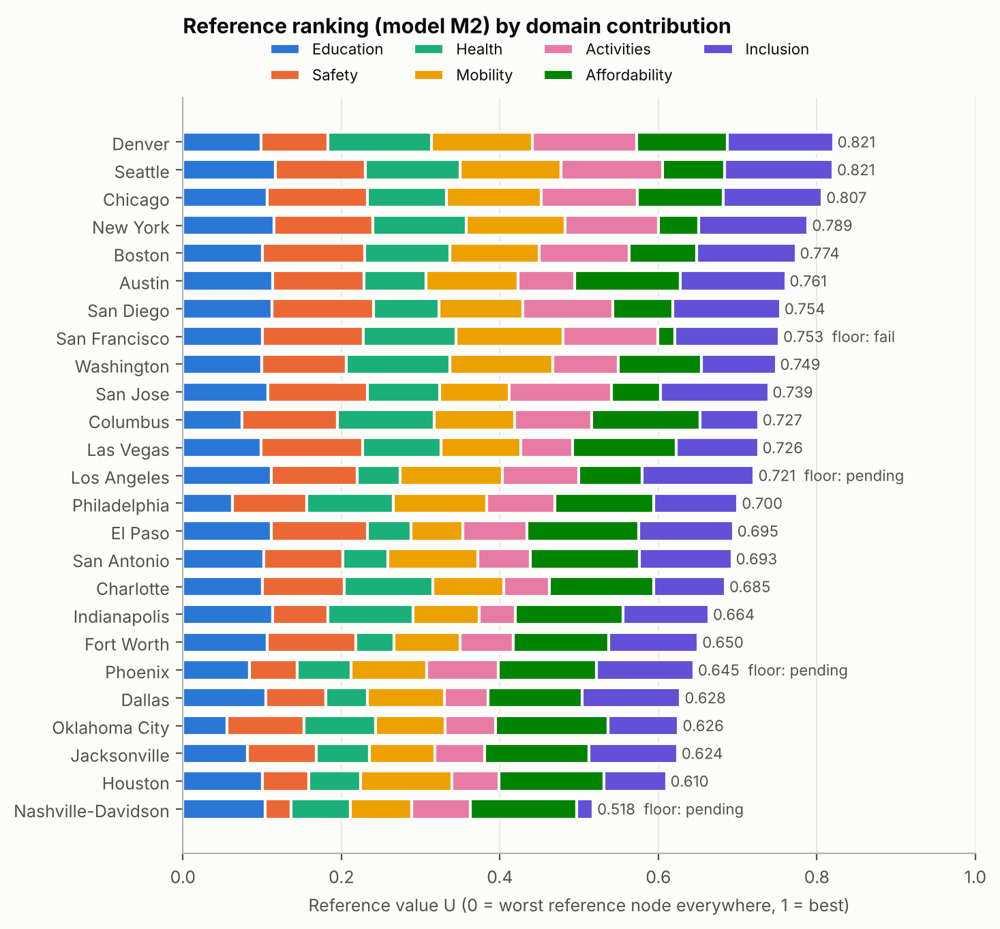

**HiMCM 2026 A 论文 · 组员 A 专用讲解**

**测量与打分**

**这份文档是什么。** 只收组员 A 负责的部分：英文原文照抄，每段后面接中文讲解（米黄色框），课程外的知识写成补充知识卡（绿色框）。原文和讲解与全文讲解总版完全一致，这里只是把你的部分单独拿出来；表中页码指总版的页码。

**标记说明（对照 2026-11-12 发给全组的原讲解版，52 页）**

| 标记 | 含义 |
|---|---|
| 本版更新 | 原讲解版就有这个讲解框，本版按修改后的论文改过；框里这种颜色的句子是改写或新加的，其余句子与原讲解版一字不差 |
| 本版新增 | 原讲解版没有这个讲解框，是本版为新增的论文内容写的 |
| 英文原文中这种颜色的句子 | 论文原文本版改过的句子；新增或改过的整行公式左侧加一条细线 |
| 无标记 | 与原讲解版完全相同 |

**你负责的内容**

| 部分 | 总版页码 | 一句话说明 |
|---|---|---|
| 第 2 章 假设 | 11–12 | 六条假设各自的理由；假设 5（可以部分补偿）就是加权求和 |
| 第 4 章 数据 | 16–19 | 长表如何汇总成 25×20 矩阵；人口加权平均；Chicago 犯罪改用警察局口径（960）；四种误差来源和 7 个零误差指标；缺失值的中位数填补和名次范围 |
| 5.1 记号 | 19–20 | 每个符号的含义；点积 φᵀθ |
| 5.2 底线 | 20–22 | 三道底线和各自依据；交通死亡为什么不再是底线；为什么在加权前检查；通过 / 待定 / 不通过；20,000 次模拟 |
| 5.3 分段线性价值 | 22–23 | φ 的截断公式；“越小越好”自动处理；为什么没有单独的权重；固定参考点 |
| 5.8 算例 | 32–34 | 手算先修课指标：0.0472 对 0.0393；七个领域合计 0.8205 对 0.8210 |
| 6.1 参考成绩单、图 1 | 34–35 | Denver 和 Seattle 只差 0.0005；只有数据误差时 Denver 52.5%、Seattle 47.5%；New York 第三 |
| 6.2 底线结果 | 35–36 | San Francisco 50.4% 不通过，收入过 80,616 美元即通过；三个待定城市；Bonferroni 下界 |
| 第 13 章 参考文献 | 61–62 | [1]–[17] 数据、[18]–[20] 方法、[21]–[25] 检验与方法、[26] NHTS |

补充知识卡：K1（向量与点积）、K2（集合记号）、K3（正态 90% 区间）、K4（截断与分段线性）、K8（蒙特卡洛）、K10（标准误）、K14（Bonferroni 下界）、K15（泊松分布与 √n）。

**建议学习顺序**：先读 5.1 记号和 K1、K2，再按第 2 章 → 第 4 章 → 5.2 → 5.3 → 5.8 → 6.1 → 6.2 → 第 13 章的顺序读。5.3 和 5.8 是重点，最好拿纸笔把 5.8 的先修课指标算一遍。

# 2. Assumptions

1. **The student attends a public high school and cannot rely on daily car rides.** *Justification:* most U.S. high schoolers attend public schools, and many teenagers do not drive; the problem asks about high schoolers, not families with cars.
2. **City-wide statistics describe the conditions a typical resident student meets.** *Justification:* consistent neighborhood data are not available for all measures in 25 cities. We test this assumption with census-tract data in Section 9.3.
3. **The reference family earns $80,000 a year and rents a two-bedroom home.** *Justification:* this is close to the U.S. median household income; we scan $50,000–$120,000 in Section 9.2.
4. **Recent multi-year averages represent current conditions.** *Justification:* we use 2021–2025 data and average several years where single years are noisy (crime 2022–2025, Chicago 2021; traffic and air 2021–2024).
5. **Once floors are met, a better result in one measure can partly make up for a worse one in another.** *Justification:* this is the usual way families trade off. We test it against a non-compensatory method (ELECTRE III) and against low-substitution aggregation (Section 8.2).
6. **Missing values are not zero.** *Justification:* a missing report is not evidence of no service. Two of 500 cells are missing; we show each city's rank with the missing value set to the worst and to the best node.

本版更新 **第 2 节 假设逐条讲。** 每条假设后面都跟一个理由（Justification），这是 HiMCM 论文的标准写法。

1. **学生上公立高中，不能指望每天有人开车接送。** 理由：美国大多数高中生上公立学校，很多青少年不开车。题目问的是高中生，而不是有车的家庭。
2. **全市统计值能代表一个普通在读学生遇到的情况。** 理由：25 个城市没有统一的社区级数据。这个假设第 9.3 节会用普查区数据检验，结果发现它在 Seattle 不太成立。
3. **参考家庭年收入 8 万美元，租两居室。** 理由：接近美国家庭收入中位数。第 9.2 节把收入从 5 万扫到 12 万，看结论怎么变。
4. **最近几年的平均值能代表现在的情况。** 理由：单一年份波动大，所以犯罪用 2022–2025 四年平均（Chicago 例外，用 2021 年，原因见 4.1），交通和空气用 2021–2024 四年平均。
5. **过了底线以后，一个指标好可以部分弥补另一个指标差。** 这就是"加权求和"的含义：总分 = 各项分数按权重加起来，A 项多 0.1 分可以抵消 B 项少 0.1 分。理由：家庭做选择时通常就是这样权衡的。第 8.2 节用"不允许补偿"的方法（ELECTRE III、低替代的 CES）做对照。
6. **缺失值不等于零。** 没报数据不代表没有这项服务。500 个格子（25 城 × 20 指标）里缺 2 个；第 4.3 节给出把缺失值设成最差和最好时的排名范围。

# 4. Data

## 4.1 Sources and processing

We assembled a long table of 157,256 records (121,160 numeric values) from 28 public sources. It covers multiple years, geographic levels (school, police agency, county, metro area, transit operator) and sources [1]–[17]. From it we computed the 25 × 20 matrix used by the model. The main processing rules:

- **School measures** sum all high-school-offering schools located inside each city boundary (2,264 schools in CRDC 2023–24) and divide by their enrollment. Negative CRDC reserve codes are treated as missing, never as zero.
- **Rates** use Census city population, except where the police agency covers a larger area (Charlotte-Mecklenburg, Las Vegas Metropolitan and Metro Nashville), where we use the FBI agency population.
- **Chicago's violent crime.** The FBI series counts about 3,400 aggravated assaults a year in Chicago, against 15,606 aggravated assaults and batteries in the police department's 2021 report: aggravated battery is missing. We use the department's 2021 total (25,979, or 960 per 100,000) and keep the FBI series' relative error.
- **Fares** are the price of one local ride for an eligible student; Dallas and Indianapolis sell only 3-hour and 2-hour passes, whose prices we use.
- **Located measures**: traffic deaths are counted where the crash occurred and mental-health facilities by their postal city (no capacity data). Park access is county-scale for Charlotte and Nashville and rounded to whole percents (standard deviation 0.3).
- **Area measures** (air quality, rent) are weighted by the share of the city's residents in each county.
- **Neighborhood measures** (walkability, transit access) are population-weighted means over the census block groups inside each city (22,398 populated block groups).

本版更新 **4.1 数据来源和处理。** "长表"指每一行只存一个数字，并记录它属于哪个城市、哪一年、哪个地理层级、来自哪个数据源。15.7 万条记录覆盖学校、警察局辖区、县、都市区、公交运营商等不同层级，最后汇总成模型用的 25 × 20 矩阵（25 行城市、20 列指标）。四条处理规则：

- **学校指标**：把位于城市边界内、开设高中年级的所有学校（共 2,264 所）的数量加总，再除以这些学校的学生总数。CRDC 用负数编码表示"不适用"或"保密"，这些一律当缺失，而不是当 0。
- **比率**：分母一般用城市人口。三个城市的警察局管辖范围比城市大（Charlotte-Mecklenburg、Las Vegas 都市警察局、Metro Nashville），分母改用警察局辖区人口，分子分母才对得上。
- **Chicago 的暴力犯罪**：FBI 数据里 Chicago 每年只有约 3,400 起"加重伤害"，而芝加哥警察局 2021 年报告里"加重伤害和加重殴打"有 15,606 起，差的是加重殴打（aggravated battery）这一类。所以改用警察局 2021 年的总数 25,979 起，即每 10 万人 960 起；误差按 FBI 序列的相对误差保留。这一改动让 Chicago 从第 4 名降到第 7 名（第 6.4 节）。
- **票价**：符合条件的学生坐一次本地公交的价格；Dallas 和 Indianapolis 只卖 3 小时、2 小时通票，就用通票价格。
- **按地点计的指标**：交通死亡按事故发生地计；心理健康机构按邮政地址所在城市计，不考虑接待能力；公园可达性在 Charlotte 和 Nashville 是县级数据，原数据取整到百分比，所以标准差记为 0.3。
- **按县的数据**（空气、房租）：城市跨几个县时，按城市居民在各县的比例加权平均。例如 70% 居民在 A 县、30% 在 B 县，城市值 = 0.7 × A 县值 + 0.3 × B 县值。
- **社区指标**（步行指数、公交可达）：在城市内 22,398 个有人居住的"普查街区组"（block group，人口普查最小的统计单元之一，一般几百到几千人）上做人口加权平均：
$$\bar x=\frac{\sum_g p_g x_g}{\sum_g p_g},$$
其中 $p_g$ 是街区组 $g$ 的人口，$x_g$ 是该街区组的指标值。人多的街区占的分量大。

## 4.2 Measurement error

Every value carries a standard deviation used in the uncertainty analysis:

- **Multi-year measures** (crime, traffic, air): the standard error of the annual mean.
- **School measures**: the difference between the two CRDC waves (2021–22 and 2023–24) divided by √2, the sample standard deviation of two values.
- **Graduation rates** published as ranges: the range width converted to a 90% interval. Chicago and Seattle report no school-level rates for this cohort, so we use their official district rates (Illinois Report Card, Washington OSPI) and treat them as exact. Other cities use cohort-weighted school rates.
- **Counts** (youth mental-health facilities): the Poisson standard deviation √n.

本版更新 **4.2 测量误差。** 每个数据都不是绝对精确的，所以论文给每个值配一个标准差 $s$，表示"这个值大概会差多少"。后面的随机模拟会按这个标准差给数据加噪声。四种来源，各用一种方法：

- **多年平均的指标**（犯罪、交通、空气）：用"年均值的标准误"。如果有 $n$ 年数据，每年的值的标准差是 $\sigma$，那么平均值的标准差是 $\sigma/\sqrt n$。为什么要除以 $\sqrt n$，见下面 K10。
- **学校指标**：CRDC 有 2021–22 和 2023–24 两期。取新的一期作为数值，用两期的差估计误差。两个数 $a,b$ 的样本标准差（分母 $n-1$）恰好是 $|a-b|/\sqrt2$。推导：平均数 $m=(a+b)/2$，两个偏差都是 $\pm(a-b)/2$，平方和 $=2\cdot\frac{(a-b)^2}{4}=\frac{(a-b)^2}{2}$，除以 $n-1=1$ 再开方得 $|a-b|/\sqrt2$。
- **以区间公布的毕业率**：小学校为保护隐私只公布区间（比如 80–84%）。取区间中点作为数值，把区间当成 90% 区间，标准差 $=$ 区间宽度 $/(2\times1.645)$。1.645 的来历见 K3。Chicago 和 Seattle 没有这一届的学校级数据，改用州政府公布的全学区毕业率，当作精确值；其他城市按毕业队列人数加权平均各校的毕业率。
- **计数**（青少年心理健康机构数）：数到 $n$ 个，标准差取 $\sqrt n$。这是泊松分布的性质，见 K15。

有 7 个指标当作精确值、标准差为 0：房租（住房部标准）、价格平价、学生票价、青少年工资、HRC 分数、步行指数、公交可达性。前几项是官方公布的标准或法规，后两项是环保署的模型计算值。各城市、各指标的误差**相互独立**；第 8.3 节检验过"同一领域的误差同向"的情况。

**补充知识 K10　标准误：估计值本身会抖多少**

S1 学过：如果 $X_1,\dots,X_n$ 相互独立，每个的方差都是 $\sigma^2$，那么

$$\operatorname{Var}(X_1+\dots+X_n)=n\sigma^2 .$$

平均数 $\bar X=\frac1n(X_1+\dots+X_n)$ 的方差就是 $\frac1{n^2}\cdot n\sigma^2=\frac{\sigma^2}{n}$，标准差是 $\frac{\sigma}{\sqrt n}$。这个"平均数的标准差"就叫**标准误**（standard error）。它说明：平均的年数越多，平均值越稳定，但只按 $\sqrt n$ 的速度变稳——数据量变成 4 倍，误差才减半。

**比例的标准误。** 第 5.6 节会用到另一种形式。做 $n$ 次独立试验，每次"成功"（比如某城市排第一）的概率是 $p$，成功次数 $X\sim B(n,p)$。S1 学过 $\operatorname{Var}(X)=np(1-p)$。成功的比例 $\hat p=X/n$ 的方差是

$$\operatorname{Var}(\hat p)=\frac{np(1-p)}{n^2}=\frac{p(1-p)}{n}.$$

$p(1-p)$ 是开口向下的抛物线，在 $p=0.5$ 处最大，等于 0.25。所以无论 $p$ 是多少，标准误都不超过 $\sqrt{0.25/n}=0.5/\sqrt n$。$n=10{,}000$ 时，这个上界是 ${}0.5/100=0.005$，也就是 0.5 个百分点。这就是论文说"一万次模拟、任何比例的标准误不超过 0.005"的来历。

**补充知识 K15　泊松分布与"计数的标准差 $\sqrt n$"**

（泊松分布在 S2 里，这里单独讲。）

**泊松分布描述"一段时间或一块区域里，随机事件发生了几次"**，前提是事件彼此独立、发生率稳定。比如一年里一个城市发生几起交通死亡、一个地区开了几家诊所。如果平均次数是 $\lambda$，那么恰好发生 $k$ 次的概率是

$$P(X=k)=\frac{e^{-\lambda}\lambda^k}{k!},\qquad k=0,1,2,\dots$$

它最重要的性质是：**期望和方差相等，都是 $\lambda$**。所以标准差是 $\sqrt\lambda$。

**和二项分布的关系**：二项分布 $B(n,p)$ 中 $n$ 很大、$p$ 很小、$np=\lambda$ 不大时，近似于泊松分布。此时方差 $np(1-p)\approx np=\lambda$，正好对上。

**怎么用**：我们只观察到一次计数 $n$，就用 $n$ 估计 $\lambda$，标准差估计为 $\sqrt n$。例如数到 16 家机构，标准差是 4。计数越小，相对误差 $\sqrt n/n=1/\sqrt n$ 越大：数到 4 家时相对误差有 50%，数到 100 家时只有 10%。

Seven measures are published standards or modeled values and are treated as exact: rent (HUD Fair Market Rents), price parity, youth fare, teen wage, HRC score, walkability and transit access. Errors are independent across cities and measures; Section 8.3 tests errors shared within a domain.

## 4.3 Missing data

Two of the 500 cells are missing:

- San Francisco reports no school athletics in schools enrolling 94% of its students, which we treat as a reporting gap.
- Washington, D.C. is not rated by HRC.

**4.3 缺失数据。** 25 × 20 = 500 个格子里缺 2 个：

- San Francisco 的学校运动数据：覆盖全市 94% 学生的学校都没有报告运动参与人数，显然是漏报。
- Washington, D.C. 没有被 HRC 评分。

The reference ranking fills a missing cell with the 25-city median and reports the rank range when the missing value is set to the measure's worst node and to its best node. San Francisco's rank moves between 6th and 10th; Washington's between 9th and 17th. All other ranks are unaffected.

**缺失值怎么处理。** 参考排名用"有数据的城市的中位数"填补（中位数受极端值影响小）。同时报告一个范围：把缺失值分别换成最差情况和最好情况，看这个城市的名次在哪个区间里变。San Francisco 在第 6–10 名之间，Washington 在第 9–17 名之间，其他城市的名次不受影响。在第 5.6 节的随机模拟里，缺失值每次从其他城市的观测值里随机抽一个。

# 5. The Model

## 5.1 Notation

| Symbol | Meaning |
|---|---|
| $i, k$ | cities, $i = 1,\dots,25$ |
| $j$ | measures, $j = 1,\dots,20$; $d(j)$ is the domain of measure $j$ |
| $x_{ij}$, $s_{ij}$ | value of measure $j$ in city $i$ and its standard deviation |
| $t_{j0},\dots,t_{j3}$ | fixed nodes of measure $j$ (worst to best) |
| $\phi_{ijl}\in[0,1]$ | how much of segment $l$ of measure $j$ city $i$ covers |
| $\theta_{jl}\ge 0$ | value of segment $l$ of measure $j$; $\theta$ collects all 60 of them |
| $\Theta$ | set of allowed preference vectors; $\theta^0$ is the reference vector |
| $U_i(\theta)$ | overall value of city $i$, between 0 and 1 |

**5.1 记号表逐行讲。** 第 5 节是全文数学最集中的地方，先把符号认全：

- $i,k$：城市编号，1 到 25。用两个字母是因为经常要比较"城市 $i$ 和城市 $k$"。
- $j$：指标编号，1 到 20。$d(j)$ 表示指标 $j$ 属于哪个领域，比如"辅导员"属于教育。
- $x_{ij}$：城市 $i$ 在指标 $j$ 上的原始数值（比如 Seattle 的暴力犯罪率 777）；$s_{ij}$ 是它的标准差（第 4.2 节）。
- $t_{j0},t_{j1},t_{j2},t_{j3}$：指标 $j$ 的四个固定节点，从最差到最好。四个点把范围切成三段，编号 $l=0,1,2$。
- $\phi_{ijl}$：城市 $i$ 在指标 $j$ 的第 $l$ 段上"走完了多少"，在 0 到 1 之间。0 是这段一点没走，1 是整段走完。
- $\theta_{jl}$：走完指标 $j$ 第 $l$ 段能拿多少分。20 个指标 × 3 段 = 60 个数，合起来记成一个 60 维向量 $\theta$。$\theta$ 就是"偏好"或"权重"。
- $\Theta$：所有被认为合理的 $\theta$ 组成的集合（第 5.4 节）；$\theta^0$ 是其中一个特定的参考向量。
- $U_i(\theta)$：在偏好 $\theta$ 下城市 $i$ 的总分，在 0 到 1 之间。写成 $U_i(\theta)$ 是在强调：总分取决于用哪组权重。

**补充知识 K1　求和、向量的点积与转置记号**

**双重求和。** $\sum_{j=1}^{20}\sum_{l=0}^{2}a_{jl}$ 表示：对每个 $j$（1 到 20），先把 $l=0,1,2$ 三项加起来，再把 20 个结果加起来。一共 60 项。

**向量就是一列数。** P3 里的三维向量 $\begin{pmatrix}a_1\\a_2\\a_3\end{pmatrix}$ 有 3 个分量；这里的 $\theta$ 有 60 个分量，只是画不出来，运算规则完全一样。

**点积（数量积）。** P3 学过 $\mathbf a\cdot\mathbf b=a_1b_1+a_2b_2+a_3b_3$。60 维时就是 60 对分量相乘再相加：

$$\phi_i\cdot\theta=\sum_{n=1}^{60}\phi_{i,n}\,\theta_n .$$

**转置记号 $\phi_i^{\top}\theta$。** 在线性代数里，向量默认竖着写（列向量）。右上角的 $\top$（transpose，转置）把竖的变成横的。FP1 学过矩阵乘法："横 × 竖"就是对应相乘再相加。所以 $\phi_i^{\top}\theta$ 和点积 $\phi_i\cdot\theta$ 是同一个数，只是写法不同。论文的总分公式

$$U_i(\theta)=\phi_i^{\top}\theta$$

意思就是：城市 $i$ 的总分 = 它在 60 个小段上的完成度，分别乘上每段的分值，再全部加起来。

**这个写法的好处。** 总分对 $\theta$ 是**线性**的：$\theta$ 翻倍，总分翻倍；两组权重相加，总分也相加。第 5.5 节的线性规划全靠这一点。

**补充知识 K2　集合记号与"约束集合"**

- **花括号定义集合**：$\{\,i:\ \text{条件}\,\}$ 读作"所有满足条件的 $i$ 组成的集合"。例如 $\{\,x:\ x^2<4\,\}$ 就是区间 $(-2,2)$。
- **属于**：$\theta\in\Theta$ 读作"$\theta$ 属于 $\Theta$"，即 $\theta$ 是集合 $\Theta$ 里的一个元素。
- **约束集合**：$\Theta$ 是用一串不等式定义的集合。每个不等式像一堵墙，墙围起来的区域就是 $\Theta$。二维的例子：$\{(x,y):\ x\ge0,\ y\ge0,\ x+y\le1\}$ 是一个三角形。$\Theta$ 是同样的东西，只是在 60 维空间里，墙也多得多。
- **$\min_{\theta\in\Theta}f(\theta)$**：在集合 $\Theta$ 里找让 $f$ 最小的那个 $\theta$，结果是那个最小值。$\max$ 同理。
- **$\Theta_S\subset\Theta$**：$\Theta_S$ 是在 $\Theta$ 的墙里再加几堵墙，所以更小。

## 5.2 Step 1: floors that cannot be bought back

Some conditions are needs, not preferences. A city fails if any of three raw values crosses a floor:

$$
F=\{\,i:\ \text{rent}_i\le 50\%\text{ of income},\ \text{violent crime}_i\le 1200,\ \text{bad-air days}_i\le 30\%\,\}.
$$

本版更新 **5.2 第一步：赎不回来的底线。** 有些条件是"需要"，不是"偏好"：住不起或者太危险，学校再好也没用。公式里的 $F$ 是"通过底线的城市"组成的集合（读法见 K2），要同时满足三个条件：

- 两居室房租不超过家庭收入的 50%；
- 每 10 万居民暴力犯罪不超过 1,200 起；
- 空气质量差（AQI > 100）的天数不超过 30%。

逗号在这里表示"并且"。

The rent floor is HUD's "severe burden" line [12]. The violent-crime floor is about three times the 2023 national rate of 363.8 per 100,000 [5]. The air floor means that air is unhealthy for students with asthma on nearly one day in three. No city's value crosses the last two floors, and three cities come within measurement error. Traffic deaths stay in the safety domain but are not a floor: between our cities the yearly death rate differs by at most 15 per 100,000 (2.8 in New York, 18.3 in Phoenix), too small a risk to override every other strength. A floor is checked on the raw value, before any weighting, so no other strength can offset it.

本版新增 **底线数值从哪来。** 每条底线都要回答两个问题：它真的是"什么都补偿不了"的需求吗？线划在哪里有依据吗？

- **房租**：住房部的"严重负担"线（房租超过收入一半），有官方标准，而且真的起作用（San Francisco 因此不通过）。
- **暴力犯罪 1,200**：约为 2023 年全国水平（每 10 万人 363.8 起）的 3.3 倍。
- **空气 30%**：AQI 超过 100 表示对哮喘等敏感学生不健康，30% 就是将近每三天有一天。

没有城市越过后两条线，但有三个城市离得很近（Los Angeles、Phoenix 的空气，Nashville 的犯罪），在测量误差范围之内。

**交通死亡为什么不再是底线**（审计后的修改）：25 个城市里交通死亡率最高（Phoenix 18.3）和最低（New York 2.8）每 10 万人每年只差约 15 人，个人一年的风险差约 0.015%，不足以"其他方面再好都补不回来"；而且它在 90% 区间下从未让任何城市待定或不通过。所以它只保留为安全领域里加权计分的指标。

**关键点：底线检查在加权之前做**，直接看原始数值。如果把底线写进加权总分，一个城市可以靠其他指标的高分把总分补上来，底线就失去意义了。

Because each value has an error, a city has three states for each floor. It **passes** if its 90% interval $x\pm1.645s$ lies fully on the safe side, **fails** if it lies fully on the wrong side, and is **pending** otherwise. The joint chance of passing all three floors is estimated as the share of 20,000 simulated data sets in which all three values pass. Floors were also scanned over ranges (Section 9.2), because no floor value is universal.

本版更新 **通过、不通过、待定。** 数据有误差，所以不能简单地"大于就不通过、小于就通过"。论文给每个值画一个 90% 区间 $x\pm1.645s$：

- 整个区间都在安全一侧 → **通过**；
- 整个区间都在危险一侧 → **不通过**；
- 区间跨过底线 → **待定**（数据不够精确，下不了结论）。

**三项都通过的联合概率**是用 20,000 次模拟数据算出来的：每次按误差随机生成一套数据，检查三项是否都通过，最后数通过的比例（这种做法叫蒙特卡洛模拟，见 K8）。底线数值本身也不是放之四海而皆准，所以第 9.2 节还会改变收入水平，看结果怎么变。

**补充知识 K3　正态分布的 90% 区间与 1.645**

S1 学过标准正态分布 $Z\sim N(0,1)$，查表得 $\Phi(1.645)\approx0.95$，即 $P(Z<1.645)=0.95$。由对称性，

$$P(-1.645<Z<1.645)=0.95-0.05=0.90 .$$

如果测量值 $X\sim N(\mu,s^2)$，标准化 $Z=(X-\mu)/s$ 后同理得到 $P(\mu-1.645s<X<\mu+1.645s)=0.90$。论文反过来用：观测值是 $x$，就认为真实值大概率落在 $x\pm1.645s$ 里。

**单项通过概率。** 对"不超过底线 $f$"这类条件，若真实值按 $N(x,s^2)$ 估计，通过概率为

$$P(\text{真实值}\le f)=\Phi\!\left(\frac{f-x}{s}\right).$$

一个假设的例子：坏空气天数 $x=27.9\%$，底线 $f=30\%$，若 $s=2$，则 $\Phi(2.1/2)=\Phi(1.05)\approx0.85$。区间 ${}27.9\pm3.3$ 跨过了 30，所以这个城市在该项是"待定"。

本版更新 **补充知识 K8　蒙特卡洛模拟**

（课程外。）**思路：一个概率算不出来，就用电脑大量重复随机试验，数一数发生的比例。** 比如想知道"掷两颗骰子点数和至少为 10"的概率，可以真的算（${}6/36$），也可以让电脑掷一万次、数出现了多少次，比例会非常接近 ${}1/6$。

论文里有两处用这个方法：

1. **底线的联合通过概率**（5.2 节）：每次按每个数据的误差 $N(x,s^2)$ 随机生成一套"可能的真实数据"，看三个底线是否都通过，重复 20,000 次。
2. **SMAA**（5.6 节）：每次随机抽一组权重、一套带误差的数据，排一次名，重复 10,000 次，数每个城市排第一的比例。

**精度。** 重复 $n$ 次得到的比例，标准误不超过 ${}0.5/\sqrt n$（推导见 K10）。所以模拟次数越多越准，一万次时误差在 0.5 个百分点以内。

## 5.3 Step 2: a piecewise-linear value for each measure

Families value the first improvements most. Going from 10% to 25% of students in advanced courses matters more than going from 40% to 55%. We model this with a curve made of three straight segments between the four fixed nodes. The coverage of segment $l$ is

$$
\phi_{ijl}=\min\!\left(1,\ \max\!\left(0,\ \frac{x_{ij}-t_{jl}}{t_{j,l+1}-t_{jl}}\right)\right),\qquad l=0,1,2,
$$

**5.3 第二步：每个指标一条折线。** 家庭最看重"从没有到有"的改善。学生里上先修课的比例从 10% 涨到 25%，比从 40% 涨到 55% 意义更大。所以每个指标的分数不是一条直线，而是由三段直线连成的折线，越往后越平。

公式里的 $\phi_{ijl}$ 是"城市 $i$ 在指标 $j$ 的第 $l$ 段走了多远"：

- 分子 $x_{ij}-t_{jl}$：城市的值超过这段起点多少；
- 分母 $t_{j,l+1}-t_{jl}$：这段的长度；
- 两者相除就是"这段走完了几成"；外面的 $\max(0,\cdot)$ 和 $\min(1,\cdot)$ 把结果限制在 0 到 1 之间（见 K4）。

**例子**：先修课指标节点 10 / 25 / 40 / 55，某城市 $x=30$。第 0 段（10→25）：$(30-10)/15=1.33$，截成 1；第 1 段（25→40）：$(30-25)/15=0.33$；第 2 段（40→55）：$(30-40)/15<0$，截成 0。所以 $\phi=(1,\,0.33,\,0)$。

**补充知识 K4　截断函数与分段线性函数**

**$\max(0,y)$**：$y$ 和 0 取大的那个。$y$ 是负数就变成 0，否则不变。
**$\min(1,y)$**：$y$ 和 1 取小的那个。$y$ 超过 1 就变成 1，否则不变。
**$\min(1,\max(0,y))$**：两个一起用，把 $y$ 夹在 $[0,1]$ 里，也叫"截断"（clip）。它的图像是：$y<0$ 时为 0 的水平线，${}0\le y\le1$ 时为直线 $y$，$y>1$ 时为 1 的水平线。

**分段线性函数**：由几段直线首尾相接组成的函数，P1 学过的绝对值函数 $|x|$ 就是两段。一个指标的分数

$$v_j(x)=\theta_{j0}\phi_{j0}(x)+\theta_{j1}\phi_{j1}(x)+\theta_{j2}\phi_{j2}(x)$$

是三段直线。在第 $l$ 段内部，只有 $\phi_{jl}$ 在变，其余两个要么是 1 要么是 0，所以图像是直线，斜率为 $\theta_{jl}/(t_{j,l+1}-t_{jl})$。三段的终点分数依次是 $\theta_{j0}$、$\theta_{j0}+\theta_{j1}$、$\theta_{j0}+\theta_{j1}+\theta_{j2}$。

**"越小越好"的指标不用改公式。** 例如房租节点 50 / 40 / 30 / 15 是从大到小排列的，分母 $t_{j,l+1}-t_{jl}$ 是负数。某城市房租 39.7%：第 0 段 $(39.7-50)/(40-50)=1.03$，截成 1；第 1 段 $(39.7-40)/(30-40)=0.03$；第 2 段为负，截成 0。分子分母同号时结果为正，正好表示"往好的方向走了多远"。论文说的"不等号方向反过来"，在这个公式里自动完成了。

(nodes run from worst to best, so the same formula covers lower-is-better measures), and the overall value is a sum:

$$
U_i(\theta)=\sum_{j=1}^{20}\sum_{l=0}^{2}\theta_{jl}\,\phi_{ijl}=\phi_i^{\top}\theta .
$$

**总分公式。** 总分 = 60 个小段的"完成度 × 分值"全部加起来，也就是向量的点积 $\phi_i^\top\theta$（K1）。

Here $\theta_{jl}$ is the value earned by completing segment $l$. A city at or below the worst node earns 0 on that measure; a city at or above the best node earns $\theta_{j0}+\theta_{j1}+\theta_{j2}$. No separate "weight" multiplies the curve, because the segment values already include how much the measure matters. This keeps the score linear in $\theta$, which is what makes exact robustness analysis possible.

**为什么没有单独的"权重"。** 常见的做法是"总分 = Σ 权重 × 指标分数"，权重和分数分开。这里 $\theta_{jl}$ 一个数同时管两件事：

- 一个指标三段的 $\theta$ 加起来，就是这个指标的总权重（它最多能拿多少分）；
- 三段之间怎么分，决定了折线的形状。

城市值在最差节点或更差时，这个指标得 0；在最好节点或更好时，拿满 $\theta_{j0}+\theta_{j1}+\theta_{j2}$。这样写的好处是总分对 $\theta$ 保持线性（K1），后面就能用线性规划精确地分析所有可能的权重。如果写成"权重 × 曲线形状参数"，两个未知数相乘，就不再是线性的了。

**Fixed reference points.** Nodes are absolute values, not the best and worst city in the pool. Adding or removing a city therefore never changes the order of two other cities.

**固定参考点的意义。** 很多评价方法用"本组最好的城市记 1、最差的记 0"来标准化。这样一来，加入或删除一个城市，最好/最差会变，所有人的分数都跟着变，两个城市的先后可能因为一个无关城市的进出而颠倒。这里节点是事先定好的绝对数值，每个城市的分数只取决于它自己的数据，所以换掉别的城市，A 和 B 的先后不会变。第 8.1 节专门检验了这一点。

## 5.8 Worked example: Seattle against Denver

**Floors.** Seattle's two-bedroom rent ($2,645) is 39.7% of $80,000. Violent crime is 777 per 100,000 and bad-air days 1.8%. All three 90% intervals lie on the safe side, so Seattle passes with joint probability 1.000.

本版更新 **5.8 算例：Seattle 对 Denver。底线。** Seattle 两居室月租 2,645 美元，一年 ${}2645\times12=31{,}740$ 美元，占 8 万收入的 ${}31740/80000=39.7\%$，低于 50%。暴力犯罪 777、坏空气天数 1.8%，都远低于底线，而且 90% 区间整体都在安全一侧（K3），所以三项都"通过"，联合通过概率 1.000。

**One measure in detail.** Seattle has 54.2 advanced-course enrollments per 100 students. With nodes 10 / 25 / 40 / 55, it covers segments 1 and 2 fully and 14.2/15 = 0.946 of segment 3. With $\theta^0$ (education 1/7 split over three measures, so 0.0476 per measure, divided 0.563 / 0.289 / 0.148), its contribution is
$$0.0476\times(0.563+0.289+0.946\times0.148)=0.0472 .$$
Denver's 38.6 enrollments cover segment 2 only to 0.906 and earn 0.0393.

**一个指标的完整计算。** 先修课指标，节点 10 / 25 / 40 / 55，每段长 15。

- **Seattle 54.2**：第 0 段 $(54.2-10)/15>1$，截成 1；第 1 段 $(54.2-25)/15>1$，截成 1；第 2 段 $(54.2-40)/15=14.2/15=0.946$。
- **参考权重**：教育领域 1/7，平分给 3 个指标，每个 $\tfrac1{21}=0.0476$；三段分别是 ${}0.0476\times0.563$、${}0.0476\times0.289$、${}0.0476\times0.148$。
- **得分**：${}0.0476\times(1\times0.563+1\times0.289+0.946\times0.148)=0.0476\times0.992=0.0472$。这个指标满分是 0.0476，Seattle 几乎拿满。
- **Denver 38.6**：第 0 段截成 1，第 1 段 $(38.6-25)/15=0.906$，第 2 段为负截成 0。得分 ${}0.0476\times(0.563+0.906\times0.289)=0.0476\times0.825=0.0393$。

**All domains.** Summing the 20 contributions:

| Domain | Education | Safety | Health | Mobility | Activities | Affordability | Inclusion | **Total $U$** |
|---|---|---|---|---|---|---|---|---|
| Seattle | 0.116 | 0.114 | 0.119 | 0.128 | 0.128 | 0.078 | 0.137 | **0.8205** |
| Denver | 0.098 | 0.085 | 0.131 | 0.127 | 0.132 | 0.115 | 0.134 | **0.8210** |
| Difference | +0.018 | +0.030 | −0.012 | +0.001 | −0.004 | −0.037 | +0.004 | −0.0005 |

Seattle is safer and stronger in school; Denver is cheaper and has more school health staff and teen library programs.

**七个领域合计。** 20 个指标都这样算，再按领域加起来。每个领域满分是 ${}1/7\approx0.143$。读表：

- Seattle 领先的是教育（+0.018）、安全（+0.030）、包容（+0.004）；
- Denver 领先的是可负担性（−0.037，Seattle 少得多）、健康（−0.012）、活动（−0.004）；
- 合计 Seattle 0.8205，Denver 0.8210，差 0.0005。

这说明两个城市"强项不同"：Seattle 更安全、学校更强；Denver 更便宜，学校健康人员和青少年图书馆活动更多。在等权重下，两边的优势几乎正好抵消，所以谁排第一完全取决于你更看重哪些领域。

**Robust comparison.** The LPs give $U_{\text{Seattle}}-U_{\text{Denver}}\in[-0.301,\,0.290]$ over all of $\Theta$ and $[-0.130,\,0.210]$ over $\Theta_S$. Both contain 0, so the order depends on preferences.

本版更新 **稳健比较。** 用第 5.5 节的线性规划算 $U_{\text{Seattle}}-U_{\text{Denver}}$ 的取值范围：

- 在宽集合 $\Theta$ 上：$[-0.301,\ 0.290]$；
- 在我们陈述的偏好 $\Theta_S$ 上：$[-0.130,\ 0.210]$。

两个区间都包含 0，所以没有"必然偏好"：存在合理权重让 Seattle 赢，也存在合理权重让 Denver 赢。$\Theta_S$ 的区间偏向正数一侧（Seattle 最多领先 0.210，最多落后 0.130），说明在我们的偏好下 Seattle 更占优势，但还需要 SMAA 告诉我们"更占优势"具体有多少。

**Frequency and caution.** Under $\Theta_S$, SMAA puts Seattle first in 75.0% of draws against 7.8% for Denver. Seattle's worst-case regret is 0.151, against 0.210 for Denver.

本版更新

**频率和谨慎。** SMAA 给出量化答案：在 $\Theta_S$ 下 Seattle 75.0% 的模拟排第一，Denver 7.8%。最坏情况后悔值 Seattle 0.151，Denver 0.210。两个指标都指向 Seattle，这就是论文选择 Seattle 的依据。

# 6. Results: The Ranking

## 6.1 The reference scorecard

Figure 1 shows each city's value under the reference weights $\theta^0$, split by domain. Denver and Seattle differ by 0.0005, far below the spread caused by data error alone: under data noise only, each wins about half the time (Denver 52.5%, Seattle 47.5%). New York is third, 0.032 behind.

本版更新 **6.1 参考成绩单。** 先只用一组权重 $\theta^0$（等权重）给 25 个城市打分，看个大概：

- Denver 和 Seattle 只差 0.0005。这个差距远小于数据误差本身造成的波动：只让数据随机变化、权重固定为 $\theta^0$，两个城市各赢一半左右（Denver 52.5%，Seattle 47.5%）。
- 第三名 New York 落后 0.032。

所以单看一组权重无法分出高下，这正是后面要用 $\Theta$、$\Theta_S$ 和 SMAA 的原因。

<figure><figcaption>Figure 1. Reference value of each city under equal domain weights, split by domain. Floor status is shown next to the score.</figcaption></figure>

**怎么读图 1。** 每个城市一条，长度是参考权重下的总分，按 7 个领域分成不同颜色的小段，每段长度就是这个领域贡献的分数（满分 1/7）。旁边标出底线状态。看哪个颜色的段短，就知道这个城市在哪个领域吃亏。

## 6.2 Floors

At an income of $80,000:

- **21 cities pass all three floors.**
- **San Francisco fails** the rent floor: two-bedroom rent takes 50.4% of income. HUD Fair Market Rents are published standards, so we treat them as exact; San Francisco passes at incomes above $80,616.
- **Three cities are pending.** In Los Angeles and Phoenix, the share of bad-air days (27.9% and 27.4%) is within error of the 30% floor (joint pass probability 0.81 and 0.60). In Nashville, violent crime of 1,160 per 100,000 is close to 1,200 (0.73).

本版更新 **6.2 底线结果（年收入 8 万美元）。**

- **21 个城市三项全部通过。**
- **San Francisco 不通过房租底线**：房租占收入 50.4%。住房部的公平市场租金是官方公布的标准，当作精确值（标准差 0），所以没有"待定"的余地。收入门槛的算法：要让年租金不超过收入的一半，收入至少是年租金的 2 倍。论文算出 San Francisco 在年收入超过 80,616 美元时就能通过，也就是年租金约 40,308 美元。
- **三个城市待定**：Los Angeles 和 Phoenix 坏空气天数 27.9% 和 27.4%，离 30% 的底线不远，在误差范围内；三项联合通过概率分别是 0.81 和 0.60。Nashville 暴力犯罪 1,160，离 1,200 很近，联合通过概率 0.73。

Pending cities stay in the ranking but are not recommended until confirmed. The joint pass probability from simulation and the conservative Bonferroni bound ${}1-\sum_k(1-p_k)$, where $p_k$ is the chance of passing floor $k$, differ by at most 0.0032, so the bound is not overly cautious here.

本版更新 **待定城市怎么处理。** 待定城市留在排名里，但在数据确认之前不推荐。最后一句比较了两种算联合通过概率的方法：模拟法（K8）和 Bonferroni 下界（K14）。原文按审计意见补上了下界的公式 $1-\sum_k(1-p_k)$，$p_k$ 是第 $k$ 条底线的通过概率。两者最多只差 0.0032，说明保守的下界在这里并不过分保守。

本版更新 **补充知识 K14　多个条件同时满足的概率与 Bonferroni 下界**

三个底线要**同时**通过。记 $A_k$ 为"第 $k$ 项不通过"。

**如果三项相互独立**（S1）：$P(\text{全部通过})=\prod_k\big(1-P(A_k)\big)$，即各项通过概率相乘。但三个指标之间不一定独立。

**不需要独立性的下界。** S1 学过 $P(A\cup B)=P(A)+P(B)-P(A\cap B)\le P(A)+P(B)$。推广到多个事件：

$$P(A_1\cup A_2\cup A_3)\le P(A_1)+P(A_2)+P(A_3).$$

"全部通过"是"至少一项不通过"的对立事件，所以

$$P(\text{全部通过})=1-P(A_1\cup A_2\cup A_3)\ \ge\ 1-\sum_kP(A_k).$$

这个下界叫 **Bonferroni 下界**，无论各项是否独立都成立，因此是"保守"的（可能低估）。

**例子**：两项不通过概率分别为 0.10 和 0.05。Bonferroni 下界 $=1-0.15=0.85$；若独立，精确值 $=0.90\times0.95=0.855$。两者很接近，因为两个"不通过"同时发生的概率很小。论文的情况也是这样：每个城市最多只有一项接近底线。

<h1 class="refs-head">13. References</h1>

1. U.S. Census Bureau. *Annual Estimates of the Resident Population for Incorporated Places, Vintage 2025* (SUB-EST2025). https://www.census.gov/data/tables/time-series/demo/popest/2020s-total-cities-and-towns.html
2. U.S. Bureau of Economic Analysis. *Regional Price Parities by State and Metro Area, 2024*. https://www.bea.gov/data/prices-inflation/regional-price-parities-state-and-metro-area
3. U.S. Department of Education, Office for Civil Rights. *Civil Rights Data Collection 2021–22 and 2023–24*. https://ocrdata.ed.gov/data
4. U.S. Department of Education. *EDFacts Four-Year Adjusted-Cohort Graduation Rates, 2020–21*; Illinois Report Card; Washington OSPI. https://www2.ed.gov/about/inits/ed/edfacts/data-files/index.html
5. Federal Bureau of Investigation. *Crime Data Explorer, summarized agency data 2021–2025*; California DOJ OpenJustice. https://cde.ucr.cjis.gov/
6. National Highway Traffic Safety Administration. *Fatality Analysis Reporting System 2021–2024*. https://www-fars.nhtsa.dot.gov/
7. U.S. Environmental Protection Agency. *AirData Annual AQI by County and CBSA, 2021–2024*. https://aqs.epa.gov/aqsweb/airdata/download_files.html
8. SAMHSA. *2025 National Directory of Mental Health Treatment Facilities*. https://www.samhsa.gov/data/
9. U.S. EPA. *Smart Location Database v3.0* (2021), fields D4c, D5br and National Walkability Index. https://www.epa.gov/smartgrowth/smart-location-mapping
10. Youth and student fare pages of the principal transit operator in each city, accessed November 2026 (e.g., King County Metro, RTD Denver, CTA, MTA).
11. Federal Transit Administration. *National Transit Database, Annual Service Data 2022–2025*. https://www.transit.dot.gov/ntd/ntd-data
12. U.S. Department of Housing and Urban Development. *Fair Market Rents FY2024*; *Defining Housing Affordability* (30% and 50% cost-burden thresholds). https://www.huduser.gov/portal/datasets/fmr.html
13. The Trust for Public Land. *2026 ParkScore Index*. https://www.tpl.org/parkscore
14. Institute of Museum and Library Services. *Public Libraries Survey FY2023 and FY2024*; Texas State Library annual reports. https://www.imls.gov/research-evaluation/surveys/public-libraries-survey-pls
15. U.S. Department of Labor, Wage and Hour Division. *State Minimum Wage Laws* and state and city labor departments, effective 2026.
16. American School Counselor Association. *School Counselor Roles & Ratios* (recommended 250:1). https://www.schoolcounselor.org/
17. Human Rights Campaign. *Municipal Equality Index 2025*. https://www.hrc.org/resources/municipal-equality-index
18. Greco, S., Mousseau, V., & Słowiński, R. (2008). Ordinal regression revisited: Multiple criteria ranking using a set of additive value functions. *European Journal of Operational Research*, 191(2), 416–436.
19. Lahdelma, R., & Salminen, P. (2001). SMAA-2: Stochastic multicriteria acceptability analysis for group decision making. *Operations Research*, 49(3), 444–454.
20. Figueira, J. R., Greco, S., Roy, B., & Słowiński, R. (2013). An overview of ELECTRE methods and their recent extensions. *Journal of Multi-Criteria Decision Analysis*, 20(1–2), 61–85.
21. Chetty, R., Friedman, J. N., Hendren, N., Jones, M. R., & Porter, S. R. (2018). *The Opportunity Atlas*. NBER Working Paper 25147. https://opportunityinsights.org/data/
22. U.S. Census Bureau. *American Community Survey 2020–2024 5-year estimates*, tables B25064, B17001, B01001. https://www.census.gov/programs-surveys/acs/
23. Centers for Disease Control and Prevention. *Youth Risk Behavior Survey 2023, district results*. https://www.cdc.gov/yrbs/data/
24. Marshall, R. J. (1991). Mapping disease and mortality rates using empirical Bayes estimators. *Applied Statistics*, 40(2), 283–294.
25. Savage, L. J. (1951). The theory of statistical decision. *Journal of the American Statistical Association*, 46(253), 55–67.

本版更新 **第 13 节 参考文献。** 按在正文中第一次出现的顺序编号：

- [1]–[17] 是数据来源：人口、物价、学校、毕业率、犯罪、交通死亡、空气、心理健康机构、城市形态与公交可达、票价、公交运营、租金、公园、图书馆、最低工资、辅导员标准、反歧视政策；
- [18]–[20] 是方法：鲁棒序数回归（K7）、SMAA（K11）、ELECTRE（K13）；
- [21]–[23] 是外部检验用的数据：Opportunity Atlas、ACS 普查区数据、青少年风险行为调查；
- [24]–[25] 是方法：泊松–伽马经验贝叶斯（K20）、极小化最大后悔（K12）。
- [26] 是全国家庭出行调查（NHTS 2022），审计后新加，用来支持 1.2 节"不能依赖开车接送"的定义。

26. Federal Highway Administration. *2022 NextGen National Household Travel Survey, Core Data V2.1*. https://nhts.ornl.gov/

