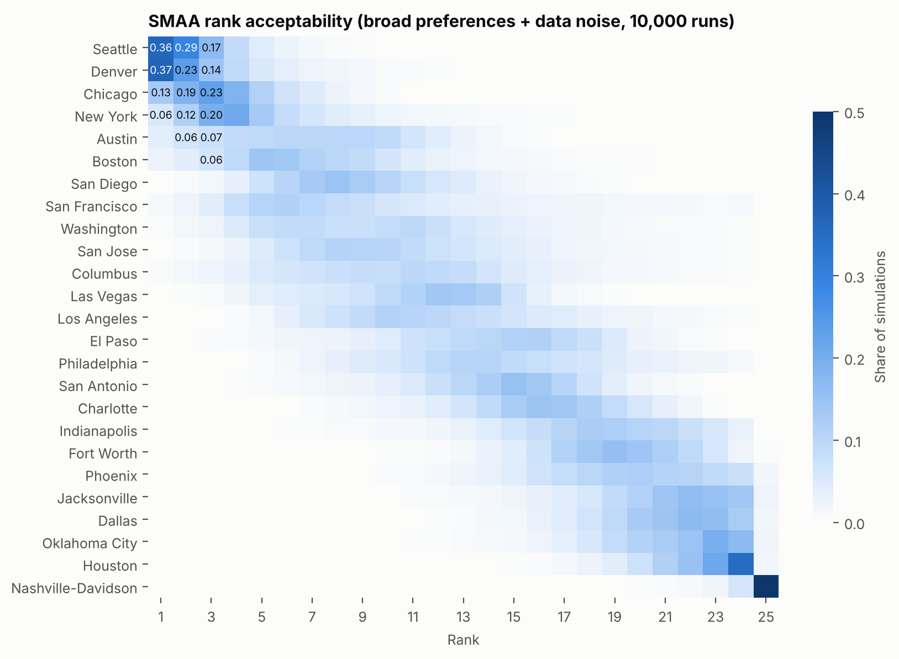
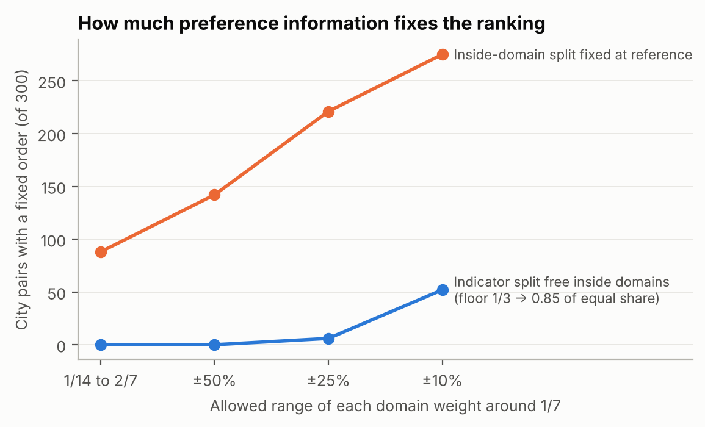

**HiMCM 2026 A 论文 · 组员 B 专用讲解**

**偏好集合与线性规划**

**这份文档是什么。** 只收组员 B 负责的部分：英文原文照抄，每段后面接中文讲解（米黄色框），课程外的知识写成补充知识卡（绿色框）。最后附自测题参考答案、常见追问、讲解提纲和交接要点。原文和讲解与全文讲解版（`HiMCM2026A_paper_explained_zh.pdf`）完全一致，这里只是把你的部分单独拿出来，并补充了只针对你的内容。

**你负责的内容**

| 部分 | 全文讲解版页码 | 一句话说明 |
|---|---|---|
| 5.1 记号（先修，属于 A） | 15 | 看懂 $x$、$\phi$、$\theta$、$\Theta$、$U$ 这几个符号，后面全靠它们 |
| 第 1 章 引言 | 6–7 | 题目要求、我们对"最好"的定义、"不能依赖开车接送"的含义、流程图 |
| 第 3 章 指标 | 8–11 | 七个领域、二十个指标、四个节点、公交可达性编码、舍弃的指标、balance |
| 5.4 偏好集合 | 19–21 | 什么样的权重算"合理"：$\Theta$、$\theta^0$、$\Theta_S$ |
| 5.5 线性规划 | 21–23 | 怎么证明"对所有合理权重都成立" |
| 6.3 宽集合下的结果 | 32 | 在 $\Theta$ 下什么都定不下来 |
| 6.4 的四段 | 33–35 | 加上 P1–P6 后：7 对确定、6 城不可能第一、$\theta^0$ 在边界、为什么加 P6、逐条去掉陈述 |
| 8.5 需要多少共识 | 45 | 分歧主要在领域内部 |

补充知识卡：K1（向量与点积）、K2（集合记号）、K5（凹性）、K6（线性规划）、K7（必然偏好、可能偏好、可能赢家）。

**建议学习顺序**：先读 5.1 记号和 K1、K2，再按第 1 章 → 第 3 章 → 5.4 → 5.5 → 6.3 → 6.4 → 8.5 的顺序读。5.4 和 5.5 是重点，最好拿纸笔把 K6 的二维例子自己算一遍。

**你这部分的主线（讲的时候按这个顺序串起来）**

1. **定义**（第 1 章）：最好的城市要先过底线，再比学生的真实机会，而且要在大家看重点不同时也站得住。最后这句"站得住"就是你这部分要落实的东西。
2. **指标**（第 3 章）：20 个指标、4 个固定节点，决定了每个城市在每一段走了多远（$\phi$）。
3. **权重不只一组**（5.4）：允许权重在一个集合 $\Theta$ 里变。$\Theta$ 由四类线性条件定义，可以写成一个集合式子。再根据定义加六条偏好 P1–P6，得到更小的 $\Theta_S$。
4. **线性规划**（5.5）：两个城市的分差对权重是线性的，所以能精确求出它在集合上的最小值和最大值，判断"必然更好"还是"可能更好"；再判断谁是"可能赢家"。
5. **宽集合下什么都定不下来**（6.3）：$\Theta$ 太宽，300 对里 0 对确定，25 城都可能第一。
6. **加上我们的偏好**（6.4）：7 对确定，6 城不可能第一；$\theta^0$ 恰好在 $\Theta_S$ 的边界上，$\Theta_S$ 的抽样平均权重偏重教育、出行和安全；P6 防止安全被压低；去掉任何一条陈述，Seattle 仍第一。
7. **需要多少共识**（8.5）：把领域内部怎么分定下来，就能确定 88 对；固定领域权重、内部自由，只能确定 4 对。结论：先就"每个领域怎么衡量"达成一致。

**先修：5.1 记号（属于组员 A，你必须看懂）。** 后面的偏好集合和线性规划全部用这些符号写成。

## 5.1 Notation

| Symbol | Meaning |
|---|---|
| $i, k$ | cities, $i = 1,\dots,25$ |
| $j$ | measures, $j = 1,\dots,20$; $d(j)$ is the domain of measure $j$ |
| $x_{ij}$, $s_{ij}$ | value of measure $j$ in city $i$ and its standard deviation |
| $t_{j0},\dots,t_{j3}$ | fixed nodes of measure $j$ (worst to best) |
| $\phi_{ijl}\in[0,1]$ | how much of segment $l$ of measure $j$ city $i$ covers |
| $\theta_{jl}\ge 0$ | value of segment $l$ of measure $j$; $\theta$ collects all 60 of them |
| $\Theta$ | set of allowed preference vectors; $\theta^0$ is the reference vector |
| $U_i(\theta)$ | overall value of city $i$, between 0 and 1 |

**5.1 记号表逐行讲。** 第 5 节是全文数学最集中的地方，先把符号认全：

- $i,k$：城市编号，1 到 25。用两个字母是因为经常要比较"城市 $i$ 和城市 $k$"。
- $j$：指标编号，1 到 20。$d(j)$ 表示指标 $j$ 属于哪个领域，比如"辅导员"属于教育。
- $x_{ij}$：城市 $i$ 在指标 $j$ 上的原始数值（比如 Seattle 的暴力犯罪率 777）；$s_{ij}$ 是它的标准差（第 4.2 节）。
- $t_{j0},t_{j1},t_{j2},t_{j3}$：指标 $j$ 的四个固定节点，从最差到最好。四个点把范围切成三段，编号 $l=0,1,2$。
- $\phi_{ijl}$：城市 $i$ 在指标 $j$ 的第 $l$ 段上"走完了多少"，在 0 到 1 之间。0 是这段一点没走，1 是整段走完。
- $\theta_{jl}$：走完指标 $j$ 第 $l$ 段能拿多少分。20 个指标 × 3 段 = 60 个数，合起来记成一个 60 维向量 $\theta$。$\theta$ 就是"偏好"或"权重"。
- $\Theta$：所有被认为合理的 $\theta$ 组成的集合（第 5.4 节）；$\theta^0$ 是其中一个特定的参考向量。
- $U_i(\theta)$：在偏好 $\theta$ 下城市 $i$ 的总分，在 0 到 1 之间。写成 $U_i(\theta)$ 是在强调：总分取决于用哪组权重。

**补充知识 K1　求和、向量的点积与转置记号**

**双重求和。** $\sum_{j=1}^{20}\sum_{l=0}^{2}a_{jl}$ 表示：对每个 $j$（1 到 20），先把 $l=0,1,2$ 三项加起来，再把 20 个结果加起来。一共 60 项。

**向量就是一列数。** P3 里的三维向量 $\begin{pmatrix}a_1\\a_2\\a_3\end{pmatrix}$ 有 3 个分量；这里的 $\theta$ 有 60 个分量，只是画不出来，运算规则完全一样。

**点积（数量积）。** P3 学过 $\mathbf a\cdot\mathbf b=a_1b_1+a_2b_2+a_3b_3$。60 维时就是 60 对分量相乘再相加：

$$\phi_i\cdot\theta=\sum_{n=1}^{60}\phi_{i,n}\,\theta_n .$$

**转置记号 $\phi_i^{\top}\theta$。** 在线性代数里，向量默认竖着写（列向量）。右上角的 $\top$（transpose，转置）把竖的变成横的。FP1 学过矩阵乘法："横 × 竖"就是对应相乘再相加。所以 $\phi_i^{\top}\theta$ 和点积 $\phi_i\cdot\theta$ 是同一个数，只是写法不同。论文的总分公式

$$U_i(\theta)=\phi_i^{\top}\theta$$

意思就是：城市 $i$ 的总分 = 它在 60 个小段上的完成度，分别乘上每段的分值，再全部加起来。

**这个写法的好处。** 总分对 $\theta$ 是**线性**的：$\theta$ 翻倍，总分翻倍；两组权重相加，总分也相加。第 5.5 节的线性规划全靠这一点。

**补充知识 K2　集合记号与"约束集合"**

- **花括号定义集合**：$\{\,i:\ \text{条件}\,\}$ 读作"所有满足条件的 $i$ 组成的集合"。例如 $\{\,x:\ x^2<4\,\}$ 就是区间 $(-2,2)$。
- **属于**：$\theta\in\Theta$ 读作"$\theta$ 属于 $\Theta$"，即 $\theta$ 是集合 $\Theta$ 里的一个元素。
- **约束集合**：$\Theta$ 是用一串不等式定义的集合。每个不等式像一堵墙，墙围起来的区域就是 $\Theta$。二维的例子：$\{(x,y):\ x\ge0,\ y\ge0,\ x+y\le1\}$ 是一个三角形。$\Theta$ 是同样的东西，只是在 60 维空间里，墙也多得多。
- **$\min_{\theta\in\Theta}f(\theta)$**：在集合 $\Theta$ 里找让 $f$ 最小的那个 $\theta$，结果是那个最小值。$\max$ 同理。
- **$\Theta_S\subset\Theta$**：$\Theta_S$ 是在 $\Theta$ 的墙里再加几堵墙，所以更小。

# 1. Introduction

## 1.1 Background

More than 15 million students attend U.S. public high schools. Most city rankings are written for adults: they weigh job markets, nightlife and home prices. A high schooler's life runs on different things: whether the nearest public school offers advanced courses, whether a bus can get her to practice and back after school, whether a counselor or a clinic will see a 16-year-old, and whether she is treated fairly. A teenager usually cannot drive and cannot choose the family budget, so the city's value to her depends on what she can reach and afford without an adult's car.

**1.1 背景。** 一般的城市排行榜是给成年人看的，看工作、夜生活、房价。高中生关心的是另一套东西：附近的公立学校有没有大学先修课，放学后能不能自己坐公交去训练再回家，有心理问题时有没有辅导员或诊所愿意接待一个 16 岁的孩子，在学校会不会被公平对待。青少年一般不能开车，也决定不了家里的预算，所以一个城市对他的价值，取决于他不靠大人开车能到达什么、家里能负担什么。

## 1.2 The task and our reading of it

1. Choose and justify criteria for a "best city for a high schooler", and discuss criteria left out.
2. Gather and cite data, apply the model, and discuss limitations.
3. Rank at least ten cities and reach a reasoned conclusion about the best one, under our own definition.
4. Show why the ranking has merit beyond opinion, and document at least one significant revision.
5. Write a one-to-two-page non-technical news article that includes our modeling process.

**1.2 题目要求。** 这五条是对题目的复述：

1. 选择并论证评价指标，也要讨论没选的指标；
2. 收集并引用数据，应用模型，讨论局限；
3. 至少排 10 个城市，按我们自己的定义得出"最好的城市"；
4. 说明排名不只是个人意见，并记录至少一次重要修订；
5. 写一篇 1–2 页、面向普通读者的新闻稿，要介绍建模过程。

**Our definition of "best".** *The best city is the one that, for a family on a fixed budget, clears basic floors on cost and serious risk, and then gives a public-school student who cannot depend on car rides the most real access to education, health support, independent travel, activities and fair treatment — and keeps that lead across reasonable disagreements about what matters most.*

**我们对"最好"的定义。** 这句话是全文的核心，后面每一个模型设计都能在这句话里找到出处：

- "预算固定的家庭"对应第 2 节的假设 3（年收入 8 万美元）。
- "先过成本和严重风险的底线"对应第 5.2 节的三道底线（房租、暴力犯罪、空气）。
- "公立学校学生、不能依赖开车接送"对应出行领域和"公交可达"指标。
- "在合理分歧下保持领先"对应第 5.4–5.6 节的权重集合、线性规划和随机模拟。

Three features of this definition shape the model. **Floors** come before trade-offs: no number of after-school programs should make up for a violent-crime rate above 1,200 per 100,000. **Real access** means measuring what a student can use (enrollments in advanced courses, jobs reachable by transit in 45 minutes), not how many buildings exist. **Robustness** means the answer must hold over a whole set of reasonable weightings, not a single set we chose.

**定义的三个特征如何决定模型。**

- **底线在先**：课外活动再多，也抵消不了超过底线的暴力犯罪率。数学上，底线检查放在加权求和之前单独做。（原来的例子是"便宜的房租买不回危险的街道"，但现实中确实有家庭为了房租住在不安全的地方，所以按审计意见换成了论文实际用到的指标。）
- **真实可用**：测量学生实际能用的东西，例如大学先修课的选课人次、45 分钟公交能到的工作岗位数，而不是数城市里有几栋楼、几所学校。
- **稳健**：结论要在一整组合理权重下成立，而不是只在我们挑的一组权重下成立。

**"Cannot depend on car rides."** The student does not drive and has no adult who can drive her to school, practice or work every day, so daily trips are made on foot, by bike or by transit. This describes many teenagers: in the 2022 National Household Travel Survey, half of all trips by 14–18-year-olds were as a passenger in someone else's car, and only half of 16–17-year-olds were drivers [26]. A city that works for such a student also works for one who sometimes gets a ride.

**"不能依赖开车接送"到底指什么。** 这段是按审计意见新加的定义：学生自己不开车，也没有大人能**每天**开车送他去学校、训练或打工，所以日常出行靠步行、自行车或公交。

数据支持来自美国交通部的全国家庭出行调查（NHTS 2022）。按调查权重算：14–18 岁青少年的出行里，49.8% 是坐别人开的私家车，24.3% 是自己开车，26.0% 是步行、骑车或坐公交；16–17 岁的人里只有 50.0% 是驾驶者，14–15 岁只有 3.4%。也就是说，一半的出行要靠别人开车，"没人接送时城市还能给学生什么"是个真实问题。

最后一句的意思：一个城市对"完全靠自己出行"的学生都好用，对偶尔有人接送的学生只会更好用，所以这个假设不会让结论偏向某类家庭。计算脚本：`analysis/model/run_nhts_teen_mode.py`。

## 1.3 Our approach

<b>Measure</b> 25 cities × 20 measures in 7 domains, with error estimates

→

<b>Floors</b> rent, violent crime, air: pass / pending / fail

→

<b>Value</b> piecewise-linear curves on fixed reference points

→

<b>Robustness</b> LP over all weights; SMAA; regret; ELECTRE III

→

<b>Audit &amp; revise</b> M0 → M1 → M2 from real-data findings

**1.3 流程图。** 五个方框从左到右：测量（25 城 × 20 指标，带误差估计）→ 底线（通过 / 待定 / 不通过）→ 价值（分段线性曲线、固定参考点）→ 稳健性（线性规划、SMAA、后悔值、ELECTRE III）→ 审计与修订（M0 → M1 → M2）。

The candidate pool is fixed before any score is computed: the 25 most populous U.S. cities in the Census Vintage 2025 estimates [1]. Every number in this paper is reproduced by our code from archived source files.

**候选城市先定死。** 25 个城市按人口普查局的人口排名确定，在算任何分数之前就固定下来。这样做是为了防止"为了让某个城市赢而挑选候选名单"。论文里的每个数字都能由代码从存档的原始文件重新算出来。

# 3. Criteria: What We Measure and What We Leave Out

## 3.1 Seven domains and twenty measures

We began from the needs of a 14–18-year-old rather than from available data. Each domain answers one question, and the domains stay separate even when their measures are correlated. Each measure has four fixed reference points ("nodes"): the worst node is worth 0 and the best node earns the full value of that measure. Node values come from standards where they exist (for example the 250-students-per-counselor recommendation [16] and HUD's 30% and 50% rent-burden lines [12]) and otherwise from round values that span realistic U.S. conditions. They were fixed before any city was scored.

**3.1 七个领域、二十个指标。** 这段讲三件事：

1. **从需求出发**：先想 14–18 岁的学生需要什么，再去找数据，而不是有什么数据就用什么。
2. **领域分开**：每个领域回答一个问题。即使两个领域的指标相关，也不合并。
3. **每个指标有 4 个固定参考点（节点 nodes）**：最差节点记 0 分，最好节点拿满这个指标的分。节点数值尽量来自权威标准（比如美国学校辅导员协会建议每 250 名学生配 1 名辅导员；住房部把房租超过收入 30% 定为"负担重"、超过 50% 定为"严重负担"），没有标准的就取覆盖美国现实范围的整数。节点在给任何城市打分之前就定好了。

| Domain (question) | Measure | Better | Nodes (worst → best) | Source |
|---|---|---|---|---|
| **Education** — what can a student learn? | AP, IB and dual-enrollment course enrollments per 100 students | ↑ | 10 / 25 / 40 / 55 | CRDC 2023–24 [3] |
| | Four-year graduation rate, non-charter schools (%) | ↑ | 60 / 75 / 85 / 95 | EDFacts 2020–21 [4] |
| | School counselors per 1,000 students | ↑ | 2 / 3 / 4 / 6 | CRDC 2023–24 [3] |
| **Safety** — how likely is serious harm? | Violent crimes per 100,000 residents (2022–25) | ↓ | 1200 / 900 / 600 / 300 | FBI CDE [5] |
| | Traffic deaths per 100,000 residents (2021–24) | ↓ | 20 / 14 / 8 / 2 | NHTSA FARS [6] |
| **Health** — can a student stay well? | Days with AQI above 100 (% of days, 2021–24) | ↓ | 30 / 15 / 5 / 0 | EPA AirData [7] |
| | School nurses, psychologists, social workers per 1,000 students | ↑ | 0.5 / 2 / 4 / 8 | CRDC 2023–24 [3] |
| | Youth mental-health facilities per 100,000 residents under 18 | ↑ | 2 / 6 / 12 / 20 | SAMHSA 2025 [8] |
| **Mobility** — can a student get around alone? | Jobs reachable in 45 min by transit and walking (thousands) | ↑ | 10 / 60 / 200 / 600 | EPA SLD v3 [9] |
| | National Walkability Index (1–20) | ↑ | 5.75 / 10.5 / 15.25 / 20 | EPA SLD v3 [9] |
| | Student fare for one local ride (USD) | ↓ | 2 / 1 / 0.5 / 0 | operator fare pages [10] |
| | Weekend service as a share of weekday service | ↑ | 0.3 / 0.5 / 0.7 / 0.9 | FTA NTD 2022–25 [11] |
| **Activities** — what can a student do after school? | Residents within a 10-minute walk of a park (%) | ↑ | 30 / 55 / 80 / 100 | TPL ParkScore 2026 [13] |
| | Teen library program attendance per 1,000 residents of the library's service area | ↑ | 0 / 10 / 25 / 50 | IMLS FY2023–24 [14] |
| | School sports participations per 100 students | ↑ | 10 / 20 / 35 / 50 | CRDC 2023–24 [3] |
| | Minimum wage for ages 16–17, divided by BEA all-items price parity (USD/h) | ↑ | 6.5 / 10 / 14 / 18 | DOL, state laws [15]; BEA [2] |
| **Affordability** — can the family pay? | Two-bedroom Fair Market Rent as % of $80,000 income | ↓ | 50 / 40 / 30 / 15 | HUD FY2024 [12] |
| | Prices of goods and other services (U.S. = 100) | ↓ | 110 / 105 / 100 / 95 | BEA RPP 2024 [2] |
| **Inclusion** — is the student treated fairly? | City non-discrimination laws and municipal services (% of HRC MEI parts I and III, 42 points) | ↑ | 25 / 50 / 75 / 100 | HRC MEI 2025 [17] |
| | Students suspended out of school per 100 | ↓ | 16 / 10 / 5 / 0 | CRDC 2023–24 [3] |

**怎么读这张指标表。** 每行一个指标，列依次是：所属领域（和它回答的问题）、指标、方向（↑ 越大越好，↓ 越小越好）、四个节点（从最差到最好）、数据来源。几个容易看不懂的指标：

- **AP、IB、双学分课程**：AP 是大学先修课，IB 是国际文凭课程，双学分（dual enrollment）是高中生在读期间修大学课程、同时拿高中和大学学分。"每 100 名学生的选课人次"是把这三类课的选课人次加起来除以学生数再乘 100；一个学生选两门算两次，所以这个数可以超过 50。
- **非特许学校的四年毕业率**：特许学校（charter school）由政府出钱、独立运营，一般靠申请或抽签入学，而不是按住址划片。原因见第 7 节修订 1。
- **违法犯罪、交通死亡"每 10 万居民"**：用人数除以人口再乘 100,000，便于不同大小的城市比较。
- **AQI 超过 100 的天数占比**：AQI 是空气质量指数，超过 100 表示对敏感人群不健康。
- **45 分钟公交可达的工作岗位数（千个）**：从居民所在地出发，步行加按时刻表乘公交，45 分钟内能到达的地方一共有多少工作岗位。岗位数代表"能到达的目的地有多少"（商店、图书馆、工作地点等都有岗位）。
- **步行指数（1–20）**：美国环保署算的街区适合步行程度。注意它的四个节点 5.75 / 10.5 / 15.25 / 20 是等间距的。
- **周末服务 / 工作日服务**：周末公交服务量是工作日的几成，0.9 表示周末几乎和平时一样多。
- **按当地物价调整后的 16–17 岁最低工资**：名义最低工资除以 BEA 的全部商品价格平价（含住房，全国 = 100），换成"在全国平均物价下值多少钱"。第 8.3 节试过改用不含住房的价格。
- **图书馆青少年活动参与人次**：分母是图书馆系统服务区的人口（不一定等于城市人口），取 FY2023、FY2024 两年平均。
- **两居室公平市场租金占 8 万收入的百分比**：公平市场租金（Fair Market Rent）是住房部公布的当地标准租金，大约是当地普通质量出租房租金的第 40 百分位。
- **商品和其他服务的价格（全国 = 100）**：BEA 的地区价格水平，去掉了住房部分（因为房租已经单独算了）。
- **HRC 得分**：一个人权组织给城市打的"市政平等指数"。我们只用其中第一部分（反歧视法律，30 分）和第三部分（市政服务，12 分），共 42 分，换算成百分比。

节点的例子：辅导员的节点 2 / 3 / 4 / 6（每千名学生）中，"4 人/千人"正好对应"每 250 名学生 1 人"；房租的节点 50 / 40 / 30 / 15 中，50% 和 30% 正好是住房部的两条线。

**Avoiding double counting.** Counselors appear only in education; nurses, psychologists and social workers only in health. Housing is excluded from the BEA price measure because rent is measured directly. Transit service and transit access are not both scored: in M2 the access measure already contains the service it uses (Section 7).

**避免重复计算。** 同一个东西不能在两个地方各算一次分，否则它等于被加了双倍权重：

- 辅导员只算在教育领域；护士、心理学家、社工只算在健康领域。
- BEA 价格指标去掉住房，因为房租单独测了。
- 公交"服务量"和公交"可达性"不同时计分：M2 的可达性已经用到了时刻表里的服务（第 7 节）。

**Transit access data.** The access field is coded −99999 where no transit stop lies within walking distance; we count these residents as reaching 0 jobs. Unlike the frequency field of Revision 1, this code is reliable: in every city the share of residents coded −99999 equals the share with no stop within walking distance. The field uses 2020 timetables and 2017 job locations.

**公交可达性数据的编码。** 环保署的可达性字段在"步行范围内没有公交站"的街区组里填 −99999。我们把这些居民记为"坐公交能到 0 个岗位"。

为什么这里可以这样处理，而第 7 节修订 1 的"发车频率"字段不行？因为验证过：在每个城市里，可达性字段为 −99999 的人口比例，**正好等于**步行范围内没有车站的人口比例（最高是 Oklahoma City 的 41.6%）。所以 −99999 在这里确实表示"没有公交"，而频率字段的 −99999 表示"缺时刻表数据"（San Diego 有车站却被标成 −99999）。最后一句说明数据年份：2020 年的时刻表、2017 年的就业分布，第 10 节把它列为缺点。

## 3.2 Criteria we considered and left out

| Criterion | Reason left out |
|---|---|
| Weather and climate | A matter of taste, not of opportunity; it belongs in a personal profile, not in the definition of "best" |
| College and university rankings | A nearby top university does not make it easier for local students to get in. Public universities favor residents of the state and the top students of every high school in it (UT Austin admits the top 6% of each Texas high school; UC guarantees a place to the top 9% of each California high school), so every city in a state gets the same advantage; private universities admit nationally. What a city adds before graduation, college courses taken in high school, is measured by dual enrollment |
| Test scores (SEDA) | Cover grades 3–8, not high school; state high-school tests differ by state and cannot be compared across our cities |
| Nightlife, restaurants, job growth | Weakly related to ages 14–18 |
| Teen employment rate | Mixes opportunity with need: a high rate can mean students must work |
| Racial and ethnic diversity | Describes who lives there, not how students are treated; kept as background only |
| Walk Score, AllTransit | Measure the same things as our EPA walkability and transit-access measures; scoring both would count the same thing twice |
| Youth survey outcomes (YRBS) | Available for only 12 of 25 cities; used to validate the model instead (Section 8.4) |
| Adult health outcomes (CDC PLACES) | Measures adults; teenagers' needs differ |

**3.2 考虑过但没用的指标。** 题目要求讨论舍弃的指标。舍弃的理由归成几类：

- **属于个人口味**：天气。喜欢冷还是热因人而异，放进个人偏好，而不是"最好"的定义。
- **测的不是高中生**：夜生活和就业增长、成年人健康数据。
- **大学排名**：附近有好大学，不等于本地高中生更容易进去。公立大学确实偏向本地学生，但按"州"和"每所高中"给优惠：UT Austin 自动录取得州**每一所**高中排名前 6% 的学生，UC 保证加州**每一所**高中前 9% 的学生能进某个 UC 校区。所以同一个州里的城市待遇相同（我们有 6 个得州城市、4 个加州城市）；私立大学面向全国招生。城市本身在高中阶段能多给的，是在高中修大学课程的机会，已经由双学分课程指标衡量。
- **含义不清**：青少年就业率高，可能是机会多，也可能是家里需要孩子打工。
- **描述而非对待**：种族多样性说明谁住在这里，不说明学生是否被公平对待，只当背景资料。
- **不可比或重复**：SEDA 考试成绩只覆盖 3–8 年级；高中阶段各州考试不同，城市之间不能比较。Walk Score 和 AllTransit 测的东西和我们的步行指数、公交可达性相同，再加就重复计分了。（原文曾以"许可证、付费"为理由，按审计意见换成了实质理由。）青少年问卷（YRBS）只有 12 个城市有，改用来做外部验证（第 8.4 节）。

## 3.3 The candidate cities

The pool is the 25 most populous cities in the Census Vintage 2025 estimates [1], with each city as the Census defines it. Indianapolis and Nashville share their governments with their counties; for them the Census ranks the "balance", the merged city-county minus the small towns inside it that keep their own governments (for example Belle Meade in Nashville), and we use the same area for every measure. The list was frozen before any data were scored, so no city was added or dropped to favor a result.

**3.3 候选城市。** 用人口普查局对"城市"的官方边界。Indianapolis 和 Nashville 是市县合并的城市：城市和县合用一个政府，但县里还有一些保留自己政府的小镇。普查局的城市人口排名用"balance"，就是合并辖区扣掉这些小镇后剩下的部分。例如 Nashville 合并辖区 745,904 人，balance 721,074 人，扣掉的是 Belle Meade、Berry Hill、Forest Hills、Oak Hill 等；Indianapolis 合并辖区 910,638 人，balance 901,116 人。我们所有指标（人口、学校、街区组）都用同一个 balance 边界，口径一致。名单在打分前冻结，没有为了结果增删城市。

## 5.4 Step 3: the set of reasonable preferences

People disagree about how much, say, advanced courses are worth compared with after-school activities, or lower prices compared with better transit. Instead of one weight vector, we keep the whole set $\Theta$ of vectors that satisfy:

- **Normalization:** $\theta\ge0$ and $\sum\theta=1$, so $U_i\in[0,1]$.
- **Diminishing returns:** $\theta_{j0}\ge\theta_{j1}\ge\theta_{j2}$ for every measure, and the last segment keeps at least 10% of the measure's value.
- **Balanced domains:** each domain receives between half and double an equal share, $\tfrac1{14}\le\sum_{j\in D}\theta_j\le\tfrac27$.
- **No measure ignored:** within a domain, each measure receives at least one third of an equal share of that domain.

**5.4 第三步：合理偏好的集合 $\Theta$。** 人们对"大学先修课和课外活动哪个更重要""便宜一点和公交好一点哪个更重要"看法不同，所以不只用一组权重，（原文的例子曾是"安全和活动"，但多数人都认为安全更重要，不算合理分歧，所以按审计意见换了例子。）而是保留所有满足四类条件的权重组成的集合：

1. **归一化**：所有 $\theta\ge0$ 且 60 个加起来等于 1。这样每个城市的总分在 0 到 1 之间：最好的情况所有 $\phi=1$，总分 $=\sum\theta=1$。
2. **边际递减**：每个指标 $\theta_{j0}\ge\theta_{j1}\ge\theta_{j2}$，后一段的分值不超过前一段；并且最后一段至少占这个指标总分的 10%，即 $\theta_{j2}\ge0.1(\theta_{j0}+\theta_{j1}+\theta_{j2})$。后者防止"到了某个水平以后再好也不加分"。
3. **领域平衡**：7 个领域，平均每个 1/7。每个领域的权重总和（该领域所有指标、所有段的 $\theta$ 之和）在平均值的一半和两倍之间：$\tfrac1{14}\le\text{领域权重}\le\tfrac27$。
4. **不忽略任何指标**：一个领域里有 $n_D$ 个指标，平分的话每个占领域权重的 ${}1/n_D$。每个指标至少要拿到平分份额的三分之一。例如教育有 3 个指标，领域权重为 $W$，每个指标至少 $W/9$。

**这些条件全是关于 $\theta$ 的线性不等式**（或等式），例如"领域权重 ≤ 2/7"就是把该领域的若干个 $\theta$ 加起来 ≤ 2/7。所以 $\Theta$ 是 60 维空间里由平面围成的一块区域（K2）。

**补充知识 K5　凹函数与"边际递减"**

**边际递减**：每多一份投入，增加的好处越来越少。吃第一个包子很满足，第五个就没那么香了。

**用斜率表达**：函数 $v(x)$ 的斜率越来越小，叫**凹函数**（concave，图像向下弯）。P1 的说法是 $v''(x)<0$，或者"任意两点连线都在图像下方"。$\sqrt x$、$\ln x$、${}1-e^{-x}$ 都是凹函数。

**在折线上**：折线没有二阶导数，但可以看每段的斜率是否越来越小。当三段长度相等时（比如先修课节点 10 / 25 / 40 / 55，每段 15），斜率 $=\theta_{jl}/15$，所以 $\theta_{j0}\ge\theta_{j1}\ge\theta_{j2}$ 正好等于"斜率递减"。节点间隔不等时，可以把每一段看作一个"同样有意义的台阶"，条件 $\theta_{j0}\ge\theta_{j1}\ge\theta_{j2}$ 说的是：越往后的台阶，值的分越少。

**论文里用到凹性的地方**：$\Theta$ 的边际递减条件；参考向量的段分值来自凹函数 $u(z)=(1-e^{-2z})/(1-e^{-2})$；第 8.2 节比较了"没有边际递减的直线"和"不同弯曲程度的指数曲线"。

In symbols, write $W_j=\sum_l\theta_{jl}$ for the total value of measure $j$ and $W_D=\sum_{j\in D}W_j$ for domain $D$, which has $n_D$ measures. Then

$$
\Theta=\Big\{\theta\ge0:\ \textstyle\sum\theta=1,\ \ \theta_{j0}\ge\theta_{j1}\ge\theta_{j2}\ge0.1\,W_j,\ \ \tfrac1{14}\le W_D\le\tfrac27,\ \ W_j\ge\dfrac{W_{d(j)}}{3\,n_{d(j)}}\Big\}.
$$

**把 $\Theta$ 写成一个式子。** 这是按审计意见新加的：上面四条文字条件，用两个简写就能写成一行。

- $W_j=\sum_l\theta_{jl}$：指标 $j$ 三段之和，即这个指标的总分值。
- $W_D=\sum_{j\in D}W_j$：领域 $D$ 里所有指标的总分值，即领域权重；$n_D$ 是这个领域的指标个数。

于是集合里的条件依次是：全部非负且加起来为 1（归一化）；$\theta_{j0}\ge\theta_{j1}\ge\theta_{j2}\ge0.1W_j$（边际递减，且最后一段至少占 10%）；$\tfrac1{14}\le W_D\le\tfrac27$（领域平衡）；$W_j\ge W_{d(j)}/(3n_{d(j)})$（每个指标至少拿到领域内平分份额的三分之一）。

这三个层次（领域 → 领域内的指标 → 指标内的三段）正好对应第 5.6 节抽样时的三层。

The **reference vector** $\theta^0$ gives each domain 1/7 and splits it equally among its measures. Within each measure, it splits the value 0.563 / 0.289 / 0.148 across the three segments. These are the values of the smooth curve $u(z)=(1-e^{-2z})/(1-e^{-2})$ at $z=\tfrac13,\tfrac23,1$, a moderate diminishing return.

**参考向量 $\theta^0$。** 在整个集合 $\Theta$ 里挑一个"最中性"的点作为参考：

- 每个领域 1/7；
- 领域内平分给各指标（教育 3 个指标，每个 $\tfrac17\times\tfrac13=\tfrac1{21}\approx0.0476$）；
- 每个指标的三段按 0.563 / 0.289 / 0.148 分配。

**这三个数的来历**（P3 指数函数）：取凹函数 $u(z)=\dfrac{1-e^{-2z}}{1-e^{-2}}$，$z$ 从 0 到 1，$u(0)=0$、$u(1)=1$。计算：

- $u(\tfrac13)=\dfrac{1-e^{-2/3}}{1-e^{-2}}=\dfrac{1-0.5134}{0.8647}=0.5628$；
- $u(\tfrac23)=\dfrac{1-e^{-4/3}}{0.8647}=\dfrac{1-0.2636}{0.8647}=0.8516$；
- $u(1)=1$。

三段分别增加 ${}0.5628$、${}0.8516-0.5628=0.2888$、${}1-0.8516=0.1484$。也就是说，参考折线是把这条光滑曲线在三个节点处"拉直"得到的。指数里的 2 决定弯曲程度：越大越弯，边际递减越强；第 8.2 节试了 1、2、4 三种。

**Our stated preferences $\Theta_S$.** Our definition in Section 1.2 implies six further statements, each tied to a sentence of the definition:

| | Statement | Reason in our definition |
|---|---|---|
| P1 | Education weight ≥ Affordability weight | The budget is handled by the rent floor; extra savings above it are a softer preference |
| P2 | Mobility weight ≥ Affordability weight | Same reason, for independent travel |
| P3 | Mobility weight ≥ 1/7 | The student cannot rely on car rides |
| P4 | Education weight ≥ 1/7 | Access to school and courses is the first purpose |
| P5 | Each measure gets 0.6–1.4 times an equal share inside its domain, ${}0.6\,W_D/n_D\le W_j\le1.4\,W_D/n_D$ | Every core measure covers its own part of the domain |
| P6 | Safety weight ≥ 1/7 | "Serious risk": the crime floor catches only extreme rates, so safety keeps at least an equal share |

**我们陈述的偏好 $\Theta_S$。** $\Theta$ 允许的范围很宽，比如允许"可负担性权重是教育的四倍"。论文根据自己的定义（1.2 节）补了六条更具体的偏好，每条都能在定义里找到出处：

- **P1 教育 ≥ 可负担性**、**P2 出行 ≥ 可负担性**：预算问题已经由房租底线处理了（住不起的直接出局）。过了底线以后，再省一点钱是较弱的偏好，不应该压过教育和出行。
- **P3 出行 ≥ 1/7**：学生不能靠家长开车，所以出行领域至少拿平均份额。
- **P4 教育 ≥ 1/7**：上学和选课是首要目的。
- **P5 每个指标拿领域内平分份额的 0.6 到 1.4 倍**：比 $\Theta$ 的"至少三分之一"更严，防止一个指标独占整个领域。写成式子是 $0.6\,W_D/n_D\le W_j\le1.4\,W_D/n_D$。
- **P6 安全 ≥ 1/7**（审计后新加）：定义里写了"严重风险"，而暴力犯罪底线只拦得住极端情况。没有 P6 时，P1–P4 抬高了教育和出行，安全的平均权重被挤到 0.127，比平均份额还低；P6 保证安全至少拿平均份额。

加上这六条后得到更小的集合 $\Theta_S$。它们也都是线性不等式，所以 $\Theta_S$ 仍然可以用线性规划处理。$\theta^0$ 满足全部六条：教育、出行、可负担性、安全都是 1/7，P1–P4 和 P6 都以等号成立；P5 中每个指标正好是平分份额的 1 倍。第 6.4 节会指出，正因为这几条都"刚好压线"，$\theta^0$ 处在 $\Theta_S$ 的边界上。

$\theta^0$ satisfies all six. $\theta^0$ is a benchmark, not our decision rule. It gives one transparent scorecard (Figure 1, Section 5.8) and the starting point of single-vector checks; the ranking itself is decided over $\Theta_S$ (Table 1).

**$\theta^0$ 只是基准，不用来做决定。** 这句是按审计意见新加的，回答"参考向量用在哪里"：

- **用来展示**：图 1 的参考成绩单、第 5.8 节的算例都用 $\theta^0$，因为一组固定权重最容易看懂。
- **用来做单一权重的检验**：第 8 章的不少检验（权重扫描、节点平移、误差放大、换加总规则）先在 $\theta^0$ 下做。
- **不用来排名**：最终排名（表 1）看的是 $\Theta_S$ 里一万组权重下的平均名次。$\theta^0$ 下 Denver 以 0.0005 领先 Seattle，但这不改变最终结论。

## 5.5 Step 4: what holds for every reasonable preference (linear programs)

For two cities $a$ and $b$, we solve

$$
\underline{\Delta}_{ab}=\min_{\theta\in\Theta}(\phi_a-\phi_b)^{\top}\theta,\qquad
\overline{\Delta}_{ab}=\max_{\theta\in\Theta}(\phi_a-\phi_b)^{\top}\theta .
$$

**5.5 第四步：对所有合理偏好都成立的结论。** 比较城市 $a$ 和 $b$，总分之差是

$$U_a(\theta)-U_b(\theta)=\phi_a^\top\theta-\phi_b^\top\theta=(\phi_a-\phi_b)^\top\theta ,$$

对 $\theta$ 是线性的。论文求它在 $\Theta$ 上的最小值 $\underline\Delta_{ab}$ 和最大值 $\overline\Delta_{ab}$。这样就知道：权重在合理范围内随便怎么取，$a$ 比 $b$ 最多领先多少、最多落后多少。

If $\underline\Delta_{ab}\ge0$, city $a$ is at least as good as $b$ under **every** reasonable preference: a *necessary* preference. If $\overline\Delta_{ab}\ge0$, there is **some** preference under which it is: a *possible* preference. Both are linear programs because $\Theta$ is defined by linear inequalities. This is the idea of robust ordinal regression [18].

**必然偏好和可能偏好。**

- 最小值 $\underline\Delta_{ab}\ge0$：最不利于 $a$ 的权重下，$a$ 也不输 $b$。所以对**每一组**合理权重，$a$ 都不比 $b$ 差。这叫**必然偏好**（necessary）。
- 最大值 $\overline\Delta_{ab}\ge0$：**至少存在一组**合理权重，使 $a$ 不比 $b$ 差。这叫**可能偏好**（possible）。
- 如果最小值 < 0 < 最大值：$a$ 和 $b$ 谁好取决于权重，没有确定的先后。

因为 $\Theta$ 是由线性不等式定义的、目标函数是线性的，求最小值和最大值都是**线性规划**问题（K6），电脑可以精确求解。这套思路叫**鲁棒序数回归**（K7）。

**补充知识 K6　线性规划（Linear Programming, LP）**

（课程外，属于决策数学。）

**线性规划问题**：在一组线性不等式（约束）围成的区域里，找让一个线性函数（目标函数）最大或最小的点。

**二维的例子**（和论文完全同构）：只有两个指标，权重 $w_1,w_2$。约束：$w_1+w_2=1$，并且每个权重在 $[0.25,\,0.75]$ 之间（"领域平衡"）。城市 A 两项得分 $(0.9,\,0.4)$，城市 B $(0.6,\,0.7)$。

$$U_A-U_B=(0.9-0.6)w_1+(0.4-0.7)w_2=0.3w_1-0.3w_2 .$$

把 $w_2=1-w_1$ 代入得 ${}0.6w_1-0.3$，$w_1\in[0.25,0.75]$。这是一条直线，最小值和最大值在区间的两个端点：

- $w_1=0.25$ 时 $=-0.15$（最小）；
- $w_1=0.75$ 时 $=+0.15$（最大）。

区间 $[-0.15,\,0.15]$ 包含 0，所以 A 和 B 谁好取决于权重：A 是 B 的"可能偏好"，B 也是 A 的"可能偏好"，没有必然偏好。

**加一条偏好陈述**：如果规定"指标 1 不比指标 2 次要"，即 $w_1\ge w_2$，那么 $w_1\in[0.5,\,0.75]$，最小值变成 ${}0.6\times0.5-0.3=0$。此时 $\underline\Delta_{AB}=0\ge0$，A 必然不比 B 差。**偏好说得越具体，确定下来的先后关系越多。** 这就是第 6.4 节从 $\Theta$ 到 $\Theta_S$ 时必然偏好对数从 0 变成 4 的原因，也是第 8.5 节讨论的问题。

**为什么最优值一定在"角"上**：约束围成的区域是一个多边形（高维叫多面体）。线性函数沿任何直线方向都是均匀增加或减少的，所以在区域内部总能沿某个方向继续变大，直到碰到边界；在边上同理，一直走到角（顶点）。所以只需要检查顶点。论文的 $\Theta$ 在 60 维空间里，顶点非常多，由电脑用专门的算法（论文用的是 HiGHS 求解器）求解，结果是精确值，不是近似值。

**补充知识 K7　鲁棒序数回归：必然偏好、可能偏好、可能赢家**

（课程外。）"鲁棒"（robust）的意思是"在各种情况下都站得住"。这个方法不去争论哪一组权重"正确"，而是问：

1. **必然偏好** $a\succsim^N b$：对集合里**所有**权重，$a$ 都不比 $b$ 差。判定：$\min_\theta(U_a-U_b)\ge0$。
2. **可能偏好** $a\succsim^P b$：**存在**一组权重使 $a$ 不比 $b$ 差。判定：$\max_\theta(U_a-U_b)\ge0$。
3. **可能赢家**：存在**同一组**权重，使 $a$ 同时不比**所有**其他城市差。

第 3 条要注意"同一组"。$a$ 可能在权重 $\theta^{(1)}$ 下赢 $b$、在 $\theta^{(2)}$ 下赢 $c$，但找不到一组权重同时赢 $b$ 和 $c$，这时 $a$ 不是可能赢家。

**怎么判断可能赢家**：多引入一个变量 $\varepsilon$（领先幅度），解

$$\max\ \varepsilon\quad\text{使得}\quad(\phi_i-\phi_k)^\top\theta\ge\varepsilon\ \ \text{对所有}\ k\ne i,\quad\theta\in\Theta .$$

意思是：找一组权重，让 $i$ 对"最难赢的那个对手"的领先幅度尽量大。如果最大的 $\varepsilon\ge0$，就存在一组权重让 $i$ 不输给任何人。约束仍然是线性的（$\varepsilon$ 也只是一次出现），所以还是线性规划。

A city can win only if a **single** vector makes it at least as good as all others at once. We test this by maximizing a margin $\varepsilon$ subject to $(\phi_i-\phi_k)^{\top}\theta\ge\varepsilon$ for all $k$ and $\theta\in\Theta$. City $i$ is a *possible winner* if the best $\varepsilon\ge0$. Beating each rival with a different weighting is not enough.

**可能赢家。** 详细解释见上面 K7 第 3 条。这段强调：一个城市要成为"可能赢家"，必须用**同一组**权重同时不输给所有对手；对每个对手各用一组不同的权重去赢，不算。

**Data uncertainty in the LP.** Each value of $\phi$ rises with the measure's quality and $\theta\ge0$. So, for any $\theta$, the worst case of $U_a-U_b$ over all data inside the 90% intervals puts $a$ at the bad end and $b$ at the good end. One LP with these two fixed rows therefore gives an exact robust answer for both preference and data uncertainty.

**线性规划里怎么考虑数据误差。** 除了权重不确定，数据本身也有误差。这段的论证分三步：

1. $\phi$ 随指标的"好坏"单调变化：数据往好的方向变，$\phi$ 只会增加或不变（K4 的截断函数是单调的）。
2. $\theta\ge0$，所以 $U=\phi^\top\theta$ 也随数据单调变化。
3. 因此，在 90% 区间内的所有可能数据中，$U_a-U_b$ 最小的情况是：$a$ 的每个指标都取区间里最差的一端，$b$ 的每个指标都取最好的一端。这个"最坏数据"对任何 $\theta$ 都一样，不需要随 $\theta$ 改变。

所以只要把 $a$ 的 $\phi$ 换成"最差数据下的 $\phi$"、$b$ 的换成"最好数据下的 $\phi$"，再解一次线性规划，就同时考虑了权重和数据两种不确定性，结果仍然是精确的。

## 6.3 How stable is the ranking? (all reasonable preferences)

Over the full set $\Theta$, the LPs fix the order of **no** pair of cities, and all 25 cities are possible winners. The broad set allows extreme views (one domain at double weight, another at half), and almost any city has a domain in which it excels. Frequency, not possibility, then separates the cities (Figure 2):

- **First place:** Seattle 41.4%, Denver 40.5%, New York 6.7%, Austin 5.1% and Boston 2.7%.
- **Top three:** Seattle 86.8% and Denver 80.8%.
- **90% rank intervals:** Seattle 1–5, Denver 1–7 and New York 1–11.

**6.3 在宽集合 $\Theta$ 下排名有多稳。**

- 线性规划的结论：在 $\Theta$ 上**没有任何一对**城市的先后是确定的，25 个城市**都是**可能赢家。原因是 $\Theta$ 很宽，允许某个领域翻倍、另一个领域减半，而几乎每个城市都有某个特别强的领域，只要把那个领域的权重拉满，它就能排第一。
- 所以光看"可不可能"分不出高下，要看频率。在 $\Theta$ 中抽一万次（加数据误差）：
  - 第一名比例：Seattle 41.4%，Denver 40.5%，New York 6.7%，Austin 5.1%，Boston 2.7%；
  - 进前三：Seattle 86.8%，Denver 80.8%；
  - **90% 名次区间**：把一个城市一万次的名次从好到坏排开，去掉最好的 5% 和最差的 5%，剩下的范围。Seattle 是第 1 到第 5 名，说明它 90% 的情况下都在前五；New York 是第 1 到第 11 名，波动大得多。

在宽集合下 Denver 和 Seattle 几乎打平，接下来加入我们的偏好陈述看会怎样。

<figure><figcaption>Figure 2. Share of 10,000 SMAA draws (broad preference set plus data noise) in which each city takes each rank.</figcaption></figure>

**怎么读图 2。** 这是 K11 讲的"排名可接受度"热力图：每个城市一行，每个名次一列，颜色越深，这个城市拿到这个名次的比例越高（前几格标出了数字）。一行的比例加起来是 100%。深色集中在左边的城市稳定靠前，例如 Seattle 第 1、2、3 名分别是 0.41、0.32、0.14；颜色铺得很开的城市（如 San Diego、Washington）名次变化大；Nashville 几乎总是最后一名。

## 6.4 Under our stated definition: the final ranking

Adding statements P1–P6 narrows $\Theta$ to $\Theta_S$:

- **Fixed pairs:** seven pairs now have a necessary order (New York, Denver, Chicago and Austin above Nashville; Austin above Dallas, Fort Worth and Houston).
- **Possible winners:** six cities can no longer rank first under any preference in $\Theta_S$: Fort Worth, Phoenix, Dallas, Jacksonville, Houston and Nashville.

**6.4 在我们的定义下：最终排名。** 加上 P1–P6 后，集合从 $\Theta$ 缩小到 $\Theta_S$：

- **确定下来的先后**：有 7 对城市出现了必然偏好：New York、Denver、Chicago、Austin 必然不比 Nashville 差；Austin 必然不比 Dallas、Fort Worth、Houston 差。25 个城市一共有 $\binom{25}{2}=300$ 对，只有 7 对确定，说明即使在 $\Theta_S$ 下，大部分先后关系仍然取决于具体权重。
- **可能赢家减少**：Fort Worth、Phoenix、Dallas、Jacksonville、Houston、Nashville 这 6 个城市在 $\Theta_S$ 的任何权重下都排不了第一（K7 的线性规划给出 $\varepsilon<0$）。

**What the stated preferences weigh.** The reference vector $\theta^0$ sits on the edge of $\Theta_S$: it gives education, mobility and affordability the same weight, the least that P1–P4 allow, and safety the 1/7 that P6 requires. The average of 10,000 vectors drawn from $\Theta_S$ (Step 5) gives education, mobility and safety 0.18 each, affordability 0.10 and the other three domains 0.11 each. Under this single vector Seattle scores 0.808, New York 0.788 and Denver 0.779.

**我们的偏好实际偏重什么。** 讲两件事：

1. **$\theta^0$ 在 $\Theta_S$ 的边界上。** P3、P4、P6 要求教育、出行、安全 ≥ 1/7，P1、P2 要求教育和出行 ≥ 可负担性。$\theta^0$ 让这些领域都等于 1/7，这几条都"刚好压线"（等号成立）。所以 $\theta^0$ 是 $\Theta_S$ 里"最不偏重教育、出行和安全"的那类点，并不在集合中间。
2. **$\Theta_S$ 的抽样平均权重。** 把表 1 用的一万组权重取平均，得到一个"典型"偏好：教育、出行、安全各 0.18，可负担性 0.10，其余三个领域各 0.11。在这组权重下 Seattle 0.808、New York 0.788、Denver 0.779。读者因此能看清：我们的定义实际上把教育、出行和安全放在了成本前面。注意这是抽样的平均，不是集合的几何中心（见 5.6 第 (a) 步）。

**Why P6.** Without P6, statements P1–P4 raise education and mobility and leave safety at 0.127 on average, below an equal share, although our definition names serious risk and the crime floor catches only extreme rates. P6 raises Seattle's share of first places from 67.4% to 75.0% and moves New York ahead of Denver, whose violent-crime rate (978 per 100,000) is the highest of the three leaders.

**为什么加 P6（审计后的修改）。** 没有 P6 时，P1–P4 抬高教育和出行，总权重又固定为 1，安全就被一起压低，平均只有 0.127，比平均份额 1/7 ≈ 0.143 还低（69.5% 的抽样低于 1/7）。可是定义里明确写了"严重风险"，而暴力犯罪底线只能拦住极端情况（没有城市越线）。所以安全既没有底线保护、权重又偏低，这是评委很可能抓住的漏洞。

加上 P6 以后：Seattle 夺冠比例从 67.4% 升到 75.0%；New York 超过 Denver，因为 Denver 的暴力犯罪率（978）在前三名里最高。也就是说，Seattle 第一不依赖 P6，但第二、三名的顺序依赖它。

**（6.4 节的"Table 1 gives the final ranking"、表 1、"Why Seattle"、"Why the others trail"归组员 C，这里略去。）**

**Leave-one-statement-out check.** Removing any single statement P1–P6 keeps Seattle first in SMAA (62.2–74.6%) and keeps it the minimum-regret city. P1 and P2 both limit affordability; removing them together still leaves Seattle first (72.2% against New York's 11.9%). All seven necessary pairs depend on P5; without it the count returns to 0.

**逐条去掉偏好陈述的检查。** P1–P6 是我们写的，读者可能不同意其中某条。所以每次去掉一条，重新做 SMAA：

- 去掉任何一条，Seattle 仍是第一（夺冠比例 62.2% 到 74.6%），也仍是最大后悔最小的城市。去掉 P5 时最低（62.2%），去掉 P6 时 67.4%。
- P1 和 P2 都是在限制可负担性的权重（不让它超过教育和出行）。两条一起去掉，Seattle 仍第一（72.2%，New York 11.9%）。
- 第 6.4 节开头的 7 对必然偏好全部依赖 P5：去掉 P5，必然偏好的对数回到 0；去掉 P6 剩 3 对。

**（6.4 节最后的"ELECTRE III"段归组员 D，这里略去。）**

## 8.5 How much agreement would settle the ranking?

Figure 5 shows how the number of fixed pairs grows as preferences are narrowed. Most of the disagreement lies **inside** domains (how to split, say, safety between crime and traffic), not between domains. If the split inside domains is fixed at the reference, 88 of 300 pairs are already settled. If, in addition, every domain weight is held within ±25% of 1/7, 221 pairs are settled. In the opposite case, with every domain weight fixed at exactly 1/7 and the split inside domains left free, only 4 pairs are settled. Agreeing on how each domain is measured settles more of the ranking than agreeing on how much each domain matters.

**8.5 需要多少共识才能定下排名？** 这里的"确定的对"就是必然偏好（K7）：在集合里所有权重下先后都不变的城市对，总共 300 对。逐步收窄偏好集合，看确定的对数怎么增加：

- 领域**内部**的分配和每条曲线的形状都固定为参考值（比如安全领域里犯罪和交通死亡各占一半），领域之间仍然自由：确定 88 对；
- 再加上每个领域权重在 1/7 的 ±25% 以内：确定 221 对；
- 反过来，每个领域权重固定为 1/7，领域内部自由分配：只确定 4 对。

这些都是在宽集合 $\Theta$ 上算的，不是 $\Theta_S$。

结论：大部分分歧来自领域**内部**怎么测、怎么分，而不是领域之间谁更重要。所以想让大家对排名达成一致，先就"每个领域怎么衡量"达成共识，比争论"哪个领域更重要"有效得多。

**怎么读图 5。** 横轴是每个领域权重允许偏离 1/7 的范围，从左到右逐步收窄（最左边是 $\Theta$ 本身的 1/14 到 2/7，即最低减半、最高翻倍；然后是 ±50%、±25%、±10%）；纵轴是 300 对里确定下来的对数。上面的橙线是"领域内部分配固定为参考值"，下面的蓝线是"领域内部自由分配"，并且领域范围收窄时，每个指标在领域内的最低份额同时从平分份额的 1/3 提高到 0.6、0.85（蓝线依次是 0、0、6、52 对）。两条线差距很大：同样收窄领域权重，内部分配固定时确定的对数多得多。

<figure><figcaption>Figure 5. City pairs whose order is fixed for every preference in $\Theta$, as the set is narrowed. Upper line: the split inside domains and the value curves are fixed at $\theta^0$. Lower line: everything varies, and each measure's minimum share of its domain rises from 1/3 to 0.6 and 0.85 of an equal share.</figcaption></figure>

# 附一　自测题参考答案

**1. $\Theta$ 的每条约束为什么都是 $\theta$ 的线性不等式？这一点为什么重要？**

每条约束都只是"把若干个 $\theta_{jl}$ 乘上常数再相加，和一个常数比大小"，没有平方、相乘或开方。逐条看：

- 归一化：60 个 $\theta$ 之和 $=1$，每个 $\theta\ge0$。
- 边际递减：$\theta_{j0}-\theta_{j1}\ge0$，$\theta_{j1}-\theta_{j2}\ge0$；最后一段 $\theta_{j2}-0.1(\theta_{j0}+\theta_{j1}+\theta_{j2})\ge0$。
- 领域平衡：某领域所有 $\theta$ 之和在 $\tfrac1{14}$ 和 $\tfrac27$ 之间。
- 不忽略指标：指标 $j$ 三段之和 $-\tfrac13\times\dfrac{\text{领域}\ \theta\ \text{之和}}{n_D}\ge0$。
- P1：教育领域 $\theta$ 之和 $-$ 可负担性领域 $\theta$ 之和 $\ge0$；P3：出行领域之和 $\ge\tfrac17$；P6：安全领域之和 $\ge\tfrac17$；P5 和"不忽略指标"同一形式，系数换成 0.6 和 1.4。

论文 5.4 节现在把这些条件写成了一个集合式子，用 $W_j$（指标总分值）和 $W_D$（领域权重）两个简写，一行就能写完。

**重要在于**：比较两个城市时，目标 $(\phi_a-\phi_b)^\top\theta$ 也是线性的（$\phi$ 由数据算好，是常数）。"线性目标 + 线性约束"就是线性规划，电脑能精确求出最小值和最大值（K6）。如果用随机抽样去找，可能漏掉最极端的那组权重；线性规划不会漏。

**2. 用两个指标的例子说明：加一条偏好陈述，为什么会多出必然偏好。**

两个指标，权重 $w_1+w_2=1$，各在 $[0.25,\,0.75]$。A 得分 $(0.9,0.4)$，B 得分 $(0.6,0.7)$，$U_A-U_B=0.6w_1-0.3$。$w_1$ 从 0.25 到 0.75，差值从 $-0.15$ 到 $+0.15$，包含 0，所以 A、B 谁好取决于权重，没有必然偏好。

加一条陈述"指标 1 不比指标 2 次要"（$w_1\ge w_2$），$w_1$ 只能在 $[0.5,\,0.75]$，最小值变成 ${}0.6\times0.5-0.3=0$，于是 A 对每一组允许的权重都不比 B 差：必然偏好出现了。**陈述把可选的权重范围砍小，最小值就可能从负数变成非负。** 论文里从 $\Theta$ 到 $\Theta_S$，必然偏好从 0 对变成 4 对，就是这个道理。

**3. "对每个对手各用一组权重去赢"为什么不算可能赢家？**

一个家庭只有一组偏好。说"A 可能是第一"，意思是存在某个家庭（某一组权重），在它眼里 A 同时不输给所有城市。反例：在 $\theta^{(1)}$ 下 A 赢 B 但输给 C，在 $\theta^{(2)}$ 下 A 赢 C 但输给 B。A 两两都"可能赢"，但没有任何一个家庭会把 A 排第一。所以论文用一个线性规划同时要求 A 对所有对手的领先幅度 $\ge\varepsilon$，并且所有对手共用同一个 $\theta$。

**4. Seattle − Denver 在 $\Theta$ 上是 $[-0.301,\,0.290]$，在 $\Theta_S$ 上是 $[-0.130,\,0.210]$，各说明什么？**

- 两个区间都包含 0：两种集合下都没有必然偏好，谁好取决于具体权重。
- $\Theta$ 的区间几乎左右对称：在宽集合里，偏向 Seattle 和偏向 Denver 的极端偏好差不多一样"有力"。
- $\Theta_S$ 的区间整体变窄，并且偏向正数一侧：Seattle 最多领先 0.210，最多落后 0.130。P1–P6 去掉了"极度看重可负担性"这类对 Denver 最有利的权重，所以 Denver 能领先的最大幅度缩小得更多。
- 区间只说明"可能的范围"，说明不了"多常见"，后者要看 C 负责的 SMAA（Seattle 75.0% 对 Denver 7.8%）。

**5. $\theta^0$ 为什么在 $\Theta_S$ 的边界上？$\Theta_S$ 的平均权重偏重什么？**

$\theta^0$ 给七个领域各 $\tfrac17$。P3、P4、P6 要求出行、教育、安全 $\ge\tfrac17$，$\theta^0$ 正好等于下限，三条都"压线"；P1、P2 要求教育、出行不低于可负担性，$\theta^0$ 三者相等，也压线。不等式取等号的点在集合的边上，不在中间。所以 $\theta^0$ 是 $\Theta_S$ 里"最不偏重教育、出行和安全"的一类点。

$\Theta_S$ 的抽样平均权重：教育、出行、安全各 0.18，可负担性 0.10，其余三个领域各 0.11。也就是我们的定义实际把教育、出行和安全放在成本前面。在这组平均权重下 Seattle 0.808、New York 0.788、Denver 0.779，Seattle 领先；在 $\theta^0$ 下 Denver 以 0.0005 领先。两者不矛盾：$\theta^0$ 处在对 Seattle 最不利的边上。

**6. P1–P6 各自对应定义中的哪句话？**

定义原文：*The best city is the one that, for a family on a fixed budget, clears basic floors on cost and serious risk, and then gives a public-school student who cannot depend on car rides the most real access to education, health support, independent travel, activities and fair treatment.*

| 陈述 | 对应的话 | 理由 |
|---|---|---|
| P1 教育 ≥ 可负担性 | "clears basic floors on cost" 和 "access to education" | 预算已经由房租底线处理，过线后再省钱是较弱的偏好，不应压过教育 |
| P2 出行 ≥ 可负担性 | 同上，加 "independent travel" | 同上，针对独立出行 |
| P3 出行 ≥ 1/7 | "cannot depend on car rides" | 不能靠家长开车，出行至少拿平均份额 |
| P4 教育 ≥ 1/7 | "access to education"（列在第一位） | 上学选课是首要目的 |
| P5 每个指标拿领域内平分份额的 0.6–1.4 倍 | "the most real access to …" 列出的每一项 | 每个核心指标都代表领域的一部分，不能被别的指标挤掉 |
| P6 安全 ≥ 1/7 | "clears basic floors on … serious risk" | 暴力犯罪底线只拦得住极端情况，安全领域至少拿平均份额，不被 P1–P4 挤低 |

# 附二　常见追问

**问：为什么不直接定一组权重？** 答：任何一组权重都是某个人的看法。我们的定义要求结论"在合理分歧下站得住"，所以只规定权重的范围，再用线性规划和 SMAA 检查结论在整个范围里是否成立。等权重 $\theta^0$ 只是范围里的一个点，而且在 $\Theta_S$ 的边上。

**问：P1–P6 不也是主观的吗？** 答：是我们的判断，所以每条都对应定义中的一句话，并做了逐条去掉的检查：去掉任何一条，Seattle 仍第一（62.2%–74.6%）；P1、P2 一起去掉，Seattle 72.2% 对 New York 11.9%。论文第 10 章把"偏好陈述是我们自己的"列为缺点，并说明其他家庭可以改写陈述重算。

**问：7 对必然偏好可靠吗？** 答：7 对全部依赖 P5，去掉 P5 就变回 0 对（去掉 P6 剩 3 对）；把数据放到 90% 区间不利的一端，7 对也全部消失（8.3 节）。所以论文不把它们当作确定结论，只说明"偏好越具体，能定下来的先后越多"。

**问：线性规划的结果怎么验证？** 答：AI 使用报告写明，我们用 3,000 组随机抽取的权重核对过线性规划给出的上下界。线性规划由 HiGHS 求解器精确求解。

**问：为什么宽集合 $\Theta$ 下 25 个城市都可能第一？** 答：$\Theta$ 允许任何一个领域翻倍、另一个减半。几乎每个城市都有一个特别强的领域，把那个领域的权重拉到 $\tfrac27$，它就能排第一。所以光看"可能"分不出高下，要看 SMAA 的频率（C 的部分）。

**问：8.5 节和 $\Theta_S$ 有什么关系？** 答：8.5 节问的是"要加多少条类似 P1–P6 的陈述，才能把排名定下来"。结论是：把领域内部的分配定下来（例如安全领域里犯罪和交通死亡各占一半）最有效，能确定 88 对；只把领域权重固定为 $\tfrac17$、内部自由，只能确定 4 对。

**问：节点是不是也影响你这部分的结论？** 答：影响。节点决定 $\phi$，$\phi$ 决定每个线性规划的目标。节点随机移动 ±10% 的检验在 8.3 节（C 的部分）：$\Theta_S$ 下 Seattle 仍有 73.1% 第一（点估计数据）。

# 附三　讲解提纲（组内讲解约 12 分钟）

1. **（1 分钟）定义**：念一遍"最好"的定义，指出最后一句"在合理分歧下站得住"是你这部分要证明的东西。
2. **（2 分钟）指标与节点**：七个领域二十个指标；四个固定节点；为什么舍弃天气、大学排名等九个指标。
3. **（3 分钟）偏好集合**：$\Theta$ 的四类条件和集合式子；$\theta^0$ 的 0.563 / 0.289 / 0.148 怎么算出来；P1–P6 和 $\Theta_S$；为什么加 P6。
4. **（3 分钟）线性规划**：在白板上算 K6 的二维例子；必然偏好与可能偏好；可能赢家为什么要用同一组权重。
5. **（2 分钟）结果**：$\Theta$ 下 0 对、25 城都可能第一；$\Theta_S$ 下 7 对、6 城不可能第一；$\theta^0$ 在边界上；逐条去掉陈述 Seattle 仍第一。
6. **（1 分钟）8.5 节**：88 / 221 / 4 对，先就"每个领域怎么衡量"达成一致。

# 附四　交接要点

- **你需要从 A 那里拿到**：$\phi$ 是怎么由节点算出来的（5.3 节）。你的线性规划把 $\phi$ 当作已知常数。
- **你要讲给 C 的**：$\Theta_S$ 是什么、P1–P6 各是什么。C 的 SMAA 是从 $\Theta_S$ 里抽权重，C 的置信因子、中心权重都是 $\Theta_S$ 里的点。
- **你要讲给 D 的**：$\Theta_S$ 是什么。D 的 ELECTRE III 用 $\Theta_S$ 里抽的 400 组权重。
- **你需要从 C 那里拿到**：SMAA 的"第一名比例"是什么意思，因为 6.4 节逐条去掉陈述的检查报告的就是这个比例。

**2026-11-12 的三项修改（已写进论文，讲的时候要知道）**：

- **Chicago 暴力犯罪改用约 960/10 万**（FBI 数据漏计加重殴打），Chicago 从第 4 名降到第 7 名；
- **交通死亡不再是底线**，只留在安全领域里加权计分，底线从四条变成三条；
- **新增 P6"安全 ≥ 1/7"**，这是你负责的部分：没有 P6 时安全平均只有 0.127。加上后必然偏好从 4 对变成 7 对，New York 升到第二。
