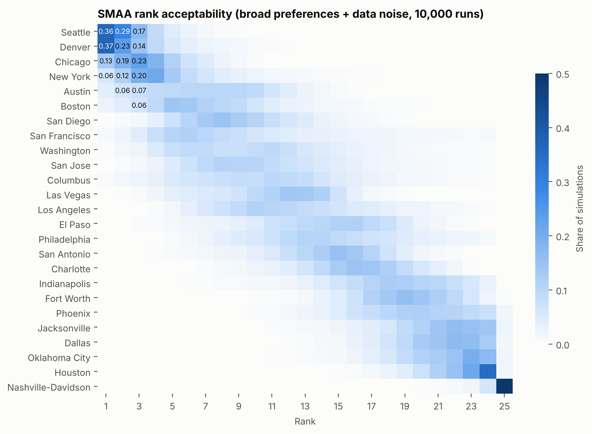
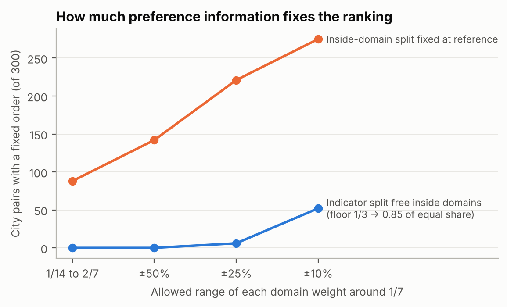

HiMCM 2026 Problem A — Original Text for Member B

Sections 1, 3, 5.1 (notation), 5.4, 5.5, 6.3, the member-B paragraphs of 6.4, and 8.5, copied unchanged from the final paper.

# 1. Introduction

## 1.1 Background

More than 15 million students attend U.S. public high schools. Most city rankings are written for adults: they weigh job markets, nightlife and home prices. A high schooler's life runs on different things: whether the nearest public school offers advanced courses, whether a bus can get her to practice and back after school, whether a counselor or a clinic will see a 16-year-old, and whether she is treated fairly. A teenager usually cannot drive and cannot choose the family budget, so the city's value to her depends on what she can reach and afford without an adult's car.

## 1.2 The task and our reading of it

1. Choose and justify criteria for a "best city for a high schooler", and discuss criteria left out.
2. Gather and cite data, apply the model, and discuss limitations.
3. Rank at least ten cities and reach a reasoned conclusion about the best one, under our own definition.
4. Show why the ranking has merit beyond opinion, and document at least one significant revision.
5. Write a one-to-two-page non-technical news article that includes our modeling process.

**Our definition of "best".** *The best city is the one that, for a family on a fixed budget, clears basic floors on cost and serious risk, and then gives a public-school student who cannot depend on car rides the most real access to education, health support, independent travel, activities and fair treatment — and keeps that lead across reasonable disagreements about what matters most.*

Three features of this definition shape the model. **Floors** come before trade-offs: no number of after-school programs should make up for a violent-crime rate above 1,200 per 100,000. **Real access** means measuring what a student can use (enrollments in advanced courses, jobs reachable by transit in 45 minutes), not how many buildings exist. **Robustness** means the answer must hold over a whole set of reasonable weightings, not a single set we chose.

**"Cannot depend on car rides."** The student does not drive and has no adult who can drive her to school, practice or work every day, so daily trips are made on foot, by bike or by transit. This describes many teenagers: in the 2022 National Household Travel Survey, half of all trips by 14–18-year-olds were as a passenger in someone else's car, and only half of 16–17-year-olds were drivers [26]. A city that works for such a student also works for one who sometimes gets a ride.

## 1.3 Our approach

<b>Measure</b> 25 cities × 20 measures in 7 domains, with error estimates

→

<b>Floors</b> rent, violent crime, air: pass / pending / fail

→

<b>Value</b> piecewise-linear curves on fixed reference points

→

<b>Robustness</b> LP over all weights; SMAA; regret; ELECTRE III

→

<b>Audit &amp; revise</b> M0 → M1 → M2 from real-data findings

The candidate pool is fixed before any score is computed: the 25 most populous U.S. cities in the Census Vintage 2025 estimates [1]. Every number in this paper is reproduced by our code from archived source files.

# 3. Criteria: What We Measure and What We Leave Out

## 3.1 Seven domains and twenty measures

We began from the needs of a 14–18-year-old rather than from available data. Each domain answers one question, and the domains stay separate even when their measures are correlated. Each measure has four fixed reference points ("nodes"): the worst node is worth 0 and the best node earns the full value of that measure. Node values come from standards where they exist (for example the 250-students-per-counselor recommendation [16] and HUD's 30% and 50% rent-burden lines [12]) and otherwise from round values that span realistic U.S. conditions. They were fixed before any city was scored.

| Domain (question) | Measure | Better | Nodes (worst → best) | Source |
|---|---|---|---|---|
| **Education** — what can a student learn? | AP, IB and dual-enrollment course enrollments per 100 students | ↑ | 10 / 25 / 40 / 55 | CRDC 2023–24 [3] |
| | Four-year graduation rate, non-charter schools (%) | ↑ | 60 / 75 / 85 / 95 | EDFacts 2020–21 [4] |
| | School counselors per 1,000 students | ↑ | 2 / 3 / 4 / 6 | CRDC 2023–24 [3] |
| **Safety** — how likely is serious harm? | Violent crimes per 100,000 residents (2022–25) | ↓ | 1200 / 900 / 600 / 300 | FBI CDE [5] |
| | Traffic deaths per 100,000 residents (2021–24) | ↓ | 20 / 14 / 8 / 2 | NHTSA FARS [6] |
| **Health** — can a student stay well? | Days with AQI above 100 (% of days, 2021–24) | ↓ | 30 / 15 / 5 / 0 | EPA AirData [7] |
| | School nurses, psychologists, social workers per 1,000 students | ↑ | 0.5 / 2 / 4 / 8 | CRDC 2023–24 [3] |
| | Youth mental-health facilities per 100,000 residents under 18 | ↑ | 2 / 6 / 12 / 20 | SAMHSA 2025 [8] |
| **Mobility** — can a student get around alone? | Jobs reachable in 45 min by transit and walking (thousands) | ↑ | 10 / 60 / 200 / 600 | EPA SLD v3 [9] |
| | National Walkability Index (1–20) | ↑ | 5.75 / 10.5 / 15.25 / 20 | EPA SLD v3 [9] |
| | Student fare for one local ride (USD) | ↓ | 2 / 1 / 0.5 / 0 | operator fare pages [10] |
| | Weekend service as a share of weekday service | ↑ | 0.3 / 0.5 / 0.7 / 0.9 | FTA NTD 2022–25 [11] |
| **Activities** — what can a student do after school? | Residents within a 10-minute walk of a park (%) | ↑ | 30 / 55 / 80 / 100 | TPL ParkScore 2026 [13] |
| | Teen library program attendance per 1,000 residents of the library's service area | ↑ | 0 / 10 / 25 / 50 | IMLS FY2023–24 [14] |
| | School sports participations per 100 students | ↑ | 10 / 20 / 35 / 50 | CRDC 2023–24 [3] |
| | Minimum wage for ages 16–17, divided by BEA all-items price parity (USD/h) | ↑ | 6.5 / 10 / 14 / 18 | DOL, state laws [15]; BEA [2] |
| **Affordability** — can the family pay? | Two-bedroom Fair Market Rent as % of $80,000 income | ↓ | 50 / 40 / 30 / 15 | HUD FY2024 [12] |
| | Prices of goods and other services (U.S. = 100) | ↓ | 110 / 105 / 100 / 95 | BEA RPP 2024 [2] |
| **Inclusion** — is the student treated fairly? | City non-discrimination laws and municipal services (% of HRC MEI parts I and III, 42 points) | ↑ | 25 / 50 / 75 / 100 | HRC MEI 2025 [17] |
| | Students suspended out of school per 100 | ↓ | 16 / 10 / 5 / 0 | CRDC 2023–24 [3] |

**Avoiding double counting.** Counselors appear only in education; nurses, psychologists and social workers only in health. Housing is excluded from the BEA price measure because rent is measured directly. Transit service and transit access are not both scored: in M2 the access measure already contains the service it uses (Section 7).

**Transit access data.** The access field is coded −99999 where no transit stop lies within walking distance; we count these residents as reaching 0 jobs. Unlike the frequency field of Revision 1, this code is reliable: in every city the share of residents coded −99999 equals the share with no stop within walking distance. The field uses 2020 timetables and 2017 job locations.

## 3.2 Criteria we considered and left out

| Criterion | Reason left out |
|---|---|
| Weather and climate | A matter of taste, not of opportunity; it belongs in a personal profile, not in the definition of "best" |
| College and university rankings | A nearby top university does not make it easier for local students to get in. Public universities favor residents of the state and the top students of every high school in it (UT Austin admits the top 6% of each Texas high school; UC guarantees a place to the top 9% of each California high school), so every city in a state gets the same advantage; private universities admit nationally. What a city adds before graduation, college courses taken in high school, is measured by dual enrollment |
| Test scores (SEDA) | Cover grades 3–8, not high school; state high-school tests differ by state and cannot be compared across our cities |
| Nightlife, restaurants, job growth | Weakly related to ages 14–18 |
| Teen employment rate | Mixes opportunity with need: a high rate can mean students must work |
| Racial and ethnic diversity | Describes who lives there, not how students are treated; kept as background only |
| Walk Score, AllTransit | Measure the same things as our EPA walkability and transit-access measures; scoring both would count the same thing twice |
| Youth survey outcomes (YRBS) | Available for only 12 of 25 cities; used to validate the model instead (Section 8.4) |
| Adult health outcomes (CDC PLACES) | Measures adults; teenagers' needs differ |

## 3.3 The candidate cities

The pool is the 25 most populous cities in the Census Vintage 2025 estimates [1], with each city as the Census defines it. Indianapolis and Nashville share their governments with their counties; for them the Census ranks the "balance", the merged city-county minus the small towns inside it that keep their own governments (for example Belle Meade in Nashville), and we use the same area for every measure. The list was frozen before any data were scored, so no city was added or dropped to favor a result.

# 5. The Model

## 5.1 Notation

| Symbol | Meaning |
|---|---|
| $i, k$ | cities, $i = 1,\dots,25$ |
| $j$ | measures, $j = 1,\dots,20$; $d(j)$ is the domain of measure $j$ |
| $x_{ij}$, $s_{ij}$ | value of measure $j$ in city $i$ and its standard deviation |
| $t_{j0},\dots,t_{j3}$ | fixed nodes of measure $j$ (worst to best) |
| $\phi_{ijl}\in[0,1]$ | how much of segment $l$ of measure $j$ city $i$ covers |
| $\theta_{jl}\ge 0$ | value of segment $l$ of measure $j$; $\theta$ collects all 60 of them |
| $\Theta$ | set of allowed preference vectors; $\theta^0$ is the reference vector |
| $U_i(\theta)$ | overall value of city $i$, between 0 and 1 |

## 5.4 Step 3: the set of reasonable preferences

People disagree about how much, say, advanced courses are worth compared with after-school activities, or lower prices compared with better transit. Instead of one weight vector, we keep the whole set $\Theta$ of vectors that satisfy:

- **Normalization:** $\theta\ge0$ and $\sum\theta=1$, so $U_i\in[0,1]$.
- **Diminishing returns:** $\theta_{j0}\ge\theta_{j1}\ge\theta_{j2}$ for every measure, and the last segment keeps at least 10% of the measure's value.
- **Balanced domains:** each domain receives between half and double an equal share, $\tfrac1{14}\le\sum_{j\in D}\theta_j\le\tfrac27$.
- **No measure ignored:** within a domain, each measure receives at least one third of an equal share of that domain.

In symbols, write $W_j=\sum_l\theta_{jl}$ for the total value of measure $j$ and $W_D=\sum_{j\in D}W_j$ for domain $D$, which has $n_D$ measures. Then

$$
\Theta=\Big\{\theta\ge0:\ \textstyle\sum\theta=1,\ \ \theta_{j0}\ge\theta_{j1}\ge\theta_{j2}\ge0.1\,W_j,\ \ \tfrac1{14}\le W_D\le\tfrac27,\ \ W_j\ge\dfrac{W_{d(j)}}{3\,n_{d(j)}}\Big\}.
$$

The **reference vector** $\theta^0$ gives each domain 1/7 and splits it equally among its measures. Within each measure, it splits the value 0.563 / 0.289 / 0.148 across the three segments. These are the values of the smooth curve $u(z)=(1-e^{-2z})/(1-e^{-2})$ at $z=\tfrac13,\tfrac23,1$, a moderate diminishing return.

**Our stated preferences $\Theta_S$.** Our definition in Section 1.2 implies six further statements, each tied to a sentence of the definition:

| | Statement | Reason in our definition |
|---|---|---|
| P1 | Education weight ≥ Affordability weight | The budget is handled by the rent floor; extra savings above it are a softer preference |
| P2 | Mobility weight ≥ Affordability weight | Same reason, for independent travel |
| P3 | Mobility weight ≥ 1/7 | The student cannot rely on car rides |
| P4 | Education weight ≥ 1/7 | Access to school and courses is the first purpose |
| P5 | Each measure gets 0.6–1.4 times an equal share inside its domain, ${}0.6\,W_D/n_D\le W_j\le1.4\,W_D/n_D$ | Every core measure covers its own part of the domain |
| P6 | Safety weight ≥ 1/7 | "Serious risk": the crime floor catches only extreme rates, so safety keeps at least an equal share |

$\theta^0$ satisfies all six. $\theta^0$ is a benchmark, not our decision rule. It gives one transparent scorecard (Figure 1, Section 5.8) and the starting point of single-vector checks; the ranking itself is decided over $\Theta_S$ (Table 1).

## 5.5 Step 4: what holds for every reasonable preference (linear programs)

For two cities $a$ and $b$, we solve

$$
\underline{\Delta}_{ab}=\min_{\theta\in\Theta}(\phi_a-\phi_b)^{\top}\theta,\qquad
\overline{\Delta}_{ab}=\max_{\theta\in\Theta}(\phi_a-\phi_b)^{\top}\theta .
$$

If $\underline\Delta_{ab}\ge0$, city $a$ is at least as good as $b$ under **every** reasonable preference: a *necessary* preference. If $\overline\Delta_{ab}\ge0$, there is **some** preference under which it is: a *possible* preference. Both are linear programs because $\Theta$ is defined by linear inequalities. This is the idea of robust ordinal regression [18].

A city can win only if a **single** vector makes it at least as good as all others at once. We test this by maximizing a margin $\varepsilon$ subject to $(\phi_i-\phi_k)^{\top}\theta\ge\varepsilon$ for all $k$ and $\theta\in\Theta$. City $i$ is a *possible winner* if the best $\varepsilon\ge0$. Beating each rival with a different weighting is not enough.

**Data uncertainty in the LP.** Each value of $\phi$ rises with the measure's quality and $\theta\ge0$. So, for any $\theta$, the worst case of $U_a-U_b$ over all data inside the 90% intervals puts $a$ at the bad end and $b$ at the good end. One LP with these two fixed rows therefore gives an exact robust answer for both preference and data uncertainty.

# 6. Results: The Ranking

## 6.3 How stable is the ranking? (all reasonable preferences)

Over the full set $\Theta$, the LPs fix the order of **no** pair of cities, and all 25 cities are possible winners. The broad set allows extreme views (one domain at double weight, another at half), and almost any city has a domain in which it excels. Frequency, not possibility, then separates the cities (Figure 2):

- **First place:** Seattle 41.4%, Denver 40.5%, New York 6.7%, Austin 5.1% and Boston 2.7%.
- **Top three:** Seattle 86.8% and Denver 80.8%.
- **90% rank intervals:** Seattle 1–5, Denver 1–7 and New York 1–11.

<figure><figcaption>Figure 2. Share of 10,000 SMAA draws (broad preference set plus data noise) in which each city takes each rank.</figcaption></figure>

## 6.4 Under our stated definition: the final ranking

Adding statements P1–P6 narrows $\Theta$ to $\Theta_S$:

- **Fixed pairs:** seven pairs now have a necessary order (New York, Denver, Chicago and Austin above Nashville; Austin above Dallas, Fort Worth and Houston).
- **Possible winners:** six cities can no longer rank first under any preference in $\Theta_S$: Fort Worth, Phoenix, Dallas, Jacksonville, Houston and Nashville.

**What the stated preferences weigh.** The reference vector $\theta^0$ sits on the edge of $\Theta_S$: it gives education, mobility and affordability the same weight, the least that P1–P4 allow, and safety the 1/7 that P6 requires. The average of 10,000 vectors drawn from $\Theta_S$ (Step 5) gives education, mobility and safety 0.18 each, affordability 0.10 and the other three domains 0.11 each. Under this single vector Seattle scores 0.808, New York 0.788 and Denver 0.779.

**Why P6.** Without P6, statements P1–P4 raise education and mobility and leave safety at 0.127 on average, below an equal share, although our definition names serious risk and the crime floor catches only extreme rates. P6 raises Seattle's share of first places from 67.4% to 75.0% and moves New York ahead of Denver, whose violent-crime rate (978 per 100,000) is the highest of the three leaders.

[Section 6.4: "Table 1 gives the final ranking", Table 1, "Why Seattle", "Why the others trail" — studied by member C, omitted here.]

**Leave-one-statement-out check.** Removing any single statement P1–P6 keeps Seattle first in SMAA (62.2–74.6%) and keeps it the minimum-regret city. P1 and P2 both limit affordability; removing them together still leaves Seattle first (72.2% against New York's 11.9%). All seven necessary pairs depend on P5; without it the count returns to 0.

[Section 6.4: "ELECTRE III" — studied by member D, omitted here.]

# 8. Why the Ranking Is More Than Our Opinion

## 8.5 How much agreement would settle the ranking?

Figure 5 shows how the number of fixed pairs grows as preferences are narrowed. Most of the disagreement lies **inside** domains (how to split, say, safety between crime and traffic), not between domains. If the split inside domains is fixed at the reference, 88 of 300 pairs are already settled. If, in addition, every domain weight is held within ±25% of 1/7, 221 pairs are settled. In the opposite case, with every domain weight fixed at exactly 1/7 and the split inside domains left free, only 4 pairs are settled. Agreeing on how each domain is measured settles more of the ranking than agreeing on how much each domain matters.

<figure><figcaption>Figure 5. City pairs whose order is fixed for every preference in $\Theta$, as the set is narrowed. Upper line: the split inside domains and the value curves are fixed at $\theta^0$. Lower line: everything varies, and each measure's minimum share of its domain rises from 1/3 to 0.6 and 0.85 of an equal share.</figcaption></figure>
