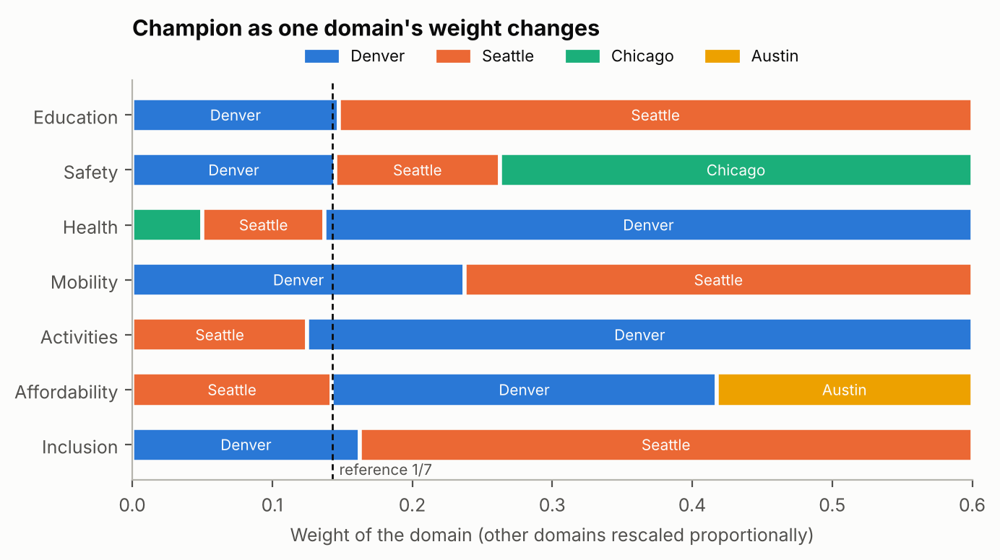
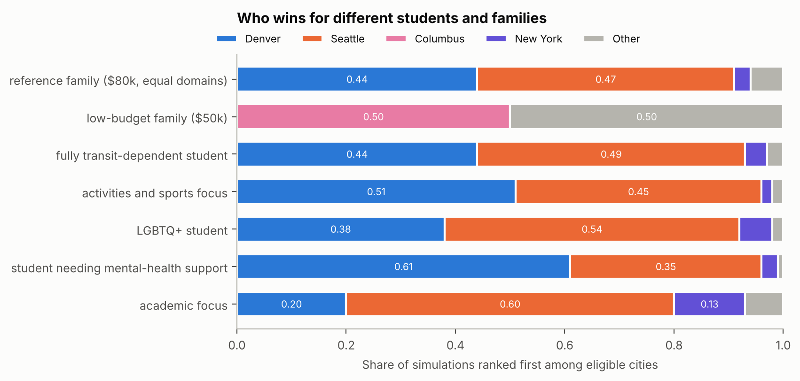
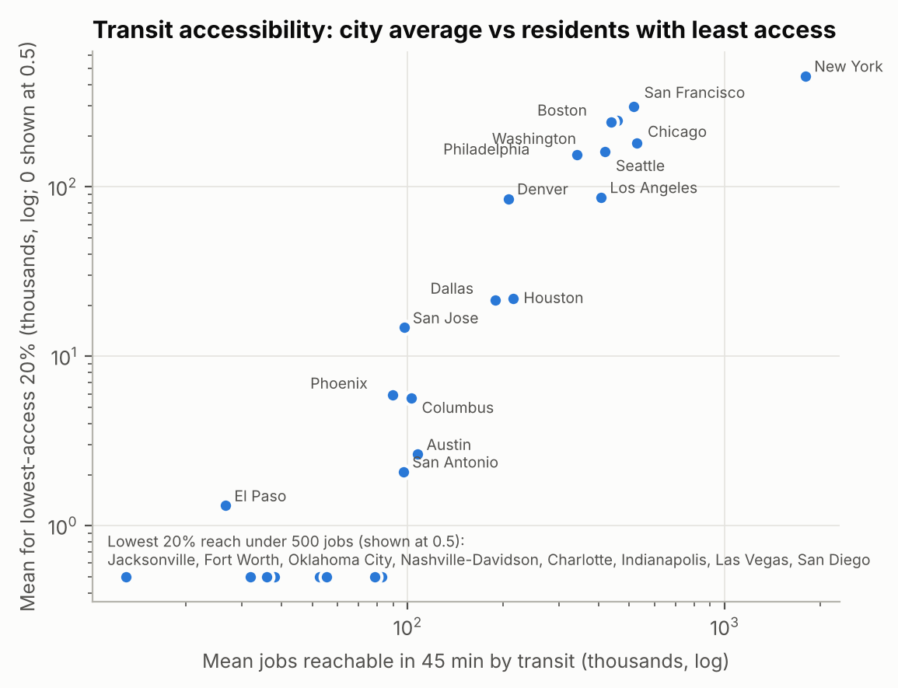

**HiMCM 2026 A 论文 · 组员 C 专用讲解**

**SMAA 与后悔值**

**这份文档是什么。** 只收组员 C 负责的部分：英文原文照抄，每段后面接中文讲解（米黄色框），课程外的知识写成补充知识卡（绿色框）。原文和讲解与全文讲解总版完全一致，这里只是把你的部分单独拿出来；表中页码指总版的页码。

**标记说明（对照 2026-11-12 发给全组的原讲解版，52 页）**

| 标记 | 含义 |
|---|---|
| 本版更新 | 原讲解版就有这个讲解框，本版按修改后的论文改过；框里这样高亮的句子是改写或新加的，其余句子与原讲解版一字不差 |
| 本版新增 | 原讲解版没有这个讲解框，是本版为新增的论文内容写的 |
| 英文原文中高亮的句子 | 论文原文本版改过的句子；新增或改过的整行公式用同样的底色框出 |
| 无标记 | 与原讲解版完全相同 |

**你负责的内容**

| 部分 | 总版页码 | 一句话说明 |
|---|---|---|
| 5.1 记号（先修，属于 A） | 19–20 | 看懂 $x$、$\phi$、$\theta$、$\Theta$、$U$ 这几个符号，后面全靠它们 |
| 5.6 SMAA | 27–30 | (a)–(d) 四步；最终权重是三层份额的乘积；拒绝抽样与通过率；排名规则；第一名比例、平均名次、中心权重、置信因子的公式；标准误与三对并列 |
| 5.7 前半段 极小化最大后悔 | 30–31 | 后悔的定义；两个 max 为什么能交换；三城市例子 |
| 6.4 中的表 1 与解读 | 38–40 | 表 1 每一列和 ‡ 并列标记；为什么是 Seattle；New York、Denver、Chicago 落后的原因 |
| 8.3 敏感性分析、图 4 | 45–48 | 领域权重扫描；节点 ±10%；误差放大与误差同向；逐个去掉指标；其他数据选择；泊松–伽马；在 Θ_S 下重做的检验 |
| 第 9 章 谁该选哪个城市、图 6、图 7 | 50–54 | 六类学生；收入与房租底线；城市内部：Seattle 仅 38.5%；对数坐标 |
| 第 12 章 新闻稿 | 57–61 | 新闻稿怎么用大白话讲底线和 SMAA；四舍五入后的数字对应论文哪个数 |

补充知识卡：K9（单纯形上的均匀抽样与拒绝抽样）、K11（SMAA 的输出）、K12（极小化最大后悔）、K20（泊松–伽马与收缩）；先修 K1、K2。

**建议学习顺序**：先读 5.1 记号和 K1、K2，再按 5.6 → 5.7 前半段 → 6.4 的表 1 → 8.3 → 第 9 章 → 第 12 章的顺序读。5.6 是重点，K9 和 K11 要和 5.6 的 (a)–(d) 四步对照着读。

**先修：5.1 记号（属于组员 A，你必须看懂）。** 后面的 SMAA 抽样、排名和后悔值全部用这些符号写成。

# 5. The Model

## 5.1 Notation

| Symbol | Meaning |
|---|---|
| $i, k$ | cities, $i = 1,\dots,25$ |
| $j$ | measures, $j = 1,\dots,20$; $d(j)$ is the domain of measure $j$ |
| $x_{ij}$, $s_{ij}$ | value of measure $j$ in city $i$ and its standard deviation |
| $t_{j0},\dots,t_{j3}$ | fixed nodes of measure $j$ (worst to best) |
| $\phi_{ijl}\in[0,1]$ | how much of segment $l$ of measure $j$ city $i$ covers |
| $\theta_{jl}\ge 0$ | value of segment $l$ of measure $j$; $\theta$ collects all 60 of them |
| $\Theta$ | set of allowed preference vectors; $\theta^0$ is the reference vector |
| $U_i(\theta)$ | overall value of city $i$, between 0 and 1 |

**5.1 记号表逐行讲。** 第 5 节是全文数学最集中的地方，先把符号认全：

- $i,k$：城市编号，1 到 25。用两个字母是因为经常要比较"城市 $i$ 和城市 $k$"。
- $j$：指标编号，1 到 20。$d(j)$ 表示指标 $j$ 属于哪个领域，比如"辅导员"属于教育。
- $x_{ij}$：城市 $i$ 在指标 $j$ 上的原始数值（比如 Seattle 的暴力犯罪率 777）；$s_{ij}$ 是它的标准差（第 4.2 节）。
- $t_{j0},t_{j1},t_{j2},t_{j3}$：指标 $j$ 的四个固定节点，从最差到最好。四个点把范围切成三段，编号 $l=0,1,2$。
- $\phi_{ijl}$：城市 $i$ 在指标 $j$ 的第 $l$ 段上"走完了多少"，在 0 到 1 之间。0 是这段一点没走，1 是整段走完。
- $\theta_{jl}$：走完指标 $j$ 第 $l$ 段能拿多少分。20 个指标 × 3 段 = 60 个数，合起来记成一个 60 维向量 $\theta$。$\theta$ 就是"偏好"或"权重"。
- $\Theta$：所有被认为合理的 $\theta$ 组成的集合（第 5.4 节）；$\theta^0$ 是其中一个特定的参考向量。
- $U_i(\theta)$：在偏好 $\theta$ 下城市 $i$ 的总分，在 0 到 1 之间。写成 $U_i(\theta)$ 是在强调：总分取决于用哪组权重。

**补充知识 K1　求和、向量的点积与转置记号**

**双重求和。** $\sum_{j=1}^{20}\sum_{l=0}^{2}a_{jl}$ 表示：对每个 $j$（1 到 20），先把 $l=0,1,2$ 三项加起来，再把 20 个结果加起来。一共 60 项。

**向量就是一列数。** P3 里的三维向量 $\begin{pmatrix}a_1\\a_2\\a_3\end{pmatrix}$ 有 3 个分量；这里的 $\theta$ 有 60 个分量，只是画不出来，运算规则完全一样。

**点积（数量积）。** P3 学过 $\mathbf a\cdot\mathbf b=a_1b_1+a_2b_2+a_3b_3$。60 维时就是 60 对分量相乘再相加：

$$\phi_i\cdot\theta=\sum_{n=1}^{60}\phi_{i,n}\,\theta_n .$$

**转置记号 $\phi_i^{\top}\theta$。** 在线性代数里，向量默认竖着写（列向量）。右上角的 $\top$（transpose，转置）把竖的变成横的。FP1 学过矩阵乘法："横 × 竖"就是对应相乘再相加。所以 $\phi_i^{\top}\theta$ 和点积 $\phi_i\cdot\theta$ 是同一个数，只是写法不同。论文的总分公式

$$U_i(\theta)=\phi_i^{\top}\theta$$

意思就是：城市 $i$ 的总分 = 它在 60 个小段上的完成度，分别乘上每段的分值，再全部加起来。

**这个写法的好处。** 总分对 $\theta$ 是**线性**的：$\theta$ 翻倍，总分翻倍；两组权重相加，总分也相加。第 5.5 节的线性规划全靠这一点。

**补充知识 K2　集合记号与"约束集合"**

- **花括号定义集合**：$\{\,i:\ \text{条件}\,\}$ 读作"所有满足条件的 $i$ 组成的集合"。例如 $\{\,x:\ x^2<4\,\}$ 就是区间 $(-2,2)$。
- **属于**：$\theta\in\Theta$ 读作"$\theta$ 属于 $\Theta$"，即 $\theta$ 是集合 $\Theta$ 里的一个元素。
- **约束集合**：$\Theta$ 是用一串不等式定义的集合。每个不等式像一堵墙，墙围起来的区域就是 $\Theta$。二维的例子：$\{(x,y):\ x\ge0,\ y\ge0,\ x+y\le1\}$ 是一个三角形。$\Theta$ 是同样的东西，只是在 60 维空间里，墙也多得多。
- **$\min_{\theta\in\Theta}f(\theta)$**：在集合 $\Theta$ 里找让 $f$ 最小的那个 $\theta$，结果是那个最小值。$\max$ 同理。
- **$\Theta_S\subset\Theta$**：$\Theta_S$ 是在 $\Theta$ 的墙里再加几堵墙，所以更小。

## 5.6 Step 5: how often each city wins (SMAA)

The LP says what is possible; SMAA [19] says how common it is. We repeat the following round $N=10{,}000$ times.

本版更新 **5.6 第五步：每个城市多常赢（SMAA）。** 线性规划回答"有没有可能"，SMAA 回答"有多常见"。例如第 6.3 节会看到，在宽集合 $\Theta$ 下 25 个城市都是"可能赢家"，光看可能性分不出高下；SMAA 告诉我们各自赢的频率。

这一节按审计意见重写成了四个编号步骤，每一轮模拟依次做 (a) 抽一组权重、(b) 抽一套带误差的数据、(c) 打分并排名、(d) 一万轮之后汇总。历年 O 奖论文写蒙特卡洛都是这样分步写、给公式的，下面逐步讲。

**(a) Draw a preference vector.** Every $\theta$ in $\Theta$ is a product of three nested shares,

$$
\theta_{jl}=W_{d(j)}\cdot v_j\cdot g_{jl},\qquad v_j=\frac{W_j}{W_{d(j)}},\qquad g_{jl}=\frac{\theta_{jl}}{W_j},
$$

and each constraint of Section 5.4 limits only one level. We draw each level from the flat Dirichlet distribution, which is uniform over all non-negative vectors that sum to 1, and redraw whenever that level breaks a constraint:

1. *Domain weights* $(W_1,\dots,W_7)$: kept only if every $W_D$ lies in $[\tfrac1{14},\tfrac27]$ (about 1 draw in 83).
2. *Measure shares* $v_j$ inside each domain: kept only if every $v_j\ge\tfrac1{3n_D}$; under $\Theta_S$, $\tfrac{0.6}{n_D}\le v_j\le\tfrac{1.4}{n_D}$ (P5).
3. *Segment shares* $(g_{j0},g_{j1},g_{j2})$ of each measure: sorted from largest to smallest (diminishing returns) and kept only if $g_{j2}\ge0.10$.
4. Under $\Theta_S$, the assembled $\theta$ is kept only if it also satisfies P1–P4 and P6 (3.8% of accepted domain draws).

All 10,000 vectors therefore lie in $\Theta$ (or $\Theta_S$). Sorting a flat Dirichlet draw keeps it uniform over the ordered region, so each level is uniform over its allowed range and every allowed set of domain weights is equally likely. The 60 values are uniform level by level, not over $\Theta$ as a whole; we chose this because families disagree mainly about domain weights.

本版新增 **(a) 抽一组权重：最终的 60 个数怎么拼出来。** 第一个式子说，每个 $\theta_{jl}$ 是三层份额的乘积：

- $W_{d(j)}$：指标 $j$ 所在领域的权重（7 个领域加起来为 1）；
- $v_j$：指标 $j$ 在本领域里占的份额（同一领域的加起来为 1）；
- $g_{jl}$：指标 $j$ 的价值在三段之间的分配（三段加起来为 1）。

例如领域权重 0.18、指标在领域内占 0.35、第一段占 0.55，则 $\theta_{j0}=0.18\times0.35\times0.55\approx0.035$。

5.4 节的每条约束只管其中一层，所以可以一层一层地抽、一层一层地检查：

1. **领域权重**：从平坦狄利克雷分布抽 7 个数（K9），只要有一个不在 $[1/14,\,2/7]$ 就整组扔掉重抽。大约 83 次才留下 1 次（通过率 1.21%）。
2. **领域内份额**：同样抽，检查"不忽略指标"；在 $\Theta_S$ 下检查 P5（每个指标在平分份额的 0.6 到 1.4 倍之间）。P5 下 2 个指标的领域通过率 40%，3 个指标 11%，4 个指标 3.2%。
3. **三段份额**：抽 3 个数后**从大到小排序**，自动满足边际递减；再检查最后一段至少 10%（通过率 49%）。
4. **偏好陈述**：在 $\Theta_S$ 下，拼好的权重还要满足 P1–P4 和 P6。在已通过第 1 步的领域权重里，只有 3.8% 能通过这一步。

扔掉的都会重抽，所以一万组全部落在 $\Theta$（或 $\Theta_S$）里。最后一句是一个重要的诚实说明：每一层各自均匀，但 60 个数合起来在整个集合上**不是**均匀的；论文给出的理由是家庭真正有分歧的是领域权重，逐层均匀能让每种领域权重组合的机会相等。

本版更新 **补充知识 K9　在"总和为 1"的约束下均匀抽样与拒绝抽样**

（课程外。FS1 学过连续均匀分布：在 $[a,b]$ 上概率密度为常数。）

**问题**：要抽 3 个非负数 $g_0,g_1,g_2$，要求 $g_0+g_1+g_2=1$，并且所有满足条件的组合被抽中的机会均等。

**方法**：抽两个独立的 $U(0,1)$ 随机数，排序得 $u_{(1)}\le u_{(2)}$，把区间 $[0,1]$ 切成三段，取三段长度：

$$g_0=u_{(1)},\quad g_1=u_{(2)}-u_{(1)},\quad g_2=1-u_{(2)} .$$

三段长度非负、加起来是 1，而且可以证明所有组合机会均等。这个分布叫**平坦的狄利克雷分布**（flat Dirichlet）。抽 7 个领域权重就切 6 刀，抽 $n$ 个就切 $n-1$ 刀。

**拒绝抽样**：要求权重还要满足额外条件（比如每个领域在 ${}1/14$ 到 ${}2/7$ 之间）时，最简单的办法是：照常抽，不满足条件的整组扔掉，重新抽。留下来的仍然在"满足条件的区域"里机会均等。

**论文的三层抽法**：

1. 7 个领域权重：平坦狄利克雷，拒绝超出 $[1/14,\,2/7]$ 的。
2. 每个领域内各指标的分配：平坦狄利克雷，拒绝不满足"不忽略任何指标"（或 $\Theta_S$ 的 P5）的。
3. 每个指标三段的分配：平坦狄利克雷抽出三个数后**从大到小排序**，满足 $\theta_{j0}\ge\theta_{j1}\ge\theta_{j2}$；再拒绝最后一段小于 10% 的。

最后 $\theta_{jl}=$ 领域权重 × 指标在领域内的份额 × 段的份额。对 $\Theta_S$，再拒绝不满足 P1–P4 和 P6 的。

**要注意**：每一层各自均匀，但乘起来的 60 维 $\theta$ 在整个 $\Theta$ 上并不均匀。论文第 (a) 步最后一句如实说明了这一点。

**为什么排序后仍然均匀。** 平坦狄利克雷对三个分量是对称的：$(0.2,0.5,0.3)$ 和 $(0.5,0.3,0.2)$ 被抽中的机会一样。把每组都排成从大到小，相当于把 6 种排列"叠"到同一个有序区域上，每个有序组合得到的概率仍然相同。

**(b) Draw a data set.** Each value is perturbed independently, $\tilde x_{ij}=x_{ij}+s_{ij}\varepsilon_{ij}$ with $\varepsilon_{ij}\sim N(0,1)$; measures treated as exact (Section 4.2) have $s_{ij}=0$. A missing cell takes the value of a randomly chosen city among those that report the measure. A value pushed beyond the end nodes needs no correction, because $\phi$ clips it to $[0,1]$.

本版新增 **(b) 抽一套数据。** 每个数据加上独立的正态误差：$\tilde x_{ij}=x_{ij}+s_{ij}\varepsilon_{ij}$，$\varepsilon_{ij}\sim N(0,1)$，所以 $\tilde x_{ij}\sim N(x_{ij},s_{ij}^2)$。7 个当作精确值的指标 $s_{ij}=0$，不加误差。缺失的格子（San Francisco 的学校体育、Washington 的 HRC）每一轮从报告了该指标的城市里**等概率随机挑一个城市**，用它的值。加了误差可能超出节点范围（例如变成负数），不用处理，因为 $\phi$ 会把它截断到 0 到 1 之间（K4）。

**(c) Score and rank.** $U_i=\tilde\phi_i^{\top}\theta$ and $r_i=1+\#\{k:\ U_k>U_i\}$. No two cities tied in any round.

本版新增 **(c) 打分并排名。** 用这一轮的权重和数据算 25 个总分 $U_i$，名次 $r_i=1+\#\{k:\ U_k>U_i\}$，即"比我分数高的城市个数加 1"。$\#$ 表示"个数"。实际一万轮里没有出现过两个城市分数完全相同的情况，所以不用规定并列怎么处理。

**(d) Summarize.** Over the $N$ rounds,

$$
p^{(1)}_i=\frac1N\sum_{n=1}^{N}\mathbf 1\big[r^{(n)}_i=1\big],\qquad
p^{(3)}_i=\frac1N\sum_{n=1}^{N}\mathbf 1\big[r^{(n)}_i\le3\big],\qquad
\bar r_i=\frac1N\sum_{n=1}^{N}r^{(n)}_i .
$$

The final ranking (Table 1) orders cities by mean rank $\bar r_i$. A city's *central weight vector* $\theta^c_i$ is the average of $\theta^{(n)}$ over the rounds it wins; its *confidence factor* is the share of 5,000 new data sets in which it ranks first with $\theta$ fixed at $\theta^c_i$. The 90% rank interval runs from the 5th to the 95th percentile of $r^{(n)}_i$. Fixing $\theta=\theta^0$ and drawing only data gives the "data noise only" runs of Sections 6.1 and 8.3.

本版新增 **(d) 汇总。** 三个公式里的 $\mathbf 1[\cdot]$ 是**示性函数**：括号里的条件成立取 1，不成立取 0。所以

- $p^{(1)}_i$：一万轮里城市 $i$ 排第一的轮数 ÷ 一万，即"夺冠比例"；
- $p^{(3)}_i$：排前三的比例；
- $\bar r_i$：名次的平均值，表 1 按它排序。

**中心权重**：只看城市 $i$ 拿第一的那些轮，把这些轮的权重向量取平均。**置信因子**：把权重固定为这个中心权重，另抽 5,000 套数据，看 $i$ 还有多少比例排第一。中心权重和置信因子都用表 1 同一批抽样计算（审计时发现原来用的是另一批，Denver 的数字因此改过）。**90% 名次区间**：名次的第 5 和第 95 百分位数。**"只有数据噪声"**：权重固定为 $\theta^0$、只抽数据，第 6.1、8.3 节会用到。

本版更新 **补充知识 K11　SMAA 的几个输出**

SMAA = Stochastic Multicriteria Acceptability Analysis（随机多准则可接受度分析）。（课程外。）

- **排名可接受度**：城市 $i$ 排第 $r$ 名的次数占总次数的比例。"排第一的比例"是 $r=1$ 的那一项；"进前三"是 $r=1,2,3$ 三项相加。图 2 就是这张"城市 × 名次"的比例表。
- **平均名次**：所有模拟中名次的平均值。表 1 按它排序。
- **中心权重**：在城市 $i$ 拿第一的那些模拟里，把权重向量取平均。它代表"支持 $i$ 当第一的典型偏好"。
- **置信因子**：把权重固定为城市 $i$ 的中心权重，只让数据随机变化，$i$ 仍排第一的比例。它回答：如果某人的偏好正好是支持 $i$ 的典型偏好，数据误差会不会推翻 $i$ 的第一？第 6.4 节报告 Seattle 98.9%、New York 65.0%、Denver 38.9%：Seattle 的支持者几乎不会因为数据误差而改变结论，Denver 的支持者有六成情况会。

**Precision.** The standard error of a share is at most $\sqrt{0.25/N}=0.005$ and that of a mean rank at most 0.03. Neighbors in Table 1 differ by more than five standard errors of their gap, except three pairs (San Diego and Chicago, San Jose and Los Angeles, Houston and Oklahoma City, at most 2.1 standard errors), which we treat as tied.

本版新增 **精度。** 比例的标准误不超过 $\sqrt{0.25/N}=0.005$（推导见 K10）。平均名次的标准误最大 0.03。更重要的是相邻两名之间差距的标准误：表 1 里大多数相邻城市的差距超过 5 个标准误，可以放心说谁在前；但有三对差距不到 2.2 个标准误，即 San Diego 与 Chicago、San Jose 与 Los Angeles、Houston 与 Oklahoma City，论文把它们当作**并列**，在表 1 里用 ‡ 标出。计算脚本：`analysis/model/run_table1_precision.py`。

## 5.7 Step 6: two cross-checks with different philosophies

**Minimax regret** [25] answers a cautious family's question: "If I pick city $i$ and my true preferences are the worst case for that choice, how much value do I lose against the best city?"

$$
R_i=\max_{\theta\in\Theta}\Big[\max_k U_k(\theta)-U_i(\theta)\Big]
=\max_k\ \overline{\Delta}_{ki}.
$$

It reuses the pairwise LPs (over $\Theta_S$ in Table 1); the city with the smallest $R_i$ is the cautious choice.

本版更新 **5.7 第六步之一：极小化最大后悔。** 设想一个谨慎的家庭：它不知道自己"真正的"权重是哪一组，最怕的是选完以后发现另一个城市好得多。对每个城市算"最坏情况下会后悔多少"，再选后悔最小的那个。公式的两个等号：

- 第一个式子是定义：对每组权重 $\theta$，后悔 = 当时最好的城市的分数 − 城市 $i$ 的分数；在所有 $\theta$ 中取最大，就是最坏情况的后悔。
- 第二个式子：两个"取最大"可以交换次序（先挑 $\theta$ 再挑 $k$，和先挑 $k$ 再挑 $\theta$，最后找到的都是所有组合里的最大值）。交换后，里面那层 $\max_\theta(U_k-U_i)$ 正好是第 5.5 节已经算过的 $\overline\Delta_{ki}$。所以后悔值不用另外计算，直接复用两两比较的线性规划结果。表 1 里的后悔值是在 $\Theta_S$ 上算的，所以公式里的 $\Theta$ 换成 $\Theta_S$。

**补充知识 K12　极小化最大后悔（minimax regret）**

（课程外，来自决策论，Savage 1951。）

**例子**：三个城市，两种可能的偏好（$\theta^{(1)}$ 重学校，$\theta^{(2)}$ 重成本），总分如下。

| 城市 | $\theta^{(1)}$ 下的分数 | $\theta^{(2)}$ 下的分数 |
|---|---|---|
| A | 0.80 | 0.70 |
| B | 0.85 | 0.60 |
| C | 0.70 | 0.78 |
| 当时最好 | 0.85（B） | 0.78（C） |

**后悔 = 当时最好 − 自己**：

| 城市 | $\theta^{(1)}$ 下的后悔 | $\theta^{(2)}$ 下的后悔 | 最大后悔 |
|---|---|---|---|
| A | 0.05 | 0.08 | **0.08** |
| B | 0 | 0.18 | 0.18 |
| C | 0.15 | 0 | 0.15 |

A 在两种偏好下都不是第一，但最大后悔最小，所以"极小化最大后悔"选 A。它奖励"在任何偏好下都不会差太多"的城市。

**名字的意思**：先对每个选项求最大（max）后悔，再在选项之间取最小（min），所以叫 minimax。论文中 $\theta$ 不是两种，而是整个集合 $\Theta$ 里的无穷多种，所以要用线性规划求最大值。

**（5.7 节的"ELECTRE III [20] does not allow"归组员 D，这里略去。）**

# 6. Results: The Ranking

## 6.4 Under our stated definition: the final ranking

**（6.4 节的"Adding statements P1–P6 narrows Θ to"、"What the stated preferences weigh"、"Why P6"归组员 B，这里略去。）**

Table 1 gives the final ranking by mean SMAA rank under $\Theta_S$ with data noise. With each city's central weight vector fixed and only the data varying, Seattle wins 98.9% of draws (its confidence factor); New York's is 65.0% and Denver's 38.9%.

本版更新 **表 1 的排序方法和置信因子。** 最终排名按 $\Theta_S$ 下 SMAA 的**平均名次**排序。置信因子（K11）：把各城市的中心权重固定、只让数据变，Seattle 赢 98.9%，New York 65.0%，Denver 只有 38.9%。中心权重和置信因子都用表 1 同一批抽样计算。

**Table 1. Final ranking (stated preferences $\Theta_S$, 10,000 draws with data noise).** "Ref." is the reference scorecard rank; regret is on the 0–1 value scale. San Francisco fails a floor and is listed without a rank; the simulation includes all 25 cities, and leaving San Francisco out changes no other city's position. ‡ marks neighbors whose mean ranks differ by less than 2.2 standard errors; we treat them as tied.

| Rank | City | Mean rank | First | Top 3 | Max regret | Ref. | Floors ($80k) | Status |
|---|---|---|---|---|---|---|---|---|
| 1 | **Seattle** | 1.32 | 75.0% | 99.1% | **0.151** | 2 | pass | **Best city** |
| 2 | New York | 2.49 | 14.0% | 85.2% | 0.221 | 3 | pass | runner-up |
| 3 | Denver | 3.54 | 7.8% | 60.3% | 0.210 | 1 | pass | leads at equal weights |
| — | San Francisco | 5.83 | 0.7% | 17.9% | 0.235 | 8 | **fail** | fails rent floor, not ranked |
| 4 | Boston | 6.05 | 0.7% | 12.1% | 0.249 | 5 | pass |  |
| 5 | Austin | 6.30 | 1.7% | 15.7% | 0.307 | 6 | pass |  |
| 6 ‡ | San Diego | 7.17 | 0.0% | 3.8% | 0.275 | 7 | pass |  |
| 7 ‡ | Chicago | 7.25 | 0.0% | 3.5% | 0.247 | 4 | pass |  |
| 8 | Washington | 8.98 | 0.1% | 2.1% | 0.292 | 9 | pass |  |
| 9 ‡ | San Jose | 10.14 | 0.0% | 0.1% | 0.294 | 10 | pass |  |
| 10 ‡ | Los Angeles | 10.21 | 0.0% | 0.1% | 0.299 | 13 | pending (air) |  |
| 11 | Las Vegas | 11.16 | 0.0% | 0.2% | 0.362 | 12 | pass |  |
| 12 | Columbus | 12.45 | 0.0% | 0.1% | 0.398 | 11 | pass |  |
| 13 | San Antonio | 14.41 | 0.0% | 0.0% | 0.392 | 16 | pass |  |
| 14 | El Paso | 14.85 | 0.0% | 0.0% | 0.401 | 15 | pass |  |
| 15 | Philadelphia | 15.83 | 0.0% | 0.0% | 0.382 | 14 | pass |  |
| 16 | Charlotte | 16.48 | 0.0% | 0.0% | 0.425 | 17 | pass |  |
| 17 | Fort Worth | 17.97 | 0.0% | 0.0% | 0.440 | 19 | pass | cannot rank first |
| 18 | Indianapolis | 19.43 | 0.0% | 0.0% | 0.448 | 18 | pass |  |
| 19 | Dallas | 20.62 | 0.0% | 0.0% | 0.461 | 21 | pass | cannot rank first |
| 20 | Phoenix | 21.20 | 0.0% | 0.0% | 0.447 | 20 | pending (air) | cannot rank first |
| 21 | Jacksonville | 21.70 | 0.0% | 0.0% | 0.491 | 23 | pass | cannot rank first |
| 22 ‡ | Houston | 22.31 | 0.0% | 0.0% | 0.450 | 24 | pass | cannot rank first |
| 23 ‡ | Oklahoma City | 22.33 | 0.0% | 0.0% | 0.486 | 22 | pass |  |
| 24 | Nashville | 24.99 | 0.0% | 0.0% | 0.608 | 25 | pending (crime) | cannot rank first |

本版更新 **怎么读表 1。** 各列含义：

- **Rank**：最终名次。San Francisco 不通过底线，写成"—"，不参与排名，但它仍在模拟里（删掉它也不改变其他城市的先后，已用同一批抽样验证）。名次后的 ‡ 表示和相邻城市差距不到 2.2 个标准误，算并列：San Diego 与 Chicago、San Jose 与 Los Angeles、Houston 与 Oklahoma City。
- **Mean rank**：一万次模拟的平均名次。Seattle 1.32 表示它绝大多数时候是第 1 名。
- **First / Top 3**：排第一、进前三的比例。
- **Max regret**：最大后悔值（K12），越小越"稳妥"。
- **Ref.**：等权重 $\theta^0$ 下的名次（6.1 节）。Seattle 等权重下第 2、$\Theta_S$ 下第 1；Denver 等权重下第 1、$\Theta_S$ 下第 3，原因就是上面讲的"$\theta^0$ 在边界上"和 P6。
- **Floors**：8 万收入下的底线状态。
- **Status**：结论标签。"cannot rank first" 就是不再是可能赢家的 6 个城市。

几个观察：Seattle 的平均名次、第一比例、前三比例、最大后悔四项都是最好的。Denver 的最大后悔（0.210）比 New York（0.221）小一点，但夺冠比例低得多。Chicago 因为暴力犯罪改用约 960 的口径，从原来的第 4 名降到第 7 名，和 San Diego 并列。

**Why Seattle.** Seattle has no weak domain except affordability. It has the highest advanced-course enrollment (54.2 per 100 students against a median of 32.8) and school sports participation (49.9 per 100 against 25.9). Its price-adjusted teen minimum wage ($19.17 per hour) is the highest of the 25, its students ride free, and it reaches 419,000 jobs by transit in 45 minutes (median 102,000). Its suspension rate is low (2.7 per 100 against 6.9).

**为什么是 Seattle。** 除了可负担性，Seattle 没有弱的领域，并且有几项是 25 个城市中最好的：

- 先修课选课人次最高（每 100 名学生 54.2，中位数 32.8）；
- 校园运动参与最高（49.9，中位数 25.9）；
- 按物价调整后的青少年最低工资最高（19.17 美元/小时）；
- 学生坐公交免费；
- 45 分钟公交能到 41.9 万个工作岗位（中位数 10.2 万）；
- 停学率低（每 100 名学生 2.7，中位数 6.9）。

"中位数"是 25 个城市排开后中间那个（第 13 个），用来说明 Seattle 比典型城市好多少。

**Why the others trail.**

- **New York** offers by far the most transit access (1.8 million jobs) and the fewest traffic deaths (2.8 per 100,000), but is expensive (rent 41.3% of income).
- **Denver** is held back by violent crime (978 per 100,000) and a lower district graduation rate (71.8%).
- **Chicago** is cheap for its quality (rent 25.7% of income), but its violent crime (960 per 100,000) and few school health staff (1.4 per 1,000 students against a median of 1.9) place it 7th.

本版更新 **为什么其他城市落后。**

- **New York**：公交可达性远超其他城市（180 万个岗位），交通死亡率最低（每 10 万人 2.8），但房租贵（占收入 41.3%）。
- **Denver**：暴力犯罪较高（978），学区毕业率较低（71.8%）。
- **Chicago**：相对质量来说很便宜（房租占 25.7%），但暴力犯罪按补齐加重殴打后的口径是 960，学校健康人员也少（每千名学生 1.4 人，中位数 1.9），所以排第 7。

**（6.4 节的"Leave-one-statement-out check"、"ELECTRE III"归组员 B、组员 D，这里略去。）**

# 8. Why the Ranking Is More Than Our Opinion

## 8.3 Sensitivity

Unless stated otherwise, $\Theta_S$ percentages in this section include data noise (10,000 draws); the node-shift and measure-removal tests use point data (2,000 and 4,000 draws).

- **Weights (Figure 4).** Raising any one domain while scaling the others shows where the leader changes. Seattle leads once education reaches 0.148, safety 0.145, inclusion 0.163 or mobility 0.238. Denver leads once affordability exceeds 0.143, health 0.138 or activities 0.125. No third city leads within the allowed range: New York needs safety above 0.39 and Austin affordability above 0.42.
The first four tests start from the reference weights $\theta^0$, where Denver and Seattle are tied, and are then repeated under $\Theta_S$.

本版更新 **8.3 敏感性分析：权重。** 把一个领域的权重从 0 逐步调大，其余六个领域按原比例缩小（保持总和为 1），看第一名在什么位置换人。等权重是 ${}1/7\approx0.143$：

- 教育只要升到 0.148、安全升到 0.145、包容升到 0.163 或出行升到 0.238，Seattle 就领先；
- 可负担性超过 0.143、健康超过 0.138 或活动超过 0.125，Denver 领先；
- 在允许的范围（最多 2/7 ≈ 0.286）内没有第三个城市领先：New York 要安全超过 0.39，Austin 要可负担性超过 0.42。

教育只要从 0.143 稍微升到 0.148 就换成 Seattle，说明在等权重附近两者几乎正好打平。

紧接着的说明：下面"节点""数据误差""逐个去掉指标""数据区间"四项检验，先在参考权重 $\theta^0$ 下做（此时 Denver 和 Seattle 打平），再在 $\Theta_S$ 下重复。

- **Nodes.** Shifting every node independently by a uniform amount of up to ±10% of the measure's range, then re-sorting the four nodes (2,000 runs) keeps the winner between Denver (66.5%) and Seattle (33.5%). With weights drawn from $\Theta_S$, Seattle wins 73.1% of shifted runs, New York 15.1% and Denver 9.5%.
- **Data error.** Multiplying every standard deviation by 0.5, 1, 2 or 4 keeps Denver and Seattle as the two most frequent winners (Seattle 43.1%, 48.1%, 48.1%, 36.2%). Letting all measures of a city's domain share one error, instead of independent errors, changes Seattle's share of first places under $\Theta_S$ from 74.5% to 70.6% (5,000 draws).
- **One measure at a time.** Removing any one of the 20 measures (its weight spread over all remaining measures) leaves the champion Denver 13 times and Seattle 7 times. Under $\Theta_S$ (each domain keeps its weight), Seattle stays first for 19 of the 20 removals; removing advanced courses makes New York first (48% against 39%). Removing the graduation rate leaves a three-way tie (Seattle 34%, Denver 34%, New York 30%): much of Seattle's lead comes from Denver's low district graduation rate (71.8% against 87.2%).
- **Data intervals.** Placing every value at the unfavorable end of its 90% interval removes all seven necessary pairs of $\Theta_S$. Those orders depend on point estimates, so we do not claim them as certain.
- **Alternative data choices.** Each of the following keeps Seattle first under $\Theta_S$:
    - Chicago's FBI series (516 instead of 960 per 100,000) moves Chicago from 7th to 3rd by mean rank (11.5% first) and leaves Seattle first in 68.2% of draws.
    - Metro-area air monitors put Seattle first (82.7% of $\Theta_S$ draws); under metro monitors Phoenix fails the air floor.
    - Applying the non-charter rule of Revision 1 to all five school measures (charter schools enroll 5% of Seattle's students, 23% of Denver's and 50% of Oklahoma City's) keeps Seattle first in 71% of $\Theta_S$ draws against New York's 11%. Also leaving out alternative schools gives 58% against 21%.
    - Deflating the teen wage by non-housing prices, so that housing cost counts only through rent, leaves the reference top two unchanged and Seattle first in 74.1% of $\Theta_S$ draws.
    - A hierarchical Poisson–Gamma estimate [24] of traffic deaths at ages 14–18 shrinks small-city rates toward the 5.96 per 100,000 average (overdispersion χ² = 116.4 on 24 df) and keeps Seattle first at reference weights (τ = 0.940) and in 79.6% of $\Theta_S$ draws.

本版更新

**其余敏感性检验逐条讲。** 开头一句是按审计意见加的：本节里 $\Theta_S$ 下的百分比默认带数据噪声（一万次）；节点平移和去掉指标两项用的是点估计数据（分别 2,000 次和 4,000 次），两类数字不要直接比。

- **节点**：每个指标的四个节点各自随机移动，幅度在"最好节点 − 最差节点"的 ±10% 以内均匀抽取，移动后重新排序保持单调，重复 2,000 次。参考权重下第一名始终在 Denver（66.5%）和 Seattle（33.5%）之间；权重从 $\Theta_S$ 中抽时，Seattle 73.1%，New York 15.1%，Denver 9.5%。节点是我们定的，这项检验回答"节点稍微定得不一样，结论会不会变"。
- **数据误差**：把所有标准差乘以 0.5、1、2、4 倍（参考权重），Denver 和 Seattle 始终是夺冠最多的两个，Seattle 的比例依次是 43.1%、48.1%、48.1%、36.2%。另一个检验：让同一城市同一领域的指标共用一个误差（误差同向），$\Theta_S$ 下 Seattle 从 74.5% 变成 70.6%。
- **逐个去掉指标**：参考权重下（去掉的权重按比例摊给所有其他指标），冠军 13 次 Denver、7 次 Seattle。在 $\Theta_S$ 下（去掉的指标所在领域保持原权重），20 次里 19 次 Seattle 第一；去掉先修课时 New York 第一（48% 对 39%）。去掉毕业率时三城几乎打平（Seattle 34%、Denver 34%、New York 30%）：Seattle 的领先很大一部分来自 Denver 学区毕业率低（71.8% 对 87.2%）。论文第 10 节把这一点列为弱点。
- **数据区间**：把每个数据都放到 90% 区间里不利的一端（K3），$\Theta_S$ 下的 7 对必然偏好全部消失。所以这 7 对依赖于点估计，论文不把它们当作确定结论。
- **其他数据选择**，每种都保持 Seattle 在 $\Theta_S$ 下第一：
  - Chicago 改回 FBI 序列（516 而不是 960）：Chicago 按平均名次从第 7 升到第 3（11.5% 夺冠），Seattle 68.2%；
  - 用都市区的空气监测站：Seattle 82.7%；Phoenix 在这个口径下空气底线不通过；
  - 把修订 1 的"只算非特许学校"规则推广到全部五个学校指标（特许学校在 Seattle 占 5% 学生，Denver 23%，Oklahoma City 50%）：Seattle 71%，New York 11%；再去掉"另类学校"（为特殊需要学生设的学校），58% 对 21%；
  - 青少年最低工资改用"非住房物价"调整（房价只通过房租计入一次）：参考权重前两名不变，$\Theta_S$ 下 Seattle 74.1%；
  - 用分层泊松–伽马模型（K20）估计 14–18 岁的交通死亡率：小城市的比率被拉向平均值 5.96/10 万；参考权重下排名和原来的 $\tau=0.940$，$\Theta_S$ 下 Seattle 79.6%。
- **在 $\Theta_S$ 下重做原来只在等权重下做的检验**（审计时加的）：数据误差放大 2 倍，Seattle 59.2%；放大 4 倍，35.9%，平均名次仍最好；跨领域的 CES 在 $\rho=0$ 和 $\rho=-1$ 时 Seattle 分别 88.9% 和 83.7%。所以第 8.2 节里\"等权重下谁领先\"的结论，不能直接搬到我们陈述的偏好下。

**补充知识 K20　泊松–伽马模型、过度离散检验与"收缩"**

（课程外。卡方检验 FS1 学过，泊松分布见 K15。）

**问题**：14–18 岁的交通死亡人数很少，小城市可能四年只有一两起。直接用"死亡数 ÷ 人数"算比率，偶然性很大：多死一人，比率就跳一大截。

**记号**：城市 $i$ 四年里 14–18 岁交通死亡 $Y_i$ 人；"人年" $E_i$ = 这个年龄段人口 × 年数（一个人活一年算 1 人年）。全国合并比率 $\hat\lambda=\sum Y_i/\sum E_i$，论文得 5.96/10 万。

**第一步：检验城市之间是否真的不同（过度离散检验）。** 如果所有城市真实比率都等于 $\hat\lambda$，那么 $Y_i$ 服从均值 $E_i\hat\lambda$ 的泊松分布，期望死亡数是 $E_i\hat\lambda$。算卡方统计量（和 FS1 的拟合优度检验一样，"(观测 − 期望)² ÷ 期望"再求和）：

$$\chi^2=\sum_{i=1}^{25}\frac{(Y_i-E_i\hat\lambda)^2}{E_i\hat\lambda}.$$

25 个城市、估计了 1 个参数，自由度 24。卡方分布的均值等于自由度，所以"城市间没差别"时 $\chi^2$ 应该在 24 左右。论文算出 116.4，远远超过，说明城市之间的真实比率确实不同（"过度离散"：波动比泊松分布能解释的更大）。

**第二步：给真实比率一个分布。** 假设每个城市的真实比率 $\lambda_i$ 来自一个**伽马分布**。伽马分布是一种只取正值的连续分布，有两个参数 $\alpha,\beta$，均值 $\alpha/\beta$，方差 $\alpha/\beta^2$。用 25 个城市的数据匹配均值和方差（矩估计），就能确定 $\alpha,\beta$。

**第三步：收缩估计。** 结合城市自己的数据和全体分布，城市 $i$ 的比率估计为

$$\hat\lambda_i=\frac{\alpha+Y_i}{\beta+E_i}=\underbrace{\frac{E_i}{\beta+E_i}}_{\text{自己的权重}}\cdot\frac{Y_i}{E_i}+\underbrace{\frac{\beta}{\beta+E_i}}_{\text{全体的权重}}\cdot\frac{\alpha}{\beta}.$$

（右边通分就能验证等于左边。）它是"自己的原始比率"和"全体平均"的加权平均。人年 $E_i$ 越大（大城市），越相信自己的数据；$E_i$ 越小（小城市），越往全体平均"收缩"。这样小城市不会因为一两起偶然事故而被评得极好或极差。这种方法叫经验贝叶斯估计。

- **The same checks under $\Theta_S$** (10,000 draws). Seattle stays first with data errors doubled (59.2%) or quadrupled (35.9%, still the best mean rank), and under CES across domains at $\rho=0$ (88.9%) and $\rho=-1$ (83.7%), so the leaders at equal weights in Section 8.2 do not carry over to our stated preferences.

<figure><figcaption>Figure 4. Leader as one domain's weight changes (others rescaled proportionally). The dashed line is the equal weight 1/7.</figcaption></figure>

**怎么读图 4。** 每一行是一个领域，横轴是这个领域的权重（其余领域按比例缩放），颜色表示此时第一名是哪个城市。虚线是等权重 1/7。看虚线附近颜色是否马上改变，就知道结论对这个领域的权重有多敏感。

# 9. Who Should Choose Which City

## 9.1 Student profiles

The model answers different questions for different students by changing both their floors and their weights. The priority domain's weight is centered on 2/7, double the equal share, and the other six domains share the rest equally. We draw 5,000 vectors from a Dirichlet distribution centered on this profile (concentration 200) and keep those inside $\Theta$; because 2/7 is the upper limit of $\Theta$, the priority weight averages 0.26. Each vector is paired with a data set, and cities that fail the profile's floors are removed before ranking.

本版更新 **9.1 不同学生的选择。** "最好"因人而异。论文给六类学生各做一次 SMAA（每类 5,000 次），每类改两样东西：

1. **加一道自己的底线**：例如 LGBTQ+ 学生要求城市 HRC 政策分数 ≥ 75；
2. **把最看重的领域权重提高**：以 2/7（平均份额的两倍）为中心，其余六个领域平分剩下的权重。具体做法：从以这个比例为中心的狄利克雷分布（集中度 200，越大越集中）抽 5,000 组权重，只保留落在 $\Theta$ 里的。因为 2/7 正好是 $\Theta$ 的上限，超过的都被扔掉，所以抽到的优先领域权重平均只有 0.26，不是正好翻倍。

然后只在满足这类学生底线的城市里，统计谁排第一的比例。注意这里用的是宽集合 $\Theta$，不是我们自己的 $\Theta_S$，所以图 6 里"参考家庭"那一行（Seattle 0.47、Denver 0.44）和表 1 不能直接比。

<figure><figcaption>Figure 6. Share of 5,000 draws in which each city ranks first among the cities that meet each profile's floors. Weights are centered on each profile inside $\Theta$ (not $\Theta_S$), so the reference-family row differs from Table 1.</figcaption></figure>

**怎么读图 6。** 每一行是一类学生（最上面一行是参考家庭：8 万收入、领域等权重），每一行被切成几段，每段的颜色代表一个城市，长度是这个城市在该类学生中排第一的比例，加起来是 1。灰色"Other"是其他城市合计。

The main model assumes the student cannot count on daily rides; the transit-dependent profile assumes no rides at all, so it adds a floor on transit coverage.

| Profile | Extra floor | Cities eligible | Leader |
|---|---|---|---|
| Academic focus | — | 24 | Seattle (0.60) |
| LGBTQ+ student | city HRC policy score ≥ 75 | 19 | Seattle (0.54) |
| Fully transit-dependent student | ≤ 25% of residents without any transit access | 18 | Seattle (0.49) |
| Activities and sports | — | 24 | Denver (0.51) |
| Needs mental-health support | ≥ 5 youth facilities per 100,000 under 18 | 14 | Denver (0.61) |
| Low-budget family ($50,000) | rent floor at $50,000 | 17 | Columbus (0.50) |

本版更新 **六类学生的结果表。** 各列：学生类型、额外底线、满足底线的城市数、领先城市（括号里是排第一的比例）。

- **重学业**：没有额外底线，24 个城市（San Francisco 不通过房租底线），Seattle 60%。
- **LGBTQ+ 学生**：要求 HRC 分数 ≥ 75，剩 19 个城市，Seattle 54%。
- **完全靠公交的学生**：要求完全没有公交可达的居民不超过 25%，剩 18 个城市，Seattle 49%。主模型已经假设学生不能指望每天有人接送；这一类更极端，假设完全没有人接送，所以多加一道公交覆盖的底线。原来叫"没有车的学生"，和主模型的假设重复，按审计意见改了名。
- **重活动和运动**：Denver 51%。
- **需要心理健康支持**：要求每 10 万未成年人至少 5 家青少年心理健康机构，剩 14 个城市，Denver 61%。
- **低收入家庭（年收入 5 万）**：房租底线按 5 万收入算，剩 17 个城市，Columbus 50%，领先明显（Chicago 暴力犯罪口径补齐后不再领先）。

结论：没有一个城市对所有学生都是最好的。论文的"最好城市"是针对参考家庭的答案，其他学生应该按自己的类型看这张表。

## 9.2 Income changes the eligible set

The rent floor depends on income, so the eligible set does too:

- At **$120,000** all 25 cities pass.
- At **$70,000** San Jose and San Francisco fail.
- At **$50,000** eight cities fail: New York, Los Angeles, San Diego, San Jose, San Francisco, Seattle, Denver and Boston. The best remaining cities at reference weights are Chicago, Columbus, Austin, Las Vegas and Washington.

**9.2 收入改变了"有资格的城市"。** 房租底线是"房租 ≤ 收入的一半"，收入一变，通过底线的城市就变。等价地说，一个城市通过的条件是：年收入 ≥ 2 × 两居室年租金。

- 年收入 12 万：25 个城市全部通过；
- 7 万：San Jose 和 San Francisco 不通过；
- 5 万：8 个城市不通过（New York、Los Angeles、San Diego、San Jose、San Francisco、Seattle、Denver、Boston）。剩下的城市在参考权重下最好的是 Chicago、Columbus、Austin、Las Vegas、Washington。

收入变化还会改变可负担性指标"房租占收入的百分比"本身：收入降低时，每个城市的房租占比都上升，贵的城市更快掉到最差节点（50%），所以便宜城市的相对优势变大。

At reference weights, the leader among eligible cities is Seattle at $100,000 and above, Denver at $60,000–$80,000 (by less than 0.001 at $80,000) and Chicago at $50,000. Under our stated preferences Seattle leads at $80,000 (Table 1).

本版更新 **按收入看谁领先（参考权重下）。** 收入 10 万及以上，Seattle 领先；6 万到 8 万，Denver 领先（8 万时只领先不到 0.001）；5 万时 Chicago 领先。而在我们陈述的偏好 $\Theta_S$ 下，8 万收入时 Seattle 领先（表 1）。规律是：收入越低，房租的约束越紧，便宜而质量不错的城市（Chicago）越有优势。

## 9.3 Inside the city: averages hide who is left out

City averages assume that a student lives in a typical neighborhood (Assumption 2). We tested this with census-tract data. We mapped ACS 2020–24 tract rents [22] to the transit-accessibility block groups (98–100% population coverage) and asked what share of residents live in tracts that are **both** affordable on $80,000 (the tract's median gross rent over all unit sizes, ACS table B25064, at most 30% of income) **and** reach at least 60,000 jobs by transit within 45 minutes (population-weighted over the tract's block groups). Median rent over all unit sizes is usually below two-bedroom rent, so these shares are upper bounds for a family that needs two bedrooms.

本版更新 **9.3 城市内部：平均值掩盖了谁被落下。** 这一节检验第 2 节的假设 2（全市平均能代表典型学生）。做法：

1. 用美国社区调查（ACS）2020–24 年每个**普查区**（census tract，一般几千人的统计单元，比街区组大）的租金中位数。注意是**所有户型**的租金中位数（ACS 表 B25064），不是主模型用的两居室租金；所有户型的中位数通常低于两居室，所以对需要两居室的家庭，算出来的"住得起"比例可能偏高。论文按审计意见把这一点写进了原文；
2. 把普查区和公交可达性数据所在的街区组对应起来（覆盖 98%–100% 的人口）；
3. 统计有多少居民住在**同时满足**两个条件的普查区：
   - **住得起**：房租不超过收入的 30%。8 万收入时，月租不超过 ${}0.3\times80000/12=2000$ 美元；5 万收入时不超过 1,250 美元；
   - **公交可达**：45 分钟坐公交能到至少 6 万个工作岗位（普查区内各街区组按人口加权平均）。

把这个比例换进模型替代原来的可达性指标时，用的节点是 0.02 / 0.10 / 0.30 / 0.60。

| City | Affordable at $80k | Affordable and transit-accessible ($80k) | Same at $50k |
|---|---|---|---|
| Philadelphia | 94.6% | 94.3% | 38.1% |
| Chicago | 87.5% | 86.1% | 36.5% |
| Denver | 68.2% | 68.1% | 6.6% |
| Seattle | 38.5% | 38.5% | 1.1% |
| San Francisco | 15.5% | 15.5% | 5.9% |

**怎么读这张表。** 三列分别是：8 万收入下住得起的居民比例；8 万收入下既住得起又公交可达的比例；5 万收入下既住得起又公交可达的比例。

- Philadelphia 和 Chicago：绝大多数居民（94%、86%）住在既便宜又通公交的地方；收入降到 5 万仍有三成以上。
- Denver：68%。
- Seattle：只有 38.5%；5 万收入时只剩 1.1%。
- San Francisco：15.5%。

Seattle 的平均数据很好，但这些好条件集中在大多数中等收入家庭住不起的社区。

- **Seattle's averages describe its central neighborhoods.** Fewer than four in ten residents live where an $80,000 family can afford rent and a student can reach the city by transit.
- **Replacing the access measure with this joint share (nodes 0.02 / 0.10 / 0.30 / 0.60) keeps Denver first** at reference weights (τ = 0.953). Under $\Theta_S$ Seattle stays first, but by less: 62% of draws against Denver's 17% and New York's 14%.
- **Some cities strand their least-served residents.** The 20% of residents with the least transit access reach on average fewer than 500 jobs by transit in Jacksonville, Fort Worth, Oklahoma City, Nashville, Charlotte, Indianapolis, Las Vegas and San Diego.

本版更新 **这一节的三个结论。**

- **Seattle 的平均值描述的是它的中心社区**：不到四成居民住在 8 万收入家庭租得起、学生又能坐公交到达各处的地方。
- **用"既住得起又公交可达的比例"替换原来的公交可达性指标**：参考权重下 Denver 第一，排名和原来的肯德尔 $\tau=0.953$（K17）。在 $\Theta_S$ 下 Seattle 仍第一，但领先缩小：62% 对 Denver 的 17%、New York 的 14%。
- **有些城市把公交最差的居民落下了**：公交可达性最差的 20% 居民（按人口加权取最低的 20%，再求平均），在 Jacksonville、Fort Worth、Oklahoma City、Nashville、Charlotte、Indianapolis、Las Vegas、San Diego 只能坐公交到不足 500 个工作岗位，基本等于没有可用的公交。

<figure><figcaption>Figure 7. Mean transit access against the mean for the 20% of residents with the least access (log scales).</figcaption></figure>

**怎么读图 7（对数坐标）。** 每个点是一个城市：横轴是全市平均能到达的岗位数，纵轴是可达性最差的 20% 居民的平均岗位数，单位都是千个。两个轴都是**对数坐标**：刻度 ${}10^0,10^1,10^2,10^3$ 即 1、10、100、1000，相邻刻度之间是 10 倍，而不是加 10。P3 学过 $\log_{10}$：在对数坐标上，点的位置其实是 $\log_{10}x$。好处是 0.5 千和 1,800 千这种相差几千倍的数能画在同一张图上。$\log 0$ 没有定义，所以不足 500 个岗位的城市统一画在 0.5 的位置，排在最底下一排（图下方列出了这 8 个城市）。离对角方向越远、越靠下的城市，内部差距越大。

COMAP · <i>The Best City for a High Schooler</i> · November 2026

<h1 class="news-title">Seattle Tops Our Ranking — But Your Family's Budget Writes the Fine Print</h1>

We compared the 25 biggest U.S. cities on what a teenager without a car can actually reach, afford and use. Seattle came out on top, with New York and Denver close behind.

Picture a 15-year-old after the last bell. Practice ends at 5:30. Can she take a bus home, or does someone have to leave work to drive her? Can she sign up for AP Chemistry at her neighborhood school? Will a counselor see her if she is struggling? Those questions, not nightlife or house prices, decide whether a city is good for a high schooler.

**第 12 节 新闻稿。** 题目要求写 1–2 页给普通读者看的新闻稿，要介绍建模过程，不能有公式。新闻稿的开头用一个具体的场景（15 岁学生放学后怎么回家、能不能选到化学先修课、有心理困扰时能不能见到辅导员）引出问题：对高中生来说，重要的是这些，而不是夜生活或房价。

**How we judged.** Our team gathered public records for the 25 most populous U.S. cities and turned them into 20 measures in seven areas. *Education* covers advanced courses, graduation and counselors. *Safety* covers violent crime and traffic deaths. *Health* covers clean air, school nurses and psychologists, and youth mental-health clinics. *Getting around* covers how many places a bus can reach in 45 minutes, walkability, student fares and weekend service. *Things to do* covers parks, teen library programs, school sports and the minimum wage for a first job. *Cost* covers rent and prices. *Fair treatment* covers anti-discrimination laws and how often students are suspended.

**Some things can't be traded.** Before scoring anything, we checked three basics: rent below half of an $80,000 family income, and violent crime and polluted-air days below danger levels. A city that fails one is not recommended, however good its schools are. San Francisco missed the rent line: a two-bedroom costs about half the family's income.

**Everyone weighs things differently.** One family cares most about safety; another about cost. So instead of picking one set of weights, we let a computer try 10,000 different ones that fit our definition, and counted how often each city came out first.

本版更新 **新闻稿怎么用大白话讲模型。** 对照论文：

- "**我们怎么评判**"：7 个领域 20 个指标，用日常语言逐个列出（例如"出行"写成"45 分钟坐公交能到多少地方、步行友好程度、学生票价、周末班次"）。
- "**有些东西不能交换**"：就是第 5.2 节的三道底线（房租、暴力犯罪、空气）。用 San Francisco 做例子：两居室要花掉家庭收入的一半左右。
- "**每个人的权衡不同**"：就是 SMAA。不选一组固定权重，而是让电脑试一万组符合我们定义的权重，数每个城市第一的次数。

**The result.** Seattle won 75% of the time and finished in the top three 99% of the time. Its students ride transit free, a student can reach about 420,000 jobs by bus and train within 45 minutes, and its high schools have about one school-sport spot and one advanced or college-credit course enrollment for every two students. New York came second, with the best transit but high rents; Denver, cheaper but with more violent crime, was third.

<b>Top 5</b> 1 Seattle · 2 New York · 3 Denver · 4 Boston · 5 Austin San Francisco would be 4th but fails the rent check for an $80,000 family

本版更新

**新闻稿的结果部分。** 数字是论文结果四舍五入后的版本：75% 就是 75.0%，99% 就是 99.1%。第二名 New York（公交最好但房租贵），第三名 Denver（便宜但暴力犯罪多）。"约 42 万个岗位"对应 41.9 万；"大约每两个学生就有一个运动名额和一个先修课选课人次"对应运动参与 49.9 和先修课 54.2（每 100 名学生）。前五名框里说明了 San Francisco 因为房租不通过而不排名。

**We changed our minds twice.** Our first model used a federal "buses per hour" figure. When we checked the raw files, it was blank for almost all of San Diego, though buses do run there. We also found that one adult-education school was dragging San Francisco's graduation rate down to 56%; the schools local teens actually attend graduate 85%. Fixing both moved San Francisco from 13th to 8th. Then we stopped counting buses and started counting places a student can reach. These fixes came from the data, not from wanting a different winner, and the top three never changed.

**Why trust it?** We tried the ranking every way we could think of: bigger data errors, different scoring rules, dropping any one city, measure or preference. Seattle stayed on top every time but one: without advanced courses, New York edges ahead. In the cities with student surveys, places we scored as safer had fewer students skipping school out of fear, and places with more school sports had more students on teams.

本版更新 **新闻稿讲修订和可信度。** "我们改了两次主意"讲的是第 7 节的两次修订；"为什么可信"讲的是第 8 节的敏感性分析和外部检验。新闻稿特意强调修订"来自数据，而不是想换一个赢家"，并且"前三名从未改变"，这是在用普通读者能理解的方式解释稳健性。关于 San Diego 的那句改过：M0 实际上把空白字段当缺失值处理，并没有把 San Diego 算成"没有公交"，所以新闻稿只说"那里明明有公交，字段却是空白"。"为什么可信"一段也如实写了唯一的例外：去掉先修课指标时 New York 会超过 Seattle。

**The fine print.** Seattle's strengths sit in neighborhoods many families cannot afford. Only about 4 in 10 Seattle residents live where an $80,000 family can afford rent *and* buses reach plenty of destinations, compared with 86% in Chicago. If your family earns closer to $50,000, Chicago and Columbus are the better bets.

**The bottom line.** The best city for a high schooler is one where she can reach good classes, safe streets and things to do on her own, and where her family can afford to live. Today that is Seattle for families who can afford it, and Chicago for many who cannot.

本版更新 **新闻稿的提醒和结尾。** "细则"段对应第 9.3 节：Seattle 只有约四成居民住在既住得起又公交便利的地方，Chicago 是 86%；收入接近 5 万的家庭，Chicago（等权重下）和 Columbus（更看重花费时）更合适。结尾一句话总结：对住得起的家庭，Seattle 最好；对很多住不起的家庭，Chicago 更好。

<h2 class="news-sub">How we built the ranking, in four steps</h2>

<b>1. Measure</b> 20 things a teen can actually use, from public records for 25 cities

→

<b>2. Check the basics</b> rent, crime and dirty-air days must stay below danger lines

→

<b>3. Score</b> early gains count most: going from few to some courses beats going from many to more

→

<b>4. Stress-test</b> 10,000 different weightings plus data errors; count who wins

本版更新 **新闻稿第二页的流程图。** 四步对应论文的模型：

1. 测量：20 项学生真正能用的东西；
2. 检查基本条件：三道底线；
3. 打分：最初的进步最值钱（边际递减，K5）；
4. 压力测试：一万组权重加数据误差，数谁赢（SMAA）。

| Rank | City | How often #1 | Top 3 |
|---|---|---|---|
| 1 | Seattle | 75% | 99% |
| 2 | New York | 14% | 85% |
| 3 | Denver | 8% | 60% |
| 4 | Boston | <1% | 12% |
| 5 | Austin | 2% | 16% |
| 6 | San Diego | <1% | 4% |
| 7 | Chicago | <1% | 3% |
| 8 | Washington, D.C. | <1% | 2% |
| 9 | San Jose | 0% | <1% |
| 10 | Los Angeles | 0% | <1% |

**What the numbers mean.** "How often #1" is the share of our 10,000 test runs in which a city came out on top. A city that wins under many different weightings is a safer bet than one that wins only if you value one thing above all else.

**Pick by your priority.** Families who rank cost first should look at Columbus. Students who need mental-health support or love activities will find Denver on top. Students focused on academics, or who want strong anti-discrimination protection, will find Seattle first.

本版更新 **新闻稿的表格和侧栏。** 表格是论文表 1 的前 10 名（不含 San Francisco），"How often #1"就是第一名比例，"<1%"表示不到 1%。侧栏解释："在很多不同权重下都赢的城市，比只在你极端看重某一项时才赢的城市更可靠"，这就是 SMAA 的思想。最后按优先级给建议，对应第 9.1 节的分类结果（最看重花费的家庭看 Columbus）。

<figure class="news-fig"><figcaption>Who wins for different students: share of test runs in which each city ranks first, among the cities that meet each student's basic needs.</figcaption></figure>

