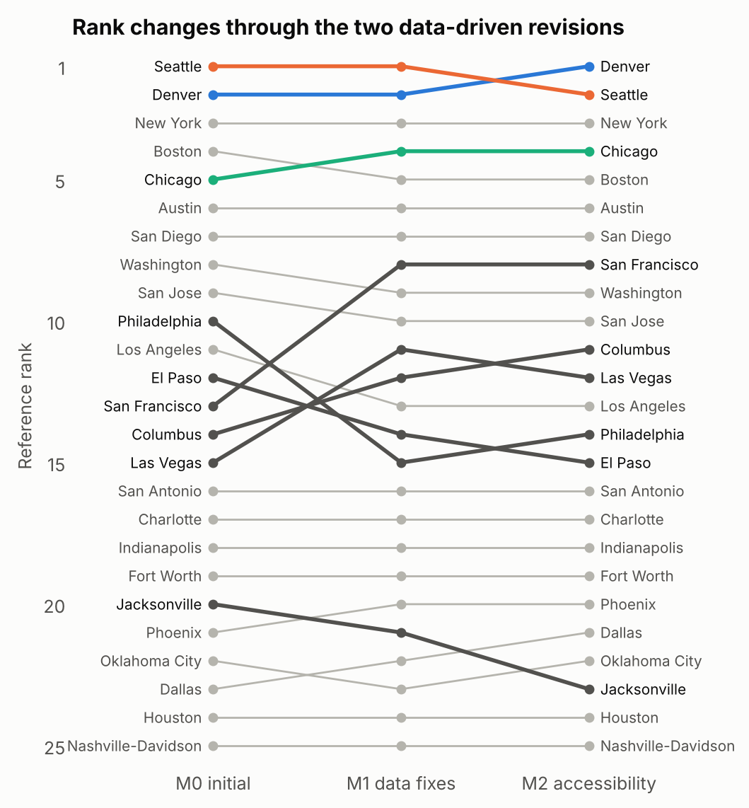

**HiMCM 2026 A 论文 · 组员 D 专用讲解**

**不可补偿规则与对照方法**

**这份文档是什么。** 只收组员 D 负责的部分：英文原文照抄，每段后面接中文讲解（米黄色框），课程外的知识写成补充知识卡（绿色框）。原文和讲解与全文讲解总版完全一致，这里只是把你的部分单独拿出来；表中页码指总版的页码。

**标记说明（对照 2026-11-12 发给全组的原讲解版，52 页）**

| 标记 | 含义 |
|---|---|
| 本版更新 | 原讲解版就有这个讲解框，本版按修改后的论文改过；框里这种颜色的句子是改写或新加的，其余句子与原讲解版一字不差 |
| 本版新增 | 原讲解版没有这个讲解框，是本版为新增的论文内容写的 |
| 英文原文中这种颜色的句子 | 论文原文本版改过的句子；新增或改过的整行公式左侧加一条细线 |
| 无标记 | 与原讲解版完全相同 |

**你负责的内容**

| 部分 | 总版页码 | 一句话说明 |
|---|---|---|
| 5.1 记号（先修，属于 A） | 19–20 | 看懂 $x$、$\phi$、$\theta$、$\Theta$、$U$ 这几个符号，后面全靠它们 |
| 摘要页 | 6–9 | 定义、模型五步、结果、修订、可信度、提醒，各用一句话讲清 |
| 5.7 后半段 ELECTRE III | 31–32 | 0–1 分数 g 和权重 W 的来历；和谐度、不和谐度、否决；可信度公式；区分阈值 0.30 − 0.15σ；提炼；核心；抽样版 |
| 6.4 中的 ELECTRE 结果段 | 40 | 参考权重下核心是 Austin 和 Denver；400 组权重下 Seattle 88%、Austin 35%、Denver 13% |
| 第 7 章 两次修订、图 3 | 40–43 | −99999 缺失编码与成人特许学校；控制变量比较；从服务量到可达性；τ = 0.887、0.967 |
| 8.1 熵权法 | 43–44 | 删一城熵权法颠倒 106 对、我们 0 对；为什么熵权会把 New York 推成第一 |
| 8.2 其他加总规则 | 44–45 | 各规则的公式；线性、指数、CES、Choquet、熵权 / CRITIC 各选出谁 |
| 8.4 外部检验 | 48–49 | 六项外部结果和 ρ；霸凌那一项为什么不吻合 |
| 第 10 章 优缺点 | 54–55 | 五条优点；六条缺点及各自的改进办法 |
| 第 11 章 结论 | 55–57 | 五条结论对应题目哪项要求 |
| AI 使用报告 | 62 | 两个工具各做了什么；发现并改正的三个问题 |

补充知识卡：K13（ELECTRE III）、K16（斯皮尔曼 ρ）、K17（肯德尔 τ）、K18（熵权法与 CRITIC）、K19（CES 与 Choquet）；先修 K1、K2。

**建议学习顺序**：先读 5.1 记号和 K1、K2，再按 5.7 后半段（K13）→ 6.4 的 ELECTRE 段 → 第 7 章 → 8.1 → 8.2 → 8.4 → 第 10、11 章 → 摘要页 → AI 使用报告的顺序读。摘要页放在最后读，因为它概括的是全文。

**先修：5.1 记号（属于组员 A，你必须看懂）。** 后面的 ELECTRE III 和各种加总规则全部用这些符号写成。

Problem Chosen: <b>A</b><b>2026 HiMCM Summary Sheet</b>Team Control Number: <b>TEAM_NUMBER</b>

<h1 class="paper-title">Floors First, Then Freedom: Ranking 25 U.S. Cities for High Schoolers Who Cannot Rely on a Car</h1>

**What makes a city great for a high schooler?** We define the best city as the one that, for a family on a fixed budget, clears basic floors on rent, violent crime and air quality, and then gives a public-school student who cannot depend on car rides the most real access to education, health support, independent travel, activities and fair treatment. The city must also keep that lead when reasonable people weigh these things differently.

本版更新 **摘要页第一段：我们的"最好"指什么。** 这段给出整篇论文的定义。拆开看有三层：

1. **先过底线**：对一个预算固定的家庭，房租、暴力犯罪、空气质量这三项必须达标。
2. **再比真实机会**：学生上公立学校、不能指望家长每天开车接送，那就看这个学生自己能用上多少教育、健康支持、独立出行、课外活动和公平对待。
3. **还要稳**：不同的人看重点不一样（有人最看重安全，有人最看重学校），排第一的城市在这些合理分歧下都应该保持领先。

后面所有的模型都是为了把这三层落实成数学。

**Criteria and data.** We built 20 measures in seven separate domains: education, safety, health, mobility, activities, affordability and inclusion. Every measure is computed from public data for the 25 most populous U.S. cities (Census Vintage 2025): CRDC and EDFacts school records, FBI and NHTSA FARS, EPA air data, SAMHSA, EPA Smart Location Database, FTA NTD, HUD, BEA and HRC. We dropped nine candidate criteria (for example weather and college rankings) and explain why (Section 3.2).

本版更新 **指标和数据。** 7 个领域、20 个指标，都来自公开数据，覆盖美国人口最多的 25 个城市（以人口普查局 2025 年估计为准）。括号里那一串缩写是数据来源：CRDC 和 EDFacts 是美国教育部的学校数据，FBI 是犯罪数据，NHTSA FARS 是交通死亡数据，EPA 是环保署的空气和城市形态数据，SAMHSA 是心理健康机构名录，FTA NTD 是公交运营数据，HUD 是住房部的租金标准，BEA 是各地物价水平，HRC 是一个评估城市反歧视政策的组织。

七个领域各回答一个问题，彼此分开计算。另外有 9 个候选指标被排除了，原因在 3.2 节。

**Model.** (1) Three non-compensable floors screen cities before any scoring. (2) Each measure is converted to value by a piecewise-linear curve with fixed, city-independent reference points. (3) Linear programs test every pair of cities over the whole set of allowed preference weights. (4) Stochastic multicriteria acceptability analysis (SMAA) repeats the ranking 10,000 times under random weights and data errors. (5) Minimax regret and ELECTRE III check a cautious decision rule and a no-weak-spot rule.

**模型五步。** 先用大白话把五个术语翻译一下，第 5 节会逐个用数学讲：

1. **不可补偿的底线**（non-compensable floors）：越线就出局，别的指标再好也"赎不回来"。
2. **分段线性曲线 + 固定参考点**：每个指标先换算成分数。换算规则是事先定好的几个数值（参考点），和这 25 个城市里谁最好谁最差无关。
3. **线性规划**：允许权重在一个范围内变，检查"城市 A 比 B 好"这个结论是否对范围内的每一组权重都成立。
4. **SMAA**（随机多准则可接受度分析）：随机抽一万组权重，同时给数据加上随机误差，每次排一次名，统计每个城市拿第一的比例。
5. **极小化最大后悔**和 **ELECTRE III**：前者站在"最怕选错"的家庭角度；后者不允许一个指标特别差的城市靠别的指标把分数补回来。两者都用来交叉检验。

**Results.** Seattle is our Best City for a High Schooler.

- Under the preferences stated in our definition, Seattle ranks first in **75.0%** of 10,000 simulations and in the top three in **99.1%**.
- It has the smallest worst-case regret (**0.151** on a 0–1 value scale) and passes all three floors.
- New York is second (first in 14.0% of simulations) and Denver third (7.8%), although Denver narrowly leads on equal domain weights (0.8210 against 0.8205).
- Among cities that pass the floors, the top five are Seattle, New York, Denver, Boston and Austin. San Francisco would place fourth but fails the rent floor for an $80,000 family (rent takes 50.4% of income).

本版更新 **结果的四个要点。**

- **"在我们陈述的偏好下"**指第 5.4 节的偏好集合 $\Theta_S$：我们根据定义，额外写下了六条偏好（比如"教育的权重不低于可负担性""安全的权重不低于 1/7"），只在满足这六条的权重里抽样。在这一万次模拟里，Seattle 75.0% 的次数排第一，99.1% 的次数进前三。
- **最大后悔 0.151**：不管真实偏好是哪一组权重，选 Seattle 最多比"当时的最佳城市"少 0.151 分（满分 1）。这是 25 个城市里最小的，详见 K12。
- **Denver 和 Seattle 几乎打平**：如果每个领域权重都是 1/7，Denver 0.8210，Seattle 0.8205，只差 0.0005。所以"Seattle 第一"的依据是它在大多数合理权重下都赢，等权重这一组只是其中一个点。New York 第二（14.0% 夺冠），Denver 第三（7.8%）。
- **San Francisco**：平均名次能排第四，但 8 万美元年收入的家庭付两居室房租要花掉 50.4% 的收入，超过 50% 的底线，所以不进入排名。

**Significant revisions.** Auditing real data changed our model twice.

**重要修订。** 题目要求至少记录一次模型修订。我们的两次修订都来自检查原始数据时发现的问题，第 7 节详细讲。

- M0→M1: a transit-frequency measure was blank for 96% of San Diego's residents, and one adult charter school pulled San Francisco's graduation rate to 56%. Fixing both moved San Francisco from 13th to 8th.
- M1→M2: we replaced transit service hours with jobs reachable within 45 minutes by scheduled transit, so we measure what a student can actually reach.

**两次修订的大意。**

- **M0 → M1**：第一版模型（M0）用的"公交发车频率"字段，在 San Diego 有 96% 的居民所在地区是空白（缺失编码），会被误当成"没有公交"。另外 San Francisco 有一所面向成年人的特许学校，把全市毕业率拉低到 56%。修好这两处后，San Francisco 从第 13 名升到第 8 名。
- **M1 → M2**：把"公交服务小时数"（运了多少车）换成"45 分钟内坐公交能到达的工作岗位数"（学生实际能到达多少地方）。后者更接近定义里的"真实机会"。

**Why it is more than our opinion.** Reference points are fixed, so removing any city reverses **0** pairs of other cities (an entropy-weight ranking reverses 106). At equal weights Denver and Seattle stay the two leaders with data noise up to four times its size and ±10% node shifts. Under our stated preferences Seattle stays first with node shifts (73%), with data noise quadrupled (36%), under low-substitution aggregation (84%) and without any single preference statement (62–75%). School-age survey outcomes agree with our domain scores: skipping school for fear of being unsafe rises with violent crime (ρ = +0.62), and sadness or hopelessness correlates with our health domain (ρ = −0.76).

本版更新 **为什么不只是我们的主观看法。** 这一段列了四类证据：

1. **换掉候选城市不影响别人的相对顺序**：参考点是固定的绝对数值，删掉任何一个城市，其余城市参考分数之间的先后关系一对都不变（0 对逆转）。对照组"熵权法"会逆转 106 对（熵权法见 K18）。
2. **等权重下的扰动**：把数据误差放大到 4 倍、参考点随机移动 ±10%，领先的始终是 Denver 和 Seattle 两个。
3. **在我们陈述的偏好下 Seattle 仍第一**：参考点移动时 73% 夺冠；数据误差放大 4 倍时 36%；用"长处很难弥补短处"的加总方式时 84%；随便去掉一条偏好陈述，仍有 62%–75%。
4. **和模型没用过的外部数据对得上**：青少年问卷里"因为觉得不安全而逃学"的比例和暴力犯罪率同向变化，$\rho=+0.62$；"感到悲伤或绝望"和我们的健康领域分数反向变化，$\rho=-0.76$。$\rho$ 是斯皮尔曼等级相关系数，范围 −1 到 1，绝对值越大说明两组排名越一致，见 K16。

**Caveat.** Seattle's lead belongs to families who can afford its neighborhoods. Only 38.5% of its residents live in census tracts that are affordable on $80,000 and well served by transit. For a $50,000 family Chicago leads at equal weights and Columbus when cost counts double.

本版更新 **提醒。** 城市平均值会掩盖内部差别。Seattle 只有 38.5% 的居民住在"8 万美元家庭付得起房租、并且公交能到很多地方"的普查区里。换句话说，Seattle 的优势主要属于住得起它中心社区的家庭。年收入 5 万美元的家庭：领域等权重时 Chicago 领先；把"花费"的权重加倍时 Columbus 领先。

<b>Keywords:</b> piecewise-linear value model; robust ordinal regression; linear programming; SMAA; minimax regret; ELECTRE III; transit accessibility

**关键词。** 分段线性价值模型；鲁棒序数回归；线性规划；SMAA；极小化最大后悔；ELECTRE III；公交可达性。每个词在第 5 节都有对应的步骤和补充知识卡。

# 5. The Model

## 5.1 Notation

| Symbol | Meaning |
|---|---|
| $i, k$ | cities, $i = 1,\dots,25$ |
| $j$ | measures, $j = 1,\dots,20$; $d(j)$ is the domain of measure $j$ |
| $x_{ij}$, $s_{ij}$ | value of measure $j$ in city $i$ and its standard deviation |
| $t_{j0},\dots,t_{j3}$ | fixed nodes of measure $j$ (worst to best) |
| $\phi_{ijl}\in[0,1]$ | how much of segment $l$ of measure $j$ city $i$ covers |
| $\theta_{jl}\ge 0$ | value of segment $l$ of measure $j$; $\theta$ collects all 60 of them |
| $\Theta$ | set of allowed preference vectors; $\theta^0$ is the reference vector |
| $U_i(\theta)$ | overall value of city $i$, between 0 and 1 |

**5.1 记号表逐行讲。** 第 5 节是全文数学最集中的地方，先把符号认全：

- $i,k$：城市编号，1 到 25。用两个字母是因为经常要比较"城市 $i$ 和城市 $k$"。
- $j$：指标编号，1 到 20。$d(j)$ 表示指标 $j$ 属于哪个领域，比如"辅导员"属于教育。
- $x_{ij}$：城市 $i$ 在指标 $j$ 上的原始数值（比如 Seattle 的暴力犯罪率 777）；$s_{ij}$ 是它的标准差（第 4.2 节）。
- $t_{j0},t_{j1},t_{j2},t_{j3}$：指标 $j$ 的四个固定节点，从最差到最好。四个点把范围切成三段，编号 $l=0,1,2$。
- $\phi_{ijl}$：城市 $i$ 在指标 $j$ 的第 $l$ 段上"走完了多少"，在 0 到 1 之间。0 是这段一点没走，1 是整段走完。
- $\theta_{jl}$：走完指标 $j$ 第 $l$ 段能拿多少分。20 个指标 × 3 段 = 60 个数，合起来记成一个 60 维向量 $\theta$。$\theta$ 就是"偏好"或"权重"。
- $\Theta$：所有被认为合理的 $\theta$ 组成的集合（第 5.4 节）；$\theta^0$ 是其中一个特定的参考向量。
- $U_i(\theta)$：在偏好 $\theta$ 下城市 $i$ 的总分，在 0 到 1 之间。写成 $U_i(\theta)$ 是在强调：总分取决于用哪组权重。

**补充知识 K1　求和、向量的点积与转置记号**

**双重求和。** $\sum_{j=1}^{20}\sum_{l=0}^{2}a_{jl}$ 表示：对每个 $j$（1 到 20），先把 $l=0,1,2$ 三项加起来，再把 20 个结果加起来。一共 60 项。

**向量就是一列数。** P3 里的三维向量 $\begin{pmatrix}a_1\\a_2\\a_3\end{pmatrix}$ 有 3 个分量；这里的 $\theta$ 有 60 个分量，只是画不出来，运算规则完全一样。

**点积（数量积）。** P3 学过 $\mathbf a\cdot\mathbf b=a_1b_1+a_2b_2+a_3b_3$。60 维时就是 60 对分量相乘再相加：

$$\phi_i\cdot\theta=\sum_{n=1}^{60}\phi_{i,n}\,\theta_n .$$

**转置记号 $\phi_i^{\top}\theta$。** 在线性代数里，向量默认竖着写（列向量）。右上角的 $\top$（transpose，转置）把竖的变成横的。FP1 学过矩阵乘法："横 × 竖"就是对应相乘再相加。所以 $\phi_i^{\top}\theta$ 和点积 $\phi_i\cdot\theta$ 是同一个数，只是写法不同。论文的总分公式

$$U_i(\theta)=\phi_i^{\top}\theta$$

意思就是：城市 $i$ 的总分 = 它在 60 个小段上的完成度，分别乘上每段的分值，再全部加起来。

**这个写法的好处。** 总分对 $\theta$ 是**线性**的：$\theta$ 翻倍，总分翻倍；两组权重相加，总分也相加。第 5.5 节的线性规划全靠这一点。

**补充知识 K2　集合记号与"约束集合"**

- **花括号定义集合**：$\{\,i:\ \text{条件}\,\}$ 读作"所有满足条件的 $i$ 组成的集合"。例如 $\{\,x:\ x^2<4\,\}$ 就是区间 $(-2,2)$。
- **属于**：$\theta\in\Theta$ 读作"$\theta$ 属于 $\Theta$"，即 $\theta$ 是集合 $\Theta$ 里的一个元素。
- **约束集合**：$\Theta$ 是用一串不等式定义的集合。每个不等式像一堵墙，墙围起来的区域就是 $\Theta$。二维的例子：$\{(x,y):\ x\ge0,\ y\ge0,\ x+y\le1\}$ 是一个三角形。$\Theta$ 是同样的东西，只是在 60 维空间里，墙也多得多。
- **$\min_{\theta\in\Theta}f(\theta)$**：在集合 $\Theta$ 里找让 $f$ 最小的那个 $\theta$，结果是那个最小值。$\max$ 同理。
- **$\Theta_S\subset\Theta$**：$\Theta_S$ 是在 $\Theta$ 的墙里再加几堵墙，所以更小。

## 5.7 Step 6: two cross-checks with different philosophies

**（5.7 节的"Minimax regret [25] answers a cautious"、"It reuses the pairwise LPs (over"归组员 C，这里略去。）**

**ELECTRE III** [20] does not allow free trade-offs. It uses each measure's value on a 0–1 scale, $g_{ij}=\sum_l\theta_{jl}\phi_{ijl}/W_j$, and the measure weights $W_j$. For cities $a,b$ let $\delta_j=g_{bj}-g_{aj}$ be $b$'s lead on measure $j$. Then

本版更新 **5.7 第六步之二：ELECTRE III。** 加权求和允许"拿长处补短处"：一个指标差 0.3，另一个指标好 0.3，就抵消了。ELECTRE III 不允许这样随便抵消。它对每一对城市 $(a,b)$ 问两个问题：

- **和谐**（concordance）：支持"$a$ 至少和 $b$ 一样好"的指标，权重加起来够不够多？
- **否决**（veto）：有没有哪个指标上 $a$ 远远落后于 $b$？如果有，不管其他指标多支持 $a$，都不能说 $a$ 至少和 $b$ 一样好。

三个阈值都在每个指标 0 到 1 的分数尺度上：差距不超过 0.05 算"差不多"（无差异），超过 0.20 算"明显更好"（偏好），达到 0.80 就触发否决。后面"降序和升序提炼"、"核心"等术语见 K13。另外用 $\Theta_S$ 里抽的 400 组权重各做一次 ELECTRE，看结论是否随权重变化。原文下面的公式和提炼规则是按审计意见补写的，逐项讲解见 K13。

$$
c_j=\operatorname{clip}\Big(\frac{p-\delta_j}{p-q}\Big),\qquad
d_j=\operatorname{clip}\Big(\frac{\delta_j-p}{v-p}\Big),\qquad
\sigma(a,b)=C\prod_{j:\,d_j>C}\frac{1-d_j}{1-C},\quad C=\sum_j W_j c_j ,
$$

where clip limits a number to $[0,1]$ and $(q,p,v)=(0.05,0.20,0.80)$. $c_j$ measures how much measure $j$ supports "$a$ is at least as good as $b$"; $d_j=1$ is a veto, a lead of at least 80% of the scale. $\sigma(a,b)$ is the credibility of that statement. At a cut level $\lambda$, $a$ outranks $b$ if $\sigma(a,b)>\lambda$ and $\sigma(a,b)-\sigma(b,a)>0.30-0.15\,\sigma(a,b)$; a city's qualification is the number of cities it outranks minus the number that outrank it. The descending distillation repeatedly removes the cities with the highest qualification, the ascending one those with the lowest. City $a$ is placed above $b$ if it is at least as good in both orders and better in one; the *kernel* is the set of cities with no city above them. The sampled version repeats this for the first 400 vectors of Step 5 under $\Theta_S$, with point data; each vector changes both the weights $W_j$ and the shape of each value curve.

本版更新 **补充知识 K13　ELECTRE III**

（课程外。ELECTRE 是法语"消除与选择"的缩写，是法国学者提出的一类排序方法。）

记 $g_j(a)$ 为城市 $a$ 在指标 $j$ 上的分数（0 到 1），$w_j$ 为指标权重（加起来为 1）。论文里 $g_{ij}=\sum_l\theta_{jl}\phi_{ijl}/W_j$，就是把指标 $j$ 的分段得分除以该指标的总分值 $W_j$，换算成 0 到 1；权重 $w_j=W_j$。论文原文里的 clip 就是把数截到 $[0,1]$，和下面分三段写的式子是一回事。对一对城市 $(a,b)$ 和一个指标 $j$，令 $\delta=g_j(b)-g_j(a)$，表示 $b$ 在这个指标上比 $a$ 好多少。三个阈值 $q=0.05$、$p=0.20$、$v=0.80$。

**1. 单项和谐度** $c_j(a,b)$：这个指标在多大程度上支持"$a$ 不比 $b$ 差"。

$$c_j=\begin{cases}1,&\delta\le q\ (\text{$b$ 最多好一点点})\\ \dfrac{p-\delta}{p-q},&q<\delta<p\\ 0,&\delta\ge p\ (\text{$b$ 明显更好})\end{cases}$$

例：$\delta=0.125$ 时 $c_j=(0.20-0.125)/0.15=0.5$。

**2. 总和谐度** $C(a,b)=\sum_j w_jc_j$，在 0 到 1 之间。

**3. 单项不和谐度** $d_j(a,b)$：这个指标在多大程度上反对。

$$d_j=\begin{cases}0,&\delta\le p\\ \dfrac{\delta-p}{v-p},&p<\delta<v\\ 1,&\delta\ge v\ (\text{否决})\end{cases}$$

例：$\delta=0.5$ 时 $d_j=(0.5-0.2)/0.6=0.5$。

**4. 可信度** $\sigma(a,b)$：综合二者。

$$\sigma(a,b)=C(a,b)\times\prod_{j:\ d_j>C}\frac{1-d_j}{1-C} .$$

$\prod$ 是连乘符号，只对"反对程度超过总和谐度"的指标连乘。任何一个 $d_j=1$，因子就是 0，$\sigma=0$：**一票否决**。没有指标强烈反对时，$\sigma=C$。

**5. 提炼（distillation）**：有了 25 × 25 的可信度表，怎么排出名次？

- **降序提炼**：从高到低设定一个可信度门槛 $\lambda$。在门槛下，$a$"明显胜过"$b$ 的条件是 $\sigma(a,b)>\lambda$ 并且 $\sigma(a,b)-\sigma(b,a)>0.30-0.15\,\sigma(a,b)$（后一项叫区分阈值，防止两边可信度差不多时硬分高下）。每个城市"明显胜过几个城市"减去"被几个城市明显胜过"叫资格分。资格分最高的城市放进第一档，拿走，对剩下的城市重复。
- **升序提炼**：反过来，每次挑资格分最低的放进最后一档。
- 两种做法得到两个排序。**最终排序取二者的交集**：只有当 $a$ 在两个排序里都不比 $b$ 差、且至少在一个里更好时，才说 $a$ 排在 $b$ 前面；两个排序矛盾的就算"不可比较"。

**6. 核心（kernel）**：最终排序中没有被任何城市排在前面的城市。论文说参考权重下核心是 Austin 和 Denver：没有任何城市在两个排序里都压过它们。

**7. 抽样版**：用表 1 那批 $\Theta_S$ 抽样的前 400 组权重各做一次（数据用点估计、不加噪声），统计每个城市进入核心的比例。每组权重同时改变 $W_j$ 和每条曲线的形状，所以 $g_{ij}$ 也会跟着变。

**直观理解**：ELECTRE III 偏爱"没有明显短板"的城市。一个城市某项特别差（差距达到 0.8 个分数尺度），就会被那一项的对手否决。

# 6. Results: The Ranking

## 6.4 Under our stated definition: the final ranking

**（6.4 节的"Adding statements P1–P6 narrows Θ to"、"What the stated preferences weigh"、"Why P6"、"Table 1 gives the final ranking"、表 1、"Why Seattle"、"Why the others trail"、"Leave-one-statement-out check"归组员 B、组员 C，这里略去。）**

**ELECTRE III.** With the reference weights, the kernel is Austin and Denver, followed by Seattle. With 400 weight vectors from $\Theta_S$, Seattle is in the kernel 88% of the time, Austin 35% and Denver 13%. No measure vetoes Seattle against any city.

本版更新

**ELECTRE III 的结果。** 用参考权重时，核心（K13）是 Austin 和 Denver，其后是 Seattle。用 $\Theta_S$ 里抽的 400 组权重各做一次：Seattle 88% 的时候在核心里，Austin 35%，Denver 13%。没有任何指标否决 Seattle（Seattle 没有哪项比别人差 0.8 个分数尺度）。原来"Chicago 在这个规则下最强"的结论，在 Chicago 犯罪数据补齐后不再成立。

# 7. Significant Revisions to the Model

<figure class="float-right"><figcaption>Figure 3. Reference rank of each city through the two revisions. Colored: top three; dark gray: cities that moved three or more places.</figcaption></figure>

We built a complete first model (M0) with the indicators and methods above, then audited every measure against its raw records. Two findings in real data led to revisions.

**第 7 节 重要修订。** 题目要求记录至少一次重要修订。我们先用上面的指标和方法建了完整的第一版模型 M0，然后对照原始记录逐项审计每个指标，在真实数据中发现两个问题，各引出一次修订。

**图 3** 显示每个城市在 M0、M1、M2 三个版本里的参考名次。彩色线是前三名，深灰色线是名次变化 3 位以上的城市。

**Revision 1 (M0 → M1): fixing two measures that mismeasured students' conditions.**

- *Evidence 1.* M0 used the EPA's transit-frequency field (trips per hour near home). In San Diego, 96% of residents live in block groups where this field is coded −99999, yet only 22% live more than 0.75 mile from a stop. The code marks missing schedule data, not missing buses. Federal NTD data show San Diego's operator runs 1.11 service hours per resident, above the 25-city median of 0.85.
- *Evidence 2.* M0 averaged graduation rates over all schools in the city. In San Francisco, one charter school for adult re-entry students holds 36% of the city's graduation cohort and graduates 4%, pulling the city to 56%. Oklahoma City (one charter school, 51% of the cohort, 48%) and Las Vegas (21%, 7%) show the same pattern. A resident student enrolls by address in district schools, not in these programs.
- *Change.* We replaced transit frequency with NTD service hours per resident plus weekend service retention. Graduation now uses non-charter schools only, which places San Francisco at 85.4%. The other five school measures keep charter schools, which enroll resident students; Section 8.3 tests applying the same rule to them.
- *Controlled comparison.* Changing graduation alone moves San Francisco 13 → 9. Changing transit alone moves it 13 → 10; together, 13 → 8. Las Vegas rises 15 → 11 and Philadelphia falls 10 → 15. The top three do not change (Kendall τ between M0 and M1 = 0.887).

本版更新 **修订 1（M0 → M1）：修好两个测错了的指标。**

- **证据 1：公交频率字段的缺失编码。** M0 用环保署数据库里的"家附近每小时公交班次"。San Diego 96% 的居民所在街区组这个字段是 −99999。−99999 是"缺失"的编码，但如果当成数值处理，就等于"没有公交"。可是只有 22% 的居民离公交站超过 0.75 英里，联邦公交数据库还显示 San Diego 人均公交服务 1.11 小时，高于 25 城中位数 0.85。所以 −99999 表示的是"没有时刻表数据"，而不是"没有公交"。
- **证据 2：成人特许学校拉低毕业率。** M0 对城市里所有学校的毕业率取平均（按毕业年级人数加权）。San Francisco 有一所面向成年人重返校园的特许学校，占全市毕业年级人数的 36%，毕业率只有 4%，把全市拉到 56%。Oklahoma City 和 Las Vegas 也有同样的情况。本地学生按住址入读学区学校，不会进这类学校。
- **改动**：公交频率换成"人均公交服务小时 + 周末服务保留率"；毕业率只算非特许学校，San Francisco 变成 85.4%。其他五个学校指标仍然包括特许学校，因为特许学校也招收本地学生；第 8.3 节检验了把同样规则用到这五个指标上会怎样。
- **控制变量比较**：只改毕业率，San Francisco 从 13 升到 9；只改公交，13 到 10；两个一起改，13 到 8。这种"一次只改一处"的比较能看出每个改动各贡献了多少。前三名不变。M0 和 M1 两个排名之间的肯德尔 $\tau=0.887$（K17），大约有 17 对城市的先后颠倒了。

**Revision 2 (M1 → M2): from service supplied to places a student can reach.**

- *Evidence.* Service hours count buses, not destinations, and correlate 0.895 (Spearman) with transit access. Scoring both would count transit twice.
- *Change.* We replaced service hours by the EPA's 45-minute transit accessibility. This field counts jobs reachable from each block group by walking and scheduled transit, computed from GTFS timetables. Jobs stand in for shops, libraries, workplaces and other destinations.
- *Effect.* Kendall τ between M1 and M2 is 0.967. Denver and Seattle swap places in the reference scorecard. The measure also reveals large within-city gaps (Section 9.3).

**修订 2（M1 → M2）：从"运了多少车"到"能到多少地方"。**

- **证据**：公交服务小时数在数"有多少车在跑"，不是"能到哪里"。它和公交可达性的斯皮尔曼相关系数是 0.895（K16），高度相关。两个都计分，等于公交被算了两遍。
- **改动**：用环保署的"45 分钟公交可达性"替换服务小时数。它根据公交时刻表（GTFS 是公交公司公开时刻表的标准格式）计算从每个街区组出发，步行加坐公交 45 分钟能到达的工作岗位数。岗位数代表商店、图书馆、工作地点等各种目的地。
- **效果**：M1 和 M2 的肯德尔 $\tau=0.967$，大约只有 5 对城市颠倒。Denver 和 Seattle 在参考成绩单上互换位置。这个指标还揭示了城市内部的巨大差距（9.3 节）。

本版更新 **补充知识 K16　斯皮尔曼等级相关系数 $\rho$ 与 $p$ 值**

（课程外。）**先说普通的相关系数（皮尔逊 $r$）**：衡量两组数据 $(x_i,y_i)$ 是否沿一条直线同增同减，

$$r=\frac{\sum(x_i-\bar x)(y_i-\bar y)}{\sqrt{\sum(x_i-\bar x)^2\ \sum(y_i-\bar y)^2}},\qquad -1\le r\le1 .$$

$r=1$ 是完全正相关（点在一条上升直线上），$r=-1$ 是完全负相关，$r\approx0$ 是没有线性关系。

**斯皮尔曼 $\rho$**：先把 $x$ 和 $y$ 各自换成名次（最小的记 1，第二小记 2……），再对名次算皮尔逊 $r$。没有并列名次时有简便公式

$$\rho=1-\frac{6\sum d_i^2}{n(n^2-1)},$$

$d_i$ 是第 $i$ 个对象两个名次之差。

**例子**：4 个城市，暴力犯罪名次 (1, 2, 3, 4)，逃学比例名次 (1, 3, 2, 4)。$d=(0,-1,1,0)$，$\sum d^2=2$，$\rho=1-\dfrac{6\times2}{4\times15}=0.8$。

**为什么用名次**：只关心"一个越大另一个是否也越大"，不要求是直线关系，也不怕个别极端值。纽约的公交可达性是别的城市好几倍，用名次就不会让它一个点主导结果。

**$p$ 值**（FS1 的假设检验里出现过这个概念）：假设两者其实毫无关系，仅凭偶然得到这么大（或更大）的 $|\rho|$ 的概率。$p$ 越小，越不像是偶然。常用 0.05 作为分界。第 8.4 节的 Opportunity Atlas 相关 $\rho=0.33$、$p=0.11$：如果真的无关，也有 11% 的机会偶然得到这么大的相关，所以论文标为"弱"。

本版更新 **补充知识 K17　肯德尔 $\tau$：两个排名有多一致**

（课程外。）把所有城市两两配对。$n$ 个城市有 $\binom n2=\dfrac{n(n-1)}2$ 对（S1 的组合数）；25 个城市就是 300 对。对每一对，看两个排名里它们的先后是否一致：一致叫**同序对**（个数 $C$），相反叫**异序对**（个数 $D$）。

$$\tau=\frac{C-D}{n(n-1)/2}.$$

- 两个排名完全相同：$D=0$，$\tau=1$；
- 完全倒过来：$C=0$，$\tau=-1$。

**从 $\tau$ 反推颠倒了几对**（无并列时 $C+D=300$）：$D=\dfrac{(1-\tau)\times300}{2}$。

- $\tau=0.887$：$D\approx17$ 对颠倒；
- $\tau=0.967$：$D\approx5$ 对颠倒。

肯德尔 $\tau$ 和斯皮尔曼 $\rho$ 都衡量排名一致性。论文比较两个排名时用 $\tau$，因为它的含义直接对应"有多少对城市换了先后"。

**Why these revisions should convince more people.**

- They come from records, not from a preferred winner: both were found by checking raw files. The reference top three (Seattle, Denver, New York) was the same in M0, M1 and M2; only the order of the first two changed in M2, by 0.0005.
- Each fix makes a measure describe what a resident student can actually use: the bus schedule, the school she would attend, the destinations she can reach.

本版更新 **为什么这两次修订更有说服力。**

- **来自原始记录**：两个问题都是逐项检查原始文件时发现的，而不是为了让某个城市赢而调参数。前三名（Seattle、Denver、New York）在 M0、M1、M2 三个版本中都没变，只有 M2 里第一、二名换了位置，差距 0.0005。
- **每次修订都让指标更贴近"学生实际能用的东西"**：真实的公交时刻表、学生按住址会去的学校、学生能到达的地方。

# 8. Why the Ranking Is More Than Our Opinion

## 8.1 Fixed reference points make the ranking stable when the pool changes

Popular objective methods such as entropy weighting derive weights from how much the measures vary among the candidates. Their results therefore depend on who else is in the pool. We tested this directly: removing one city at a time and re-scoring the other 24 reverses **106** pairs in total over the 25 removals under min-max entropy weights. Under our fixed reference points it reverses **0**, because a city's score depends only on its own data. The final ranking in Table 1, by mean SMAA rank, reverses only 2 pairs over the 25 removals, both between cities we already treat as tied (San Diego and Chicago; Houston and Oklahoma City). Entropy weighting would also put the largest weight on transit access (0.134) simply because New York is an outlier, and it would crown New York.

本版更新 **8.1 固定参考点让排名不受候选名单影响。** 熵权法这类"客观"方法，权重是根据指标在候选城市之间的差异程度算出来的（K18），所以结果取决于"候选名单里有谁"。论文直接做了检验：每次删掉一个城市，用剩下 24 个重新打分，统计其余城市之间的先后颠倒了多少对。

- 熵权法（最小–最大标准化）：25 次删城加起来共颠倒 **106** 对；
- 我们的固定参考点：**0** 对。原因：每个城市的分数只取决于它自己的数据，删掉别人，自己的分数不变，先后自然不变。
- 表 1 的最终排名按 SMAA 平均名次排序，25 次删城一共只颠倒 2 对，而且都是本来就并列的城市（San Diego 和 Chicago、Houston 和 Oklahoma City）：平均名次是在同一批模拟里重新排的，并列的城市差一点就会换位。

熵权法还会把最大的权重（0.134）给公交可达性，只因为 New York 在这一项是极端值，结果让 New York 当第一。这说明"客观权重"其实是在奖励"数据分散"，和"什么对学生重要"无关。

**补充知识 K18　熵权法与 CRITIC**

（课程外。这是两种常见的"由数据定权重"的方法，论文用它们作对照。）

**第一步：最小–最大标准化。** 对每个指标，

$$m_{ij}=\frac{x_{ij}-\min_i x_{ij}}{\max_i x_{ij}-\min_i x_{ij}},$$

本组最差的城市记 0、最好的记 1（越小越好的指标再用 ${}1-m_{ij}$ 翻转）。注意 $\min$ 和 $\max$ 取自候选城市，换一批城市就会变：这就是"依赖候选名单"的根源。

**熵权法。** 把每个指标的分数变成比例 $p_{ij}=m_{ij}/\sum_i m_{ij}$（每列加起来为 1），计算**熵**

$$e_j=-\frac1{\ln n}\sum_{i=1}^{n}p_{ij}\ln p_{ij}\qquad(0\le e_j\le1),$$

权重 $w_j$ 与 ${}1-e_j$ 成正比。熵衡量"分布有多均匀"：

- 所有城市分数一样，$p_{ij}=1/n$，$e_j=-\frac1{\ln n}\cdot n\cdot\frac1n\ln\frac1n=1$，权重为 0；
- 只有一个城市有分、其余为 0，$e_j=0$，权重最大。

所以一个指标里出现一个远超其他城市的极端值（如 New York 的公交可达性），这个指标的熵就低，权重就高。

**CRITIC 法。** 权重与"标准差 × 与其他指标的不相关程度"成正比：

$$w_j\propto\sigma_j\sum_k(1-r_{jk}),$$

$\sigma_j$ 是指标 $j$ 标准化后的标准差，$r_{jk}$ 是指标 $j$ 和 $k$ 的相关系数（K16）。差异大、又和别的指标不重复的指标权重高。它同样依赖候选名单。

## 8.2 Different aggregation rules, similar leaders

| Rule (Kendall τ with our reference ranking) | Leader |
|---|---|
| Linear value, no diminishing returns (0.867) | Seattle |
| Smooth exponential value, k = 1, 2, 4 (0.920, 0.933, 0.867) | Denver |
| Geometric mean of domains, CES ρ = 0 (0.873) | Denver |
| Low substitution between domains, CES ρ = −1 (0.753) | Denver |
| Almost no substitution, CES ρ ≤ −4.75 | Chicago |
| Mobility–activities complementarity, 2-additive Choquet (0.987) | Seattle |

| ELECTRE III with vetoes (kernel) | Austin and Denver |
| Entropy weights / CRITIC (0.740 / 0.807) | New York / Seattle |

本版更新 **8.2 换不同的加总规则，领先者相似。** 表里每一行是一种和我们不同的加总方法，括号里是它和我们参考排名的肯德尔 $\tau$（K17），右边是它选出的第一名：

- **线性价值，无边际递减**：每个指标在最差和最好节点之间按直线给分。领先者 Seattle。
- **光滑指数价值，$k=1,2,4$**：每个指标用 $u(z)=(1-e^{-kz})/(1-e^{-k})$ 给分，$z$ 是在最差和最好节点之间的相对位置（0 到 1）。$k$ 越大边际递减越强（K5）。领先者 Denver。
- **领域几何平均（CES，$\rho=0$）**：7 个领域分数相乘再开 7 次方。领先者 Denver。
- **领域之间低替代（CES，$\rho=-1$）**：短板领域的影响更大。领先者 Denver。
- **几乎不能替代（CES，$\rho\le-4.75$）**：接近"只看最差领域"。领先者 Chicago。
- **出行与活动互补（2-可加 Choquet 积分）**：活动再多，去不了也没用，所以惩罚"出行和活动分数不平衡"。领先者 Seattle。
- **ELECTRE III（带否决）**：核心是 Austin 和 Denver。
- **熵权 / CRITIC**：领先者 New York / Seattle。

CES 和 Choquet 见下面 K19。

本版更新 **补充知识 K19　广义平均（CES）、几何平均与 Choquet 积分**

（课程外。）设 7 个领域的分数为 $s_1,\dots,s_7$（各在 0 到 1 之间，等于该领域贡献 × 7）。

**CES（常替代弹性）聚合**，也叫幂平均：

$$\text{CES}_\rho=\left(\frac17\sum_{d=1}^{7}s_d^{\ \rho}\right)^{1/\rho}.$$

- $\rho=1$：算术平均，长处可以一比一补短处；
- $\rho\to0$：几何平均 $\left(\prod_d s_d\right)^{1/7}$（可以用 P3 的对数和极限证明，这里不展开）；
- $\rho=-1$：调和平均 ${}7\big/\sum_d(1/s_d)$；
- $\rho\to-\infty$：等于最小值 $\min_d s_d$，只看最差的领域。

**例子**：两个领域 $(0.9,\,0.5)$。算术平均 0.70；几何平均 $\sqrt{0.45}=0.671$；调和平均 ${}2/(1/0.9+1/0.5)=0.643$；最小值 0.5。$\rho$ 越小，结果越被短板拉向 0.5。

论文发现：$\rho$ 要降到约 $-4.75$ 以下，第一名才换成 Chicago，因为 Chicago 的各领域最均衡。Chicago 的暴力犯罪改用补齐后的口径以后，它的安全领域变弱，所以要"几乎只看最差领域"时才会领先。

**2-可加 Choquet 积分**：普通加权平均假设各领域"各自独立地贡献分数"。Choquet 积分允许两个领域之间有**交互**：互补（缺一个，另一个也打折扣）或替代。论文只设一对互补：出行和活动，交互强度 $I=0.05$ 或 ${}0.10$。在这种只有一对交互、各领域重要性相同的情况下，Choquet 积分可以化简为

$$\text{得分}=\frac17\sum_{d}s_d-\frac I2\,\big|s_{\text{出行}}-s_{\text{活动}}\big| .$$

第一项是普通平均，第二项惩罚两者的差距：两者越不平衡，扣分越多。

Here $s_D\in[0,1]$ is domain $D$'s contribution under $\theta^0$ times 7. CES is $(\tfrac17\sum_D s_D^{\rho})^{1/\rho}$ (the geometric mean at $\rho=0$); the Choquet rule is $\bar s-\tfrac I2\,|s_{\text{Mob}}-s_{\text{Act}}|$ with $I=0.05$ or ${}0.10$; the linear and exponential rules replace each curve by $z$ or $(1-e^{-kz})/(1-e^{-k})$, where $z$ is the position between the worst and best node; entropy and CRITIC weights use min-max normalized values. Seattle or Denver lead under every rule except entropy weighting, which follows New York's outlying transit access, and the two rules that most restrict trade-offs: Chicago leads only when domains can barely make up for each other (ρ ≤ −4.75), and the ELECTRE kernel adds Austin to Denver.

本版新增 **表下的说明和结论。** 第一句是按审计意见补的公式，把每种对照方法写清楚：$s_D$ 是领域 $D$ 在 $\theta^0$ 下的贡献乘以 7，换算成 0 到 1 的领域分；CES 是领域分的幂平均（K19）；Choquet 规则在平均分上减去"出行和活动不平衡"的惩罚；线性和指数规则把每条折线换成直线或指数曲线；熵权和 CRITIC 先做最小–最大标准化（K18）。

结论：除了熵权法（它被 New York 极端的公交可达性带偏），以及两种最不允许补偿的规则，领先的都是 Seattle 或 Denver。Chicago 只有在领域之间几乎完全不能互相弥补（$\rho\le-4.75$）时才领先；ELECTRE 的核心是 Austin 和 Denver。注意这些都是等权重下的结果；第 8.3 节最后一条在 $\Theta_S$ 下重做了 CES，Seattle 仍然第一。

## 8.4 External checks

We compared our results with outcomes we did not use to build the model, including the 2023 Youth Risk Behavior Survey (YRBS) [23].

| External outcome (not used in the model) | Compared with | Spearman ρ | Expected sign |
|---|---|---|---|
| YRBS 2023: students who skipped school because they felt unsafe (9 cities) | violent crime | +0.62 | + ✓ |
| YRBS 2023: students not on a sports team (7 cities) | school sports participation | −0.93 | − ✓ |
| YRBS 2023: students who felt sad or hopeless (11 cities) | our health domain | −0.76 | − ✓ |
| YRBS 2023: students bullied at school (11 cities) | our inclusion domain | +0.45 | − ✗ |
| GTFS 2026 timetables: weekend/weekday trips (23 cities) | NTD weekend retention | 0.73 | + ✓ |
| Opportunity Atlas: adult income of children from low-income families [21] | total value $U$ | 0.33 (p = 0.11) | + ✓ (weak) |

本版更新 **8.4 外部检验。** 用模型没用过的数据来检验模型。如果模型测的东西是对的，它应该和独立来源的结果"方向一致"。表的每一行：一个外部结果、跟模型里哪个量比、斯皮尔曼 $\rho$（K16）、预期符号是否吻合。

- **因为觉得不安全而逃学**（9 个城市）与暴力犯罪：$\rho=+0.62$，犯罪越多逃学越多，符合预期。
- **没参加运动队的学生**（7 个城市）与校园运动参与：$\rho=-0.93$，符合预期。
- **感到悲伤或绝望**（11 个城市）与健康领域分数：$\rho=-0.76$，健康领域分数越高，悲伤比例越低，符合预期。
- **在学校被霸凌**（11 个城市）与包容领域：$\rho=+0.45$，方向相反，不符合预期。
- **2026 年公交时刻表的周末/工作日班次比**与我们用的 NTD 周末保留率：$\rho=0.73$，两份数据互相印证。
- **Opportunity Atlas**（研究低收入家庭孩子长大后收入的数据库）与总分 $U$：$\rho=0.33$，$p=0.11$，方向对，但证据弱。

YRBS（青少年风险行为调查）只覆盖部分城市，所以样本只有 7 到 11 个城市。

本版更新 **霸凌那一项为什么不吻合。** 包容领域用的是城市的反歧视政策分数（HRC），它衡量城市"承诺了什么"，而不是学校走廊里"实际发生了什么"。论文把这一点作为包容领域的局限如实报告。

表下新加的一句交代了口径："健康领域""包容领域"的分数是 $\theta^0$ 下的领域贡献；Opportunity Atlas 是县级数据，按城市人口在各县的比例加权；时刻表对比去掉了参考周没有服务数据的 Indianapolis 和 San Francisco。

Domain scores are domain contributions under $\theta^0$; the Opportunity Atlas value is county-level, weighted by each city's population share; the GTFS check leaves out Indianapolis and San Francisco, which had no service in the reference week. Three of four youth outcomes agree with our measures in the expected direction. Bullying does not: city non-discrimination policy measures what a city promises, not what happens in school hallways. We report this as a limit of the inclusion domain.

# 10. Strengths and Weaknesses

**Strengths**

- **Floors before trade-offs.** No strength can compensate for unaffordable rent or high risk, and borderline cities are flagged as pending instead of being passed or failed silently.
- **Exact robustness, not just one weighting.** Linear programs test every pair over the whole preference set. SMAA turns that into frequencies with a standard error of at most 0.005, and minimax regret serves cautious families.
- **Stable when the pool changes.** Fixed reference points mean that adding or removing a city reverses no other pair of reference scores.
- **Data-driven revisions.** Two revisions came from errors found in real records, with controlled comparisons.
- **Reproducible.** Every number in this paper comes from archived public data and our scripts.

本版更新 **第 10 节 优点。**

- **底线在权衡之前**：住不起或风险太高的城市不能靠别的长处补回来；处在边缘的城市标为"待定"，不会被悄悄算作通过或不通过。
- **精确的稳健性分析**：线性规划精确检验所有合理权重下的两两比较；SMAA 把它变成频率（标准误 ≤ 0.005）；最大后悔服务于谨慎的家庭。
- **候选名单变化时稳定**：固定参考点，增删城市不改变其他城市参考分数之间的先后。
- **修订来自数据**：两次修订都源于原始记录中的错误，并且做了控制变量比较。
- **可重复**：每个数字都来自存档的公开数据和代码。

**Weaknesses and what would fix them**

- **Proxy for destinations.** The accessibility measure counts jobs, not schools, parks or teen programs. Point-level routing to actual facilities with current timetables would measure student trips directly.
- **Inclusion is measured by policy.** HRC points describe what a city promises; school-level climate surveys for all 25 cities would measure students' experience.
- **School location is not school access.** We use schools located inside each city; attendance-zone and lottery rules would show which schools a student can actually attend.
- **Some measures are dated.** Graduation rates are for the 2020–21 cohort and accessibility uses 2017 jobs with 2020 schedules. Seattle's lead depends on graduation: removing it leaves Seattle, Denver and New York tied under $\Theta_S$ (Section 8.3).
- **Crime definitions differ by agency.** Chicago's FBI series omits aggravated battery, so we used the police department's 2021 total; with the FBI series Chicago would rank 3rd (Section 8.3). A common incident-level definition for all 25 cities would remove this judgment.
- **Stated preferences are ours.** P1–P6 follow our definition. A family with other priorities can use the profile results or change the statements.

本版更新 **缺点，以及怎么改进。** 每条缺点后面都写了"什么数据或方法能修好它"，这是好论文的写法：

- **目的地用岗位数代替**：可达性数的是工作岗位，而不是学校、公园、青少年活动。改进：用真实设施的位置和最新时刻表做逐点路径计算。
- **包容只测了政策**：HRC 分数是城市的承诺（8.4 节霸凌检验不吻合）。改进：25 个城市的学校氛围调查。
- **学校在城里不等于学生能上**：我们用的是位于城市内的学校，实际入学还受学区划片和抽签规则限制。
- **部分数据较旧**：毕业率是 2020–21 届，可达性用 2017 年岗位和 2020 年时刻表。而且 Seattle 的领先依赖毕业率：去掉这一项，$\Theta_S$ 下 Seattle、Denver、New York 三城几乎打平（8.3 节）。
- **各地警方的犯罪统计口径不同**（审计后新加）：Chicago 的 FBI 数据漏掉了加重殴打，所以改用警察局 2021 年的总数；如果用 FBI 数据，Chicago 会排第 3。改进：给 25 个城市用统一的逐案定义重新统计。
- **偏好陈述是我们自己的**：P1–P6 来自我们的定义。偏好不同的家庭可以看 9.1 节的分类结果，或者改写这些陈述重新计算。

# 11. Conclusion

1. **Criteria.** We measured 20 conditions in seven separate domains that matter to a high schooler who cannot rely on a car, and left out nine criteria with reasons.
2. **Ranking.** We ranked all 25 of the largest U.S. cities. Under our definition, **Seattle is the Best City for a High Schooler**: first in 75.0% of 10,000 simulations, top three in 99.1%, smallest worst-case regret (0.151). It passes every floor for an $80,000 family.
3. **Close contenders.** New York is second, with by far the most transit access but high rents. Denver is a near-tie on equal weights (0.8210 vs 0.8205) and leads when affordability or health matter more. At $50,000 Chicago leads at equal weights and Columbus when cost counts double.
4. **Merit beyond opinion.** Under our stated preferences Seattle stays first with larger data errors, node shifts, low-substitution aggregation, any one preference statement removed, and any one measure removed except advanced courses. Three of four independent youth outcomes agree with our measures.
5. **Revisions.** Two revisions from real data replaced a broken transit field, removed adult-school distortions from graduation rates, and moved the model from buses supplied to places reachable.

本版更新 **第 11 节 结论，逐条对应题目要求。**

1. **指标**（对应题目要求 1）：7 个领域 20 个指标，并说明了舍弃 9 个指标的理由。
2. **排名**（要求 3）：排了全部 25 个城市；在我们的定义下 Seattle 最好：一万次模拟中 75.0% 第一、99.1% 前三、最大后悔最小（0.151），并通过 8 万收入家庭的全部底线。
3. **接近的竞争者**：New York 第二，公交可达性远超其他城市但房租贵；Denver 在等权重下几乎打平，在更看重可负担性或健康时领先。年收入 5 万的家庭，等权重下 Chicago 领先，把花费的权重加倍时 Columbus 领先。
4. **不只是意见**（要求 4）：在我们陈述的偏好下，数据误差放大、节点移动、低替代的聚合方式、去掉任一条偏好陈述、去掉除先修课以外的任一指标，Seattle 都保持第一；四个独立的青少年结果中有三个与我们的指标方向一致。
5. **修订**（要求 4）：两次来自真实数据的修订：修好公交字段、去掉成人学校对毕业率的扭曲、从"运了多少车"改成"能到达哪里"。

Seattle's lead is clear under our stated preferences but narrow at equal weights, and it belongs mostly to families who can afford its connected neighborhoods. The next step is to measure what students can reach from where they can afford to live.

本版更新

**最后一段。** Seattle 的领先在我们陈述的偏好下很明确，但在等权重下幅度很小，而且主要属于住得起它交通便利社区的家庭。下一步应该测量：学生从家里**住得起的地方**出发，实际能到达什么。

# Report on Use of AI Tools

*This report is not counted toward the 25-page limit.*

Our team used AI assistants throughout the project. All final choices of definition, criteria and the six preference statements P1–P6 were reviewed and confirmed by the team; every number in the paper was produced by code that the team can rerun from archived public data.

| # | Tool | How we used it | What we did with the output |
|---|---|---|---|
| 1 | OpenAI ChatGPT / Codex (local agent with sub-agents), Nov. 2026 | Searching for and downloading public datasets for 25 cities (Census, CRDC, EDFacts, FBI, FARS, EPA, SAMHSA, NTD, HUD, BEA, IMLS, HRC, fare and wage pages); writing collection, cleaning and archiving scripts; recording access failures | Checked file hashes, row counts and coverage tables; kept failed downloads as documented gaps instead of filling them |
| 2 | Anthropic Claude, used through Claude Code (cloud sessions), Nov. 2026 | Reading 92 Outstanding-paper analysis cards and the HiMCM writing guides; proposing model structures; writing the model code (indicator matrix, floors, piecewise-linear value model, linear programs, SMAA, regret, ELECTRE III, sensitivity, figures); auditing data; drafting this paper and the news article | Ran all code ourselves; verified LP bounds against 3,000 sampled weight vectors, hand-checked one city's score, compared rerun results with stored results; reviewed and edited the text and chose the final definition and preference statements |

**AI 使用报告。** HiMCM 要求如实报告 AI 工具的使用，这部分不计入 25 页的篇幅限制。表格列出两个工具：一个用于搜索和下载公开数据、写数据收集脚本；另一个用于阅读往年优秀论文分析、提出模型结构、写模型代码、审计数据、起草论文和新闻稿。每一行最后一列写"我们对输出做了什么"：自己重跑代码、抽样验证线性规划结果、手算一个城市的分数、核对文字。

**Representative prompts (paraphrased).**

1. "Collect the most recent public data for the 25 largest U.S. cities on high-school course access, school support staff, crime, traffic deaths, air quality, youth mental-health services, transit, parks, libraries, wages, rent and non-discrimination policy; record sources and gaps." → datasets, scripts and a gap log (tool 1).
2. "Read the knowledge-base paper cards and propose a model that ranks cities without letting low rent compensate for safety, and that shows how robust the ranking is to different weights." → the floors + piecewise value + LP + SMAA design (tool 2).
3. "Build the indicator matrix from the archived data and run all models; audit any measure that looks wrong." → code and the two real-data revisions in Section 7 (tool 2).
4. "Write the full paper and a one-to-two-page news article from the results files, following the HiMCM page limit and the writing guides." → the draft of this document; every number in it was checked against the results files (tool 2).

**Limits we observed.** The AI tools sometimes proposed weaker choices that we corrected after checking: an initial ELECTRE veto threshold that vetoed almost every comparison, a sampling loop that ran out of memory, and a sentence that misdescribed course enrollments as a share of seats. None of these errors remains in the results.

**代表性提示词和发现的问题。** 列出了四类提示词（收集数据、提出模型、建矩阵并运行、写论文），以及 AI 出过的三个问题：ELECTRE 否决阈值一开始设得太严（几乎每次比较都被否决）、抽样循环内存不够、一句话把"选课人次"错写成"座位比例"。这些都已改正。提交前队伍需要按实际情况核对这一页的措辞。

